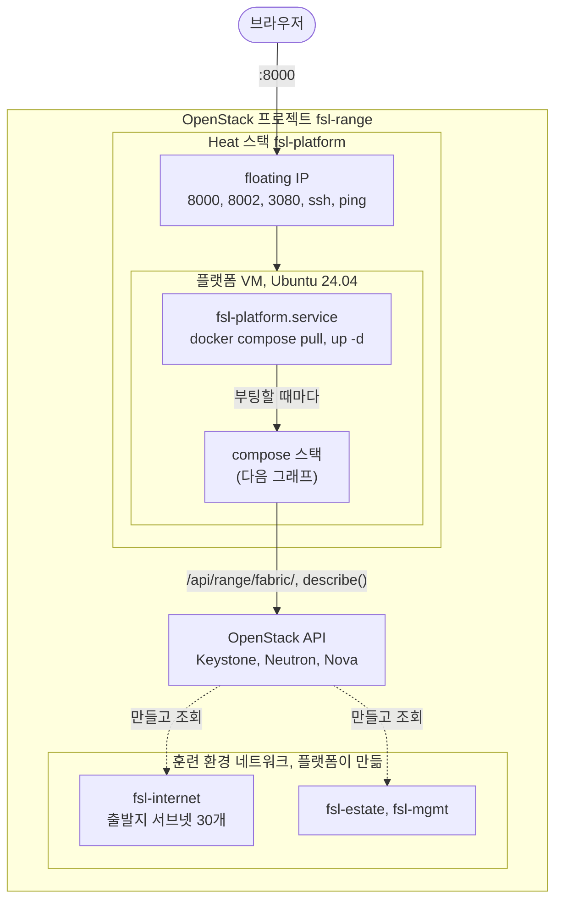
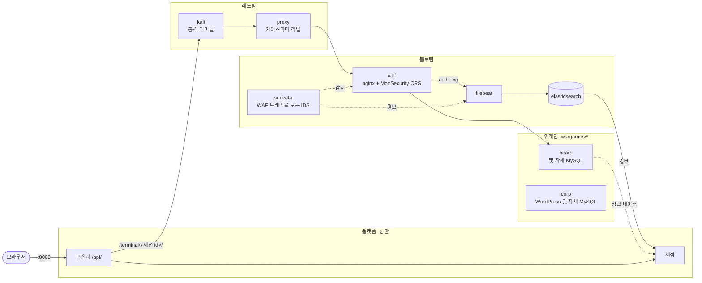

# fsl-project-mvp

사이버 공격·방어 훈련장입니다. 레드팀은 WAF 뒤에 있는 두 대상 시스템, Django
게시판과 WordPress 회사 사이트를 공격합니다. 두 사이트는 각자 MySQL을 씁니다.
블루팀은 Suricata와 ModSecurity로 방어하고, 플랫폼이 양쪽의 점수를 매깁니다.
이 저장소는 버릴 프로토타입이고, 실제 제품 프로젝트는 다른 곳에 있습니다.

- `CLAUDE.md`: 저장소의 목적, 점수 계산 방식, 작업 규칙
- `docs/superpowers/specs/2026-10-08-composable-isolated-learning-mvp-design.md`:
  승인된 방향(2026-10-08). 일부는 아직 구현하지 않았습니다
- `docs/ARCHITECTURE.md`: 훈련 환경의 구성과 앞으로의 방향
- `docs/THREAT-MODEL.md`: 훈련 환경이 모사하는 것과 제외한 것
- `docs/STATE.md`: 작업 현황
- `docs/OPENSTACK.md`: OpenStack(Kolla-Ansible 2026.1 이상)에서 클라우드부터 훈련 환경까지 설정할 내용
- `README.ko.md`, `docs/ARCHITECTURE.ko.md`: 이 README와 아키텍처 문서의 한국어판

## 전체 구성

### 실행 위치

OpenStack 클라우드에서는 스택 전체가 VM 하나에서 실행되고, 이 VM은 Heat 스택
하나(`deploy/openstack/platform.yaml`)가 만듭니다. 플랫폼은 member 역할 사용자
`fsl-range`로 OpenStack API를 호출해 훈련 환경을 다룹니다. VM에서는
`FSL_SUBSTRATE=range.openstack.connect`이므로 채점 대상 훈련 환경은 OpenStack
슬롯이고, `/api/range/ready/`가 그 슬롯이 준비됐다고 보고하기 전에는 세션을
시작할 수 없습니다.



### 스택 내부

레드팀은 블루팀의 WAF와 IDS를 거쳐 워게임을 공격합니다. 센서의 경보는
Elasticsearch로 전송됩니다. 플랫폼은 이 경보와 대상 시스템 자신의 기록(정답
데이터, ground truth)으로 점수를 매깁니다. 공격자가 제출한 탈취 데이터는 대상
시스템의 데이터와 대조합니다. 스택은 compose 파일 두 개로 나뉩니다.
`compose.yaml`은 컨트롤 플레인으로, 오래 실행되는 사본 하나입니다: 플랫폼,
Elasticsearch, Kibana, `gns3`(학습자용 구성도), 그리고 OpenStack 훈련 환경의
syslog만 받는 Filebeat인 `collector`. `session.yaml`은 세션 하나의 데이터
플레인입니다: WAF, Suricata, Filebeat, Kali, 프록시, 그리고 이 파일이 include하는
`wargames/` 아래의 워게임별 폴더. 세션을 열면(`POST /api/sessions/`)
`session.yaml`을 별도 compose 프로젝트 `fsl-<세션 id>`로 띄우고 모든 서비스가
healthy가 될 때까지 기다립니다. 그다음 플랫폼이 해당 세션의 대상 시스템에서
baseline을 읽습니다. 세션은 동시에 여러 개 실행됩니다: 스택마다 자체 `estate`
네트워크와 자체 Elasticsearch 인덱스(`fsl-logs-<세션 id>-*`)가 있고, 세션을 열 때는
닫힌 지 3분이 넘은 세션의 스택만 내립니다. 방금 닫힌 세션의 Filebeat가 채점에
쓰일 경보를 아직 전송하고 있을 수 있기 때문입니다.
동시에 열 수 있는 세션은 최대 `FSL_MAX_SESSIONS`개(기본 2)이고, 하나를 더 열면
409로 응답합니다. 스택 하나가 약 1.5 GB를 차지하기 때문입니다.
세션을 닫아도 스택은 그대로 남고, 3분 이상 지난 뒤 세션이 열릴 때 내려갑니다.
닫힌 세션은 `FSL_RETAIN_CLOSED_MINUTES`분(기본 60, `compose.yaml`에서 설정) 동안
DB에 남아 점수와 결과 보고를 읽을 수 있습니다. 그 뒤에는 플랫폼이 시작할 때와
세션이 닫힐 때마다 해당 세션을 케이스, 탐지 기록, 고객 요청, 목표와 함께
삭제합니다. 열린 세션은 삭제하지 않습니다. 새 워게임을 추가하려면 `compose.yaml`,
`scenario.yaml`, `objectives.yaml`이 든 폴더, `redteam/cases/` 아래의 케이스 파일,
`session.yaml`의 `include:` 한 줄이 필요합니다. `platform/wargames.py`가
`scenario.yaml`을 보고 워게임을 찾습니다. 워게임은 두 개입니다: 게시판(`loot_verified`)과
WordPress 사이트인 corp(`effect_observed`).



그래프에 없는 부분: Kali의 raw TCP는 프록시를 거치지 않고 WAF로 바로 전송되고,
플랫폼은 스크립트 케이스를 직접 WAF로 보냅니다. 플랫폼은 substrate runner
(compose에서는 `docker exec`, OpenStack에서는 ssh)를 통해 센서의 룰과 프록시의
케이스 라벨을 쓰고, 공격자의 명령 로그와 corp-db의 MySQL 바이너리
로그(`mysqlbinlog`)를 읽습니다. corp는 제출된 데이터가 아니라 관찰된 효과로
채점합니다. 게시판의 정답 데이터(`auth_user` 테이블)는 WAF를 거치지 않고 게시판에서
HTTP로 직접 읽습니다(`BOARD_API_URL`). compose에서 Kali 터미널(레드팀 콘솔의
터미널, 그리고 레슨·시나리오에서 블루팀 콘솔의 Kali 창)은 Kali 자체의 ttyd이고,
플랫폼의 nginx가 해당 세션의 `fsl-<id>-kali-1`을 `/terminal/<세션 id>/`로
제공합니다. OpenStack에서는 플랫폼 안의 ttyd가 세션 슬롯에 있는 Kali의 `mgmt`
주소로 ssh 접속하며(`/vm-terminal/fsl-kali/?arg=<세션 id>`), 프롬프트는
`ubuntu@kali`로 보입니다(WAF는 `ubuntu@waf`).
네트워크 구성은 `docs/ARCHITECTURE.ko.md`에 있습니다.

## 기동

Docker가 있는 호스트에서 저장소를 clone하고, GeoIP 데이터베이스를 한 번
내려받은 뒤, 이미지를 pull하고 컨트롤 플레인을 띄우세요:

```bash
bin/fetch-geoip
docker compose -f session.yaml pull
docker compose pull && docker compose up -d
```

우리 이미지 일곱 개(platform, board, corp, corp-db, kali, proxy, gns3)는 `dev`에
push할 때마다 `.github/workflows/images.yml`이 빌드해
`ghcr.io/nekonic/fsl-<name>`으로 게시하고, 커밋 SHA와 `dev`로 태그합니다.
compose는 각 이미지를 `ghcr.io/nekonic/fsl-<name>:${FSL_IMAGE_TAG:-dev}`로
지정합니다. `FSL_IMAGE_TAG`를 커밋 SHA로 설정하면 정확히 그 커밋의 이미지로
실행합니다(플랫폼 VM이 이렇게 합니다). GitHub가 첫 push 때 만드는 패키지는
저장소가 public이어도 private입니다. 일곱 개 모두 한 번씩 public으로 바꾸세요.
그러지 않으면 인증 없는 pull이 실패합니다: github.com에서 패키지 페이지, **Package
settings**, **Change visibility**, **Public**(되돌릴 수 없음). 이런 서비스는 모두
`build:`를 유지하므로, Dockerfile이나 앱을 바꾼 개발자는 pull 대신 로컬에서
빌드합니다:

```bash
docker compose -f session.yaml build
docker compose up -d --build
```

세션은 `--no-build`로 스택을 띄우고, 호스트에 그 이름으로 있는 이미지를 pull한
것이든 빌드한 것이든 그대로 씁니다. 플랫폼처럼 세션 스택을 직접 띄우려면 다음을
실행하세요:
`docker compose -p fsl-<id> -f session.yaml up -d --wait --no-build`.

Elasticsearch의 managed GeoIP downloader는 꺼 두었고, 대신 `config/ingest-geoip`
(유지되는 bind mount)에서 `GeoLite2-City.mmdb`를 읽습니다. `bin/fetch-geoip`가 이
파일을 한 번 넣어 둡니다. 이 파일은 커밋하지 않으며 컨테이너를 다시 만들어도
남습니다(클라우드의 Elasticsearch는 다운로드 CDN에 접속할 수 없습니다). 플랫폼은
시작할 때 docker 소켓 그룹을 설정합니다. 그다음 서비스를 시작하는 동안
백그라운드에서 Elasticsearch ingest pipeline을 등록하고(이벤트마다 시각을 정하고
출발지 주소의 위치 정보를 붙입니다), Kibana의 data view, "FSL alerts" 검색,
"FSL overview" 대시보드를 가져온 뒤 Kibana의 기본 경로를 그 검색으로 지정합니다.
명령줄에서 스크립트 케이스를 실행하거나 `bin/verify`(`--fast` 포함)를 실행하려면
virtualenv가 필요합니다:

```bash
python3 -m venv .venv && .venv/bin/pip install -r platform/requirements.txt
```

| 포트 | | 사용처 |
|---|---|---|
| 8000 | 콘솔, `/api/`, `/kibana/`의 Kibana, `/terminal/<세션 id>/`의 세션별 Kali ttyd, `/waf-terminal/<세션 id>/`의 세션별 WAF 쉘, `/vm-terminal/fsl-kali/`와 `/vm-terminal/fsl-waf/`의 터미널 | 사용자의 브라우저 |
| 8002 | 블루팀 콘솔의 웹사이트 창: `/site/<세션 id>/<host>/`, 해당 세션의 WAF로 프록시(OpenStack에서는 `mgmt`를 거쳐 슬롯의 WAF로) | 사용자 브라우저 안의 iframe |
| 3080 | `gns3`, GNS3 3.1의 API와 웹 UI: 세션마다 학습자용 구성도를 제공합니다. 학습자가 방어하는 회사 네트워크를 실습 네트워크 구성도로 그린 것입니다(역할 이름, 링크 끝마다 인터페이스와 프리픽스가 붙은 주소, `kali`와 `customers`에는 인터페이스만, 인터넷을 제외한 각 영역에는 네트워크를 캡션으로 표시; 관리망, 플랫폼, 장비 자체의 이름은 표시하지 않음). 슬롯(OpenStack) 또는 세션(Docker)과 그 세션의 워게임마다 영어와 한국어로 하나씩 두고, 모든 노드를 시작한 채 열어 둡니다(호스트마다 고정한 busybox 이미지 하나로 만든 표시용 컨테이너라 링크 끝이 모두 초록색입니다. 실제 장비는 훈련 환경에서 실행됩니다). 전체 배선은 `deploy/topology/system/`에 있고 학습자에게는 제공하지 않습니다. 블루팀 콘솔의 구성도 창(구성도 탭)은 `/static/web-ui/fsl-auditor.html`을 iframe으로 띄웁니다. 이 페이지는 읽기 전용으로 로그인하고 웹 UI의 사용 통계 전송을 끈 뒤, 해당 세션의 구성도를 콘솔 표시 언어로, 보기 전용으로(편집 컨트롤 없음, 드래그로 이동, 휠로 확대·축소) 창 크기에 맞춰 보여 줍니다. 컨테이너에는 `CAP_NET_ADMIN`, `/dev/net/tun`, Docker 소켓, 호스트의 pid 네임스페이스가 있습니다. GNS3가 스위치를 실행하고 docker 노드를 시작하는 데 필요합니다(`docs/ARCHITECTURE.md`, The topology) | 사용자 브라우저 안의 iframe, 그리고 `mgmt`를 거친 `platform/gns3.py` |
| 5140/udp | `collector`, Filebeat의 syslog 입력 | OpenStack의 OPNsense 에지, WAF, 워게임 호스트의 estate 센서 |
| 9200 | Elasticsearch | acceptance 테스트 |

8000과 8002는 플랫폼 이미지 안의 nginx가 제공합니다. 8002는 대상 사이트용 별도
origin이라, 대상 시스템에 심어진 스크립트가 콘솔을 읽거나 조작할 수 없습니다.
쿠키는 포트가 아니라 호스트 단위로 적용되므로 그런 스크립트도 콘솔이 보낼 쿠키를
설정할 수는 있지만, 콘솔은 쿠키를 쓰지 않습니다. nginx는 `/terminal/<세션 id>/`를
해당 세션의 Kali 컨테이너 `fsl-<id>-kali-1`의 ttyd로(compose), `/vm-terminal/`을
플랫폼 안의 ttyd 프로세스로 넘깁니다. 이 ttyd는 해당 호스트의 `mgmt` 주소로 ssh
접속합니다(OpenStack. compose에서는 Kali와 WAF에 `mgmt` 주소가 없어 연결되지
않습니다). compose에서 `/waf-terminal/<세션 id>/`는 플랫폼 안의 ttyd로 가고, 이
ttyd가 `fsl-<id>-waf-1`에 `docker exec`로 들어갑니다.
기본값으로 모든 포트는 `127.0.0.1`에 공개합니다.
플랫폼 VM에서는 8000, 8002, 3080을 VM 자신의 주소(`FSL_PUBLISH`)에, 5140/udp를
`0.0.0.0`(`FSL_SYSLOG_PUBLISH`)에 공개합니다. 플랫폼 템플릿의 보안 그룹이 8000,
8002, 3080을 엽니다(`docs/OPENSTACK.md` §3.5). 대상 시스템은 공개하지 않습니다:
명령줄 케이스와 acceptance 테스트는 콘솔과 마찬가지로 훈련 환경 안에서 대상
시스템에 접속합니다. 훈련 환경 안에서 대상 시스템은 WAF 뒤 80번 포트에 있습니다:
`http://board.com`(`edge` 네트워크의 별칭)과 `http://corp.com`(`Host` 헤더로
접속하는 vhost). edge 네트워크는 모든 세션이 함께 쓰므로 이 이름은 모든 세션의
WAF로 해석됩니다. 그래서 플랫폼은 세션마다 프록시가 자기 WAF를 향하게 하고,
실행하는 도구에는 그 WAF를 가리키는 `--add-host` 항목을 줍니다.

### OpenStack에서

클라우드마다 다른 값은 모두 파일 하나에 있습니다.
`deploy/openstack/cloud.example.yaml`을 `deploy/openstack/cloud.yaml`로 복사하고
(git이 무시하는 파일입니다) 값을 채우세요: Keystone URL, region, interface, domain,
프로젝트와 member 사용자, 비밀번호를 읽을 위치(`password_file` 또는
`password_env`; 비밀번호 자체는 절대 파일에 넣지 않습니다), 외부 네트워크, DNS,
테넌트 MTU, platform/estate/mgmt CIDR, 베이스 이미지 이름, availability zone,
플랫폼·이미지 빌더·훈련 환경·역할별(`edge`) flavor, 운영자의 키페어와 키 파일,
훈련 환경 키, 빌드할 OPNsense 릴리스(버전, 미러, 릴리스 공지에 있는 이미지
SHA256과 서명 키 SHA256), 그리고 스택, 저장소, ref. 모든 스크립트와 Heat 스택이 이
파일을 읽습니다. 해석할 수 없는 값이 있으면 아무것도 건드리기 전에 거부하고,
문제마다 해당 키를 알려 줍니다.

클라우드에 올려 둘 이미지는 딱 하나입니다: Canonical의 기본 Ubuntu 24.04 클라우드
이미지를 수정 없이 `compute.base_image`에 적은 이름으로 업로드합니다(내려받기,
체크섬, `openstack image create` 명령은 `docs/OPENSTACK.md`에 있습니다). 나머지는
모두 부팅 시점에 이 이미지에서 만듭니다: 플랫폼 VM은 cloud-init이, 훈련 환경의
골든 이미지는 빌더가, OPNsense 에지 이미지는 공식 릴리스를 내려받는 빌더가
만듭니다(아래 참고).

`python-openstackclient`와 `python-heatclient`를 설치한 운영자 컴퓨터에서
실행하세요:

```bash
.venv/bin/python bin/cloud up        # 플랫폼 VM, 그다음 훈련 환경 전체
.venv/bin/python bin/cloud down      # DB 백업, 키 보관, 훈련 환경과 스택 제거
```

`up`은 플랫폼의 Heat 스택(`deploy/openstack/platform.yaml`)이 없으면 만들고
(`--replace`를 주면 이미 있는 스택을 `bin/platform-rebuild`로 교체합니다), API가
응답할 때까지 기다린 뒤 플랫폼 자신의 훈련 환경 API를 순서대로 호출합니다:
fabric, clean이 될 때까지 images, slot, configure. 그리고 `/api/range/ready/`가
ready라고 할 때까지 기다립니다. 처음 발견한 drift, 실패한 이미지, 막힌 슬롯,
거부된 configure에서 멈추고 그 이유를 알려 줍니다. 두 명령 모두 테스트
클라우드에서 실행해 봤고, `up --replace`는 2026-10-17에 마지막으로
실행했습니다(`docs/OPENSTACK.md` §5.3).

`bin/platform-rebuild`만 실행하면 플랫폼 VM만 만들거나 교체합니다:

```bash
.venv/bin/python bin/platform-rebuild            # --cloud PATH, --ref REF
```

무엇이든 삭제하기 전에 ref의 커밋에 해당하는 이미지 일곱 개를 ghcr.io에서 인증
없이 pull할 수 있는지 확인하고, 훈련 환경 키(아래)를 보관하고, DB를
백업합니다(ssh로 `bin/backup` 실행). 그다음 스택을 삭제하고 `cloud.yaml`의 모든
파라미터로 다시 만든 뒤, `/api/sessions/`가 응답할 때까지 기다립니다.
`cloud.yaml`의 `backups.keep`(기본 1)은 `bin/platform-rebuild`와 `bin/cloud down`이
`backups/`에 남기는 DB 백업 개수입니다.

새 VM은 `ref`를 clone하고, 그 체크아웃의 커밋으로 태그된 이미지를 pull해
시작합니다. cloud-init이 클라우드 값을 `/opt/fsl/openstack.env`에 씁니다. 비밀 두
가지는 스택에 넣지 않습니다: 비밀번호와 플랫폼의 훈련 환경 ssh 키입니다. Nova의
메타데이터 서비스가 user data를 VM의 모든 프로세스(컨테이너 포함)에 내주기
때문입니다. VM이 ssh에 응답하고 cloud-init이 끝나면 `bin/platform-rebuild`가
`FSL_OPENSTACK_PASSWORD`를 `/opt/fsl/openstack.env`에 덧붙이고, 훈련 환경 키를
플랫폼 데이터 볼륨의 `/data/ssh/id_ed25519`에 쓰고, 백업해 둔 DB를 복원하고(교체인
경우), 플랫폼 컨테이너를 다시 만듭니다. 훈련 환경 키는 운영자 컴퓨터의
`keys.range`(모드 0600)에 있습니다. 이 파일이 없으면 실행 중인 플랫폼에서 한 번
복사해 오고, 실행 중인 플랫폼이 없으면 스크립트가 거부합니다. 키가 유지되므로
훈련 환경의 VM과 `fsl-platform` 키페어는 새 플랫폼을 계속 신뢰하고, 플랫폼을
교체하는 동안에도 훈련 환경은 그대로 유지할 수 있습니다.

아직 push하지 않은 커밋을 실행하려면 두 명령 모두 `--sideload
NAME=TARBALL`(여러 번 지정 가능)을 받습니다. 이 체크아웃에서 빌드한 이미지 하나를
`docker save`로 저장한 tarball입니다. VM은 여전히 `ref`를 clone하고 그 커밋의
이미지를 모두 pull합니다. 그다음 재구축 과정에서 git bundle로 이 체크아웃의 HEAD를
checkout하고, tarball마다 `docker load`한 뒤 그 이미지에 clone한 커밋의 태그를
붙입니다. compose와 훈련 환경의 이미지 빌더가 쓰는 태그입니다. 그리고 모든
서비스를 다시 만들므로(`--force-recreate`) bind mount한 파일도 HEAD의 것이 됩니다.
무엇이든 삭제하기 전에, `ghcr.io/nekonic/fsl-NAME:<commit>` 하나를 담고 있지 않은
tarball과, 이미지가 나온 커밋과 HEAD 사이에 빌드
컨텍스트(`.github/workflows/images.yml`)가 달라진 이미지를 거부합니다. sideload한
VM이 재부팅하면 clone한 커밋의 이미지를 GHCR에서 pull해 sideload한 이미지를
덮어쓸 수 있습니다. 재부팅하지 말고 push한 뒤 재구축하세요.

스택의 `address` 출력값이 floating IP입니다. 콘솔은 `http://ADDRESS:8000/`에 있고
로그인을 요구하지 않습니다. 9200은 VM의 loopback에만 열려 있고, 5140/udp는 VM의
모든 주소에서 수신합니다.

VM에서 체크아웃 위치는 `/opt/fsl`이고 소유자는 `ubuntu`입니다. compose,
`bin/backup`, 아래의 복원 절차는 이 디렉터리에서 실행하세요. 마지막 부팅의 기동
결과는 `systemctl status fsl-platform`으로 확인할 수 있습니다.

`bin/cloud up`이 실행하는 훈련 환경 단계는 직접 호출할 수도 있습니다.
fabric(네트워크, 키페어, 그룹):

```bash
curl -s -X POST -H "Content-Type: application/json" -d "{}" http://ADDRESS:8000/api/range/fabric/
```

`GET`은 없는 것, 있는 것, drift된 것, 남은 것을 보여 줍니다. `DELETE`는 fabric을
내리며, 서버가 연결되어 있으면 거부됩니다.

훈련 환경의 VM은 플랫폼이 빌드한 골든 이미지로 부팅합니다. 골든 이미지는
`declaration.yaml`이 `hosts:` 아래에 지정한 설정 스크립트로 만들고, 스크립트마다
베이스 이미지로 부팅한 빌더에서 실행합니다. POST 한 번에 모든 빌드가 한 단계씩
진행되므로(빌더 부팅, 설정이 완료를 보고하면 중지, 스냅샷, 삭제. 에지의 빌더는
스냅샷 대신 자기 디스크를 업로드합니다) 응답에 `"clean": true`가 나올 때까지
반복하세요:

```bash
curl -s -X POST -H "Content-Type: application/json" -d "{}" http://ADDRESS:8000/api/range/images/
```

빌드가 실패하면 `detail`에 해당 빌더 콘솔 출력의 끝부분이 나옵니다. 같은 경로에
`DELETE`를 보내면 실패한 빌더와 예전 스크립트로 만든 이미지를 삭제합니다.

이미지가 준비되면 POST 한 번으로 `fsl-edge`, `fsl-kali`, `fsl-waf`,
`fsl-wargame-host`(모든 워게임을 GHCR 컨테이너로 실행)를 각자의 이미지로 부팅하고,
플랫폼은 `mgmt`에서 ssh로 이들에 접속합니다:

```bash
curl -s -X POST -H "Content-Type: application/json" -d "{}" http://ADDRESS:8000/api/range/slot/
```

그다음 `POST /api/range/configure/`가 ssh로 설정을 적용합니다: OPNsense 에지의
config.xml(WAN 주소, pass 규칙, Suricata, syslog)을 넣고 재부팅하며, WAF의
ModSecurity 로그 전달을 설정합니다. `POST /api/range/slot/rebuild/`는 모든 VM을
골든 이미지로 Nova rebuild합니다. 포트와 주소는 유지하고, 수정한 데이터나 룰은
이어지지 않습니다. 재구축하면 적용한 설정도 지워집니다(board와 corp는 워게임 호스트
이미지 위에서 컨테이너로 실행되고, configure가 이들을 시작합니다). 세션을 닫으면
그 세션의 슬롯을 초기화합니다: Kali와 WAF는 재구축하고, 에지(해시를 확인하고,
파일이 drift된 경우에만 재부팅)와 워게임 호스트(`docker compose down -v`)는 그
자리에서 초기화한 뒤, VM이 ACTIVE가 되면 스스로 다시 configure합니다. 그동안
`GET /api/range/ready/`는 phase `RESETTING`을 보여 주고 세션 열기는 거부됩니다.
실패하면 이유와 함께 `RESET_FAILED`를 보여 주고, `POST /api/range/configure/`로 다시
시도합니다. `slot/rebuild/`만 따로 호출한 뒤에는 `configure/`를 직접 실행하세요.

`cloud.yaml`의 `compute.slots`(기본 1)만큼 훈련 환경 사본을 세웁니다. 사본마다 자체
에지, WAF, Kali, 워게임 호스트가 internet 네트워크와 estate 네트워크의 자체 사본
위에 있습니다(슬롯 N의 호스트는 `<host>-N`). 그 수만큼 세션을 동시에 실행할 수
있습니다. 세션은 슬롯 하나를 차지하고, 세션을 닫으면 그 슬롯만 초기화합니다.
`slot/`, `slot/rebuild/`, `configure/`는 `?slot=N`을 받고, 없으면 모든 슬롯에
적용합니다.

훈련 환경은 스택 바깥에 있습니다. `bin/platform-rebuild`로 교체한 플랫폼은 훈련
환경 키를 유지하므로 슬롯과 fabric은 교체 중에도 유지됩니다. 새 서버는 다음
`POST /api/range/fabric/`에서 `mgmt`에 다시 연결되고, `configure/`가 훈련 환경의
syslog를 새 서버로 향하게 합니다. 키를 보관하지 않고 스택을 직접 삭제하면 새 VM은
새 키를 만들고, fabric은 예전 키페어를 drift로 보고합니다. 이때는 먼저
`/api/range/slot/`과 `/api/range/fabric/`에 `DELETE`를 보내세요. 이미지는 남습니다.

스택은 `keys.operator`가 가리키는 키페어로 부팅하므로, 이 키페어를 먼저 프로젝트에
등록해야 합니다:

```bash
openstack keypair create --public-key PUBLIC_KEY_FILE fsl-claude
```

### OPNsense 이미지

에지는 OPNsense(BSD 2-clause)이고, images 단계가 자동으로 빌드합니다. 기본 Ubuntu
이미지로 부팅한 빌더가 필요한 도구를 설치하고, `opnsense.mirror`에서
`OPNsense-<version>-nano-amd64.img.bz2`와 그 `.sig`, 릴리스 키를 내려받습니다. 압축
파일은 `opnsense.image_sha256`과, 키는 `opnsense.pubkey_sha256`과 대조합니다(둘 다
미러가 아니라 릴리스 공지에서 가져온 값입니다). 그다음 압축을 풀고 서명을
검증하고, QEMU에서 한 번 부팅해 configuration importer에 응답함으로써
`deploy/opnsense/config.xml`로 시작하게 합니다(root는 플랫폼 키만 신뢰하고
비밀번호가 없습니다. 기본 이미지의 기본 비밀번호는 아예 존재하지 않습니다).
마지막으로 `qemu-img`로 qcow2로 변환해 Glance에 `fsl-opnsense-<version>`으로
업로드합니다. 버전, MTU, 플랫폼 키 중 하나가 바뀌면 새 이미지를 빌드합니다.
이미지는 클라우드마다 공식 릴리스로 빌드하며 배포하지 않습니다. OPNsense 상표
정책은 파생 이름을 쓰기 전에 허락을 받도록 요구합니다.

## 세션 진행

http://localhost:8000 을 열고 세션을 시작하세요. 레슨이나 시나리오는 공격과 방어를
모두 담은 블루팀 콘솔을 열고, 워게임(사람 대 사람)은 공격자에게 레드팀 콘솔을,
방어자에게 블루팀 콘솔을 엽니다. 헤더의 언어 버튼으로 영어와 한국어를 전환합니다.

- **레드팀** 콘솔은 공격자용입니다: 목표, "탈취한 해시 제출", Kali 터미널, 대상
  시스템을 가리키는 웹사이트 창이 있습니다. 미리 준비한 공격은 실행하지 않습니다.
  스크립트 케이스는 하네스(`redteam/run.py`, acceptance 테스트)와 시나리오 엔진이
  실행합니다.
- **블루팀** 콘솔은 도구를 프레임으로 띄운 사이드바입니다: "FSL alerts"의 열과
  쿼리를 세션으로 좁혀 Discover로 여는 Kibana, WAF 터미널, 웹사이트 창(개발자
  도구가 있는 사이트 브라우저), 구성도 창(GNS3 구성도), 필요한 시나리오에서는
  경보 창과 IDS 룰 창, 그리고 구분선 아래의 Kali 터미널(레슨과 시나리오에서만
  보이고 워게임에서는 숨김). 블루팀 콘솔은 세션, 사이트 요청, 기초
  레슨이나 단계형 시나리오의 단계와 힌트, 시나리오의 상태와 정·오탐 판단,
  수집(ingest), 탐지 기록을 위해 `/api/`를 호출합니다. 세션이 닫히면 세션 페이지에
  결과가 나옵니다: 빼앗긴 목표가 먼저, 그다음 공격을 몇 건 탐지했고 정상 요청이 몇
  건 통과했는지를 평이한 문장으로 보여 줍니다.

안내 없이 연 세션(`{"scenario": "board"}`, 홈 카드의 "워게임 시작")은 전체 방어
설정, CRS paranoia level 1의 일반 워게임입니다. `{"defense": "<name>"}`으로
워게임이 선언한 다른 방어 설정을 고를 수 있습니다(`minimal`은 PL4). 에이전트는
`PUT /api/sessions/<id>/waf/`로 WAF 설정을 조정하고, `GET`은 WAF 파일에 들어 있는
내용을 알려 줍니다.

홈 화면에는 네트워크가 처음인 학습자를 위한 기초 레슨 여섯 개가 있고, 각각 id로
엽니다(`{"lesson": "f1"}`부터 `f6`까지; `{"guidance": true}`만 보내면 F1이
열립니다). F1은 구성도 창에서 실습용 네트워크 구성도를 읽고, F2는 웹사이트 창에서
한국어 검색을 한 번 보내 그 상태 코드를 창의 개발자 도구에서 읽고, F3은 그 요청의
메서드, 경로, 파라미터, 상태 코드를 읽습니다. F4는 Kibana에서 기록을 찾아 WAF의
기록과 IDS의 기록을 구별하고, F5는 차단된 SQL Injection이 어디서 막혔고 어떤 룰이
탐지했는지 읽은 뒤 Kali 창에서 실행한 sqlmap의 요청 수를 셉니다.
F6은 차단 룰을 끈 WAF(defense `missed`)에 같은 sqlmap을 실행해, 덤프한
계정을 제출하고 첫 번째 점수에서 손실을 확인합니다. 모든 답은 고정된 정답 키가
아니라 학습자 자신의 기록이나 substrate의 네트워크 구성에서 읽습니다. 학습자가 직접
실행한 sqlmap도 다른 레드팀 행동과 똑같이 두 점수에 모두 들어갑니다.
블루팀 콘솔의 레슨 노트가 레슨의 단계를 안내하고, 플랫폼이 단계마다
확인하며(`POST /api/sessions/<id>/lesson/steps/<step>/check/`), 단계마다 진입·통과·
건너뜀을 기록합니다. 세션 응답에는 정답 키가 없습니다. 단계의 명령은 그 단계에
들어간 뒤에만, 단계의 정답 문구는 힌트가 거기까지 열린 뒤에만 실립니다. 단계마다
힌트가 있고 마지막 힌트는 "건너뛰기"입니다. 이를 누르면 단계를 건너뜀으로 기록하고
다음 단계로 넘어갈 뿐, 학습자를 위해 아무 작업도 수행하지 않습니다. 힌트 사용
여부는 세션에 기록됩니다. 레슨이 열릴 때 재생하는 정상 요청은 두 점수 어디에도
들어가지 않습니다. 여섯 레슨은 한 세션에서 이어서 진행합니다. 레슨의 마지막
단계를 통과하면 코치가 다음 레슨 이름을 보여 주고, 2초 뒤 또는 "다음 레슨"을
누르면 같은 세션에서 다음 레슨을 시작합니다(`POST /api/sessions/<id>/lesson/
{"lesson": "f2"}`: 그 레슨의 방어 설정을 그 자리에서 적용하고 정상 요청을 다시
재생합니다). 그래서 레슨 사이에 훈련 환경을 초기화하지 않으며, 각 레슨은 시작한
뒤에 일어난 일만 판정합니다. F6을 마치면 콘솔이 세션을 종료합니다.

기초 다음은 시나리오입니다(`{"scenario": "1.1"}`): 고객과 공격자가 게시판을 쓰는
동안 학습자는 실제 도구로 방어합니다. 시나리오는 상황 설명(상황, 목표, 평가 방법,
시간)으로 시작합니다. 상단 상태 표시줄에는 남은 시간, 분당 고객 차단, 분당 경보
요청, 빼앗긴 목표가 나옵니다. 학습자가 볼 수 없는 공격 일정이 평소 경로로
실행되고, 공격이 덤프한 계정이 게시판의 계정과 일치하면 첫 번째 점수에 들어갑니다.
"최종 점검 시작"(또는 일정)이 몇 분짜리 최종 점검을 열고, 판정 기준은 과제
유형에 따라 다릅니다: judgement(판단)는 점검 시작 시점에 목록에 있던 경보 항목을
모두 올바르게 판단하면 통과합니다(차단된 고객은 보고만 하고 집계하지 않습니다).
availability(가용성)와 unknown은 차단된 고객이 없고 모든 공격을 막아야 통과합니다
(2.3은 이상 점수 임계치도 5/4 이하여야 합니다). detection(탐지)은 모든 공격이 공격
수법을 확인할 수 있는(corroborated) Suricata 경보를 일으키고 고객 요청은 하나도
경보를 일으키지 않아야 통과합니다. `1.1` "고객 요청과 공격 구분하기"는 경보가
발생한 요청마다 고객인지 공격인지, 공격이 데이터를 가져갔는지를 판단하게
합니다(`/api/sessions/<id>/triage/`). `2.1` "한글 검색 오탐 해결"은 PL3 WAF가
거부하는 고객이 다시 서비스를 받게 하되 sqlmap은 통과시키지 않도록 요구합니다.
나머지 과정은 과제 유형 순서로 이어집니다: `1.2`와 `1.3`은 물려받은 예외 규칙
때문에 sqlmap이 계정을 가져가는 상황에서 경보를 판단하고(1.3은 각 공격의 종류까지),
`2.2`와 `2.3`은 PL2에서, 그리고 PL3에서 이상 점수 임계치를 5/4로 낮추면서 차단된
고객이 다시 서비스를 받게 합니다. `3.1`~`3.4`는 IDS 룰 창에서 sort 공격, 그 tamper
변형, 댓글 XSS에 IDS 경보가 발생하게 하고(두 번째 점수만), `4.1`은 처음 보는
sqlmap 변형과 새로운 오탐을 도움 없이 처리합니다. 힌트는 학습자가 막혔을 때
제안하고, 열었을 때만 기록합니다. 결과 보고에는 차단된 고객과 공격 타임라인이
추가됩니다. 자세한 내용: `docs/ARCHITECTURE.ko.md`, "시나리오".

스크립트 케이스는 acceptance 테스트처럼 명령줄에서도 실행할 수 있습니다. 대상
시스템은 공개하지 않으므로 하니스는 훈련 환경 안, 플랫폼에서 실행합니다:

```bash
docker compose exec platform \
  python redteam/run.py --tool-target http://board.com
```

하니스는 `--cases`의 파일명과 `case_file`이 일치하는 시나리오의 세션을
엽니다(`board.yaml`은 board, `corp.yaml`은 corp, 그 밖에는 board). 그리고 각
케이스를 `--platform`(기본 `http://localhost:8000`)의 플랫폼을 거쳐 실행합니다.
`--tool-target`(기본 `http://board.com`)은 도구 컨테이너가 대상 시스템에 쓰는
주소입니다.
corp는 `--cases redteam/cases/corp.yaml`로 실행하세요.

## 검증

```bash
bin/verify --changed  # 변경과 관련된 단위 테스트와 ratchet만
bin/verify --fast     # 단위·API 테스트와 지표, 스택 불필요
bin/verify            # test/의 acceptance 테스트까지, 실행 중인 스택 대상
```

`--changed`는 `dev`와의 merge-base(또는 지정한 커밋이나 `A..B`)와 비교해, 바뀐
파일마다 관련된 테스트와 그 이유를 출력합니다. `bin/select-tests`는 아무것도
실행하지 않고 그 결과만 출력합니다. `--live`를 함께 주면 변경과 관련된 acceptance
모듈도 실행합니다(`bin/acceptance --only`).

전체 실행은 플랫폼을 재시작하고 대상 시스템, 룰, 공격자의 출발지를 초기화하므로,
다른 사람이 쓰고 있는 스택에서는 실행하지 마세요. 세션은 자신이 만든 것만
삭제합니다. acceptance 단계는 `bin/acceptance`입니다: 훈련 환경이 동시에 수용할 수
있는 세션 수(`GET /api/range/ready/`의 `max_sessions`)만큼 pytest 프로세스를
띄우고, Elasticsearch만 읽는 검사용 프로세스를 하나 더 띄운 뒤, 훈련 환경 전체가
필요한 모듈(`test_concurrent_sessions`, `test_lesson`)용 프로세스를 하나
실행합니다. `bin/acceptance --plan`이 이 분할을 출력하고, `test/README.md`가
설명합니다.
플랫폼이 localhost에서 수신하지 않는 경우(OpenStack 플랫폼 VM)에는 그 호스트에서
`FSL_PLATFORM_URL=http://<address>:8000 bin/verify`로 실행하세요. 모든 acceptance
테스트는 어느 substrate에서든 실행되며, OpenStack에서 skip되는 테스트는 없습니다.
`bin/prune`은 세션을 직접 삭제하며, `--apply` 없이 실행하면 dry run입니다:

```bash
bin/prune --keep 20 --apply      # 최신 20개만 남김
bin/prune --ids FILE --apply     # FILE에 적힌 닫힌 세션만
```

템플릿에 Tailwind 클래스를 추가했으면 `bin/build-css`를 실행하세요. 생성된
스타일시트는 커밋하며, 최신 상태인지 확인하는 테스트는 없습니다.

## 백업과 복원

플랫폼의 DB(세션, 케이스, 탐지 기록, 목표, 룰셋, 예외 처리)는 SQLite 파일 하나로,
`fsl_platformdata` 볼륨의 `/data/db.sqlite3`입니다. 그 밖에는 아무것도 백업하지
않습니다: Elasticsearch의 `fsl_esdata` 볼륨, `fsl_collectordata`에 있는 collector의
registry, 세션의 볼륨(`fsl-<id>_filebeatdata`, ModSecurity audit log가 있는
`fsl-<id>_waflogs`, Suricata의 `eve.json`이 있는 `fsl-<id>_suricatalogs`, 프록시의
케이스 라벨이 있는 `fsl-<id>_label`)은 모두 백업 대상이 아닙니다. 세션 볼륨은 이
세션이 닫히고 3분이 넘은 뒤 세션이 열릴 때 삭제됩니다. `docker compose down -v`는
컨트롤 플레인의 볼륨 세 개를 삭제합니다.

```bash
bin/backup      # 플랫폼이 서비스 중일 때 backups/db-<UTC time>.sqlite3를 씀
```

SQLite의 `VACUUM INTO`로 압축한 사본을 플랫폼 옆 임시 파일에 쓰고(삭제한 세션이
차지하던 공간은 빠집니다), 그 파일을 1 MiB 단위로 스트리밍해 가져옵니다(수 GB
DB는 ssh로 몇 분 걸리며, 600초 동안 데이터가 오지 않을 때만 중단합니다). 사본을
`PRAGMA integrity_check`로 검사하고, 어느 단계든 실패하면 아무것도 남기지 않습니다.
새 사본이 검사를 통과하면 `--keep`(기본 1, 새 사본 포함)을 넘는 이전
`db-<UTC time>.sqlite3` 파일을 삭제합니다. 이름이 다른 파일은 그대로 둡니다.
Docker 안에 있지 않은 플랫폼에 접속하려면, 플랫폼 설정을 import할 수 있는 상태로
`python -`을 실행하는 명령을 `FSL_PLATFORM_EXEC`에 지정하세요.

복원은 플랫폼을 멈춘 상태에서 직접 합니다:

```bash
docker compose stop platform
docker run --rm --network none --entrypoint sh --user fsl \
  -v fsl_platformdata:/data -v "$PWD/backups:/backups:ro" fsl-platform \
  -c 'rm -f /data/db.sqlite3-journal && cp /backups/db-20260925T020000Z.sqlite3 /data/db.sqlite3'
docker compose start platform
```

`--entrypoint sh`는 인자를 무시하는 이미지의 entrypoint를 대체합니다.
`--user fsl`은 사본을 플랫폼 사용자 소유로 남깁니다. `docker cp`를 쓰면 root
소유가 되어 쓸 수 없습니다. 예전 `-journal` 파일은 반드시 지워야 합니다. 남아
있으면 SQLite가 복원한 파일에 이를 재생합니다. 플랫폼은 시작할 때 더 새로운
마이그레이션을 적용합니다. 복사 단계는 임시 볼륨에서 확인했고, 절차 전체를 실행
중인 스택에서 실행해 보지는 않았습니다.

## 로컬 실습 전용

Elasticsearch는 보안 기능 없이, Django는 `DEBUG=1`로 실행됩니다. Django는
`DJANGO_ALLOWED_HOSTS`에 추가로 지정하지 않는 한 `localhost`, `127.0.0.1`,
`[::1]`에만 응답하고, 플랫폼 VM은 여기에 자신의 floating IP를 추가합니다.
플랫폼에는 Docker 소켓이 마운트되어 있어 컨테이너 탈출 경로가 됩니다.
`/terminal/`은 인증 없는 Kali root 쉘이고(compose에서는 `/terminal/<세션 id>/`),
`/vm-terminal/` 아래 터미널은 별도 로그인 없이 Kali와 WAF의 쉘을 제공합니다.
compose의 `/waf-terminal/<세션 id>/`(해당 세션 WAF의 쉘)도 마찬가지입니다.

플랫폼 VM에서도 마찬가지입니다. 게다가 그곳에서는 프로젝트 비밀번호가
`/opt/fsl/openstack.env`와 플랫폼 컨테이너의 환경 변수에 평문으로 들어 있습니다.
VM의 ssh, 8000, 8002, 3080은 모든 주소에 열려 있고, 8000은 로그인을 요구하지
않습니다.
