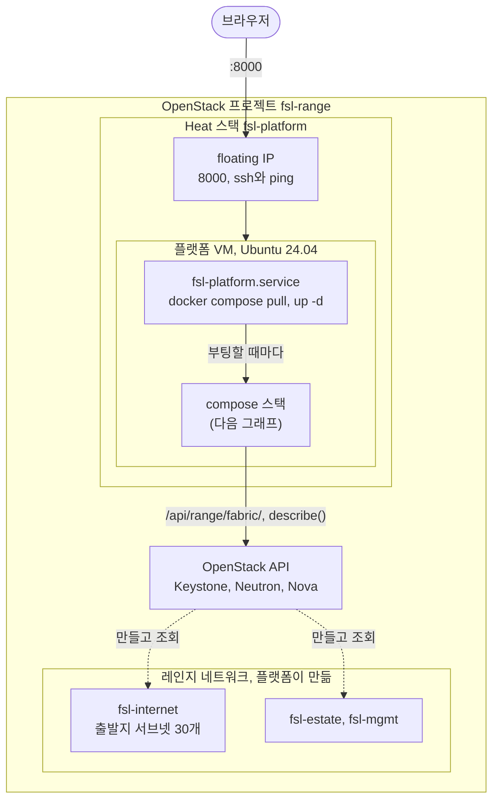
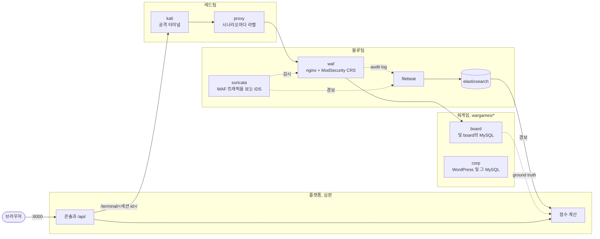

# fsl-project-mvp

사이버 공격·방어 훈련 레인지다. 레드팀은 WAF 뒤의 두 대상, Django 게시판과 WordPress 회사 사이트(각각 자체 MySQL 사용)를 공격한다. 블루팀은 Suricata와 ModSecurity로 방어하고, 플랫폼은 양쪽의 점수를 매긴다. 이 저장소는 버리는 프로토타입이고, 실제 제품 프로젝트는 다른 곳에 있다.

- `CLAUDE.md`: 저장소의 목적, 점수 방식, 작업 규칙
- `docs/superpowers/specs/2026-10-08-composable-isolated-learning-mvp-design.md`: 승인된 방향(2026-10-08). 일부는 아직 구현되지 않았다
- `docs/ARCHITECTURE.md`: 레인지의 구성 방식과 앞으로의 방향
- `docs/THREAT-MODEL.md`: 레인지가 모사하는 것과 빼 둔 것
- `docs/STATE.md`: 작업이 어디까지 왔는지
- `docs/OPENSTACK.md`: OpenStack(Kolla-Ansible 2026.1 이상)에서 클라우드부터 레인지까지 해야 할 설정
- `README.ko.md`, `docs/ARCHITECTURE.ko.md`: 이 README와 아키텍처의 한국어판

## 전체 구성

### 실행 환경

OpenStack 클라우드에서는 스택 전체가 VM 하나 안에서 돌고, 그 VM은 Heat 스택 하나(`deploy/openstack/platform.yaml`)가 만든다. 플랫폼은 member 역할 사용자 `fsl-range`로 OpenStack API를 통해 레인지를 다룬다. VM에서는 `FSL_SUBSTRATE=range.openstack.connect`이므로 점수를 매기는 레인지는 OpenStack slot이고, `/api/range/ready/`가 그 slot이 준비됐다고 보고하기 전에는 세션을 시작할 수 없다.



### 스택 내부

레드팀은 블루팀의 WAF와 IDS를 거쳐 워게임을 공격한다. 센서의 경보는 Elasticsearch로 간다. 플랫폼은 그 경보와 대상 시스템 자신의 기록(ground truth)으로 점수를 매긴다. 공격자가 제출한 탈취 데이터는 대상의 데이터와 대조한다. 스택은 compose 파일 둘로 나뉜다. `compose.yaml`은 컨트롤 플레인으로 하나만 오래 떠 있다: 플랫폼, Elasticsearch, Kibana, 그리고 OpenStack 레인지의 syslog만 받는 Filebeat인 `collector`. `session.yaml`은 세션 하나의 데이터 플레인이다: WAF, Suricata, Filebeat, Kali, 프록시, 그리고 이 파일이 include하는 `wargames/` 아래 워게임 폴더. 세션을 열면(`POST /api/sessions/`) `session.yaml`이 compose 프로젝트 `fsl-<세션 id>`로 뜨고, 모든 서비스가 healthy가 될 때까지 기다린 뒤 플랫폼이 그 세션 자신의 대상에서 baseline을 읽는다. 세션은 동시에 여럿 돈다: 스택마다 자기 `estate` 네트워크와 자기 Elasticsearch 인덱스(`fsl-logs-<세션 id>-*`)를 가지며, 새 세션을 열면 이미 닫힌 세션의 스택만 내린다. 동시에 열 수 있는 세션은 `FSL_MAX_SESSIONS`개(기본 2)까지이고, 그 이상은 409로 답한다. 스택 하나가 약 1.5 GB를 쓰기 때문이다. 세션을 닫아도 그 스택은 다음 세션이 열릴 때까지 남는다. 새 워게임에는 `compose.yaml`, `scenario.yaml`, `objectives.yaml`을 담은 폴더, `redteam/cases/` 아래 케이스 파일, `session.yaml`의 `include:` 한 줄이 필요하다. `platform/wargames.py`가 `scenario.yaml`로 워게임을 찾는다. 워게임은 둘이다: 게시판(`loot_verified`)과 WordPress 사이트 corp(`effect_observed`).



그래프에 없는 것: Kali의 raw TCP는 프록시를 거치지 않고 WAF로 바로 가고, 플랫폼은 스크립트 시나리오를 WAF에 직접 쏜다. 플랫폼은 substrate runner(compose에서는 `docker exec`, OpenStack에서는 ssh)로 센서의 탐지 규칙과 프록시의 시나리오 라벨을 쓰고, 공격자의 명령 로그와 corp-db의 MySQL 바이너리 로그(`mysqlbinlog`)를 읽는다. corp는 제출 데이터가 아니라 관찰된 효과로 채점된다. 게시판의 ground truth(`auth_user` 테이블)는 WAF를 거치지 않고 게시판에서 HTTP로 읽는다(`BOARD_API_URL`). compose에서 레드 터미널은 Kali 자체 ttyd이고, 플랫폼의 nginx가 그 세션의 `fsl-<id>-kali-1`을 `/terminal/<세션 id>/`로 내준다. OpenStack에서는 플랫폼 안의 ttyd가 Kali의 `mgmt` 주소로 ssh한다(`/vm-terminal/fsl-kali/`). 네트워크 구성은 `docs/ARCHITECTURE.md`에 있다.

## 스택 띄우기

Docker가 있는 호스트에서 저장소를 clone하고, GeoIP 데이터베이스를 한 번 받고, 이미지를 pull하고, 컨트롤 플레인을 띄운다.

```bash
bin/fetch-geoip
docker compose -f session.yaml pull
docker compose pull && docker compose up -d
```

우리 이미지 여섯 개(platform, board, corp, corp-db, kali, proxy)는 `dev`에 push될 때마다 `.github/workflows/images.yml`이 빌드해 `ghcr.io/nekonic/fsl-<name>`으로 올리고, 커밋 SHA와 `dev`로 태그한다. compose는 각 이미지를 `ghcr.io/nekonic/fsl-<name>:${FSL_IMAGE_TAG:-dev}`로 부른다. `FSL_IMAGE_TAG`를 커밋 SHA로 두면 그 커밋의 이미지를 그대로 쓴다(플랫폼 VM이 그렇게 한다). GitHub가 첫 push로 만든 패키지는 저장소가 public이어도 private이다. 여섯 개 모두 한 번 public으로 바꿔야 인증 없는 pull이 된다: github.com에서 패키지 페이지, **Package settings**, **Change visibility**, **Public**(되돌릴 수 없음). 이런 서비스는 모두 `build:`를 유지하므로, Dockerfile이나 앱을 바꾼 개발자는 pull 대신 로컬에서 빌드한다.

```bash
docker compose -f session.yaml build
docker compose up -d --build
```

세션은 스택을 `--no-build`로 띄우며, 호스트가 그 이름으로 가진 이미지(pull했든 빌드했든)를 쓴다. 플랫폼이 하는 것처럼 세션 스택을 손으로 띄우려면 `docker compose -p fsl-<id> -f session.yaml up -d --wait --no-build`.

Elasticsearch의 managed GeoIP 다운로더는 꺼져 있고, 대신 `config/ingest-geoip`(지속되는 bind mount)에서 `GeoLite2-City.mmdb`를 읽는다. `bin/fetch-geoip`가 이 파일을 거기에 한 번 넣어 둔다. 이 파일은 커밋하지 않으며 컨테이너를 다시 만들어도 남는다(클라우드의 Elasticsearch는 다운로드 CDN에 닿지 못한다). 플랫폼은 시작할 때 docker 소켓 그룹을 맞춘다. 그다음 서비스를 시작하는 동안 백그라운드에서 이벤트 시각을 정하고 출발지 주소의 위치를 찾는 Elasticsearch ingest pipeline을 등록하고, Kibana의 data view, "FSL alerts" 검색, "FSL overview" 대시보드를 가져오고 Kibana의 기본 경로를 그 검색으로 정한다. 명령줄에서 스크립트 시나리오를 실행하거나 `bin/verify`를 돌리려면(`--fast` 포함) virtualenv가 필요하다.

```bash
python3 -m venv .venv && .venv/bin/pip install -r platform/requirements.txt
```

| 포트 | | 사용처 |
|---|---|---|
| 8000 | 콘솔, `/api/`, `/terminal/<세션 id>/`의 세션별 Kali ttyd, `/waf-terminal/<세션 id>/`의 세션별 WAF 셸, `/vm-terminal/fsl-kali/`와 `/vm-terminal/fsl-waf/`의 터미널 | 사람의 브라우저 |
| 8002 | 블루 콘솔의 웹사이트 창: `/site/<세션 id>/<호스트>/`, 그 세션의 WAF로 넘김(compose 전용) | 사람의 브라우저 안 iframe |
| 5140/udp | `collector`, Filebeat의 syslog 입력 | OpenStack의 pfSense와 WAF |
| 9200 | Elasticsearch | 인수 테스트 |

플랫폼 이미지 안의 nginx가 8000과 8002를 받는다. 8002는 대상 사이트용 별도 출처라 대상에 심긴 스크립트가 콘솔을 읽거나 조작하지 못한다. 쿠키는 포트가 아니라 호스트 단위라 그런 스크립트도 콘솔이 보낼 쿠키는 심을 수 있지만, 콘솔은 쿠키를 쓰지 않는다. nginx는 8000을 받아 `/terminal/<세션 id>/`를 그 세션의 Kali 컨테이너 `fsl-<id>-kali-1`의 ttyd로(compose), `/vm-terminal/`을 플랫폼 안의 ttyd로 넘기고, ttyd는 해당 호스트의 `mgmt` 주소로 ssh한다(OpenStack. compose에서는 Kali와 WAF에 `mgmt` 주소가 없어 연결되지 않는다). compose에서 `/waf-terminal/<세션 id>/`는 플랫폼 안의 ttyd로 가고, ttyd가 `fsl-<id>-waf-1`에 `docker exec`한다. 기본값은 모든 포트를 `127.0.0.1`에 공개하는 것이다. 플랫폼 VM에서는 8000과 8002를 VM 자기 주소에(`FSL_PUBLISH`), 5140/udp를 `0.0.0.0`에(`FSL_SYSLOG_PUBLISH`) 공개한다. substrate가 OpenStack이면 `SITE_PORT`가 `None`이라 8002는 쓰이지 않고 보안 그룹 규칙도 필요 없다. 인수 테스트 VM(docker)에서는 보안 그룹이 8002를 연다. 대상 시스템은 공개하지 않는다. 명령줄 시나리오와 인수 테스트는 콘솔과 마찬가지로 레인지 안에서 대상 시스템에 닿는다. 레인지 안에서 대상 시스템은 WAF 뒤 80번 포트에 둘 있다: `http://board.com`(`edge` 네트워크 별칭)과 `http://corp.com`(`Host` 헤더로 닿는 vhost). edge 네트워크는 모든 세션이 함께 쓰므로 이 이름은 모든 세션의 WAF로 풀린다. 그래서 플랫폼은 세션마다 프록시를 그 세션의 WAF로 향하게 하고, 실행하는 도구에는 그 WAF를 가리키는 `--add-host`를 준다.

### OpenStack에서

`deploy/openstack/platform.yaml`은 플랫폼 VM용 Heat 템플릿이다. 이 템플릿이 무엇을 만들고 첫 부팅 때 무엇을 하는지는 `docs/ARCHITECTURE.md`("Built: the platform VM")에 있다. `bin/platform-rebuild`는 운영자 컴퓨터에서 스택을 만들거나, 서 있는 스택을 상태를 잃지 않고 교체한다. 프로젝트 멤버로서, 프로젝트의 openrc를 source하고 `python-openstackclient`와 `python-heatclient`를 설치한 상태에서 실행한다.

```bash
bin/platform-rebuild --keystone http://KEYSTONE:5000 --password-file PASSWORD_FILE --flavor m1.large
```

무엇이든 지우기 전에 ref의 커밋용 이미지 여섯 개를 ghcr.io에서 인증 없이 pull할 수 있는지 확인하고, 레인지 키(아래)를 보관하고, 저장소를 백업한다(ssh 너머로 `bin/backup`). 그다음 스택을 지우고 `flavor`와 `ref`로 다시 만들고, `/api/sessions/`가 응답할 때까지 기다린다. 레인지는 건드리지 않는다. 레인지는 아래 API 호출로 만든다.

새 VM은 `ref`를 clone하고, 그 체크아웃의 커밋으로 태그된 이미지를 pull해서 시작한다. `keystone`은 `/v3`를 뺀 Keystone 기본 URL이고, `/v3`는 플랫폼이 붙인다. 사용자는 `default` 도메인에서 찾고, 프로젝트는 스택이 속한 프로젝트를 쓴다. 비밀 두 가지는 스택에 넣지 않는다. Nova의 메타데이터 서비스가 user data를 VM의 모든 프로세스와 컨테이너에 내주기 때문이다: 비밀번호와 플랫폼의 레인지 ssh 키. VM이 ssh에 응답하고 cloud-init이 끝나면 `bin/platform-rebuild`가 `--password-file`의 `FSL_OPENSTACK_PASSWORD`를 `/opt/fsl/openstack.env`에 덧붙이고, 레인지 키를 플랫폼 데이터 볼륨의 `/data/ssh/id_ed25519`에 쓰고, 백업한 저장소를 복원하고(교체일 때), 플랫폼 컨테이너를 다시 만든다. 레인지 키는 운영자 컴퓨터의 `--range-key`(기본 `~/.ssh/fsl-platform`, 모드 0600)에 있다. 이 파일이 없으면 `bin/platform-rebuild`가 서 있는 플랫폼에서 한 번 복사해 오고, 서 있는 플랫폼도 없으면 거부한다. 키가 유지되므로 레인지 VM들과 키페어 `fsl-platform`은 새 플랫폼을 계속 신뢰하고, 플랫폼을 교체하는 동안 레인지는 그대로 서 있을 수 있다. 이 스크립트는 아직 클라우드에서 실행해 보지 않았다.

| 파라미터 | 기본값 | |
|---|---|---|
| `ref` | `dev` | clone할 브랜치나 태그 |
| `repository` | GitHub의 이 저장소 | |
| `user` | `fsl-range` | 플랫폼이 로그인하는 Keystone 사용자 |
| `key_name` | `fsl-claude` | `ssh ubuntu@ADDRESS`에 필요한 개인 키가 속한 키페어 |
| `image` | `ubuntu-24.04` | |
| `flavor` | `m1.large` | 8 GB RAM, 4 vCPU, 80 GB 디스크. 클라우드에 없으면 한 번 만든다: `openstack flavor create --ram 8192 --vcpus 4 --disk 80 m1.large`(admin) |
| `external_network` | `provider` | |
| `cidr` | `10.20.0.0/24` | compose 서브넷이나 `172.17.0.0/16`과 겹치면 안 된다 |
| `dns` | `8.8.8.8,8.8.4.4` | |

스택의 `address` 출력값이 floating IP다. 콘솔은 `http://ADDRESS:8000/`에 있으며 로그인을 묻지 않는다. 9200은 VM의 loopback에만 있고, 5140/udp는 VM의 모든 주소에서 받는다.

VM에서 checkout 위치는 `/opt/fsl`이고 소유자는 `ubuntu`다. compose, `bin/backup`, 아래의 복원 절차는 거기서 실행한다. 마지막 부팅 때 스택이 어떻게 올라왔는지는 `systemctl status fsl-platform`으로 본다.

비밀번호를 넣고 나면 플랫폼이 자기 API를 통해 레인지의 네트워크를 만든다.

```bash
curl -s -X POST -H "Content-Type: application/json" -d "{}" http://ADDRESS:8000/api/range/fabric/
```

`GET`은 없는 것, 있는 것, 어긋난 것, 남은 것을 보여 주고, `DELETE`는 네트워크를 내리되 서버가 붙어 있으면 거부된다.

레인지의 VM들은 플랫폼이 설정 스크립트로 만든 골든 이미지에서 부팅한다. 그 스크립트는 `declaration.yaml`이 `hosts:` 아래에 지정한다. POST 하나가 모든 빌드를 한 단계씩 진행하므로(빌더를 부팅하고, 설정이 보고하면 멈추고, 스냅샷을 찍고, 삭제한다), 답이 `"clean": true`라고 할 때까지 반복한다. 약 7분 걸린다.

```bash
curl -s -X POST -H "Content-Type: application/json" -d "{}" http://ADDRESS:8000/api/range/images/
```

빌드가 실패하면 `detail`에 그 콘솔의 끝부분을 보여 준다. 같은 경로에 `DELETE`를 보내면 실패한 빌더와 오래된 스크립트로 만든 이미지를 지운다.

이미지가 준비되면 POST 하나가 `fsl-pfsense`, `fsl-kali`, `fsl-waf`, `fsl-wg-board`를 각각 자기 이미지에서 부팅하고, 플랫폼은 `mgmt`에서 ssh로 이들에 닿는다.

```bash
curl -s -X POST -H "Content-Type: application/json" -d "{}" http://ADDRESS:8000/api/range/slot/
```

그다음 `POST /api/range/configure/`가 ssh로 설정을 넣는다. pfSense의 WAN 주소, pass 규칙, Suricata와 syslog, WAF의 ModSecurity 로그 전달이다. `POST /api/range/slot/rebuild/`는 모든 VM을 골든 이미지에서 Nova-rebuild하고(포트와 주소는 유지) 수정된 데이터나 규칙을 남기지 않는다. 세션을 닫으면 이것이 호출된다. rebuild는 넣어 둔 설정을 지우므로 VM이 올라오면 `configure/`를 다시 실행한다(게시판은 이미지에 들어 있어 rebuild만 하면 된다).

레인지는 스택 바깥에 있다. `bin/platform-rebuild`로 교체한 플랫폼은 레인지 키를 유지하므로 slot과 fabric은 교체 중에도 서 있을 수 있다. 새 서버는 다음 `POST /api/range/fabric/`에서 `mgmt`에 다시 붙고, `configure/`가 레인지의 syslog를 새 서버로 돌린다. 키를 보관하지 않고 손으로 스택을 지우면 새 VM은 새 키를 만들고 fabric은 이전 키페어를 drift로 보고한다. 그때는 먼저 `/api/range/slot/`과 `/api/range/fabric/`에 `DELETE`를 보낸다. 이미지는 남는다.

스택은 `key_name`이 가리키는 키페어로 부팅하므로, 그 키페어가 프로젝트에 먼저 있어야 한다.

```bash
openstack keypair create --public-key PUBLIC_KEY_FILE fsl-claude
```

### pfSense 이미지

pfSense CE는 클라우드 이미지도, 스크립트 설치도 없다. 설치 수단은 Netgate의 온라인 설치 프로그램 하나뿐이고(`netgate-installer-v1.2-RELEASE-amd64.iso`, $0 Netgate Store 결제로 받는다), 이것으로 CE를 설치하는 데는 계정이 필요 없다. 클라우드에 volume 서비스가 없어서, 설치는 Nova의 stable rescue를 통해 서버 자신의 root 디스크로 들어간다. stable rescue는 ISO를 CD-ROM으로 부팅하고 서버의 디스크를 붙인 채로 둔다. `fsl-range`로서 실행한다.

```bash
openstack image create netgate-installer --file netgate-installer.iso --disk-format iso --container-format bare --private --property hw_rescue_device=cdrom --property hw_rescue_bus=scsi --property hw_scsi_model=virtio-scsi
openstack network create fsl-pfsense-build-lan
openstack subnet create --network fsl-pfsense-build-lan --subnet-range 192.168.1.0/24 --no-dhcp --gateway none fsl-pfsense-build-lan
openstack server create --image cirros-0.6.3 --flavor m1.small --network fsl-platform --network fsl-pfsense-build-lan --wait fsl-pfsense-build
openstack server rescue --image netgate-installer fsl-pfsense-build
openstack console url show --novnc fsl-pfsense-build
```

그 콘솔에서: 안내를 수락하고, Install, WAN은 `vtnet0`(인터넷에 닿는 `fsl-platform` 포트)을 DHCP로, LAN은 `vtnet1`을 기본값으로, Install CE, `vtbd0`에 ZFS와 GPT, 현재 stable 버전, 그다음 Halt를 고른다. Reboot를 고르면 설치 프로그램이 다시 시작된다. 그다음 `openstack server unrescue fsl-pfsense-build`를 실행하고, pfSense가 메뉴까지 부팅하는지 확인하고, 옵션 6으로 멈춘 뒤 다음을 실행한다.

```bash
openstack server image create --name fsl-pfsense --wait fsl-pfsense-build
openstack image set --property hw_vif_model=virtio --property hw_disk_bus=virtio --property os_distro=freebsd fsl-pfsense
```

그 뒤 `fsl-pfsense-build`와 build LAN을 지운다. pfSense는 비디오 콘솔에 쓰므로 `openstack console log show`는 비어 있다. noVNC를 쓴다.

## 세션 진행

http://localhost:8000 을 열고 세션을 시작한 뒤, 레드 콘솔과 블루 콘솔을 나란히 연다. 헤더의 표시 언어 버튼으로 영어와 한국어를 전환한다.

- **레드**에는 목표, Kali 셸, 스크립트 시나리오가 있다. 실행한 시나리오에는 나가는 길에 라벨이 붙는다. 또는 시나리오 이름을 정하고 시작을 누른 뒤 셸에서 작업하고 중지를 누를 수도 있다. 그 사이에 보낸 모든 것이 그 이름으로 묶인다.
- **블루**는 도구를 프레임으로 띄운 사이드바다: "FSL alerts"의 열과 쿼리를 세션으로 좁혀 Discover로 열리는 Kibana, WAF 터미널, 그리고 웹사이트 창(Network 패널이 있는 사이트 브라우저). 세션, 사이트 요청, 레슨 힌트, 검증, ingest, 탐지를 위해 `/api/`를 호출한다. 세션이 닫히면 세션 페이지에 결과가 나타난다: 빼앗긴 목표가 먼저, 그다음 공격을 몇 건 잡았고 정상 요청이 몇 건 통과했는지를 평범한 문장으로.

`{"guidance": true, "defense": "minimal"}`로 연 세션이 WAF 레슨이다. board의 WAF는 CRS Paranoia Level 4에서 시작해 sqlmap과 함께 정상 요청인 O'Brien 검색도 차단한다. 블루 콘솔은 초보자를 일곱 단계로 안내하고, 각 단계는 플랫폼이 확인한다: 웹사이트 창에서 O'Brien을 검색해 WAF의 403 보기, 준비된 필터로 Kibana에서 그 요청 찾기, 규칙 번호(920273) 입력, 걸린 곳(`ARGS:q`) 고르기, 버튼 하나로 세션의 WAF 터미널에서 명령을 실행해 rule exclusion(규칙 제외) 추가(손으로 쓰는 규칙용 10100~10199 중 id 10100으로 `REQUEST-900-EXCLUSION-RULES-BEFORE-CRS.conf`에 덧붙이고, `nginx -t`가 통과할 때만 reload하며 통과하지 못하면 이전 파일을 되돌림), 다시 검색, 검증(`POST /api/sessions/<id>/verify/`). 단계마다 힌트가 있고 마지막은 "대신 해 주기"이며, "직접 해보기"는 필터와 버튼을 없앤다. 힌트와 "대신 해 주기"를 쓴 것은 세션에 기록되고(`POST /api/sessions/<id>/lesson/hints/`) PASS·FAIL 옆에 표시된다. 어떤 sqlmap 변형도 board 계정과 일치하는 해시를 덤프하지 못하고 모든 정상 케이스가 응답받을 때만 통과한다. 에이전트는 `PUT /api/sessions/<id>/waf/`로 튜닝하고, `GET`은 WAF 파일에 실제로 있는 내용을 알려 준다. 기본값 `{"defense": "full"}`은 Paranoia Level 1에서 시작한다.

스크립트 시나리오는 인수 테스트처럼 명령줄에서도 실행할 수 있다. 대상 시스템은 공개하지 않으므로 하니스는 레인지 안, 플랫폼에서 실행한다.

```bash
docker compose exec platform \
  python redteam/run.py --target http://board.com --tool-target http://board.com
```

하니스는 `--cases`의 파일명과 `case_file`이 일치하는 시나리오의 세션을 연다(`board.yaml`은 board, `corp.yaml`은 corp, 그 외는 board). `--target`의 기본값은 그 시나리오의 `public_url`이다. corp는 `--cases redteam/cases/corp.yaml`로 실행한다.

## 검증

```bash
bin/verify --fast     # unit and API tests and the metrics, no stack needed
bin/verify            # also the acceptance tests in test/, against the live stack
```

전체 실행은 플랫폼을 재시작하고 대상 시스템, 규칙, 공격자의 출발지를 초기화하므로, 누군가 쓰고 있는 스택에는 돌려서는 안 된다. 세션은 그 실행이 직접 만든 것만 지운다. 플랫폼이 localhost에서 듣지 않는 경우(OpenStack 플랫폼 VM)에는 그 호스트에서 `FSL_PLATFORM_URL=http://<address>:8000 bin/verify`로 실행하며, 플랫폼이 compose가 아닌 substrate를 보고하면 compose 레인지를 다루는 테스트는 skip된다. `bin/prune`은 세션을 수동으로 지우고, `--apply` 없이 실행하면 dry run이다.

```bash
bin/prune --keep 20 --apply      # keep the newest 20
bin/prune --ids FILE --apply     # only the closed sessions FILE lists
```

템플릿에 Tailwind 클래스를 추가한 뒤에는 `bin/build-css`를 실행한다. 생성된 스타일시트는 커밋해 두며, 최신이 아니면 테스트가 실패한다.

## 백업과 복원

플랫폼의 데이터(세션, 시나리오, 탐지, 목표, 탐지정책, 억제)는 SQLite 파일 하나로, `fsl_platformdata` 볼륨의 `/data/db.sqlite3`다. 그 밖에는 아무것도 백업하지 않는다. Elasticsearch의 `fsl_esdata` 볼륨, `fsl_collectordata`에 있는 collector의 registry, 세션의 볼륨(`fsl-<id>_filebeatdata`, ModSecurity audit log가 있는 `fsl-<id>_waflogs`, Suricata `eve.json`이 있는 `fsl-<id>_suricatalogs`, 프록시의 시나리오 라벨이 있는 `fsl-<id>_label`) 모두 백업 대상이 아니며, 세션 볼륨은 세션이 닫힌 뒤 다음 세션이 열릴 때 지워진다. `docker compose down -v`는 컨트롤 플레인의 볼륨 세 개를 지운다.

```bash
bin/backup      # writes backups/db-<UTC time>.sqlite3 while the platform serves
```

SQLite의 온라인 백업 API를 쓰고, 복사본을 `PRAGMA integrity_check`로 검사하며, 어느 단계든 실패하면 아무것도 남기지 않는다. Docker 안에 있지 않은 플랫폼에 닿으려면, 플랫폼 설정을 import할 수 있는 상태로 `python -`을 실행하는 명령을 `FSL_PLATFORM_EXEC`에 지정한다.

복원은 플랫폼을 멈춘 상태에서 수동으로 한다.

```bash
docker compose stop platform
docker run --rm --network none --entrypoint sh --user fsl \
  -v fsl_platformdata:/data -v "$PWD/backups:/backups:ro" fsl-platform \
  -c 'rm -f /data/db.sqlite3-journal && cp /backups/db-20260925T020000Z.sqlite3 /data/db.sqlite3'
docker compose start platform
```

`--entrypoint sh`는 인자를 무시하는 이미지의 entrypoint를 대신한다. `--user fsl`은 복사본을 플랫폼 사용자 소유로 남긴다. `docker cp`를 쓰면 root 소유로 남아 쓸 수 없다. 이전 `-journal`은 지워야 한다. 남아 있으면 SQLite가 복원한 파일 위에 재생한다. 플랫폼은 시작할 때 더 새로운 마이그레이션을 적용한다. 복사 단계는 임시 볼륨에서 확인했고, 절차 전체를 실행 중인 스택에서 돌려 보지는 않았다.

## 로컬 실습 전용

Elasticsearch는 보안 기능 없이, Django는 `DEBUG=1`로 돈다. Django는 `DJANGO_ALLOWED_HOSTS`가 더 지정하지 않는 한 `localhost`, `127.0.0.1`, `[::1]`에만 응답하고, 플랫폼 VM은 여기에 자기 floating IP를 더한다. 플랫폼에는 Docker 소켓이 마운트되어 있어 컨테이너 탈출 경로가 된다. `/terminal/`(compose에서는 `/terminal/<세션 id>/`)은 인증 없는 Kali root 셸이고, `/vm-terminal/` 아래 터미널은 별도 로그인 없이 Kali와 WAF의 셸을 준다. compose의 `/waf-terminal/<세션 id>/`도 마찬가지로 그 세션 WAF의 셸을 준다.

플랫폼 VM에서도 마찬가지다. 게다가 거기서는 프로젝트의 비밀번호가 `/opt/fsl/openstack.env`와 플랫폼 컨테이너의 환경 변수에도 평문으로 들어 있다. VM의 ssh와 8000은 모든 주소에 열려 있고, 8000은 로그인을 묻지 않는다.
