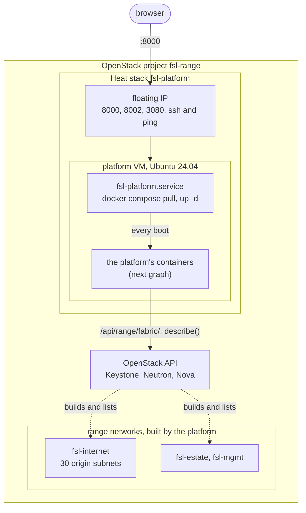
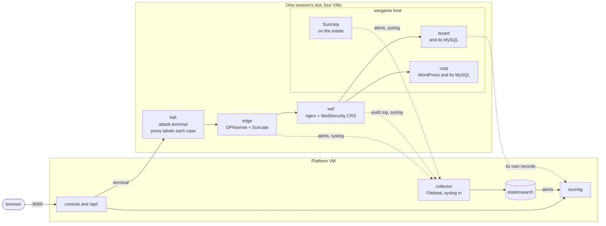

# fsl-project-mvp

A training range for cyber attack and defence. The range is the set of VMs and
networks where the attack and the defence happen. A red team attacks two
websites: a Django board and a WordPress company site. Each has its own MySQL
database, and a WAF sits in front of both. A blue team defends with Suricata
and ModSecurity. The platform scores both teams. This repo is a throwaway
prototype. The production project is in another repo.

It runs on OpenStack deployed with Kolla-Ansible 2026.1 and
`nova_compute_virt_type: kvm`. One Heat stack creates the platform VM. The
platform VM runs the platform as containers (`docker compose`, prebuilt images
from GHCR). The platform then builds the range's VMs through the OpenStack API.
`bin/cloud` does all of this from your machine.

- `CLAUDE.md`: what the repo is for, how the score works, the working rules
- `docs/superpowers/specs/2026-10-08-composable-isolated-learning-mvp-design.md`:
  the approved direction (2026-10-08). Parts of it are not built yet.
- `docs/ARCHITECTURE.md`: how the range is put together, and where it is going
- `docs/THREAT-MODEL.md`: what the range imitates and what it leaves out
- `docs/STATE.md`: where the work stands
- `docs/OPENSTACK.md`: what the cloud needs (Kolla-Ansible 2026.1), the project
  and the platform VM, the range, and a trial on one VM
- `README.ko.md`, `docs/ARCHITECTURE.ko.md`: this README and the architecture
  document in Korean

## Requirements

The operator machine, where you run `bin/cloud`:

- A machine with `git`, `ssh`, `ssh-keygen` and Python 3.10 or newer. The
  platform uses Django 5.2, which needs Python 3.10.
- `python-openstackclient` and `python-heatclient`, installed into `.venv`
  (step 3). It needs the Python venv module (`python3-venv` on Debian and Ubuntu:
  `sudo apt install python3-venv`).
- A network route to the cloud's API and to the platform VM's floating IP.
- Internet access to github.com and ghcr.io. Before `bin/cloud` deletes
  anything, it checks that it can pull the images.

The cloud:

- OpenStack deployed with Kolla-Ansible 2026.1 on x86_64 hosts, with
  `nova_compute_virt_type: kvm`. Heat is on by default. You do not need Cinder,
  Octavia or Designate.
- An external network with a floating-IP pool, and Internet access for the VMs
  on it (`docs/OPENSTACK.md` §2.5 and §2.6).
- Room for the platform VM and one slot. A slot is one copy of the range.
  Together they need 10 vCPU, 24 GB RAM, 5 instances, 1 floating IP and 180 GB
  of disk on the compute node.
  - Nova's default quotas (20 cores, 51200 MB, 10 instances) already allow
    this. Nova has no disk quota, so the 180 GB is capacity.
  - The platform VM is 2 vCPU, 8 GB, 60 GB. Each of the slot's four VMs is
    2 vCPU, 4 GB, 30 GB.
  - Each further slot (`compute.slots`) adds 8 vCPU, 16 GB, 120 GB and 4
    instances. Then you must raise the quota.

To check on one machine first, `docs/OPENSTACK.md` §9 builds the whole cloud in
a single VM on VirtualBox or VMware.

## Bringing it up

1. **Prepare the cloud (an admin, once).** Create the external network, the
   project `fsl-range` with a member user `fsl-range`, the flavors `m1.large`
   and `m1.medium`, and the base image `ubuntu-24.04`. The commands are in
   `docs/OPENSTACK.md` §2.5, §3.1, §3.3 and §3.6. When you upload the image as
   admin, add `--public`. Otherwise `fsl-range` cannot see it.
2. **Clone.**

   ```bash
   git clone https://github.com/Nekonic/fsl-project-mvp.git && cd fsl-project-mvp
   ```

3. **Make the virtualenv and install the OpenStack CLI in it.** Every later
   command runs through `.venv/bin/`, so you do not activate anything.

   ```bash
   python3 -m venv .venv
   .venv/bin/pip install -r platform/requirements.txt python-openstackclient python-heatclient
   ```

4. **Make the operator key.** This is the ssh key you use to log in to the
   platform VM. The range key needs no step. It is the key the platform uses to
   log in to the range's VMs, and the first `bin/cloud up` makes
   `~/.ssh/fsl-platform` if it is missing.

   ```bash
   ssh-keygen -t ed25519 -N "" -f ~/.ssh/fsl_claude
   ```

5. **Write `deploy/openstack/cloud.yaml`.** Copy the example. git ignores the
   copy. Change only your own values.

   ```bash
   cp deploy/openstack/cloud.example.yaml deploy/openstack/cloud.yaml
   mkdir -p ~/.config/fsl && (umask 077; touch ~/.config/fsl/fsl-range.password)
   ```

   Write the `fsl-range` user's password on one line in
   `~/.config/fsl/fsl-range.password`. Then set two keys in `cloud.yaml`:

   - `identity.keystone`: Keystone's URL without `/v3`. The example holds the
     maintainer's lab address.
   - `network.external`: the name of the external network from step 1.

   Leave the other keys alone. They already match the steps above.
   `docs/OPENSTACK.md` §4 describes every key. If a value is wrong, the loader
   refuses before it changes anything and names the key.

6. **Create the Nova keypair** from the public half of the operator key. Do it
   as the `fsl-range` user:

   ```bash
   export OS_AUTH_URL=<identity.keystone>/v3 OS_IDENTITY_API_VERSION=3 OS_INTERFACE=public \
     OS_REGION_NAME=RegionOne OS_USER_DOMAIN_ID=default OS_PROJECT_DOMAIN_ID=default \
     OS_PROJECT_NAME=fsl-range OS_USERNAME=fsl-range \
     OS_PASSWORD="$(cat ~/.config/fsl/fsl-range.password)"
   .venv/bin/openstack keypair create --public-key ~/.ssh/fsl_claude.pub fsl-claude
   ```

   Replace `<identity.keystone>` with that value from `cloud.yaml`, for
   example `http://192.168.100.10:5000`. Use the values in `cloud.yaml` for the
   region, the interface and the domain too.

7. **Bring it all up.**

   ```bash
   .venv/bin/python bin/cloud up
   ```

   `bin/cloud up` creates the platform VM. Then it builds the range through
   the platform's own API and prints each step. The first run also builds the
   range's golden images (the VM images the range boots from) and the OPNsense
   edge image on the cloud, so it takes much longer than later runs. In the
   trial of `docs/OPENSTACK.md` §9 it took 17 min 41 s from an empty cloud, with
   the four builders running in parallel. It ends with
   `the range is ready; the platform is at http://ADDRESS:8000/`.

8. **Check that it works.** Open that address in a browser.

   - The home page lists the board wargame. Under **Lessons**, press **Start**
     on **Lesson 1**.
   - The session page opens within seconds. Under **Blue team console**, press
     **Open**. The console shows the **Map** pane with the company network drawn
     on it. Beside it, the lesson note names the first step.
   - If the page says the practice network is not ready, wait. A closed session
     resets its slot in about two minutes.

   From a terminal, `curl -s http://ADDRESS:8000/api/range/ready/` answers
   `"ready": true` before you start the lesson. It answers `"ready": false`
   while a session is open, and `true` again after the session closes and the
   slot has reset.

9. **If it fails.** `bin/cloud up` stops at the first failure and says why. It
   names the `cloud.yaml` key, the missing flavor or image, or the GHCR package
   that is not public. Fix the cause and run the same command again. It
   continues where it stopped.

   - Platform VM: log in with `ssh -i ~/.ssh/fsl_claude ubuntu@ADDRESS`. Then
     run `systemctl status fsl-platform` (how the last boot's bring-up went),
     `sudo cloud-init status --long` and `sudo docker logs fsl-platform`.
   - Heat stack: in the shell of step 6, run
     `.venv/bin/openstack stack failures list fsl-platform`.
   - The stack exists, but the VM never ran `fsl-platform`. `sudo docker ps`
     shows no `fsl-platform` container, and `sudo cloud-init status --long`
     shows why. Often the VM has no Internet (`docs/OPENSTACK.md` §2.6). If the
     first boot is only slow, run `bin/cloud up` again and it finishes.
     Otherwise fix the cause and run
     `.venv/bin/python bin/cloud up --replace`. That VM has stored nothing, so
     it is replaced without a backup.
   - Sometimes the new platform VM gets no database from the old one, as in
     the case above or after a `down`. Then `bin/cloud up` restores the newest
     `backups/db-<UTC time>.sqlite3` that holds rows and prints its name. If
     there is none, it starts with an empty database and says so.
   - To start over, run `.venv/bin/python bin/cloud down`, then
     `bin/cloud up` again. `down` removes the range and the stack, including a
     failed stack. It keeps the Glance images, the keypair and the range key.
     If the platform VM holds the database, `down` backs it up first. If it
     cannot back it up, it refuses and deletes nothing. If the platform container
     is stopped, `down` starts it first. It refuses when ssh or Docker on the
     VM does not answer, or when the container does not start. Fix ssh first
     (the operator key, the security group, the route).

## How it fits together

### Where it runs

The platform and the services around it run in one VM. A single Heat stack
(`deploy/openstack/platform.yaml`) creates that VM. The platform controls the
range through the OpenStack API as the member-role user `fsl-range`. On the VM,
`FSL_SUBSTRATE=range.openstack.connect` tells the platform that the range is the
OpenStack slot. A session cannot start until `/api/range/ready/` reports the
slot ready.

Cloud-init installs `fsl-platform.service`. At every boot it runs
`docker compose pull` and `docker compose up -d` on `/opt/fsl/compose.yaml`.

- We build seven images: platform, board, corp, corp-db, kali, proxy and gns3.
  `.github/workflows/images.yml` builds them on every push to `dev`. It
  publishes them as `ghcr.io/nekonic/fsl-<name>`, tagged with the commit SHA
  and with `dev`.
- The VM writes the SHA of the commit it cloned into `/opt/fsl/.env` as
  `FSL_IMAGE_TAG`. It therefore runs the images of exactly that commit.
- GitHub makes a package private on the first push, even when the repository is
  public. Make each of the seven public once. Otherwise the pull without a
  login fails. On github.com open the package page, then **Package settings**,
  **Change visibility**, **Public**. You cannot undo this.
- The containers on the VM are `fsl-platform`, `fsl-elasticsearch`,
  `fsl-kibana`, `fsl-gns3` and `fsl-collector`. To read a log, log in with ssh
  and run `sudo docker logs fsl-platform` (or another name).
- To run a commit that is not pushed, use `--sideload` (`docs/OPENSTACK.md`
  §5.3).

Elasticsearch's managed GeoIP downloader is off. Elasticsearch reads
`GeoLite2-City.mmdb` from `config/ingest-geoip` instead. This is a bind mount
that survives a container recreate. Cloud-init fills it with `bin/fetch-geoip`,
because the cloud's Elasticsearch cannot reach the download CDN. The file is
not committed.

When the platform starts, it first sets the docker socket group. While it
starts serving, it also does three things in the background:

- It registers the Elasticsearch ingest pipeline. The pipeline sets each
  event's time and looks up the location of source addresses.
- It imports Kibana's data view, the "Alerts" search and the "Overview"
  dashboard.
- It sets Kibana's default route to that search.

These objects are in Kibana's default space. Only port 5601 reaches them.

When a session opens, it gets its own Kibana space, "SOC" (`KIBANA_URL`, set in
`compose.yaml`). The space id is `soc-` plus the session's index pattern,
`soc-logs-<slot>`. The space has a data view "logs-*" and an "Events" search.
They show the engine and the sensor's map name as fields and hide the
platform's internal fields.

The platform builds three kinds of range network. `fsl-internet` is the
simulated Internet, with 30 origin subnets. `fsl-estate` is the company's
internal network, where the targets sit. `fsl-mgmt` is the management network,
which the platform uses to reach the range's VMs.



### What a session contains

The red team attacks a wargame through the blue team's WAF and IDS. The sensors
send their alerts to Elasticsearch. The platform scores from the alerts and
from the target's own records. The first score is the objectives the red team
took. The second score counts the defence's right and wrong calls (TP, FP, FN,
TN). The target's own data decides whether an attack worked, not the platform.
For the board, the platform compares the hashes the attacker submits with a copy
of the board's accounts taken when the session opened. For corp, it reads the
changes in corp's database log.

`compose.yaml` lists the services on the platform VM; one copy of each runs as
long as the VM does: the platform, Elasticsearch, Kibana, `gns3` (the learners'
maps), and `collector`. The collector is a Filebeat that only receives syslog
from the range.

One session's services run in its slot, four VMs: the OPNsense edge (firewall
and Suricata), the WAF, Kali (with the stamping proxy and the customers'
traffic) and the wargame host (every wargame as containers, plus a second
Suricata on the estate). They send their logs by syslog to `collector`.

A closed session stays in the database for `FSL_RETAIN_CLOSED_MINUTES` (default
60, set in `compose.yaml`). That is long enough to read its score and debrief.
After that the platform deletes the session with its cases, detections,
customer requests and objectives. It checks at start and each time a session
closes. It never deletes an open session.

To add a wargame you need:

- a folder under `wargames/` with `compose.yaml`, `scenario.yaml` and
  `objectives.yaml`;
- a case file under `redteam/cases/`;
- its name under `wargames:` and its port under `publish:` in the
  `fsl-wargame-host` entry of `platform/range/declaration.yaml`, and a `server`
  block in `deploy/waf/board.com.conf`.

`platform/wargames.py` finds the wargame from `scenario.yaml`. There are two
wargames. The board is Django and is scored by `loot_verified`: submitted
hashes checked against the snapshot of the board's accounts. Corp is WordPress
and is scored by `effect_observed`: the changes in corp's database log.



Not drawn in the graph:

- Kali's raw TCP skips the proxy and goes through the edge to the WAF.
- Scripted cases leave from the attacker box: the platform runs `curl` or the
  tool on Kali over ssh, from the chosen origin.
- The platform writes the sensor's rules and the proxy's case label. It reads
  the attacker's command log and corp-db's MySQL binary log (`mysqlbinlog`). It
  does this over ssh.
- The platform reads the board's own records (its `auth_user` table) over HTTP
  straight from the board (`BOARD_API_URL`), not through the WAF.

The Kali terminal appears in the red console, and in the Kali pane of the blue
console in a lesson or scenario. It is a ttyd inside the platform
that logs in over ssh to the `mgmt` address of the Kali VM in the session's
slot (`/vm-terminal/kali/?arg=<session id>`). Its prompt reads `(kali㉿kali)`,
as Kali's own does. The WAF's prompt is `ubuntu@waf`. The networks are in
`docs/ARCHITECTURE.md`.

## Operating on OpenStack

The steps above are the short path. This section explains each part.

Everything that differs between clouds is in one file,
`deploy/openstack/cloud.yaml`. git ignores it. You make it by copying
`deploy/openstack/cloud.example.yaml`. It holds:

- Keystone URL, region, interface, domain, project and member user;
- where to read the password: `password_file` or `password_env`. The password
  itself never goes in the file;
- the external network, DNS, the tenant MTU, and the platform, estate and mgmt
  CIDRs;
- the base image name and an availability zone;
- flavors for the platform, the image builders, the range, and any role
  (`edge`);
- the operator's keypair and key file, and the range key;
- the OPNsense release to build: version, mirror, the image's SHA256 and the
  signing key's SHA256 from the release announcement;
- the stack, the repository and the ref.

Every script and the Heat stack read this file. If a value does not parse, they
refuse before they touch anything and name every bad key.

The cloud needs exactly one uploaded image: Canonical's stock Ubuntu 24.04
cloud image, uploaded unchanged under the name set in `compute.base_image`.
`docs/OPENSTACK.md` has the download, checksum and `openstack image create`
commands. Everything else is built from that image:

- cloud-init builds the platform VM at boot;
- builders build the range's golden images;
- a builder that downloads the official release builds the OPNsense edge image
  (below).

With the OpenStack CLI in `.venv` (step 3), run these on the operator's
machine:

```bash
.venv/bin/python bin/cloud up        # the platform VM, then the whole range
.venv/bin/python bin/cloud down      # back up the database, keep the key, remove range and stack
```

`up` does these things in order:

1. It creates the platform's Heat stack (`deploy/openstack/platform.yaml`) if
   there is none. With `--replace` it replaces an existing stack through
   `bin/platform-rebuild`.
2. It waits for the API.
3. It calls the platform's range API in order: fabric (the networks, keypair
   and security groups), images (repeated until clean), slot, configure.
4. It waits until `/api/range/ready/` says ready.

It stops at the first drift, failed image, blocked slot or refused configure,
and says why.

`up` and `down` both ran on the test cloud. On 2026-10-20 these
paths ran live: `up --replace --sideload`, plain `up` on a platform whose
container was stopped and which had not taken its hand-over, `down`, and `up`
after `down`, which restored the newest backup that holds rows
(`docs/DECISIONS.md` 2026-10-20, "Live checks of the bring-up paths"). Later that
day, after two more fixes, these ran live too: `down` on a platform whose container
was stopped, `up` on a platform whose `openstack.env` had lost its password
line, the first range key, and `up` after `down` without rebuilding the wargame
host. The whole of §9 ran in one VM on an empty cloud
(`docs/DECISIONS.md` 2026-10-20, "The one-VM trial and the last bring-up
fixes"). `docs/OPENSTACK.md` §5 has the steps.

`bin/platform-rebuild` alone creates or replaces only the platform VM:

```bash
.venv/bin/python bin/platform-rebuild            # --cloud PATH, --ref REF
```

Before it deletes anything, it checks that the seven images for the ref's
commit can be pulled from ghcr.io without a login. It keeps the range key
(below) and backs up the database (`bin/backup` over ssh). Then it deletes the
stack, creates it again with every parameter from `cloud.yaml`, and waits until
`/api/sessions/` answers. `backups.keep` in `cloud.yaml` (default 1) sets how
many database backups `bin/platform-rebuild` and `bin/cloud down` leave in
`backups/`.

The new VM clones `ref`, pulls the images tagged with that commit, and starts.
Cloud-init writes the cloud's values into `/opt/fsl/openstack.env`. Two secrets
are kept out of the stack: the password and the platform's range ssh key. Nova's
metadata service gives user data to every process on the VM, including
containers, so a secret in the stack would be readable there. When the VM
answers ssh and cloud-init is done, `bin/platform-rebuild`:

1. appends `FSL_OPENSTACK_PASSWORD` to `/opt/fsl/openstack.env`;
2. writes the range key to `/data/ssh/id_ed25519` in the platform's data
   volume;
3. restores the database it backed up, or, when the old VM held none, the
   newest backup in `backups/` that holds rows;
4. recreates the platform container.

The range key is a file on the operator's machine, `keys.range` (mode 0600). If
the file does not exist:

- `bin/platform-rebuild` makes it (`ssh-keygen`, ed25519) when the stack does
  not exist or its VM holds no database;
- it copies the key once from the running platform when you replace a VM that
  holds a database;
- it refuses when you replace a failed stack.

Because the key survives, the range's VMs and the `fsl-platform` keypair keep
trusting the new platform. The range can stay up while you replace the
platform.

To run a commit that is not pushed yet, both commands take `--sideload
NAME=TARBALL` (repeatable). TARBALL is a `docker save` tarball of one image
built from this checkout. The VM still clones `ref` and pulls every image at
that commit. Then the rebuild:

- checks out this checkout's HEAD from a git bundle;
- runs `docker load` on each tarball and tags the image with the cloned
  commit. Compose and the range's image builders use that tag;
- recreates every service (`--force-recreate`), so bind-mounted files are
  HEAD's too.

Before it deletes anything, it refuses two things: a tarball that does not hold
exactly one `ghcr.io/nekonic/fsl-NAME:<commit>`, and any image whose build
context (`.github/workflows/images.yml`) differs between the commit it came
from and HEAD. A sideloaded VM that reboots may pull the cloned commit's images
from GHCR over the sideloaded ones. Push and rebuild instead of rebooting.

The stack's `address` output is the floating IP. The console is at
`http://ADDRESS:8000/` and asks for no login. Ports 9200 and 5601 listen only on
the VM's loopback. Port 5140/udp listens on all of the VM's addresses.

On the VM the checkout is `/opt/fsl`, owned by `ubuntu`. Run compose,
`bin/backup` and the restore below there. `systemctl status fsl-platform` shows
how the last boot's bring-up went.

You can also call by hand the range steps that `bin/cloud up` runs. First the
fabric:

```bash
curl -s -X POST -H "Content-Type: application/json" -d "{}" http://ADDRESS:8000/api/range/fabric/
```

`GET` shows what is missing, present, changed from what was declared (drift) or
left over. `DELETE` takes the fabric down. It is refused while a server is
attached.

The range's VMs boot from golden images. The platform builds each image from a
setup script that `declaration.yaml` names under `hosts:`, on a builder VM
booted from the base image. Each POST moves every build one step: boot a
builder, stop it once its setup reports done, snapshot it, delete it. The edge's
builder is not snapshotted: it serves its disk, and the platform uploads that
disk to Glance. Repeat the POST until
the answer says `"clean": true`:

```bash
curl -s -X POST -H "Content-Type: application/json" -d "{}" http://ADDRESS:8000/api/range/images/
```

If a build fails, `detail` shows the end of the builder's console. `DELETE` on
the same path removes failed builders and images built from older scripts.

When the images are ready, one POST boots four VMs, each from its own image:
`fsl-edge`, `fsl-kali`, `fsl-waf` and `fsl-wargame-host`. The wargame host runs
every wargame as its GHCR containers. The platform reaches the four over ssh on
`mgmt`:

```bash
curl -s -X POST -H "Content-Type: application/json" -d "{}" http://ADDRESS:8000/api/range/slot/
```

`POST /api/range/configure/` then pushes configuration over ssh. On the
OPNsense edge it installs config.xml (WAN addresses, pass rules, Suricata,
syslog) and reboots it. On the WAF it sets up forwarding of the ModSecurity log.
Board and corp run as containers on the wargame host, and `configure` starts
them.

`POST /api/range/slot/rebuild/` rebuilds every VM from its golden image with
Nova. Ports and addresses stay. Edited data and rules do not carry over, and the
pushed configuration is wiped. After you call `slot/rebuild/` alone, run
`configure/` yourself.

Closing a session resets its slot:

- Kali and the WAF are rebuilt.
- The edge is reset in place. It compares hashes and reboots only if its files
  drifted.
- The wargame host is reset in place (`docker compose down -v`).

When the VMs are ACTIVE, the platform configures them again by itself.
Meanwhile `GET /api/range/ready/` reports phase `RESETTING`, and opening a
session is refused. If the reset fails, it reports `RESET_FAILED` with the
reason, and `POST /api/range/configure/` retries.

`compute.slots` in `cloud.yaml` (default 1) sets how many copies of the range
stand. Each copy has its own edge, WAF, Kali and wargame host, on its own copy
of the internet and estate networks. Slot N's hosts are named `<host>-N`. Each
session holds one slot, so that many sessions can run at once. Closing a
session resets only its slot. `slot/`, `slot/rebuild/` and `configure/` take
`?slot=N`. Without it they act on every slot.

The range is not part of the Heat stack, so it can outlive the platform VM. When
you replace the platform with `bin/platform-rebuild`, the range key is kept, so
the slot and the fabric keep working. The next `POST /api/range/fabric/`
attaches the new server to `mgmt` again, and `configure/` points the range's
syslog at it. If you delete the stack by hand without keeping the key, the new
VM makes a new key, and the fabric reports the old keypair as drift. Then first
send `DELETE` to `/api/range/slot/` and `/api/range/fabric/`. The images stay.

The stack boots with the keypair that `keys.operator` names. The keypair must be
in the project first:

```bash
openstack keypair create --public-key PUBLIC_KEY_FILE fsl-claude
```

### The OPNsense image

The edge is OPNsense (BSD 2-clause license). The images step builds it
automatically. A builder booted from the stock Ubuntu image does this:

1. It installs its tools.
2. It downloads `OPNsense-<version>-nano-amd64.img.bz2`, its `.sig` and the
   release key from `opnsense.mirror`.
3. It checks the archive against `opnsense.image_sha256` and the key against
   `opnsense.pubkey_sha256`. Both values come from the release announcement,
   not from the mirror.
4. It unpacks the archive and verifies the signature.
5. It boots the image once under QEMU and answers its configuration importer,
   so the image starts from `deploy/opnsense/config.xml`. In that
   configuration root trusts only the platform key and has no password. The
   stock image's default password never exists.
6. It converts the image to qcow2 with `qemu-img` and serves it. The platform
   checks its SHA256 and uploads it to Glance as `fsl-opnsense-<version>`.

A new version, a new MTU or a new platform key builds a new image. The image is
built from the official release on each cloud and is never published.
OPNsense's trademark policy asks for permission before a derivative name is
used.

## Ports

| Port | | Used by |
|---|---|---|
| 8000 | the console and `/api/`; Kibana at `/kibana/`; the terminals at `/vm-terminal/kali/` and `/vm-terminal/waf/` | a person's browser |
| 8002 | the Website pane of the red and blue consoles: `/site/<session id>/<host>/`. The request goes to that session's WAF from a customers address (from Kali through the edge) | the iframe in a person's browser |
| 3080 | `gns3`: GNS3 3.1's API and web UI. It holds the learner maps (below) | the iframe in a person's browser, and `platform/gns3.py` over `mgmt` |
| 5140/udp | `collector`, Filebeat's syslog input | the OPNsense edge, the WAF and the wargame host's estate sensor |
| 5601 | Kibana itself, on the platform host's loopback only. `/kibana/` on 8000 serves only the sessions' spaces, and inside them only Discover | an operator, through an ssh tunnel |
| 9200 | Elasticsearch | the acceptance tests |

The nginx inside the platform image serves ports 8000 and 8002. Port 8002 is a
separate origin for the target site, so a script planted on the target cannot
read or drive the console. Cookies are scoped by host, not port, so such a
script could still set a cookie that the console would send. The console uses
no cookies. nginx passes `/vm-terminal/` to ttyd processes inside the platform.
They log in over ssh to the host's `mgmt` address.

**The learner map (port 3080).** Each session's map shows the company network
the learner defends, drawn as a lab topology.

- It names roles, not machines. Each link end shows the interface and the
  address with its prefix. At `kali` and `customers` it shows the interface
  alone. Each zone except the Internet has the network as its caption.
- It shows no management segment, no platform and no machine's own name.
- There is one map per slot for the session's wargame, in English
  and Korean. GNS3 holds each map open with every node started.
- Each host is a display container of one pinned busybox image, so every link
  end is green. The machines themselves run in the range.
- The full wiring is in `deploy/topology/system/`. Learners never see it.
- The blue console's Map pane (tab Map) frames `/static/web-ui/map.html`. That
  page signs in read-only, turns off the web UI's usage statistics, and shows
  the session's map in the console's language, fitted to the pane. It is
  view-only: no editing controls, drag pans, the wheel zooms.
- The `gns3` container has `CAP_NET_ADMIN`, `/dev/net/tun`, the Docker socket
  and the host's pid namespace. GNS3 needs them to run its switches and start a
  docker node (`docs/ARCHITECTURE.md`, The topology).

`compose.yaml` publishes every port on `127.0.0.1` unless `FSL_PUBLISH` says
otherwise. On the platform VM, 8000, 8002 and 3080 are published on the VM's own
address (`FSL_PUBLISH`) and 5140/udp on `0.0.0.0` (`FSL_SYSLOG_PUBLISH`). The
platform template's security group opens 8000, 8002 and 3080
(`docs/OPENSTACK.md` §3.5).

The target is not published. The command-line cases and the acceptance tests
reach it from inside the range, as the console does. Inside the range the
targets sit behind the WAF on port 80: `http://board.com` and `http://corp.com`,
two virtual hosts chosen by the `Host` header. Each slot's VMs get those names
in `/etc/hosts` from their boot user data, pointing at that slot's WAF.

## Running a session

Open the console (`http://ADDRESS:8000/`) and start a session. A lesson or a
scenario opens the blue console, which has both sides. A wargame (person against
person) opens a red console for the attacker and a blue console for the
defender. The language button in the header switches between English and
Korean.

- **Red** is the attacker's console. It has the objectives, "Submit stolen
  hashes", a Kali terminal, and a Website pane pointed at the target. It runs no
  prepared attack. The scripted cases belong to the harness (`redteam/run.py`,
  the acceptance tests) and the scenario engine.
- **Blue** is a sidebar of tools in frames:
  - Kibana, opened on Discover in the session's own data view. The query is
    empty in a lesson and the alert query otherwise;
  - a WAF terminal;
  - a Website pane: a site browser with developer tools laid out like Chrome's
    Network panel;
  - the Map pane (the GNS3 map);
  - an Alerts pane and an IDS rules pane, where a scenario or lesson needs
    them;
  - below a divider, a Kali terminal, shown in lessons and scenarios and hidden
    in a wargame.

  The blue console calls `/api/` for the session, the site's requests, the
  steps and hints of a foundation lesson or worked scenario, a scenario's status
  and triage, ingest, and detections. When the session closes, the session page
  shows the result. It lists the objectives lost first. Then it says in plain
  sentences how many attacks were caught and how many benign requests passed.

A session opened with no guidance (`{"scenario": "board"}`, the home card's
"Start wargame") is a plain wargame with the full defense: CRS paranoia level 1
(PL1). `{"defense": "<name>"}` selects another defense setting that the wargame
declares (`minimal` is PL4). An agent tunes the WAF through
`PUT /api/sessions/<id>/waf/`. `GET` returns what is in the WAF's file.

### Lessons

The home page lists six lessons, called foundations, for learners new to
networks. Open one by its id: `{"lesson": "f1"}` to `f6`. `{"guidance": true}`
alone opens F1. The learner attacks from the Kali pane and the Website pane and
defends in the same blue console.

- F1: read addresses, a subnet, the attacker's network and a customer's request
  path on the map.
- F2: search with the board's search box and read method, parameter, path and
  status code in the developer tools.
- F3: find that search in Kibana with KQL the learner writes. Read both legs of
  the request, before and after the reverse proxy, and the X-Forwarded-For
  header.
- F4: send an XSS probe (403, the CRS anomaly score), write an IDS rule, bypass
  it with letter case and fix it (defense `xss-gap`).
- F5: run sqlmap on the board's `sort` parameter and read the verdict and the
  rules that caught it.
- F6: use an over-broad WAF exception (defense `overbroad`) to dump the accounts
  undetected, read the doubled penalty, remove the exception and replay the
  attack.

Every answer is read from the learner's own records or the session's map. There
is no fixed answer key. The learner's own sqlmap run counts in both scores like
any other red action.

The lesson note is a column beside the pane in the blue console. It walks
through the lesson's steps.

- The platform checks each step
  (`POST /api/sessions/<id>/lesson/steps/<step>/check/`) and records whether the
  step was reached, passed or skipped.
- Each lesson opens on its first step's pane. A step's target is highlighted on
  the map, the page, the developer tools, Kibana or a terminal line.
- The session payload has no answer key. A step's command appears only once the
  learner reaches the step, as text to type. No button runs an attack.
- Help for each step comes in order: a nudge, then a hint, then "Skip". "Skip"
  records the step as skipped and moves on. It does nothing for the learner. The
  session records hint use.
- A lesson's last step is done alone, with no highlight or hint.

The benign request that a lesson replays at open is scored as a benign case.

The six lessons run back to back in one session. When a lesson's last step
passes, the note names the next lesson. After 2 seconds, or when the learner
presses "Next lesson", it starts that lesson in the same session
(`POST /api/sessions/<id>/lesson/ {"lesson": "f2"}`). That call applies the
lesson's defense in place and replays its benign request. The range is not reset
between lessons, and each lesson judges only what happened since it started.
After F6 the note lists the lessons taken, and its button closes the session.

### Scenarios

After the foundations come scenarios (`{"scenario": "1.1"}`). Customers and an
attacker use the board while the learner defends with the real tools.

- A scenario opens on a briefing: situation, goal, how it is measured, and time.
- A status bar at the top shows the time left, the customers blocked and the
  alerted requests in the last minute, and the objectives lost.
- An attack schedule that the learner cannot see fires attacks through the
  normal path. If an attack dumps the board's accounts and they match, it counts
  in the first score.
- "Start final check" (or the schedule) opens a final check of a few minutes.
  The platform judges it by task class:
  - judgement: passes when the learner judges right every alerted item listed
    when the check started. Blocked customers are reported but do not count;
  - availability and unknown: pass when no customer is blocked and every attack
    is held. Scenario 2.3 also needs anomaly thresholds of at most 5/4;
  - detection: passes when every attack draws a corroborated Suricata alert and
    no customer request draws one. An alert is corroborated when it mentions the
    attack's mechanism.

The scenarios:

- `1.1` "Telling customer requests from attacks": the learner judges each
  request that drew an alert. Is it a customer or an attack, and did it get the
  data (`/api/sessions/<id>/triage/`)?
- `1.2` and `1.3`: judge alerts when an inherited exception lets sqlmap take the
  accounts. Scenario 1.3 also judges the kind of each attack.
- `2.1` "Fixing false positives on Korean search": the learner makes a PL3 WAF
  serve the customers it refuses, without letting sqlmap through.
- `2.2`: serve the customers that PL2 blocks. `2.3`: serve the customers at PL3
  while lowering the anomaly thresholds to 5/4.
- `3.1` to `3.4`: make the IDS alert on the sort attack, its tamper variant and
  the comment XSS, in an IDS rules pane. These count in the second score only.
- `4.1`: handle an unseen sqlmap variant and new false positives with no help.

A hint is offered when the learner is stuck, and recorded only when opened. The
debrief adds the customers blocked and the attack timeline. Detail:
`docs/ARCHITECTURE.md`, "Scenarios".

### Firing cases from the command line

You can fire the scripted cases from the command line, as the acceptance tests
do. The target is not published, so the harness runs inside the range, from the
platform:

```bash
sudo docker exec fsl-platform python redteam/run.py --tool-target http://board.com
```

The harness opens a session for the scenario whose `case_file` matches the
basename of `--cases` (`board.yaml` opens board, `corp.yaml` opens corp, anything
else opens board). It fires each case through the platform at `--platform`
(default `http://localhost:8000`). `--tool-target` (default `http://board.com`)
is the address the tool containers use for the target. For corp, add
`--cases redteam/cases/corp.yaml`.

## Checking it

```bash
bin/verify --changed  # only the unit tests the change reaches, and the ratchet
bin/verify --fast     # unit and API tests and the metrics, no stack needed
bin/verify            # also the acceptance tests in test/, against the live stack
```

The range runs only on OpenStack, so a laptop runs `--changed` and `--fast`
and nothing more. The acceptance tests need the platform VM.

`--changed` compares against the merge-base with `dev` (or a commit, or `A..B`)
and prints which tests each changed file reaches and why. `bin/select-tests`
prints that without running anything. With `--live`, `--changed` also runs the
acceptance modules the change reaches (`bin/acceptance --only`).

The full run restarts the platform and resets the target, the rules and the
attacker's origin. Do not run it against a stack someone is using. It deletes
only the sessions it created.

`bin/acceptance` runs the acceptance step. It starts:

- one pytest process for each session the range can hold at once
  (`max_sessions` in `GET /api/range/ready/`);
- one more for the checks that read only Elasticsearch;
- one for the modules that need the whole range (`test_concurrent_sessions`,
  `test_lesson`).

`bin/acceptance --plan` prints the split, and `test/README.md` explains it. The
platform VM does not listen on localhost, so run it on the VM with
`FSL_PLATFORM_URL=http://<address>:8000 bin/verify`. Every acceptance test runs
on OpenStack and none is skipped.

`bin/prune` deletes sessions by hand. Without `--apply` it is a dry run:

```bash
bin/prune --keep 20 --apply      # keep the newest 20
bin/prune --ids FILE --apply     # only the closed sessions FILE lists
```

After you add a Tailwind class to a template, run `bin/build-css`. The
generated stylesheet is committed, and no test checks that it is current.

## Backup and restore

The platform's database holds sessions, cases, detections, objectives, rule sets
and suppressions. It is one SQLite file, `/data/db.sqlite3`, on the
`fsl_platformdata` volume of the platform VM. Nothing else is backed up: not
Elasticsearch's `fsl_esdata` volume, and not the collector's registry in
`fsl_collectordata`. These volumes go with the VM when `bin/cloud down` deletes
it. `down` first backs up the database and keeps the copy in `backups/`.

```bash
FSL_PLATFORM_EXEC="ssh -i ~/.ssh/fsl_claude ubuntu@ADDRESS sudo docker exec -i fsl-platform python -" \
  bin/backup      # writes backups/db-<UTC time>.sqlite3 while the platform serves
```

`FSL_PLATFORM_EXEC` is the command that runs `python -` in the platform's
environment. `bin/backup`:

1. writes a compacted copy with SQLite's `VACUUM INTO` into a temporary file
   beside the platform. The space of deleted sessions is not copied;
2. streams the file back in 1 MiB chunks. A database of gigabytes takes minutes
   over ssh. It gives up only after 600 s with no data;
3. checks the copy with `PRAGMA integrity_check`;
4. keeps nothing if any step fails.

After the new copy passes, `bin/backup` removes older `db-<UTC time>.sqlite3`
files beyond `--keep` (default 1, the new one included). It leaves files with
other names. `bin/platform-rebuild` does this backup and the restore for you.

To restore by hand, copy the file to the VM. Then, on the VM, with the platform
stopped:

```bash
ssh -i ~/.ssh/fsl_claude ubuntu@ADDRESS mkdir -p /opt/fsl/backups
scp -i ~/.ssh/fsl_claude backups/db-20260925T020000Z.sqlite3 ubuntu@ADDRESS:/opt/fsl/backups/
ssh -i ~/.ssh/fsl_claude ubuntu@ADDRESS
cd /opt/fsl
sudo docker compose stop platform
sudo docker run --rm --network none --entrypoint sh --user fsl \
  -v fsl_platformdata:/data -v "$PWD/backups:/backups:ro" "$(sudo docker inspect --format '{{.Config.Image}}' fsl-platform)" \
  -c 'rm -f /data/db.sqlite3-journal && cp /backups/db-20260925T020000Z.sqlite3 /data/db.sqlite3'
sudo docker compose start platform
```

`--entrypoint sh` replaces the image's entrypoint, which ignores its arguments.
`--user fsl` leaves the copy owned by the platform's user. `docker cp` would
leave it owned by root, and the platform could not write it. You must remove the
old `-journal` file, or SQLite replays it onto the restored file. When the
platform starts, it applies newer migrations. `bin/platform-rebuild` runs these
same steps.

## Security limits (lab use only)

- Elasticsearch runs without security.
- Django runs with `DEBUG` off and a secret key generated once into the
  platform's data volume. It answers only to `localhost`, `127.0.0.1` and
  `[::1]`, unless `DJANGO_ALLOWED_HOSTS` names more. The platform VM adds its
  floating IP.
- The Docker socket is mounted into the platform, which gives a way out of the
  container.
- The terminals under `/vm-terminal/` need no login of their own. They give a
  shell on Kali and on the WAF. The Kali shell is user `kali`, who has
  passwordless sudo.

The same holds on the platform VM. There the project's password is also in
plain text in `/opt/fsl/openstack.env` and in the platform container's
environment. The VM's ssh, 8000, 8002 and 3080 are open to any address, and
8000 asks for no login.
