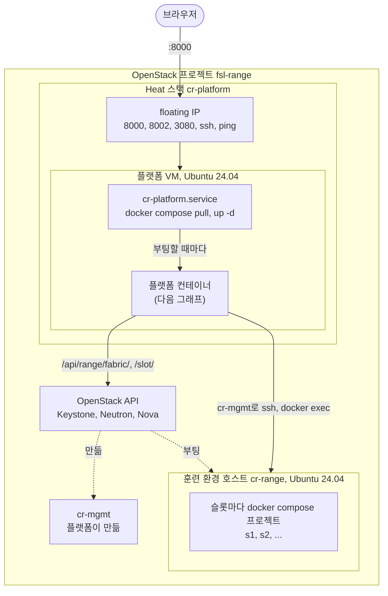
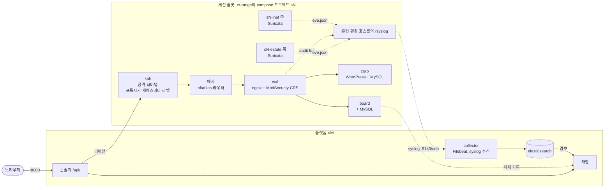

# fsl-project-mvp

사이버 공격·방어 훈련장입니다. 레드팀은 웹사이트 두 곳을 공격합니다.

- `board.com`: Django 게시판, MySQL
- `corp.com`: WordPress 회사 사이트, MySQL

두 사이트 앞단에는 WAF가 있습니다. 블루팀은 Suricata와 ModSecurity로 방어합니다.
이 저장소는 버릴 프로토타입입니다. 실제 제품은 별도 저장소에서 개발합니다.

## 점수

주 점수는 레드팀이 가져간 목표입니다. 성공 여부는 대상 시스템 자체 데이터로
판정합니다. 플랫폼이 공격 성공을 추정하지 않습니다.

- 게시판: 레드팀이 탈취한 계정 해시를 증거물(loot)로 제출합니다
  (`POST /api/sessions/<id>/loot/`). 세션 시작 때 떠 둔 게시판 계정 스냅샷과
  일치하면 그 목표를 잃은 것입니다.
- corp: corp DB에서 관리자 계정 추가, 회원 가입 설정 변경, 글 생성·덮어쓰기가
  확인되면 그 목표를 잃은 것입니다. 변경 내역은 MySQL 바이너리 로그로 읽습니다.
- 블루팀이 알아채지 못한 채 잃은 목표는 두 배로 셉니다.

탐지 결과는 주 점수 옆에 따로 보여 줍니다. 주 점수에 합치지 않습니다.

- 정탐: 탐지한 공격
- 미탐: 놓친 공격
- 오탐: 경보가 나거나 차단된 정상 요청
- 정상 통과: 경보 없이 통과한 정상 요청
- 케이스 하나는 경보가 몇 건이 나든 1건으로 셉니다. sqlmap 케이스 하나가 WAF로
  요청 약 2,000건을 보내도 1건입니다.
- 경보가 공격 수법을 짚지 않으면 탐지로 인정하지 않고 `corroborated: false`로
  표시합니다.

## 구성

Kolla-Ansible 2025.1 이상으로 구축한 OpenStack에서 돌아갑니다.

1. 로컬 PC에서 `bin/cloud up`을 실행하면 Heat 스택으로 플랫폼 VM을 만듭니다.
2. 플랫폼 VM은 GHCR 이미지를 pull해 `docker compose`로 플랫폼을 띄웁니다.
3. 플랫폼은 OpenStack API로 훈련 환경 호스트 VM을 한 대 더 만듭니다.
4. 훈련 환경 호스트에서 슬롯마다 훈련 환경을 컨테이너로 띄웁니다.

문서:

- `CLAUDE.md`: 저장소 목적, 점수 계산, 작업 규칙
- `docs/superpowers/specs/2026-10-08-composable-isolated-learning-mvp-design.md`:
  2026-10-08 승인 방향. 일부 미구현
- `docs/ARCHITECTURE.md`: 훈련 환경 구성과 향후 방향
- `docs/THREAT-MODEL.md`: 훈련 환경이 흉내 내는 것과 뺀 것
- `docs/STATE.md`: 작업 현황
- `docs/OPENSTACK.md`: 클라우드 요구 사항, 프로젝트, 플랫폼 VM, 훈련 환경, VM 1대
  체험 구성
- `docs/TROUBLESHOOTING.md`: 훈련 환경에서 겪은 문제와 해결 방법(영어)

## 필요한 것

로컬 PC(`bin/cloud` 실행 위치):

- `git`, `ssh`, `ssh-keygen`
- Python 3.10 이상과 venv 모듈. Debian·Ubuntu는 `sudo apt install python3-venv`
- 클라우드 API와 플랫폼 VM floating IP로 가는 네트워크 경로
- github.com, ghcr.io 접속

클라우드:

- x86_64 호스트, Kolla-Ansible 2025.1 이상
- 컴퓨트 노드는 `nova_compute_virt_type: kvm` 권장. `qemu`로도 돌지만 느림
- Heat 필요(Kolla 기본값으로 켜짐). Cinder·Octavia·Designate 불필요
- floating IP 풀이 있는 외부 네트워크. VM이 이 네트워크로 인터넷에 나갈 수 있어야
  함(`docs/OPENSTACK.md` §2.5, §2.6)
- VM 2대분 자원

| VM | flavor 키 | 예제 값 |
|---|---|---|
| 플랫폼 VM | `compute.flavors.platform` | `m1.large`: 2 vCPU, RAM 8 GB, 디스크 60 GB. RAM 8 GB 이상 필요 |
| 훈련 환경 호스트 | `compute.flavors.range` | `dba.range`: 6 vCPU, RAM 16 GB, 디스크 60 GB |

- 예제 기준 합계는 vCPU 8, RAM 24 GB, 인스턴스 2, floating IP 1입니다. Nova 기본
  quota(코어 20, RAM 51200 MB, 인스턴스 10)로 충분합니다.
- Nova에는 디스크 quota가 없습니다. 컴퓨트 노드에 디스크 120 GB를 실제로 확보해야
  합니다.
- `compute.slots`를 늘려도 VM은 늘지 않습니다. 훈련 환경 호스트의 컨테이너만
  늘어납니다. 슬롯당 RAM은 약 1.2 GB입니다.

VirtualBox나 VMware VM 1대에 클라우드 전체를 올려 시험하려면 `docs/OPENSTACK.md` §9를
보세요.

## 기동

1. **클라우드 준비(관리자, 최초 1회).** 명령은 `docs/OPENSTACK.md` §2.5, §3.1, §3.3,
   §3.6에 있습니다.

   - 외부 네트워크
   - 프로젝트 `fsl-range`, member 사용자 `fsl-range`
   - flavor `m1.large`, `dba.range`
   - 베이스 이미지 `ubuntu-24.04`. 관리자 계정으로 올릴 때 `--public`을 붙여야
     `fsl-range`에서 보입니다.

2. **clone.**

   ```bash
   git clone https://github.com/Nekonic/fsl-project-mvp.git && cd fsl-project-mvp
   ```

3. **virtualenv 생성, OpenStack CLI 설치.** 이후 명령은 `.venv/bin/`으로 실행하므로
   activate하지 않아도 됩니다.

   ```bash
   python3 -m venv .venv
   .venv/bin/pip install -r platform/requirements.txt python-openstackclient python-heatclient
   ```

4. **Nova 키페어용 ssh 키 생성.** 플랫폼 VM에 ssh로 접속할 때 씁니다.

   ```bash
   ssh-keygen -t ed25519 -N "" -f ~/.ssh/fsl_claude
   ```

   플랫폼이 훈련 환경 호스트에 접속하는 키(`~/.ssh/fsl-platform`)는 만들지 않아도
   됩니다. 처음 `bin/cloud up`을 실행할 때 생성합니다.

5. **`deploy/openstack/cloud.yaml` 작성.**

   ```bash
   cp deploy/openstack/cloud.example.yaml deploy/openstack/cloud.yaml
   mkdir -p ~/.config/fsl && (umask 077; touch ~/.config/fsl/fsl-range.password)
   ```

   - `~/.config/fsl/fsl-range.password`: `fsl-range` 사용자 비밀번호 한 줄
   - `cloud.yaml`의 `identity.keystone`: Keystone URL. `/v3`는 뺌
   - `cloud.yaml`의 `network.external`: 1단계에서 만든 외부 네트워크 이름

   나머지 키는 1~4단계의 이름과 같으므로 그대로 둡니다. 키 설명은
   `docs/OPENSTACK.md` §4에 있습니다. 값이 잘못되면 아무것도 바꾸기 전에 거부하고
   해당 키를 출력합니다.

6. **Nova 키페어 등록.** `fsl-range` 사용자로 4단계의 공개키를 등록합니다.

   ```bash
   export OS_AUTH_URL=<identity.keystone>/v3 OS_IDENTITY_API_VERSION=3 OS_INTERFACE=public \
     OS_REGION_NAME=RegionOne OS_USER_DOMAIN_ID=default OS_PROJECT_DOMAIN_ID=default \
     OS_PROJECT_NAME=fsl-range OS_USERNAME=fsl-range \
     OS_PASSWORD="$(cat ~/.config/fsl/fsl-range.password)"
   .venv/bin/openstack keypair create --public-key ~/.ssh/fsl_claude.pub fsl-claude
   ```

   `<identity.keystone>`에는 `cloud.yaml`의 값을 넣습니다. region, interface,
   domain도 `cloud.yaml` 값과 맞춥니다.

7. **`bin/cloud up` 실행.**

   ```bash
   .venv/bin/python bin/cloud up
   ```

   - 단계마다 진행 상황을 출력합니다.
   - 첫 실행은 오래 걸립니다. 훈련 환경 호스트 부팅, Docker 설치, 훈련 환경 이미지
     pull이 끝나야 첫 슬롯이 뜹니다.
   - 끝나면 `the range is ready; the platform is at http://ADDRESS:8000/`를
     출력합니다.

8. **동작 확인.** 브라우저로 그 주소에 접속합니다.

   - 홈 화면 **대상 시스템** 아래에 커뮤니티 게시판이 보이는지 확인합니다.
   - 첫 과정 **로그 분석 기초**의 **레슨 1**에서 **시작**을 누릅니다.
   - 몇 초 안에 블루팀 콘솔이 과정 안내 화면으로 열립니다.
   - **시작**을 누르면 **구성도** 창이 뜨고, 레슨 노트에 첫 단계가 나옵니다.
   - 훈련 네트워크가 준비되지 않았다고 나오면 기다립니다. 닫힌 세션의 슬롯은
     초기화를 먼저 거칩니다.

   터미널에서는 레슨 시작 전에 아래를 실행합니다. 빈 슬롯이 있으면
   `"ready": true`입니다.

   ```bash
   curl -s http://ADDRESS:8000/api/range/ready/
   ```

   슬롯이 1개면 세션이 열려 있는 동안 `false`입니다. 세션을 닫고 슬롯 초기화가
   끝나면 `true`로 돌아옵니다.

9. **실패 시.**

   - `bin/cloud up`은 처음 실패한 지점에서 멈추고 원인을 출력합니다.
   - `cloud.yaml` 키, 없는 flavor·이미지, public이 아닌 GHCR 패키지는 이름까지
     출력합니다.
   - 훈련 환경 호스트 설정이 실패하면 슬롯 단계 `SETUP_FAILED`와 그 호스트의
     `/var/log/cr-setup.log`를 알려 줍니다.
   - 원인을 고친 뒤 같은 명령을 다시 실행하면 멈춘 지점부터 이어 갑니다.
   - 설정에 실패했거나 이미지 태그·설정 번들이 바뀐 훈련 환경 호스트는 그 실행에서
     지우고 다시 만듭니다. 열린 세션이 있으면 그대로 둡니다.

   어디를 볼지:

   - 플랫폼 VM: `ssh -i ~/.ssh/fsl_claude ubuntu@ADDRESS`로 접속해 아래를
     확인합니다.
     - `systemctl status cr-platform`: 마지막 부팅의 기동 결과
     - `sudo cloud-init status --long`
     - `sudo docker logs cr-platform`
   - Heat 스택: 6단계의 셸에서
     `.venv/bin/openstack stack failures list cr-platform`
   - `sudo docker ps`에 `cr-platform`이 없음: 플랫폼이 한 번도 뜨지 않은 상태입니다.
     원인은 `sudo cloud-init status --long`에 나옵니다. 대개 VM이 인터넷에 나가지
     못한 경우입니다(`docs/OPENSTACK.md` §2.6).
     - 첫 부팅이 느렸을 뿐이면 `bin/cloud up`을 다시 실행합니다.
     - 아니면 원인을 고치고 `.venv/bin/python bin/cloud up --replace`를 실행합니다.
       이 VM에는 데이터가 없으므로 백업 없이 교체합니다.
   - 새 플랫폼 VM이 이전 VM의 DB를 넘겨받지 못한 경우(위 경우, `down` 직후):
     `bin/cloud up`이 `backups/db-<UTC 시각>.sqlite3` 중 행이 있는 가장 최근 백업을
     복원하고 파일 이름을 출력합니다. 그런 백업이 없으면 빈 DB로 시작한다고
     출력합니다.

   처음부터 다시 하려면 `.venv/bin/python bin/cloud down`을 실행한 뒤
   `bin/cloud up`을 실행합니다. `down` 동작:

   - 훈련 환경과 스택을 지웁니다. 키페어와 `~/.ssh/fsl-platform`은 남깁니다.
   - 플랫폼 VM에 DB가 있으면 먼저 백업합니다. 백업에 실패하면 아무것도 지우지
     않고 멈춥니다.
   - 스택이 실패했거나 VM에 플랫폼 컨테이너도 DB도 없으면 스택만 지웁니다.
   - 플랫폼 컨테이너가 멈춰 있으면 먼저 띄웁니다.
   - VM의 ssh나 Docker가 응답하지 않거나 컨테이너가 뜨지 않으면 멈춥니다. ssh(키,
     보안 그룹, 네트워크 경로)부터 고치세요.

## 전체 구성

### 실행 위치

- 플랫폼과 주변 서비스는 플랫폼 VM 1대에서 돕니다. VM은 Heat 스택
  (`deploy/openstack/platform.yaml`)으로 만듭니다.
- 플랫폼은 member 사용자 `fsl-range`로 OpenStack API를 호출해 훈련 환경을
  관리합니다. 플랫폼 VM에는 `CR_SUBSTRATE=range.openstack.connect`가 설정돼
  있습니다.
- 세션은 `/api/range/ready/`에 빈 슬롯이 있어야 시작할 수 있습니다.
- `cr-platform.service`는 cloud-init에서 설치합니다. 부팅할 때마다
  `/opt/cr/compose.yaml`로 `docker compose pull`, `docker compose up -d`를
  실행합니다.

이미지:

- 직접 빌드하는 이미지는 platform, board, corp, corp-db, gns3, kali, waf, edge
  8개입니다.
- `dev`에 push할 때마다 `.github/workflows/images.yml`로 빌드해
  `ghcr.io/nekonic/cr-<name>`에 올립니다. 태그는 커밋 SHA와 `dev`입니다.
- VM은 clone한 커밋의 SHA를 `/opt/cr/.env`의 `CR_IMAGE_TAG`에 적습니다. 그래서 그
  커밋의 이미지로 뜹니다.
- GHCR 패키지는 저장소가 public이어도 첫 push 때 private으로 생깁니다. 8개 모두
  public으로 바꿔야 로그인 없이 pull할 수 있습니다.
- github.com 패키지 페이지에서 **Package settings** → **Change visibility** →
  **Public** 순서로 바꿉니다. 되돌릴 수 없습니다.
- VM의 컨테이너는 `cr-platform`, `cr-elasticsearch`, `cr-kibana`, `cr-gns3`,
  `cr-collector`입니다. 로그는 `sudo docker logs <컨테이너 이름>`으로 봅니다.
- push하지 않은 커밋을 띄우려면 `--sideload`를 씁니다(아래 sideload,
  `docs/OPENSTACK.md` §5.3).

GeoIP:

- Elasticsearch의 managed GeoIP downloader는 끄고
  `config/ingest-geoip/GeoLite2-City.mmdb`를 읽습니다.
- 클라우드에서는 Elasticsearch가 다운로드 CDN에 닿지 못합니다. cloud-init에서
  `bin/fetch-geoip`로 이 파일을 받습니다.
- `config/ingest-geoip`는 bind mount라 컨테이너를 다시 만들어도 남습니다. 파일은
  커밋하지 않습니다.

플랫폼을 시작하면 docker 소켓 그룹을 먼저 설정합니다. 이어서 백그라운드에서 아래를
처리합니다.

- Elasticsearch ingest pipeline 등록. 이벤트 시각을 정하고 출발지 주소의 위치 정보를
  붙임
- Kibana data view, "Alerts" 검색, "Overview" 대시보드 import
- Kibana 기본 경로를 "Alerts" 검색으로 지정

이 객체는 Kibana 기본 space에 있고 5601번 포트로만 볼 수 있습니다.

세션을 열면 세션 전용 Kibana space "SOC"를 만듭니다.

- Kibana 주소는 `compose.yaml`의 `KIBANA_URL`입니다.
- space id는 `soc-logs-<slot>`입니다. `soc-` 뒤에 세션 인덱스 패턴을 붙인
  값입니다.
- data view "logs-*"와 "Events" 검색이 들어 있습니다.
- 엔진과 센서는 구성도상 이름으로 나옵니다. 플랫폼 내부 필드는 숨깁니다.

네트워크:

- 플랫폼이 OpenStack에 만드는 네트워크는 관리망 `cr-mgmt`뿐입니다. 플랫폼은 이
  망으로 훈련 환경 호스트에 접속합니다.
- 슬롯의 나머지 네트워크는 훈련 환경 호스트 안의 Docker 네트워크입니다.
  - `sN_internet`: 출발지 서브넷 30개를 둔 모의 인터넷
  - `sN_estate`: WAF와 대상 시스템이 있는 회사 내부망



### 세션의 구성

레드팀은 블루팀의 WAF와 IDS를 거쳐 대상 시스템을 공격합니다. 센서 경보는
Elasticsearch에 쌓입니다. 채점 방식은 [점수](#점수)를 보세요.

플랫폼 VM에서 상시 도는 서비스(`compose.yaml`):

- 플랫폼, Elasticsearch, Kibana
- `gns3`: 학습자용 구성도
- `collector`: 훈련 환경의 syslog만 받는 Filebeat

세션별 서비스는 세션에 배정된 슬롯에서 돕니다. 슬롯은 훈련 환경 호스트의 docker
compose 프로젝트 `sN`입니다.

- Kali: 마커를 붙이는 프록시, 고객 트래픽
- 에지: nftables 라우터
- WAF
- board, corp와 각각의 MySQL
- Suricata 센서 2개: 슬롯의 인터넷 브리지에 1개, estate 브리지에 1개

센서 경보와 WAF audit log는 훈련 환경 호스트의 rsyslog로 `collector`에 보냅니다.

닫힌 세션:

- `CR_RETAIN_CLOSED_MINUTES`분(기본 60, `compose.yaml`) 동안 DB에 남습니다. 그동안
  점수와 결과 보고를 볼 수 있습니다.
- 그 뒤 세션을 케이스, 탐지 기록, 고객 요청, 목표와 함께 지웁니다.
- 플랫폼 시작 시와 세션을 닫을 때마다 확인합니다. 열린 세션은 지우지 않습니다.

워게임을 추가할 때 필요한 것:

- `wargames/` 아래 폴더. `compose.yaml`, `scenario.yaml`, `objectives.yaml` 포함
- `redteam/cases/` 아래 케이스 파일
- `platform/range/declaration.yaml`: `cr-range` 항목의 `wargames:` 아래에 워게임
  이름, `cr-waf` 항목의 `names:` 아래에 사이트 이름
- `deploy/range-host/slot.yaml`
  - WAF가 프록시하는 서비스마다 `x-wargames.fronts` 아래에 estate 주소의 마지막
    옥텟
  - 서비스마다 `x-wargames.limits` 아래에 capability와 자원 제한
  - `waf` 서비스의 `extra_hosts`에 서비스 이름과 estate 주소
  - `kali` 서비스의 `extra_hosts`에 사이트 이름
- `platform/tests/test_containment.py`의 `LEARNER_FACING`, `CAPABILITIES`에 서비스
  추가
- `deploy/waf/board.com.conf`의 `server` 블록

워게임 목록은 `platform/wargames.py`가 `scenario.yaml`로 찾습니다.

| 워게임 | 앱 | 목표 모델 | 판정 근거 |
|---|---|---|---|
| board | Django 게시판 | `loot_verified` | 제출한 해시를 세션 시작 시 게시판 계정 스냅샷과 대조 |
| corp | WordPress | `effect_observed` | corp DB의 변경 로그 |



그래프에 없는 경로:

- Kali의 raw TCP는 프록시를 거치지 않고 에지를 지나 WAF로 갑니다.
- 스크립트 케이스는 공격자 박스에서 나갑니다. 플랫폼이 고른 출발지 주소로 Kali
  컨테이너에서 `curl`이나 도구를 실행합니다.
- 플랫폼은 센서 룰과 프록시의 케이스 라벨을 씁니다.
- 플랫폼은 공격자 명령 로그와 corp-db의 MySQL 바이너리 로그(`mysqlbinlog`)를
  읽습니다.
- 게시판 계정(`auth_user` 테이블)은 WAF를 거치지 않고 게시판 컨테이너 안에서
  읽습니다.
- 위 명령은 모두 훈련 환경 호스트의 `mgmt` 주소로 ssh 접속한 뒤 슬롯 컨테이너
  (`sN-kali`, `sN-board` 등)에 `sudo docker exec`로 실행합니다.

터미널:

- Kali 터미널은 레드팀 콘솔에 있습니다. 레슨과 시나리오에서는 블루팀 콘솔의 Kali
  창에도 뜹니다.
- 플랫폼 안의 ttyd가 훈련 환경 호스트 `mgmt` 주소로 ssh 접속합니다. 이어서 슬롯의
  Kali 컨테이너에 `docker exec`로 들어갑니다(`/vm-terminal/kali/?arg=<세션 id>`).
- WAF 터미널(`/vm-terminal/waf/`)도 같은 방식으로 슬롯의 WAF 컨테이너에 root로
  붙습니다.

네트워크 구성은 `docs/ARCHITECTURE.md`를 보세요.

## OpenStack 운영

### cloud.yaml

클라우드마다 다른 값은 모두 `deploy/openstack/cloud.yaml`에 둡니다. 스크립트와 Heat
스택 모두 이 파일을 읽습니다.

| 섹션 | 항목 |
|---|---|
| `identity` | Keystone URL, region, interface, domain, 프로젝트, member 사용자, 비밀번호 위치(`password_file` 또는 `password_env`). 비밀번호 자체는 넣지 않음 |
| `network` | 외부 네트워크, 고정 floating IP(`address`), DNS, 테넌트 MTU, platform·estate·mgmt CIDR |
| `compute` | 베이스 이미지, availability zone, 슬롯 수, flavor 2개(`platform`, `range`) |
| `keys` | Nova 키페어 이름(`operator`)과 개인키(`operator_file`), 플랫폼의 훈련 환경 ssh 키(`range`) |
| `platform` | 스택 이름, 저장소, ref |
| `backups` | `backups/`에 남길 백업 수(`keep`) |

해석할 수 없는 값이 있으면 아무것도 건드리기 전에 거부하고 잘못된 키를 모두
출력합니다.

### 베이스 이미지

클라우드에 올리는 이미지는 Canonical의 Ubuntu 24.04 클라우드 이미지뿐입니다.
수정하지 않고 `compute.base_image`의 이름으로 올립니다. 다운로드, 체크섬,
`openstack image create` 명령은 `docs/OPENSTACK.md`에 있습니다. VM 2대 모두 이
이미지로 부팅하고 cloud-init으로 설정합니다.

- 플랫폼 VM: 저장소 clone, `compose.yaml` 기동
- 훈련 환경 호스트: Nova user data로 설정 번들(`deploy/range-host/setup.sh`) 수신,
  Docker 설치, 플랫폼의 `CR_IMAGE_TAG`로 GHCR에서 훈련 환경 이미지 전체 pull,
  초기화용 대상 시스템 볼륨 원본 생성

### bin/cloud

로컬 PC에서 `.venv`에 OpenStack CLI를 설치한 상태(기동 3단계)로 실행합니다.

```bash
.venv/bin/python bin/cloud up        # 플랫폼 VM, 그다음 훈련 환경 전체
.venv/bin/python bin/cloud down      # DB 백업, 키 보관, 훈련 환경과 스택 제거
```

`up` 순서:

1. 플랫폼 Heat 스택(`deploy/openstack/platform.yaml`)이 없으면 만듭니다.
   `--replace`를 주면 기존 스택을 `bin/platform-rebuild`로 교체합니다.
2. API가 응답할 때까지 기다립니다.
3. 플랫폼의 훈련 환경 API를 차례로 호출합니다.
   - fabric: 관리망, 키페어, 보안 그룹
   - slot: 훈련 환경 호스트 부팅 또는 교체
   - configure: 훈련 환경 호스트가 설정을 마친 뒤
4. `/api/range/ready/`가 ready가 될 때까지 기다립니다.
5. 예전 VM 방식 훈련 환경의 잔여 자원을 지우고(`DELETE /api/range/leftovers/`) 지운
   항목을 출력합니다.

drift, 막힌 슬롯, 실패한 설정, 거부된 configure 중 하나라도 나오면 그 자리에서
멈추고 이유를 출력합니다. 단계별 설명은 `docs/OPENSTACK.md` §5에 있습니다.

### bin/platform-rebuild

플랫폼 VM만 만들거나 교체할 때 씁니다.

```bash
.venv/bin/python bin/platform-rebuild            # --cloud PATH, --ref REF
```

1. ref 커밋의 이미지 8개를 ghcr.io에서 로그인 없이 pull할 수 있는지 확인합니다.
   안 되면 아무것도 지우지 않습니다.
2. 플랫폼의 훈련 환경 ssh 키(`keys.range`)를 보관합니다.
3. ssh로 `bin/backup`을 실행해 DB를 백업합니다.
4. 스택을 지우고 `cloud.yaml`의 파라미터 전체로 다시 만듭니다.
5. 새 VM은 `ref`를 clone하고 그 커밋 태그의 이미지를 pull해 뜹니다. 클라우드 값은
   cloud-init에서 `/opt/cr/openstack.env`에 씁니다.
6. VM이 ssh에 응답하고 cloud-init이 끝나면 ssh로 아래를 실행합니다.
   - `/opt/cr/openstack.env`에 `CR_OPENSTACK_PASSWORD` 추가
   - 플랫폼 데이터 볼륨의 `/data/ssh/id_ed25519`에 훈련 환경 ssh 키 기록
   - 백업한 DB 복원. 이전 VM에 DB가 없었으면 `backups/`에서 행이 있는 가장 최근
     백업 복원
   - 플랫폼 컨테이너 재생성
7. `/api/sessions/`가 응답할 때까지 기다립니다.

`backups/`에 남길 백업 수는 `backups.keep`(기본 1)입니다. `bin/cloud down`도 같은
값을 씁니다.

비밀번호와 훈련 환경 ssh 키는 스택에 넣지 않습니다. Nova 메타데이터 서비스는 VM의
모든 프로세스에 user data를 내줍니다. 컨테이너도 마찬가지입니다. 스택에 넣은 비밀은
VM 안 어디서든 읽힙니다.

훈련 환경 ssh 키는 로컬 PC의 `keys.range` 파일(모드 0600)입니다. 이 파일이 없을 때:

- 스택이 없거나 VM에 DB가 없음: `ssh-keygen`(ed25519)으로 새로 생성
- DB가 있는 VM 교체: 실행 중인 플랫폼에서 복사
- 실패한 스택 교체: 거부

키가 유지되므로 훈련 환경 호스트와 `cr-platform` 키페어는 새 플랫폼을 계속
신뢰합니다. 플랫폼을 교체하는 동안 훈련 환경은 그대로 둬도 됩니다.

### sideload

push하지 않은 커밋을 띄울 때는 `bin/cloud`와 `bin/platform-rebuild` 모두
`--sideload NAME=TARBALL`을 씁니다. 여러 번 줄 수 있습니다. TARBALL은 이 체크아웃에서
빌드한 이미지 1개를 `docker save`로 저장한 파일입니다.

VM은 여전히 `ref`를 clone하고 그 커밋의 이미지를 전부 pull합니다. 재구축 중에 아래를
추가로 합니다.

- git bundle로 이 체크아웃의 HEAD를 checkout
- tarball마다 `docker load`하고 clone한 커밋의 태그를 붙임
- 모든 서비스 재생성(`--force-recreate`). bind mount한 파일도 HEAD 기준이 됨

플랫폼 VM의 compose는 이 태그를 씁니다. 훈련 환경 호스트는 GHCR에서 직접 pull하므로
sideload한 이미지를 받지 못합니다.

아무것도 지우기 전에 아래 두 경우는 거부합니다.

- `ghcr.io/nekonic/cr-NAME:<commit>` 1개만 담지 않은 tarball
- 이미지를 빌드한 커밋과 HEAD 사이에 빌드 컨텍스트(`.github/workflows/images.yml`)가
  바뀐 이미지

sideload한 VM은 재부팅하지 마세요. 재부팅하면 clone한 커밋의 이미지를 GHCR에서
pull하면서 sideload한 이미지를 덮어쓸 수 있습니다. push한 뒤 재구축하세요.

### 플랫폼 VM 접속

- 스택 출력 `address`가 floating IP입니다.
- 콘솔은 `http://ADDRESS:8000/`이고 로그인이 없습니다.
- 9200, 5601은 VM loopback에만 열립니다. 5140/udp는 VM의 모든 주소에서 받습니다.
- 체크아웃 위치는 `/opt/cr`(소유자 `ubuntu`)입니다. compose, `bin/backup`, 복원
  절차는 이 디렉터리에서 실행합니다.
- 마지막 부팅의 기동 결과는 `systemctl status cr-platform`으로 봅니다.

### 훈련 환경 API

`bin/cloud up`이 거치는 단계는 직접 호출할 수도 있습니다.

**fabric.**

```bash
curl -s -X POST -H "Content-Type: application/json" -d "{}" http://ADDRESS:8000/api/range/fabric/
```

- `GET`: 없는 것, 있는 것, 선언과 달라진 것(drift), 남은 것
- `DELETE`: fabric 제거. 서버가 붙어 있으면 거부

**slot.**

```bash
curl -s -X POST -H "Content-Type: application/json" -d "{}" http://ADDRESS:8000/api/range/slot/
```

훈련 환경 호스트 `cr-range`를 베이스 이미지로 부팅하고 user data로 설정 번들을
넣습니다. 포트는 2개입니다.

| 포트 | 보안 그룹 | 용도 |
|---|---|---|
| `mgmt` 쪽 | `cr-mgmt` | 플랫폼 접속 전용 |
| 플랫폼 네트워크 쪽 | `cr-egress`, 인바운드 없음 | 이미지 pull |

설정을 마쳐 ready를 알리면 두 번째 포트를 떼어 냅니다. 그 뒤 훈련 환경 호스트에는
`cr-range.mgmt`만 남습니다. 인터넷으로 나가는 경로도, DNS 리졸버도 없습니다.

`GET /api/range/slot/` 단계:

- `SETTING_UP`: 설정이 `/var/lib/cr/ready`를 남기기 전
- `SETUP_FAILED`: 설정 실패. `/api/range/ready/`도 슬롯 단계를 `SETUP_FAILED`로
  보고하고 `/var/log/cr-setup.log`를 가리킴. `bin/cloud up`은 이유를 출력하고 멈춤

떠 있는 호스트에 같은 POST를 보내면 아래 경우에 호스트를 교체합니다. 세션이 슬롯을
잡고 있으면 교체하지 않습니다.

- 설정에 실패한 호스트
- 이미지 태그나 설정 번들이 플랫폼과 다른 호스트

**configure.** `POST /api/range/configure/`는 슬롯마다 아래를 실행합니다.

1. `deploy/range-host/slot.yaml`과 `wargames/<w>/compose.yaml`로 슬롯 compose 파일
   생성
2. ssh로 훈련 환경 호스트에 올리고 `deploy/range-host/slot.sh up N` 실행
   - compose 프로젝트 `sN` 기동
   - Kali와 에지에 출발지 주소 추가
   - 훈련 환경 호스트의 rsyslog에 슬롯 로그 전달 설정
3. 두 센서에 기본 룰 적용

**rebuild.** `POST /api/range/slot/rebuild/`는 슬롯의 compose 프로젝트를 볼륨째
내립니다. 바꾼 데이터와 룰은 남지 않습니다. 다시 띄우려면 `configure/`를
호출합니다.

**reset.** 세션을 닫으면 `slot.sh reset N`으로 그 슬롯을 제자리에서 초기화합니다.

- Kali, WAF: 컨테이너 재생성
- 대상 시스템: 지운 뒤 훈련 환경 호스트의 원본 볼륨으로 복구
- 에지: neighbour 테이블만 비움. 에지와 센서는 계속 돎
- 슬롯 로그: 제자리에서 비우고 센서가 로그 파일을 다시 엶. 이어서 두 센서에 기본
  룰을 다시 적용

초기화 중에는 `GET /api/range/ready/`에 phase `RESETTING`이 나오고 세션을 열 수
없습니다. 실패하면 이유와 함께 `RESET_FAILED`가 나옵니다.
`POST /api/range/configure/`로 다시 시도합니다.

**슬롯 수.** `cloud.yaml`의 `compute.slots`(기본 1)로 정합니다.

- 슬롯마다 compose 프로젝트 `sN`, 인터넷·estate 네트워크를 따로 둡니다.
- 슬롯 N의 estate는 `network.estate`의 N번째 /24입니다(예제 기준
  `10.30.N.0/24`).
- 컨테이너 이름은 `sN-<service>`입니다.
- 세션 1개가 슬롯 1개를 차지합니다. 슬롯 수만큼 세션을 동시에 돌릴 수 있습니다.
- 세션을 닫으면 그 슬롯만 초기화합니다.
- `slot/`, `slot/rebuild/`, `configure/`는 `?slot=N`을 받습니다. 생략하면 모든
  슬롯에 적용합니다.

**leftovers.** `GET /api/range/leftovers/`는 예전 VM 방식 훈련 환경이 프로젝트에 남긴
자원을 보여 줍니다.

- 당시 VM과 이미지 빌더
- 폐기한 세그먼트의 포트, 서브넷, 네트워크
- 보안 그룹 `cr-range`, `cr-build`
- 당시 이미지

`DELETE`하면 지웁니다. `bin/cloud up`이 마지막 단계에서 호출합니다.

**플랫폼 교체 후.** 훈련 환경은 Heat 스택 밖에 있어서 플랫폼 VM보다 오래 남을 수
있습니다.

- `bin/platform-rebuild`로 교체하면 훈련 환경 ssh 키가 유지됩니다. 슬롯과 fabric도
  계속 동작합니다.
- 이후 `POST /api/range/fabric/`를 호출하면 새 서버가 `mgmt`에 다시 붙습니다.
- `configure/`를 호출하면 훈련 환경 syslog가 새 서버로 갑니다.
- 키를 보관하지 않고 스택을 직접 지우면 새 VM이 새 키를 만듭니다. fabric은 예전
  키페어를 drift로 보고합니다.
- 이때는 `/api/range/slot/`과 `/api/range/fabric/`에 `DELETE`를 먼저 보냅니다.
  `?slot=` 없이 보내면 훈련 환경 호스트까지 지웁니다.

스택은 `keys.operator`의 키페어로 부팅합니다. 이 키페어는 프로젝트에 먼저 등록해야
합니다(기동 6단계).

## 포트

| 포트 | 서비스 | 접속 주체 |
|---|---|---|
| 8000 | 콘솔, `/api/`, Kibana(`/kibana/`), 터미널(`/vm-terminal/kali/`, `/vm-terminal/waf/`) | 사용자 브라우저 |
| 8002 | 레드·블루팀 콘솔의 웹사이트 창(`/site/<세션 id>/<host>/<path>`) | 사용자 브라우저 안의 iframe |
| 3080 | `gns3`: GNS3 3.1 API와 웹 UI, 학습자용 구성도 | 사용자 브라우저 안의 iframe, `mgmt`를 거친 `platform/gns3.py` |
| 5140/udp | `collector`: Filebeat syslog 입력 | 훈련 환경 호스트의 rsyslog. 슬롯마다 센서 2개의 경보와 WAF audit log |
| 5601 | Kibana 직접 접속. 플랫폼 호스트 loopback 전용. 8000번 `/kibana/`는 세션별 space의 Discover만 제공 | 운영자(ssh 터널) |
| 9200 | Elasticsearch | acceptance 테스트 |

8000과 8002는 플랫폼 이미지 안의 nginx가 받습니다.

`board.com`과 `corp.com`은 훈련 환경 안에서만 응답합니다. 학습자 브라우저는
8002번의 nginx를 거쳐 접속합니다(`/site/<세션 id>/<host>/<path>`). 요청은 고객
주소로 Kali 컨테이너에서 나가 에지를 지나 그 세션의 WAF로 갑니다.

- 8002는 대상 사이트 전용 origin입니다. 대상 시스템에 심긴 스크립트는 콘솔을
  읽거나 조작할 수 없습니다.
- 쿠키는 포트가 아니라 호스트 단위입니다. 그런 스크립트도 콘솔용 쿠키는 설정할 수
  있지만, 콘솔은 쿠키를 쓰지 않습니다.
- `/vm-terminal/`은 플랫폼 안의 ttyd로 넘깁니다. ttyd는 훈련 환경 호스트 `mgmt`
  주소로 ssh 접속해 `docker exec`로 슬롯 컨테이너를 엽니다.

훈련 환경 안에서 대상 시스템은 WAF 뒤 80번 포트에 있습니다.

- `http://board.com`과 `http://corp.com`은 `Host` 헤더로 나누는 가상 호스트입니다.
- 슬롯 Kali 컨테이너의 `/etc/hosts`에는 이 두 이름만 들어갑니다. 둘 다 그 슬롯의
  WAF를 가리킵니다.
- 명령줄 케이스와 acceptance 테스트도 훈련 환경 안에서 접속합니다.

publish 주소:

| 포트 | 설정 | 기본값 | 플랫폼 VM |
|---|---|---|---|
| 9200, 5601 | 고정 | `127.0.0.1` | `127.0.0.1` |
| 8000, 8002, 3080 | `CR_PUBLISH` | `127.0.0.1` | VM 자신의 주소 |
| 5140/udp | `CR_SYSLOG_PUBLISH` | `127.0.0.1` | `0.0.0.0` |

8000, 8002, 3080은 플랫폼 템플릿의 보안 그룹에서 엽니다(`docs/OPENSTACK.md` §3.5).

### 학습자용 구성도(3080)

세션마다 학습자가 지키는 회사 네트워크를 구성도로 보여 줍니다.

- 장비 이름 대신 역할 이름을 씁니다.
- 호스트 쪽 링크 끝에는 주소만 표시합니다. 인터페이스와 프리픽스는 표시하지
  않습니다.
- DB 스위치와 관제 스위치로 가는 링크에는 라벨이 없습니다.
- DMZ 캡션에는 네트워크를 덧붙입니다. 인터넷, DB존, 관리망은 이름만 둡니다.
- 관리망, 플랫폼, 장비 자체의 이름은 표시하지 않습니다.
- 구성도는 슬롯과 워게임 조합마다 한국어로 1개씩 둡니다. GNS3에서 모든 노드를
  시작한 상태로 엽니다.
- 노드는 고정된 busybox 이미지로 호스트마다 띄운 표시용 컨테이너입니다. 그래서
  링크 끝이 모두 초록색입니다. 실제 장비는 훈련 환경에서 돕니다.
- 전체 배선은 `deploy/topology/system/`에 있습니다. 학습자에게는 보여 주지 않습니다.
- 블루팀 콘솔의 구성도 창은 `/static/web-ui/map.html`을 iframe으로 띄웁니다.
- 이 페이지는 읽기 전용으로 로그인하고 웹 UI 사용 통계 전송을 끕니다. 해당 세션의
  구성도를 창 크기에 맞춰 보여 줍니다.
- 편집 컨트롤은 없습니다. 드래그로 이동하고 휠로 확대·축소합니다.
- `gns3` 컨테이너에는 `CAP_NET_ADMIN`, `/dev/net/tun`, Docker 소켓, 호스트 pid
  네임스페이스가 붙어 있습니다. GNS3에서 스위치를 돌리고 docker 노드를 시작하려면
  필요합니다(`docs/ARCHITECTURE.md`, 네트워크 구성도).

## 세션 진행

콘솔(`http://ADDRESS:8000/`)에서 세션을 시작합니다.

- 레슨, 시나리오: 공격과 방어를 모두 담은 블루팀 콘솔로 엶
- 워게임(사람 대 사람): 공격자는 레드팀 콘솔, 방어자는 블루팀 콘솔

**레드팀 콘솔(공격자용).**

- 목표, "탈취한 해시 제출", Kali 터미널, 대상 시스템을 띄우는 웹사이트 창
- 미리 준비한 공격은 실행하지 않습니다. 스크립트 케이스는 하네스
  (`redteam/run.py`, acceptance 테스트)와 시나리오 엔진이 실행합니다.

**블루팀 콘솔.** 사이드바에 도구 창이 있습니다.

- Kibana: 세션 전용 data view로 Discover를 엶. 레슨은 빈 쿼리, 그 밖에는 경보 쿼리
- WAF 터미널
- 웹사이트 창: Chrome 네트워크 패널 배치의 개발자 도구가 붙은 사이트 브라우저
- 구성도 창(GNS3)
- 경보 창, IDS 룰 창: 시나리오나 레슨에 필요할 때
- 구분선 아래 Kali 터미널: 레슨과 시나리오에서만 보임. 워게임에서는 숨김

블루팀 콘솔은 `/api/`에서 아래를 가져옵니다. 세션, 사이트 요청, 레슨·시나리오의
단계와 힌트, 시나리오 상태, 경보 판단, ingest, 탐지 기록입니다.

세션을 닫으면 세션 페이지에 결과가 나옵니다. 잃은 목표가 먼저 나옵니다. 이어서
탐지 결과를 문장으로 보여 줍니다. 공격 n건 중 정탐 건수, 미탐한 공격 이름, 오탐한
정상 요청입니다.

**방어 설정.**

- 안내 없이 연 세션(`{"scenario": "board"}`, 홈 카드의 "워게임 시작")은 일반
  워게임입니다. 전체 방어 설정, CRS paranoia level 1(PL1)로 돕니다.
- 워게임에 선언된 다른 방어 설정은 `{"defense": "<name>"}`으로 고릅니다
  (`minimal`은 PL4).
- 에이전트는 `PUT /api/sessions/<id>/waf/`로 WAF 설정을 바꾸고, `GET`으로 WAF 파일의
  현재 내용을 받습니다.

### 레슨

홈 화면의 기초 레슨 6개는 과정 2개로 묶여 있습니다. 레슨은 id로 엽니다
(`{"lesson": "f1"}`~`f6`). `{"guidance": true}`만 보내면 F1이 열립니다.

과정 1 "로그 분석 기초"(F1-F3)는 훈련 환경을 읽기만 합니다.

- F1: 구성도에서 공격자와 웹 서버 주소, customers에서 출발한 요청이 지나는 장비,
  DMZ 대역, 로그 서버를 읽습니다.
- F2: 게시판 검색창으로 검색하고 개발자 도구에서 메서드, 파라미터, 경로, 상태
  코드를 확인합니다.
- F3: 직접 작성한 KQL로 그 검색을 Kibana에서 찾습니다. `and`·`not`으로 리버스 프록시
  뒤 구간의 건수를 셉니다. 해당 행의 출발지와 X-Forwarded-For 헤더를 읽습니다.

과정 2 "공격 탐지 실습"(F4-F6)은 훈련 환경을 바꿉니다. 학습자는 Kali 창과 웹사이트
창에서 공격하고 같은 블루팀 콘솔에서 방어합니다.

- F4: XSS 요청을 보내고(퍼센트 인코딩된 URL, CRS 이상 점수) IDS 룰을 작성합니다.
  대소문자로 우회한 뒤 `nocase`와 올린 `rev`로 고칩니다(defense `xss-gap`).
- F5: 게시판 `sort` 파라미터에 sqlmap을 돌립니다. 판정, 실행이 남긴 WAF 기록 수
  (Kibana), 탐지한 룰을 읽습니다.
- F6: 범위가 넓은 WAF 예외 처리(defense `overbroad`)를 악용해 탐지되지 않은 채
  계정을 덤프합니다. 두 배가 된 감점을 확인하고, 예외를 지운 뒤 공격을 다시
  실행합니다.

과정 안내:

- 과정의 첫 레슨은 과정 안내로 시작합니다.
- 안내 화면에는 과정에서 할 일과 참고 카드(KQL, Kibana 필드, 구성도의 주소, 룰
  형태)가 나옵니다. 같은 카드는 레일에서 여는 참고 열에도 남습니다.
- Kibana 단계의 강조 표시는 학습자가 맞는 쿼리를 쓸 때까지 쿼리 입력창에
  머뭅니다.
- 답도 Kibana에 그 쿼리가 있어야 인정합니다. 구성도나 참고 열에서 짐작한 값으로는
  통과하지 못합니다.
- 답은 학습자 자신의 기록이나 세션 구성도에서 읽습니다. 고정된 정답 키는 없습니다.
- 학습자가 직접 돌린 sqlmap도 주 점수와 탐지 결과에 똑같이 반영됩니다.

레슨 노트는 블루팀 콘솔에서 창 옆에 붙는 열입니다. 레슨 단계를 안내합니다.

- 단계마다 플랫폼에서 확인합니다(`POST /api/sessions/<id>/lesson/steps/<step>/check/`).
  단계 진입, 통과, 건너뜀을 기록합니다.
- 레슨은 첫 단계의 창으로 열립니다. 단계 대상은 구성도, 페이지, 개발자 도구,
  Kibana, 터미널 줄에 강조 표시합니다.
- 세션 응답에는 정답 키가 없습니다. 단계 명령은 학습자가 그 단계에 들어간 뒤에
  입력할 문구로 나옵니다. 공격을 대신 실행하는 버튼은 없습니다.
- 도움은 단계마다 넛지, 힌트 순으로 나옵니다.
- 단계 카드의 진행 버튼은 1개입니다. 통과한 단계에서는 "다음", 그 밖에는
  "건너뛰기"입니다.
- "건너뛰기"는 단계를 건너뜀으로 기록하고 다음 단계로 넘깁니다. 학습자 대신
  실행하는 것은 없습니다.
- 힌트 사용 여부는 세션에 기록합니다. 결과 화면에는 틀린 뒤 통과한 단계 수도
  나옵니다.
- 레슨의 마지막 단계는 강조 표시와 힌트 없이 혼자 풉니다.

레슨이 재생하는 정상 요청은 정상 케이스로 채점합니다.

- 첫 레슨의 요청: 세션을 열 때 재생
- 이후 레슨의 요청: 학습자가 그 레슨의 단계를 처음 통과하거나 건너뛰거나 힌트를 볼
  때 재생

한 과정의 레슨은 같은 세션에서 이어서 진행합니다.

- 마지막 단계를 통과하거나 건너뛰면 레슨 노트에 다음 레슨 이름이 나오고
  대기합니다.
- "다음 레슨"을 누르면 같은 세션에서 다음 레슨이 시작됩니다
  (`POST /api/sessions/<id>/lesson/ {"lesson": "f2"}`). 그 레슨의 방어 설정도 이
  호출로 적용합니다.
- 레슨 사이에 훈련 환경을 초기화하지 않습니다. 레슨마다 시작한 뒤에 일어난 일만
  판정합니다.
- 과정이 끝나면 레슨 노트에 들은 레슨과 레슨별 통과 단계 수가 나옵니다. 같은
  버튼은 확인을 받은 뒤 세션을 종료합니다.
- 과정 1은 훈련 환경을 읽기만 하므로 결과 화면에 레슨만 나오고 점수는 없습니다.

### 시나리오

기초 다음 단계는 시나리오입니다(`{"scenario": "1.1"}`). 고객과 공격자가 게시판을
쓰는 동안 학습자가 실제 도구로 방어합니다.

- 상황 설명으로 시작합니다. 상황, 목표, 평가 방법, 시간이 나옵니다.
- 시간과 공격 일정은 이 화면에서 시작을 누른 순간부터 흐릅니다.
- 상단 상태 표시줄에는 남은 시간, 최근 1분간 차단된 고객 요청과 경보 요청, 탈취된
  목표가 나옵니다.
- 학습자에게 보이지 않는 공격 일정에 따라 평소 경로로 공격이 들어옵니다.
- 덤프한 계정이 게시판 계정과 일치하면 주 점수에 들어갑니다.
- "최종 점검 시작"을 누르거나 일정이 되면 몇 분짜리 최종 점검이 열립니다. 플랫폼이
  과제 유형별로 판정합니다.

| 과제 유형 | 통과 조건 |
|---|---|
| judgement | 점검 시작 때 목록에 있던 경보 항목을 모두 올바르게 판단. 판단하지 않은 항목이 있으면 "최종 점검 시작"이 거부되고 남은 개수가 나옴. 차단된 고객은 보고만 하고 집계하지 않음 |
| availability, unknown | 차단된 고객 없음, 공격 모두 차단. 시나리오 2.3은 이상 점수 임계치 5/4 이하도 필요 |
| detection | 모든 공격이 Suricata 경보를 일으키고 그 경보가 공격 수법을 짚음(`corroborated`). 고객 요청은 경보 0건 |

시나리오 목록:

- `1.1` "고객 요청과 공격 구분하기": 경보가 난 요청마다 고객인지 공격인지, 공격이
  데이터를 가져갔는지 판단(`/api/sessions/<id>/triage/`)
- `1.2`, `1.3`: 물려받은 예외 규칙 때문에 sqlmap이 계정을 가져가는 상황에서 경보
  판단. 1.3은 공격 종류까지 판단
- `2.1` "한글 검색 오탐 해결하기": PL3 WAF에 거부당하는 고객이 다시 서비스를 받게
  함. sqlmap은 통과시키지 않음
- `2.2`, `2.3`: PL2에서 차단된 고객이 서비스를 받게 함. 2.3은 PL3에서 이상 점수
  임계치를 5/4로 낮추면서 해결
- `3.1`~`3.4`: IDS 룰 창에서 sort 공격, 그 tamper 변형, 댓글 XSS에 IDS 경보가 나게
  함. 탐지 결과에만 반영
- `4.1`: 처음 보는 sqlmap 변형과 새 오탐을 도움 없이 처리

힌트는 학습자가 막혔을 때 제안합니다. 열어 본 경우에만 기록합니다. 결과 보고에는
차단된 고객과 공격 타임라인이 추가됩니다. 자세한 내용은 `docs/ARCHITECTURE.md`의
"시나리오" 절을 보세요.

### 명령줄에서 케이스 실행

스크립트 케이스는 명령줄에서도 돌릴 수 있습니다. 대상 시스템은 훈련 환경 안에서만
응답하므로 하네스는 플랫폼 컨테이너에서 실행합니다.

```bash
sudo docker exec cr-platform python redteam/run.py --tool-target http://board.com
```

- 하네스는 `--cases` 파일명과 `case_file`이 일치하는 시나리오로 세션을 엽니다.
  `board.yaml`은 board, `corp.yaml`은 corp, 그 밖에는 board입니다.
- 각 케이스는 `--platform`(기본 `http://localhost:8000`)의 플랫폼을 거쳐 실행합니다.
- `--tool-target`(기본 `http://board.com`)은 도구 컨테이너에서 대상 시스템에 접속할
  주소입니다.
- corp를 돌리려면 `--cases redteam/cases/corp.yaml`을 추가합니다.

## 검증

```bash
bin/verify --changed  # 변경이 닿는 단위 테스트와 ratchet만
bin/verify --fast     # 단위·API 테스트와 지표, 스택 불필요
bin/verify            # test/의 acceptance 테스트까지, 실행 중인 스택 대상
```

- 노트북에서는 `--changed`와 `--fast`까지만 돌릴 수 있습니다. acceptance 테스트는
  플랫폼 VM에서 돌립니다.
- `--changed`는 `dev`와의 merge-base(또는 지정한 커밋, `A..B`)를 기준으로 합니다.
  바뀐 파일마다 닿는 테스트와 이유를 출력합니다.
- 실행 없이 선택 결과만 보려면 `bin/select-tests`를 씁니다.
- `--live`를 함께 주면 변경이 닿는 acceptance 모듈까지 실행합니다
  (`bin/acceptance --only`).

전체 실행은 플랫폼을 재시작하고 대상 시스템, 룰, 공격자 출발지를 초기화합니다.
다른 사람이 쓰는 스택에서는 돌리지 마세요. 전체 실행이 지우는 세션은 스스로 만든
것뿐입니다.

acceptance 단계는 `bin/acceptance`로 실행합니다.

- Elasticsearch만 읽는 검사용 pytest 프로세스 1개를 띄웁니다.
- 세션을 같이 쓰는 모듈 묶음마다 프로세스를 1개씩 띄웁니다.
- 묶음은 슬롯이 비는 대로 시작합니다. 동시 실행 수는 슬롯 수
  (`GET /api/range/ready/`의 `max_sessions`)입니다.
- `test_concurrent_sessions`는 세션 2개를 함께 열어 슬롯 2개를 씁니다.
- unit 테스트는 옆에서 가장 낮은 CPU 우선순위로 돕니다.
- 레드팀 실행은 sqlmap 케이스 중 덤프 1개만 쏩니다. sqlmap 변형을 전부 쏘려면
  `CR_SQLMAP_VARIANTS=1 bin/verify`로 실행합니다.
- 분할 결과는 `bin/acceptance --plan`으로 봅니다. 설명은 `test/README.md`에
  있습니다.
- 플랫폼 VM은 localhost에서 수신하지 않습니다. VM에서는
  `CR_PLATFORM_URL=http://<address>:8000 bin/verify`로 실행합니다.
- 전체 실행 결과에 skip이 1개 나옵니다. `test_lesson.py`의 F1 구성도 테스트는
  코스마다 돌고, F1으로 시작하지 않는 코스(`c2`는 F4로 시작)에서는 skip합니다.

세션을 직접 지우려면 `bin/prune`을 씁니다. `--apply` 없이 실행하면 dry run입니다.

```bash
bin/prune --keep 20 --apply      # 최신 20개만 남김
bin/prune --ids FILE --apply     # FILE에 적힌 닫힌 세션만
```

템플릿에 Tailwind 클래스를 추가했다면 `bin/build-css`를 실행합니다. 생성된
스타일시트도 커밋합니다. 최신 여부를 검사하는 테스트는 없습니다.

## 백업과 복원

백업 대상은 플랫폼 DB뿐입니다. 플랫폼 VM `cr_platformdata` 볼륨의
`/data/db.sqlite3` SQLite 파일입니다.

- 들어 있는 것: 세션, 케이스, 탐지 기록, 목표, 룰셋, 비활성화한 룰
- 백업하지 않는 것: Elasticsearch `cr_esdata` 볼륨, `cr_collectordata`의 collector
  registry. `bin/cloud down`으로 VM을 지우면 함께 사라짐
- `down`은 먼저 DB를 백업해 `backups/`에 사본을 남깁니다.

```bash
CR_PLATFORM_EXEC="ssh -i ~/.ssh/fsl_claude ubuntu@ADDRESS sudo docker exec -i cr-platform python -" \
  bin/backup      # 플랫폼이 서비스 중일 때 backups/db-<UTC time>.sqlite3를 씀
```

`CR_PLATFORM_EXEC`는 플랫폼 환경에서 `python -`을 실행하는 명령입니다. `bin/backup`
순서:

1. SQLite `VACUUM INTO`로 정리한 사본을 플랫폼 컨테이너 안 임시 파일에 씀. 삭제한
   세션이 차지하던 공간은 복사하지 않음
2. 그 파일을 1 MiB 단위로 스트리밍해 가져옴. 수 GB DB는 ssh로 몇 분 걸림. 600초
   동안 데이터가 오지 않을 때만 중단
3. `PRAGMA integrity_check`로 사본 검사
4. 어느 단계든 실패하면 아무것도 남기지 않음

새 사본이 검사를 통과하면 `--keep`(기본 1, 새 사본 포함)을 넘는 이전
`db-<UTC time>.sqlite3` 파일을 지웁니다. 이름이 다른 파일은 건드리지 않습니다.
`bin/platform-rebuild`는 VM을 교체할 때 이 백업과 복원을 직접 실행합니다.

직접 복원하려면 파일을 VM에 복사하고, VM에서 플랫폼을 멈춘 뒤 진행합니다.

```bash
ssh -i ~/.ssh/fsl_claude ubuntu@ADDRESS mkdir -p /opt/cr/backups
scp -i ~/.ssh/fsl_claude backups/db-20260925T020000Z.sqlite3 ubuntu@ADDRESS:/opt/cr/backups/
ssh -i ~/.ssh/fsl_claude ubuntu@ADDRESS
cd /opt/cr
sudo docker compose stop platform
sudo docker run --rm --network none --entrypoint sh --user cr \
  -v cr_platformdata:/data -v "$PWD/backups:/backups:ro" "$(sudo docker inspect --format '{{.Config.Image}}' cr-platform)" \
  -c 'rm -f /data/db.sqlite3-journal && cp /backups/db-20260925T020000Z.sqlite3 /data/db.sqlite3'
sudo docker compose start platform
```

- `--entrypoint sh`: 인자를 무시하는 이미지 entrypoint를 대체
- `--user cr`: 사본을 플랫폼 사용자 소유로 남김. `docker cp`로 복사하면 root 소유가
  되어 플랫폼에서 쓸 수 없음
- 예전 `-journal` 파일은 반드시 지웁니다. 남아 있으면 SQLite가 복원한 파일에 그
  내용을 재생합니다.
- 더 새로운 마이그레이션은 플랫폼 시작 시 적용합니다.

## 보안 한계(실습 전용)

- Elasticsearch는 보안 기능 없이 돕니다.
- Django는 `DEBUG`를 끄고, 플랫폼 데이터 볼륨에 한 번 생성한 비밀 키를 씁니다.
- `DJANGO_ALLOWED_HOSTS`를 지정하지 않으면 `localhost`, `127.0.0.1`, `[::1]`에만
  응답합니다. 플랫폼 VM은 여기에 자기 floating IP를 추가합니다.
- 플랫폼에 Docker 소켓이 마운트되어 있습니다. 컨테이너 탈출 경로입니다.
- `/vm-terminal/` 아래 터미널은 로그인 없이 슬롯의 Kali·WAF 컨테이너 root 셸을
  줍니다.
- 두 컨테이너 모두 지정한 몇 가지를 뺀 capability를 전부 버리고
  `no-new-privileges`로 돕니다.
- Docker user namespace remap으로 컨테이너의 root는 훈련 환경 호스트에서 권한 없는
  사용자입니다.
- 슬롯은 모두 훈련 환경 호스트의 커널을 공유합니다(`docs/THREAT-MODEL.md`).
- 프로젝트 비밀번호가 `/opt/cr/openstack.env`와 플랫폼 컨테이너 환경 변수에 평문으로
  들어 있습니다.
- 플랫폼 VM의 ssh, 8000, 8002, 3080은 모든 주소에 열려 있습니다. 8000은 로그인 없이
  접속됩니다.
