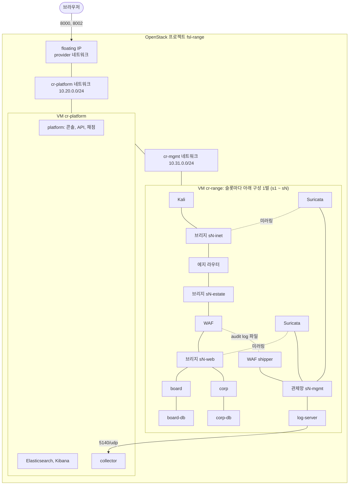

# fsl-project-mvp

사이버 공격·방어 훈련 플랫폼입니다. 레드팀이 웹사이트 두 곳을 공격하고, 블루팀이
WAF(ModSecurity)와 IDS(Suricata)로 방어합니다.

- `board.com`: Django 게시판, MySQL
- `corp.com`: WordPress 회사 사이트, MySQL

## 점수

주 점수는 레드팀의 공격 성공입니다. 성공 여부는 대상 시스템의 데이터로 판정합니다.

- 게시판: 레드팀이 탈취한 계정 해시를 증거물로 제출합니다
  (`POST /api/sessions/<id>/loot/`). 세션 시작 시점의 계정 해시와 같으면 성공입니다.
- corp: MySQL 바이너리 로그에 관리자 계정 추가, 회원 가입 설정 변경, 글 생성·덮어쓰기가
  남으면 성공입니다.
- 블루팀이 탐지하지 못한 성공은 2배로 계산합니다.

탐지 결과는 주 점수와 따로 표시합니다.

- 정탐: 탐지한 공격
- 미탐: 놓친 공격
- 오탐: 경보가 나거나 차단된 정상 요청
- 정상 통과: 경보 없이 통과한 정상 요청
- 케이스 하나는 경보 건수와 관계없이 1건입니다. sqlmap 케이스 하나가 요청 약 2,000건을
  보내도 1건입니다.
- 경보가 공격 수법을 짚지 못하면 탐지로 인정하지 않고 `corroborated: false`로 표시합니다.

## 구성



| 연결 | 경로 |
|---|---|
| 브라우저 → 콘솔 | floating IP의 8000, 8002 |
| 플랫폼 → 훈련 환경 호스트 | `cr-mgmt`로 ssh, `docker exec` |
| 센서·WAF shipper → log-server | 슬롯 관제망 `sN-mgmt`로 syslog 514/tcp |
| log-server → collector | 훈련 환경 호스트 NAT, `cr-mgmt`로 syslog 5140/udp(센서 경보, WAF audit log) |

- `bin/cloud up`이 Heat 스택으로 VM `cr-platform`을 만들고, 플랫폼이 OpenStack API로 VM
  `cr-range`를 만듭니다.
- 슬롯은 `cr-range` 안의 compose 프로젝트 `sN`입니다. 브리지와 DB 연결은 그 안의 Docker
  네트워크입니다.
- board와 corp는 WAF와만 이어진 `sN-web`에 있습니다. Kali의 공격은 모두 WAF를
  지나갑니다.
- 센서는 감시하는 브리지(`sN-inet`, `sN-web`)에 주소 없는 인터페이스로 붙고, `tc mirred`로
  브리지의 다른 포트 트래픽을 모두 받습니다(SPAN). 관제망 `sN-mgmt`에도 붙습니다.
- 슬롯의 log-server가 센서 경보와 WAF audit log를 관제망으로 받아 collector에 넘깁니다.
- 세션 하나가 슬롯 하나를 씁니다.

자세한 구성은 [ARCHITECTURE.md](docs/ARCHITECTURE.md)에 있습니다.

## 요구 사항

컨트롤러 노드:

- `git`, `ssh`, `ssh-keygen`
- Python 3.10 이상
- [uv](https://docs.astral.sh/uv/getting-started/installation/)
- github.com, ghcr.io 접속

클라우드:

- x86_64 호스트, Kolla-Ansible 2025.1 이상
- compute node는 KVM 권장
- Heat 필요
- [외부 네트워크](docs/OPENSTACK.md#25-external-network-and-floating-ips-admin-once): floating IP 풀, [인터넷 연결](docs/OPENSTACK.md#26-internet-egress)
- 아래 조건의 [flavor](docs/OPENSTACK.md#33-flavors-admin-once-init-chooses) 2개

| VM | flavor 키 | vCPU | RAM | 디스크 |
|---|---|---|---|---|
| 플랫폼 VM | `compute.flavors.platform` | 2 이상 | 8 GB 이상 | 40 GB 이상 |
| 훈련 환경 호스트 | `compute.flavors.range` | 6 이상 | 16 GB 이상 | 40 GB 이상 |

- 예: `m1.large`(2 vCPU, 8 GB, 60 GB), `dba.range`(6 vCPU, 16 GB, 60 GB)
- Nova 기본 quota로 충분
- 슬롯 하나에 RAM 약 1.2 GB

VM 1대에 클라우드 전체를 올려 시험하려면 [VM 1대로 시험하기](docs/OPENSTACK.md#9-try-it-in-one-vm-virtualbox-or-vmware)를 보세요.

## 설치

컨트롤러 노드에서 `kolla-ansible post-deploy`를 실행한 계정으로 실행합니다.

```bash
git clone https://github.com/Nekonic/fsl-project-mvp.git && cd fsl-project-mvp
uv run bin/cloud init
uv run bin/cloud up
```

`up`이 끝나면 `the range is ready; the platform is at http://ADDRESS:8000/`를
출력합니다. 첫 `up`은 훈련 환경 호스트 부팅, Docker 설치, 이미지 pull 때문에 20분
넘게 걸립니다.

### init

관리자 인증 정보는 `/etc/kolla/clouds.yaml`의 `kolla-admin` 항목에서 읽습니다. 다시
실행하면 빠진 것만 만듭니다.

| 항목 | 동작 |
|---|---|
| 외부 네트워크 | `router:external` 네트워크를 찾음 |
| 프로젝트, 사용자 | `fsl-range` 프로젝트와 member 사용자 생성. 비밀번호는 무작위 |
| 인증 정보 | `~/.config/openstack/clouds.yaml`의 `fsl-range` 항목(0600)에 씀 |
| flavor | 조건에 맞는 것 중 가장 작은 것을 고름. private flavor는 프로젝트에 공유 |
| 베이스 이미지 | `ubuntu-24.04`가 없으면 noble amd64 클라우드 이미지를 받아 `SHA256SUMS`로 확인하고 public으로 올림 |
| quota | 인스턴스 2개와 두 flavor가 들어가는지 확인 |
| ssh 키 | `~/.ssh/fsl_claude`가 없으면 생성 |
| `cloud.yaml` | `deploy/openstack/cloud.yaml`에 찾은 값을 씀 |

| `init` 출력 | 조치 |
|---|---|
| `no admin credentials` | `source /etc/kolla/admin-openrc.sh` 후 다시 실행 |
| `are not an admin's` | 새 셸에서 실행 |
| `no external network` | [외부 네트워크](docs/OPENSTACK.md#25-external-network-and-floating-ips-admin-once) 생성 후 다시 실행 |
| `more than one external network` | 출력된 이름 하나를 `cloud.yaml`의 `network.external`에 적고 다시 실행 |
| `no flavor fits` | 출력된 `openstack flavor create` 명령 실행 후 다시 실행 |
| `not active` | 출력된 `openstack image delete` 명령 실행 후 다시 실행 |
| `cannot hold the platform and the range host` | 출력된 값만큼 `openstack quota set` 후 다시 실행 |
| `no working entry fsl-range` | `uv run bin/cloud init --reset-password` 실행 후 `uv run bin/cloud up --replace` |

### up

- `cloud.yaml`의 `cloud`가 가리키는 `clouds.yaml` 항목으로 인증합니다.
- `keys.key_name` Nova 키페어가 없으면 `keys.key_file`의 공개키로 등록합니다.
- 실패하면 원인을 출력하고 멈춥니다. 원인을 고친 뒤 같은 명령을 다시 실행하면 멈춘
  곳부터 이어 갑니다.

## 동작 확인

1. 브라우저로 `http://ADDRESS:8000/`에 접속합니다.
2. **로그 분석 기초**의 **레슨 1**에서 **시작**을 누릅니다.
3. 과정 안내에서 **시작**을 누르면 구성도와 레슨 노트의 첫 단계가 나옵니다.

슬롯 상태는 API로 확인합니다. 빈 슬롯이 있으면 `"ready": true`입니다.

```bash
curl -s http://ADDRESS:8000/api/range/ready/
```

닫은 세션의 슬롯은 초기화에 약 1분 걸립니다. 그동안 그 슬롯은 `RESETTING`입니다.

## 문제 해결

| 증상 | 확인 | 조치 |
|---|---|---|
| 슬롯이 `SETUP_FAILED` | 훈련 환경 호스트의 `/var/log/cr-setup.log` | 원인 수정 후 `uv run bin/cloud up` |
| 플랫폼이 응답하지 않음 | `ssh -i ~/.ssh/fsl_claude ubuntu@ADDRESS`에서 `systemctl status cr-platform`, `sudo docker logs cr-platform` | 원인 수정 후 `uv run bin/cloud up` |
| `docker ps`에 `cr-platform`이 없음 | `sudo cloud-init status --long`. 대개 VM이 인터넷에 못 나감([인터넷 연결](docs/OPENSTACK.md#26-internet-egress)) | 원인 수정 후 `uv run bin/cloud up --replace` |
| Heat 스택 생성 실패 | `uvx --from python-openstackclient --with python-heatclient openstack --os-cloud fsl-range stack failures list cr-platform` | 원인 수정 후 `uv run bin/cloud up` |
| 슬롯이 `RESET_FAILED` | `GET /api/range/ready/`의 이유 | `curl -X POST http://ADDRESS:8000/api/range/configure/` |

## 운영

```bash
uv run bin/cloud up              # 없는 것만 만들고 슬롯을 띄움
uv run bin/cloud up --replace    # 플랫폼 VM 교체. DB는 백업 후 복원
uv run bin/cloud down            # DB 백업 후 훈련 환경과 플랫폼 VM 삭제
uv run bin/platform-rebuild      # 플랫폼 VM만 교체
```

- `down`과 `--replace`는 먼저 DB를 `backups/db-<UTC 시각>.sqlite3`로 받습니다. 백업이
  실패하면 아무것도 지우지 않습니다.
- 플랫폼 VM을 교체해도 훈련 환경 ssh 키(`keys.range`)를 옮겨 주므로 훈련 환경은 그대로
  씁니다.
- push하지 않은 이미지를 올릴 때는 `--sideload NAME=TARBALL`을 씁니다. 절차는
  [재구축과 삭제](docs/OPENSTACK.md#53-rebuild-and-delete--lossless)에 있습니다.
- 슬롯 수는 `cloud.yaml`의 `compute.slots`입니다. 테스트 클라우드는 8개입니다.
  바꾼 뒤 `uv run bin/cloud up`을 실행합니다.

`cloud.yaml` 항목:

| 섹션 | 항목 |
|---|---|
| `cloud` | `clouds.yaml` 항목 이름 |
| `network` | 외부 네트워크, 고정 floating IP, DNS, MTU, platform·estate·mgmt CIDR |
| `compute` | 베이스 이미지, availability zone, 슬롯 수, flavor 2개 |
| `keys` | Nova 키페어 이름과 개인키 경로, 플랫폼의 훈련 환경 ssh 키 |
| `platform` | 스택 이름, 저장소, ref |
| `backups` | `backups/`에 남길 백업 수 |

훈련 환경 API(`/api/range/fabric/`, `/slot/`, `/configure/`, `/slot/rebuild/`)는
[훈련 환경](docs/OPENSTACK.md#6-the-range-substrate-openstack)에 있습니다.

## 포트

| 포트 | 서비스 | 접속 |
|---|---|---|
| 8000 | 콘솔, `/api/`, 구성도(`/map/`), Kibana(`/kibana/`), 터미널(`/vm-terminal/`) | 브라우저 |
| 8002 | 대상 사이트(`/site/<세션 id>/<host>/<path>`) | 콘솔 안의 iframe |
| 5140/udp | collector | 슬롯 log-server(훈련 환경 호스트에서 NAT) |
| 5601 | Kibana 직접 접속, VM loopback 전용 | ssh 터널, `elastic`으로 로그인 |
| 9200 | Elasticsearch, VM loopback 전용 | acceptance 테스트, `elastic`으로 인증 |

- 8002는 콘솔과 다른 origin이라 대상 사이트의 스크립트가 콘솔을 읽지 못합니다. 로그인은 8000과 같이 씁니다.
- `board.com`과 `corp.com`은 훈련 환경 안에서만 응답합니다. 8002는 요청을 그 세션의
  Kali 컨테이너에서 고객 주소로 내보냅니다.

## 세션

콘솔에서 레슨, 시나리오, 워게임 중 하나로 세션을 엽니다.

| 종류 | 시작 | 내용 |
|---|---|---|
| 레슨 | `{"lesson": "f1"}`~`f6` | 과정 1 "로그 분석 기초"(F1~F3), 과정 2 "공격 탐지 실습"(F4~F6) |
| 시나리오 | `{"scenario": "1.1"}` | 고객 트래픽 속 공격 대응. 시간 제한과 최종 점검 |
| 워게임 | `{"scenario": "board"}` | 사람 대 사람. 공격자는 레드팀 콘솔, 방어자는 블루팀 콘솔 |

레슨:

- F1: 구성도에서 주소, 경로, DMZ 대역, 로그 서버 읽기
- F2: 개발자 도구로 HTTP 요청의 메서드, 파라미터, 경로, 상태 코드 읽기
- F3: KQL로 Kibana에서 같은 요청을 찾고 X-Forwarded-For 읽기
- F4: XSS 요청 보내기, IDS 룰 작성, 대소문자 우회를 `nocase`로 막기
- F5: `sort` 파라미터에 sqlmap 실행, WAF 기록과 탐지 룰 읽기
- F6: 넓은 WAF 예외를 이용한 계정 덤프, 2배 감점 확인, 예외 삭제 후 재실행

시나리오:

- `1.1`~`1.3`: 경보마다 고객 요청인지 공격인지, 데이터가 나갔는지 판단
- `2.1`~`2.3`: WAF 오탐으로 차단된 고객이 다시 서비스를 받게 함
- `3.1`~`3.4`: IDS 룰로 sort 공격, tamper 변형, 댓글 XSS 탐지
- `4.1`: 처음 보는 sqlmap 변형과 새 오탐을 도움 없이 처리

레슨 단계와 시나리오 판정 방식은 [ARCHITECTURE.md](docs/ARCHITECTURE.md)에 있습니다.

## 워게임 추가

1. `wargames/<이름>/`에 `compose.yaml`, `scenario.yaml`, `objectives.yaml`
2. `redteam/cases/<이름>.yaml`에 공격 케이스와 정상 케이스
3. `platform/range/declaration.yaml`의 `cr-range` `wargames:`에 워게임 이름, `cr-waf`
   `names:`에 사이트 이름
4. `deploy/range-host/slot.yaml`의 `x-wargames.fronts`, `x-wargames.limits`, `waf`와
   `kali`의 `extra_hosts`
5. `deploy/waf/`에 사이트의 `server` 블록
6. `platform/tests/test_containment.py`의 `LEARNER_FACING`, `CAPABILITIES`

## 검증

```bash
bin/verify --changed   # 바뀐 파일이 닿는 단위 테스트와 ratchet
bin/verify --fast      # 단위·API 테스트 전체
bin/verify             # acceptance까지. 플랫폼 VM에서 실행
```

- 플랫폼 VM에서는 `CR_PLATFORM_URL=http://<address>:8000 bin/verify`로 실행합니다.
- 전체 실행은 약 9분 걸리고 skip이 1개 나옵니다(`test_lesson.py`의 F1 구성도 테스트,
  F4로 시작하는 과정 2).
- sqlmap 변형 6개를 모두 쏘려면 `CR_SQLMAP_VARIANTS=1 bin/verify`로 실행합니다.
- acceptance 분할 방식은 [test/README.md](test/README.md)에 있습니다.

## 백업과 복원

백업 대상은 플랫폼 VM `cr_platformdata` 볼륨의 `/data/db.sqlite3`입니다. 세션, 케이스,
탐지 기록, 목표, 룰셋이 들어 있습니다. Elasticsearch 데이터는 백업하지 않습니다.

```bash
CR_PLATFORM_EXEC="ssh -i ~/.ssh/fsl_claude ubuntu@ADDRESS sudo docker exec -i cr-platform python -" \
  bin/backup
```

`backups/db-<UTC 시각>.sqlite3`에 저장하고 `PRAGMA integrity_check`로 검사합니다.

복원:

```bash
scp -i ~/.ssh/fsl_claude backups/db-20260925T020000Z.sqlite3 ubuntu@ADDRESS:/opt/cr/backups/
ssh -i ~/.ssh/fsl_claude ubuntu@ADDRESS
cd /opt/cr
sudo docker compose stop platform
sudo docker compose run --rm --no-deps --user cr --entrypoint sh -v ./backups:/backups:ro platform \
  -c 'rm -f /data/db.sqlite3-journal && cp /backups/db-20260925T020000Z.sqlite3 /data/db.sqlite3'
sudo docker compose start platform
```

`-journal` 파일은 꼭 지웁니다. 남아 있으면 SQLite가 복원한 파일 위에 옛 내용을
재생합니다.

## 보안

실습 전용 환경입니다. 표면마다 막는 장치는 다음과 같습니다.

| 표면 | 보호 |
|---|---|
| 콘솔(8000)과 `/api/` | Django 로그인. 세션 쿠키는 HttpOnly, SameSite=Lax. 쓰기 요청은 CSRF 토큰과 같은 출처 필요. CORS 헤더 없음 |
| `/vm-terminal/`, `/kibana/`, 8002(`/site/...`) | nginx `auth_request`로 같은 로그인 세션 확인. 없으면 로그인 페이지로 |
| 회원가입 계정 | 비활성 상태로 만들어짐. 관리자가 계정 관리에서 승인해야 로그인 가능. 거절하면 삭제 |
| 로그인 시도 | IP당 분당 5회(버스트 5), 넘으면 429. 같은 아이디로 10번 틀리면 그 아이디는 15분 잠김 |
| 회원가입 요청 | IP당 분당 1회(버스트 3), 같은 주소에서 시간당 5개까지. 승인 대기 계정이 50개면 가입을 받지 않음 |
| `/api/` 요청량 | 로그인 세션당 초당 20회(버스트 40), IP당 초당 100회(버스트 200). 넘으면 429 |
| 터미널, 8002 사이트 연결 | 로그인 세션당 동시 연결 10개 |
| 학습자 세션 | 계정 하나에 열린 세션 하나. 관리자 계정은 제한 없음 |
| 제한 제외 | 플랫폼 VM 자신이 보낸 요청(loopback, Docker 게이트웨이, `DJANGO_ALLOWED_HOSTS`의 IP)은 nginx 제한을 받지 않음. VM에서 도는 `bin/verify` 수락 테스트가 여기에 해당 |
| 8002의 대상 사이트 | 콘솔 쿠키를 지운 뒤 대상에 넘기고, 대상의 `Set-Cookie`는 브라우저로 보내지 않음. 사이트의 스크립트는 세션 쿠키도 CSRF 토큰도 읽지 못함 |
| Elasticsearch, Kibana | 9200, 5601은 플랫폼 VM loopback에만 열림. 인증은 켜지 않음. Kibana의 관리·개발 도구 API는 nginx가 거부 |
| 프로젝트 비밀번호 | `/opt/cr/openstack-password`(0600)를 compose secret으로 읽기 전용 마운트. 컨테이너 환경 변수에는 없음 |
| 플랫폼 VM 인바운드 | ssh, 8000, 8002는 `cloud.yaml`의 `network.allowed`에서만. 기본값 `[0.0.0.0/0]` |
| 슬롯의 학습자용 컨테이너 | Docker 기본 런타임. capability 최소화, `no-new-privileges`, userns-remap |
| Docker 소켓 | 플랫폼 VM의 어떤 서비스에도 마운트하지 않음 |

다른 계정은 로그인 화면의 회원가입으로 만들고, 관리자가 콘솔 상단의 계정 관리에서 승인합니다.

초기 계정은 `admin` / `123456`입니다. 비밀번호를 바꾸라고 요구하지 않습니다. 바꾸려면:

```bash
sudo docker exec -it -u cr cr-platform python manage.py changepassword admin
```

위협 모델은 [THREAT-MODEL.md](docs/THREAT-MODEL.md)에 있습니다.

## 문서

- [CLAUDE.md](CLAUDE.md): 저장소 목적, 점수 계산, 작업 규칙
- [ARCHITECTURE.md](docs/ARCHITECTURE.md): 구성, 레슨·시나리오 동작, API
- [OPENSTACK.md](docs/OPENSTACK.md): 클라우드 준비, 플랫폼 VM, 훈련 환경 운영
- [THREAT-MODEL.md](docs/THREAT-MODEL.md): 위협 모델
- [TROUBLESHOOTING.md](docs/TROUBLESHOOTING.md): 겪은 문제와 해결(영어)
- [STATE.md](docs/STATE.md): 작업 현황
- [설계 문서](docs/superpowers/specs/2026-10-08-composable-isolated-learning-mvp-design.md): 2026-10-08 승인 방향
