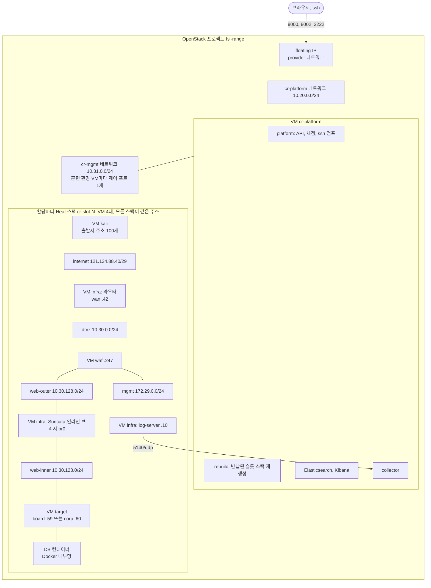

# fsl-project-mvp

사이버 공격·방어 훈련 플랫폼입니다. 공격 쪽은 웹사이트를 뚫고, 방어 쪽은 WAF(ModSecurity, OWASP CRS)와
IDS(Suricata)로 막습니다. 플랫폼은 대상 시스템이 무엇을 잃었는지와 방어가 무엇을 맞히고 틀렸는지를 따로 채점합니다.

워게임은 두 개입니다.

- `board`: `board.com`, Django 게시판과 MySQL
- `corp`: `corp.com`, WordPress 회사 사이트와 MySQL

학습은 **레슨**에서 시작해 **실전 라운드**로 갑니다. 레슨도 내부적으로는 라운드 하나(종류 `lesson`)입니다.

실전 라운드는 슬롯 스택 하나에 공격석과 방어석 두 자리를 둡니다. 매치업은 셋입니다.

| 매치업 | 공격석 | 방어석 |
|---|---|---|
| `pvp` | 사람 | 사람 |
| `def_vs_bot` | AI 공격 봇 | 사람 |
| `atk_vs_bot` | 사람 | AI 수비 봇 |

사람 콘솔과 봇은 같은 API를 씁니다. 공격 API(`/api/rounds/<id>/attack/`)와 방어 API(`/api/rounds/<id>/defence/`)가
하나씩 있고, 봇은 사람과 같은 엔드포인트를 같은 권한으로 호출합니다. 터미널도 마찬가지입니다. 봇은 특정 모델에
묶이지 않습니다. 지금은 Claude Code가 `bots/cli.py`로 자리를 맡고, 다른 모델은 `bots/provider.py` 인터페이스로
붙입니다([bots/README.md](bots/README.md)).

## 학습 단계

교육 담당자가 문제를 만들고, 학습자는 레슨으로 도구와 판단 기준을 익힌 다음 실전 라운드에 들어갑니다.

### 1. 레슨

레슨 문제 하나는 단계 목록입니다. 단계마다 다음을 정합니다.

- 본문: 학습자에게 보여 줄 설명과 과제
- 여는 패널(`opens`): `kibana`, `terminal_kali`, `terminal_waf`, `site`, `map`, `ids_rules`, `waf`, `alerts`, `none` 중 하나
- 판정(`check`): 서버가 판정하는 종류 하나와 그 파라미터
- 힌트: 학습자가 하나씩 열어 봄

판정 종류는 아래와 같습니다. 판정은 라운드에 실제로 쌓인 기록(룰 테스트, 적용 이력, 탐지, 요청, 명령, 목표)을 읽습니다.

| 종류 | 통과 조건 |
|---|---|
| `answer` | 입력한 답이 허용 답안과 일치 |
| `choice` | 고른 보기가 정답 |
| `loot` | 이 라운드에서 제출한 loot로 대상의 목표가 넘어감 |
| `rule_test` | 학습자의 최근 룰 테스트에서 지정 케이스가 정탐이고 수법까지 짚었으며(`corroborated`), 정상 케이스는 모두 정상 통과 |
| `rule_applied` | 단계가 열린 뒤 룰을 적용함. 필요하면 테스트한 룰 그대로 적용했는지까지 봄 |
| `alert_seen` | 조건에 맞는 알림이 나옴 |
| `sent` | 조건에 맞는 요청을 보냄 |
| `kali` | Kali 명령 기록에 지정 문자열이 있음. 명령 기록은 학습자가 고칠 수 있어 학습 보조로만 씀 |
| `waf_changed` | WAF 설정이 지정한 방향으로 바뀜(paranoia·임계값 올림/내림, 예외 추가·삭제·좁힘, 탐지 전용 켬/끔) |

- 앞 단계를 통과해야 다음 단계를 판정합니다. 순서를 건너뛰면 `step_locked`입니다.
- 진도는 학습자와 문제별로 남습니다. 할당을 닫고 다시 열어도 마지막으로 통과한 단계 다음부터 이어 갑니다.
- 문제의 공격·방어 범위(`side`)가 `both`이면 학습자 한 명이 두 자리를 다 맡습니다.
- 마지막 단계를 통과하면 라운드가 `steps_done`으로 끝나고 할당을 닫습니다.

### 2. 실전 라운드

라운드 문제는 매치업, 시작 방어 설정(posture), 룰 테스트에 쓸 케이스, 노리는 목표, HP 규칙, 고객 트래픽, 시간 제한을
정합니다.

- 공격석은 Kali 터미널, 대상 사이트 패널, API로 공격하고 탈취한 값을 loot로 제출합니다.
- 방어석은 Kibana, WAF 읽기 전용 터미널, 구성도, 알림 목록으로 보고, IDS 룰과 WAF 설정을 고칩니다. 고친 룰은
  적용하기 전에 녹화된 요청으로 테스트할 수 있습니다(룰 테스트).
- 플랫폼이 라운드 내내 정상 케이스와 고객 트래픽을 보냅니다. 공격석이 아무것도 하지 않아도 오탐과 정상 통과가 쌓입니다.
- 라운드는 시간 제한, 목표 전부 탈취, 공격 출발지 전부 소진, 운영자 종료, 한쪽 기권으로 끝납니다. 출발지 소진으로
  끝나는 것은 정상 케이스가 한 바퀴 이상 돈 뒤입니다.

### 문제 내용

지금 저장소에는 레슨과 라운드 문제가 하나도 없습니다. 기존 레슨 F1~F6, 과정 c1·c2, 시나리오 1.1~4.1은
삭제했습니다. 문제는 스태프 페이지에서 새로 작성할 예정이고, 문제 본문은 DB에만 둡니다. 저장소 사이 이동은
스태프 API의 내보내기·가져오기(`/api/staff/problems/<id>/export/`, `/api/staff/problems/import/`)로만 합니다.
스태프 페이지(`/staff/problems/`)가 이 API를 그대로 씁니다. 스태프 페이지는 아직 훈련 환경에서 써 보지 않았습니다.

| 스태프 API | 용도 |
|---|---|
| `GET\|POST /api/staff/problems/`, `GET\|PUT\|DELETE /api/staff/problems/<id>/` | 문제, 단계, 라운드 설정, 시작 posture를 한 문서로 저장. `PUT`은 `base_revision`이 최신이 아니면 `409 stale_revision` |
| `POST /api/staff/problems/validate/` | 저장하지 않고 검증. 오류는 필드 경로(`steps[3].check.params.case`)로 옴 |
| `GET\|POST /api/staff/postures/`, `GET\|PUT /api/staff/postures/<id>/` | 시작 방어 설정(Suricata 룰, CRS 튜닝) |
| `POST /api/staff/steps/<문제>/<순서>/try/` | 같은 워게임의 끝난 라운드 기록으로 단계 판정을 미리 돌려 봄 |
| `POST /api/staff/wargames/<id>/probes/record/` | 룰 테스트용 요청 녹화 |

## 점수

점수는 두 가지이고 서로 합치지 않습니다.

**목표**(주 점수): 공격이 성공했는지는 대상 시스템이 직접 저장한 데이터로 판정합니다. 플랫폼이 공격 성공을 추정하지
않습니다.

- board: 공격석이 탈취한 계정 해시를 loot로 제출합니다(`POST /api/rounds/<id>/attack/loot/`). 라운드 시작
  시점에 읽어 둔 해시와 정확히 같으면 그 목표를 잃은 것입니다. 응답은 비밀값을 드러내지 않습니다.
- corp: MySQL 바이너리 로그에 관리자 계정 추가, 회원 가입 설정 변경, 글 생성·덮어쓰기가 남으면 잃은 것입니다.
- 방어 쪽이 탐지하지 못한 채 잃은 목표는 2배로 셉니다. 목표 등급의 난이도가 가중치입니다.

**탐지 결과**: 케이스마다 정탐, 미탐, 오탐, 정상 통과 중 하나입니다.

- 케이스 하나는 알림이 몇 건 나오든 1건입니다. `board-sqli-orderby-sqlmap`은 WAF로 요청을 약 2,000건 보내고
  알림도 많이 나오지만 1건입니다. 알림 단위로 세면 방어가 아니라 알림 임계값을 재게 됩니다.
- 알림이 공격 수법을 짚지 못하면(케이스의 `expect` 문자열이 시그니처에 없으면) `corroborated: false`로 표시하고
  탐지로 인정하지 않습니다.
- 탐지 결과에 들어가는 것은 선언된 케이스(`redteam/cases/`)와 플랫폼이 보내는 정상 케이스뿐입니다. 공격석이
  터미널이나 API로 자유롭게 보낸 요청은 출발지별로 따로 보여 주고(`free_actions`) 정탐·오탐으로 세지 않습니다.
- 모든 요청을 막는 방어는 탐지 결과에서 만점을 받지만 정상 케이스에서 오탐이 쌓이고, 목표는 지켜도 그 오탐이 옆에
  그대로 남습니다.

점수는 `GET /api/rounds/<id>/score/`입니다. 자리는 라운드가 끝난 뒤에, 운영자와 스태프는 언제든 읽습니다.

## HP

공격 출발지마다 HP가 있어 의미 없는 스캔을 막습니다. 수치는 문제의 라운드 설정(`hp`)에서 정합니다.

- 출발지마다 `budget`에서 시작하고, 요청 하나에 `per_request`씩 줄어듭니다.
- WAF가 거부한 요청(400, 403)은 `refused_x`배, 1초에 `burst_per_s`건을 넘는 요청은 `burst_x`배입니다. 두 배수는
  곱합니다.
- 0 이하가 되면 그 출발지는 소진됩니다. infra 라우터가 그 주소를 떨어뜨리고(이미 맺은 연결 포함), 돌고 있던 도구를
  멈추고, 다음 출발지로 바꿉니다. 출발지가 다 떨어지면 공격 API 쓰기는 `409 origins_spent`입니다.
- 공격 API의 모든 응답(오류 포함)에 `hp` 블록과 `X-Origin`, `X-Origin-HP` 헤더가 붙습니다.
- API로 보낸 요청은 그 자리에서 차감합니다. 터미널, 도구, 봇 셸의 요청은 그 라운드에 다음 API 요청이 들어올 때
  WAF 접근 로그를 읽어 차감합니다.
  같은 요청을 두 번 차감하지 않습니다.
- 고객 주소는 소진 대상이 아닙니다.

## 구성



| 연결 | 경로 |
|---|---|
| 브라우저 → 콘솔 | floating IP의 8000, 8002 |
| 학습자 ssh → Kali | floating IP의 2222(플랫폼 컨테이너의 sshd) → `cr-mgmt`의 Kali 22번. 공격석의 점프 권한 |
| 학습자 ssh → WAF | 같은 2222 → `cr-mgmt`의 WAF 22번, `analyst` 계정. 방어석의 점프 권한 |
| 플랫폼 → 훈련 환경 VM | `cr-mgmt`의 제어 포트로 ssh. 관리 계정 `ubuntu`, 비밀번호 없는 sudo. 대상 컨테이너는 target VM에서 `docker exec` |
| WAF → log-server | 스택의 `mgmt`로 syslog 514/tcp |
| log-server → collector | infra의 제어 포트에서 `cr-mgmt`로 syslog 5140/udp(센서 알림, WAF audit log, 모든 요청의 nginx 접근 로그) |

- `bin/cloud up`이 Heat 스택 `cr-platform`으로 플랫폼 VM을 만들고, 플랫폼이 Heat API로 슬롯 스택
  `cr-slot-<n>`을 만듭니다.
- 슬롯 스택은 VM 4대(kali, waf, infra, target)와 LAN 5개(internet, dmz, web-outer, web-inner, mgmt)입니다. LAN은
  스택마다 따로 만든 Neutron 네트워크이고 Neutron 라우터가 없습니다. 스택끼리 네트워크가 다르므로 모든 스택이 같은
  주소를 씁니다.
- 스택은 워게임별 풀에 미리 띄워 둡니다(`compute.pool`, 기본 board 3개, corp 1개). 할당을 열면(`POST /api/allocations/`)
  준비된 스택 하나를 받고, 할당을 닫거나 하트비트 없이 만료되면 그 스택을 지우고 새로 만듭니다. 할당 하나에서 라운드를
  여러 번 열 수 있지만, 목표를 하나라도 잃은 할당에서는 채점 라운드를 새로 시작하지 않습니다(board의 비밀값을 스택
  재생성 없이 바꿀 수 있는지 아직 모름).
- 훈련 환경 VM은 `deploy/roles/<역할>/install.sh`로 미리 구운 Glance 이미지로 부팅합니다. 기본 이름은
  `cr-<역할>-bake1`이고, 이 클라우드의 WAF는 `cr-waf-bake2`입니다. 부팅할 때 인터넷에 나가지 않습니다.
- Kali는 인터넷 역할입니다. 출발지 30개국의 /24 대역에 걸친 주소 100개를 갖고, 기본 출발지 5.188.10.10을 첫 주소로
  둡니다. Kali의 `internet` 포트는 address pair `0.0.0.0/0`으로 이 주소를 모두 쓰고, MAC은 Neutron이 준 것만
  통과합니다.
- 라우터는 infra VM의 nftables입니다. `wan`은 공인 IP 121.134.88.42/29 하나이고, 80/tcp를 WAF의 DMZ 주소로
  포트포워딩합니다. Kali에서 `board.com`, `corp.com`은 이 공인 IP로 풀립니다.
- board와 corp는 target VM의 Docker 컨테이너이고 WAF 뒤 `web-inner`에 있습니다. DB는 target VM 안의 Docker
  내부망에만 있습니다. Kali의 공격은 모두 WAF를 지나갑니다.
- 센서는 스택마다 하나이고 infra VM에 있습니다. `web-outer`와 `web-inner`를 잇는 리눅스 브리지 `br0`에 인라인으로
  붙어 af-packet으로 WAF와 대상 사이의 트래픽을 봅니다. WAF가 막은 요청은 센서에 닿지 않고 WAF 로그에 남습니다.
- 센서가 보는 요청의 출발지는 WAF입니다. 수집할 때 같은 요청의 X-Forwarded-For 주소를 알림의 출발지로 씁니다.
- 격리는 Neutron 보안 그룹과 port security가 맡습니다. Kali나 WAF의 root 셸로는 바꿀 수 없습니다.
- 플랫폼 VM의 `rebuild` 서비스(같은 이미지의 `manage.py rebuild_slots`)는 반납된 슬롯의 스택을 다시 만드는 일만
  합니다. 주기적으로 도는 라운드 작업은 없습니다.
- 알림 수집, HP 차감, corp 변경 관찰, 명령 기록 읽기, WAF 설정 변경 감시, 정상 케이스, 라운드 종료 조건은 그 라운드에
  API 요청(이벤트, 상태, 점수, 공격·방어 동작)이 들어올 때 처리합니다. 라운드마다 한 번에 한 요청만 읽고, 읽은 뒤
  `CR_READ_EVERY_SECONDS`(기본 5초) 동안은 다시 읽지 않습니다.
- 제한 시간이 지난 라운드는 다음 요청이 끝내고, 종료 시각은 제한 시간으로 기록합니다. 채점은 종료 시각까지 일어난
  것만 셉니다.
- 만료된 할당은 다음 할당 요청이나 그 할당에 들어온 요청이 닫습니다.

자세한 구성은 [ARCHITECTURE.md](docs/ARCHITECTURE.md)에 있습니다.

## 요구 사항

컨트롤러 노드:

- `git`, `ssh`, `ssh-keygen`
- Python 3.10 이상
- [uv](https://docs.astral.sh/uv/getting-started/installation/)
- github.com, ghcr.io 접속

클라우드:

- x86_64 호스트, Kolla-Ansible 2025.1 이상
- compute node는 KVM 권장
- Heat 필요
- [외부 네트워크](docs/OPENSTACK.md#25-external-network-and-floating-ips-admin-once): floating IP 풀, [인터넷 연결](docs/OPENSTACK.md#26-internet-egress)
- 아래 [flavor](docs/OPENSTACK.md#33-flavors-admin-once-init-chooses). `init`은 flavor를 만들지 않습니다.
- Glance에 역할 이미지 4개(기본 이름 `cr-kali-bake1`, `cr-waf-bake1`, `cr-infra-bake1`, `cr-target-bake1`. 이름은 `compute.images`. 이 클라우드의 WAF는 `cr-waf-bake2`).
  `deploy/roles/<역할>/install.sh`를 인터넷에 나갈 수 있는 빌더 VM에서 실행하고 스냅샷을 뜹니다.
  스냅샷의 `min_disk`는 빌더의 디스크 크기가 되므로, 빌더 flavor의 디스크가 훈련 환경 VM의 flavor보다 크면 스택이 뜨지 않습니다.
  절차는 [이미지](docs/OPENSTACK.md#36-images)에 있습니다. target 이미지는 구울 때 받은 board, corp
  이미지의 태그(그 커밋)를 `compute.target_tag`에 적습니다. 기본값은 `cr-target-bake1`을 구운 커밋입니다.

| VM | flavor 키 | 조건 |
|---|---|---|
| 플랫폼 VM | `compute.flavors.platform` | 2 vCPU, 8 GB RAM, 40 GB 디스크 이상 |
| 훈련 환경 VM(kali, waf, infra, target) | `compute.flavors.<역할>` | 디스크가 역할 이미지의 `min_disk` 이상(지금 이미지는 모두 30 GB). 지정하지 않으면 `dba.small`(디스크 30 GB) |

- 예: 플랫폼 `m1.large`(2 vCPU, 8 GB, 60 GB)
- quota: 인스턴스 1 + 4 × 스택 수, 그만큼의 vCPU와 RAM. 기본 풀(스택 4개)이면 인스턴스 17개. 보안 그룹은 스택 수와 상관없이 9개
- 스택 하나에 드는 RAM, `dba.small`로 target의 Docker와 MySQL이 충분한지는 아직 재지 않았습니다.

VM 1대에 클라우드 전체를 올려 시험하려면 [VM 1대로 시험하기](docs/OPENSTACK.md#9-try-it-in-one-vm-virtualbox-or-vmware)를 보세요.

## 설치

컨트롤러 노드에서 `kolla-ansible post-deploy`를 실행한 계정으로 실행합니다.

```bash
git clone https://github.com/Nekonic/fsl-project-mvp.git && cd fsl-project-mvp
uv run bin/cloud init
uv run bin/cloud up
```

`up`이 끝나면 `the range is ready; the platform is at http://ADDRESS:8000/`를
출력합니다. `up`은 플랫폼 스택, 공용 네트워크 `cr-mgmt`와 보안 그룹, 이전 훈련 환경이 남긴
자원 정리, 슬롯 스택 생성, 스택 부팅 대기, IDS 기본 룰 적재 순서로 진행합니다. 플랫폼 VM과
역할 이미지 빌드는 apt 패키지를 카카오 미러(`mirror.kakao.com`)에서 받습니다.

### init

관리자 인증 정보는 `/etc/kolla/clouds.yaml`의 `kolla-admin` 항목에서 읽습니다. 다시
실행하면 빠진 것만 만듭니다.

| 항목 | 동작 |
|---|---|
| 외부 네트워크 | `router:external` 네트워크를 찾음 |
| 프로젝트, 사용자 | `fsl-range` 프로젝트와 member 사용자 생성. 비밀번호는 무작위 |
| 인증 정보 | `~/.config/openstack/clouds.yaml`의 `fsl-range` 항목(0600)에 씀 |
| flavor | 플랫폼은 조건에 맞는 것 중 가장 작은 것을, 훈련 환경 VM은 역할마다 `compute.flavors.<역할>`(없으면 `dba.small`)을 고름. private flavor는 프로젝트에 공유 |
| 베이스 이미지 | `ubuntu-24.04`가 없으면 noble amd64 클라우드 이미지를 받아 `SHA256SUMS`로 확인하고 public으로 올림 |
| quota | 플랫폼 VM과 `compute.pool`의 스택(스택마다 VM 4대)이 들어가는지 확인 |
| ssh 키 | `~/.ssh/fsl_claude`가 없으면 생성 |
| `cloud.yaml` | `deploy/openstack/cloud.yaml`에 찾은 값을 씀 |

| `init` 출력 | 조치 |
|---|---|
| `no admin credentials` | `source /etc/kolla/admin-openrc.sh` 후 다시 실행 |
| `are not an admin's` | 새 셸에서 실행 |
| `no external network` | [외부 네트워크](docs/OPENSTACK.md#25-external-network-and-floating-ips-admin-once) 생성 후 다시 실행 |
| `more than one external network` | 출력된 이름 하나를 `cloud.yaml`의 `network.external`에 적고 다시 실행 |
| `no flavor fits` | 출력된 `openstack flavor create` 명령 실행 후 다시 실행 |
| `not active` | 출력된 `openstack image delete` 명령 실행 후 다시 실행 |
| `cannot hold the platform and the pool` | 출력된 값만큼 `openstack quota set` 후 다시 실행하거나 `compute.pool`의 스택 수를 줄임 |
| `no flavor ... for the slot role` | 있는 flavor 이름을 `compute.flavors.<역할>`에 적고 다시 실행 |
| `no working entry fsl-range` | `uv run bin/cloud init --reset-password` 실행 후 `uv run bin/cloud up --replace` |

### up

- `cloud.yaml`의 `cloud`가 가리키는 `clouds.yaml` 항목으로 인증합니다.
- `keys.key_name` Nova 키페어가 없으면 `keys.key_file`의 공개키로 등록합니다.
- 실패하면 원인을 출력하고 멈춥니다. 원인을 고친 뒤 같은 명령을 다시 실행하면 멈춘
  곳부터 이어 갑니다.

## 동작 확인

콘솔의 스태프 레인지 페이지(`/staff/range/`)가 이 상태를 보여 주지만 훈련 환경에서는 아직 확인하지 않았으므로, API로도 확인합니다. 스태프 계정으로 로그인한 쿠키로 풀 상태를 봅니다. 슬롯마다
할당과 재생성 상태(`refill.state`)가 나오고, `idle`이면서 할당이 없는 슬롯을 새 할당이 받습니다. 슬롯 스택의 서버
상태는 `GET /api/staff/range/pool/`에 있습니다.

```bash
curl -s -c cookies.txt http://ADDRESS:8000/api/auth/csrf/
curl -s -b cookies.txt http://ADDRESS:8000/api/staff/range/
```

라운드 하나를 처음부터 끝까지 돌리는 순서는 `test/plays.py`와 [test/README.md](test/README.md)에 있습니다. 할당 열기,
라운드 만들기(`POST /api/allocations/<id>/rounds/`), 시작, 케이스 발사, 종료, 점수 읽기 순서입니다.

## 문제 해결

| 증상 | 확인 | 조치 |
|---|---|---|
| 스택이 `SETUP_FAILED` | 그 VM의 `/var/lib/cr/failed`(부팅 유닛의 `systemctl status`. target은 이미지 태그가 `compute.target_tag`와 다르면 그 `image:` 줄)와 `/var/log/cloud-init-output.log` | 원인 수정 후 `uv run bin/cloud up` |
| 스택이 `NOT_STANDING`, `no active image ... in Glance` | `compute.images`의 이름과 Glance의 이미지 | 이미지를 굽거나 있는 이름을 `compute.images.<역할>`에 적고 `uv run bin/cloud up --replace` |
| 스택이 `CREATE_FAILED` | `GET /api/staff/range/pool/`의 `failures`(Heat의 `stack_status_reason`) | 원인 수정 후 `uv run bin/cloud up` |
| 플랫폼이 응답하지 않음 | `ssh -i ~/.ssh/fsl_claude ubuntu@ADDRESS`에서 `systemctl status cr-platform`, `sudo docker logs cr-platform` | 원인 수정 후 `uv run bin/cloud up` |
| `docker ps`에 `cr-platform`이 없음 | `sudo cloud-init status --long`. 대개 VM이 인터넷에 못 나감([인터넷 연결](docs/OPENSTACK.md#26-internet-egress)) | 원인 수정 후 `uv run bin/cloud up --replace` |
| Heat 스택 생성 실패 | `uvx --from python-openstackclient --with python-heatclient openstack --os-cloud fsl-range stack failures list cr-platform` | 원인 수정 후 `uv run bin/cloud up` |
| 슬롯의 `refill.state`가 `failed` | `GET /api/staff/range/`의 `refill.reason` | 원인 수정 후 `uv run bin/cloud up` |

## 운영

```bash
uv run bin/cloud up              # 없는 것만 만들고 풀의 스택을 띄움
uv run bin/cloud up --replace    # 플랫폼 VM 교체 후 풀까지 맞춤. DB는 백업 후 복원
uv run bin/cloud down            # DB 백업 후 슬롯 스택, cr-mgmt, 플랫폼 VM 삭제
uv run bin/platform-rebuild      # 플랫폼 VM만 교체. 훈련 환경은 맞추지 않음
```

- `down`과 `--replace`는 먼저 DB를 `backups/db-<UTC 시각>.sqlite3`로 받습니다. 백업이
  실패하면 아무것도 지우지 않습니다.
- 플랫폼 VM 교체는 보통 `uv run bin/cloud up --replace`로 합니다. 훈련 환경 ssh 키(`keys.range`)를
  옮겨 주고, 템플릿·이미지·flavor·`target_tag`가 같은 스택은 그대로 씁니다. 다른 스택은
  `STALE`이 되어 지우고 새로 만듭니다. 새 플랫폼 VM은 이전 VM의 `cr-mgmt` 포트(`cr-platform.mgmt`)를
  그대로 붙이므로 `cr-mgmt` 주소가 바뀌지 않습니다.
- push하지 않은 이미지를 올릴 때는 `--sideload NAME=TARBALL`을 씁니다. 절차는
  [재구축과 삭제](docs/OPENSTACK.md#53-rebuild-and-delete--lossless)에 있습니다.
- 풀 크기는 `cloud.yaml`의 `compute.pool`(워게임별 스택 수)입니다. 바꾼 뒤 `uv run bin/cloud up --replace`를
  실행합니다. 플랫폼은 이 값을 Heat 스택 파라미터로 받고, 할당이 없는 스택은 새 배정에 맞는
  워게임으로 다시 만듭니다.

`cloud.yaml` 항목:

| 섹션 | 항목 |
|---|---|
| `cloud` | `clouds.yaml` 항목 이름 |
| `network` | 외부 네트워크, 고정 floating IP, DNS, platform·mgmt CIDR, 플랫폼에 접속할 수 있는 대역 |
| `compute` | 베이스 이미지, availability zone, 워게임별 스택 수(`pool`), 역할별 flavor와 이미지, target 이미지의 워게임 태그(`target_tag`) |
| `keys` | Nova 키페어 이름과 개인키 경로, 플랫폼의 훈련 환경 ssh 키 |
| `platform` | 스택 이름, 저장소, ref |
| `backups` | `backups/`에 남길 백업 수 |

`bin/cloud`가 쓰는 훈련 환경 API(`/api/staff/range/fabric/`, `/leftovers/`, `/pool/`)는
[훈련 환경](docs/OPENSTACK.md#6-the-range-substrate-openstack)에 있습니다.

## 포트

| 포트 | 서비스 | 접속 |
|---|---|---|
| 8000 | 콘솔, `/api/`, Kibana(`/kibana/`), 터미널(`/vm-terminal/`) | 브라우저, 봇, `test/`, `bin/` |
| 8002 | 대상 사이트(`/site/<라운드 id>/<host>/<path>`) | 콘솔 안의 iframe |
| 2222 | SSH 점프 호스트, 플랫폼 컨테이너 안의 sshd | 학습자 PC의 `ssh`. 자리마다 받은 키로 공격석은 Kali 22번, 방어석은 WAF 22번(`analyst`)으로만 포워딩. 셸 없음 |
| 5140/udp | collector | 훈련 환경 infra VM의 log-server, `cr-mgmt`에서만 |
| 5601 | Kibana 직접 접속, VM loopback 전용 | ssh 터널, 인증 없음 |
| 9200 | Elasticsearch, VM loopback 전용 | acceptance 테스트, 인증 없음 |

- 8002는 콘솔과 다른 origin이라 대상 사이트의 스크립트가 콘솔을 읽지 못합니다. 로그인은 8000과 같이 씁니다.
  로그인하지 않은 채 8002를 열면 콘솔 로그인 페이지로 가고, 로그인하면 보던 사이트 주소로 돌아옵니다.
- 콘솔과 사이트의 origin은 `compose.yaml`의 `CR_CONSOLE_ORIGIN`, `CR_SITE_ORIGIN`으로 정합니다. 비워 두면 요청한
  호스트의 `http://<host>:8000`, `http://<host>:8002`입니다. TLS 리버스 프록시나 도메인 뒤에 둘 때는 둘 다
  `https://cr.example`처럼 scheme, 호스트, 포트만 적습니다. 플랫폼 컨테이너가 시작할 때 nginx 설정에 넣고,
  사이트 origin은 `/api/me/`의 `site_origin`으로 콘솔에 알려 줍니다. 형식이 틀리면 컨테이너가 시작하지 않습니다.
- `board.com`과 `corp.com`은 훈련 환경 안에서만 응답합니다. 공격석이 8002로 보낸 요청은 공격 API와 같은 경로로
  나가고 HP를 차감합니다. 방어석과 레슨의 요청은 할당의 브라우징 마커를 달고 고객 주소로 나가며, 공격으로도 오탐으로도
  세지 않습니다.
- 공격 API와 방어 API의 계약은 `openapi/schema.yaml`입니다. 자리별 스키마는 `/api/schema/attack/`,
  `/api/schema/defence/`입니다.

## 워게임 추가

1. `wargames/<이름>/`에 `wargame.yaml`(id, 제목, 이미지, 공개 URL, 호스트, 목표 판정 방식, 케이스 파일, 기본 고객
   트래픽), `compose.yaml`, `objectives.yaml`, `topology.yaml`(스택의 LAN, VM, 고정 IP, 장치와 역할), 필요하면
   `traffic.yaml`
2. `redteam/cases/<이름>.yaml`에 공격 케이스와 정상 케이스. 정상 케이스가 없으면 테스트가 실패합니다
3. 모든 워게임 `topology.yaml`의 `cr-waf`에서 `names:`에 사이트 이름, `upstreams:`에 대상 주소
4. `deploy/roles/target/`에 compose 파일 링크 `<이름>.yaml`, `wargames.yaml`의 `fronts`와 `limits`,
   `install.sh`의 `WARGAMES`
5. `deploy/waf/`에 사이트의 `server` 블록, `deploy/roles/waf/slot-boot`와 `deploy/roles/kali/install.sh`의 호스트 이름
6. target, waf, kali 이미지를 다시 굽고 `cloud.yaml`의 `compute.images`에 새 이름, `compute.pool`에 스택 수
7. 룰 테스트용 요청을 녹화해 `wargames/<이름>/probes/`에 커밋(`bin/record-probes`, 스태프 API 사용)

## 단위 테스트

로컬에서는 단위 테스트만 돌립니다. 훈련 환경은 OpenStack에만 있습니다.

```bash
uv sync --frozen        # .venv를 uv.lock에 맞춤
bin/verify --changed    # 바뀐 파일이 닿는 테스트만
bin/verify --fast       # 단위·API 테스트 전체
```

- `bin/verify`는 먼저 `bin/gen-clients`로 `openapi/schema.yaml`을 다시 내보내고 `bots/client/`와
  `front/src/api/schema.d.ts`를 생성합니다. 생성 코드는 커밋하지 않습니다. 스키마가 바뀌면 그 변경과 함께 커밋합니다.
  node가 없으면 TypeScript 타입과 `front/` 검사를 건너뜁니다.
- `front/`, `strings/`, `openapi/` 아래가 바뀌면 `bin/verify`가 `front/`를 타입 검사·빌드하고 vitest를 돌립니다.
- `--fast`는 `platform/tests/` 아래 계층별로 `domain`(Django 없이), `seams`, 앱별(`accounts`, `events`, `content`,
  `match`, `referee`, `defence`, `attack`, `lessons`), `contract` 순서로 돌리고, 그다음 `platform/tests/test_*.py`를
  돌립니다.
- 한 계층만 돌리려면 `platform/`에서 실행합니다.

```bash
cd platform && ../.venv/bin/python -m pytest tests/domain -q
```

- 콘솔 화면은 가짜 응답으로 띄워 볼 수 있습니다. 화면마다 어느 파일을 고치는지는
  [ARCHITECTURE.md](docs/ARCHITECTURE.md) "화면 바꾸는 법"에 있습니다.

```bash
cd front && npm ci && npm run types && npm run dev   # http://localhost:5173, front/mock/의 응답
npm run build && npx vitest run
```

- 전체 `bin/verify`는 acceptance(`test/`)까지 돌리고 플랫폼 VM에서 실행합니다:
  `CR_PLATFORM_URL=http://<address>:8000 bin/verify`. acceptance 구성은 [test/README.md](test/README.md)에 있습니다.

## 백업과 복원

백업 대상은 플랫폼 VM `cr_platformdata` 볼륨의 `/data/db.sqlite3`입니다. 계정, 할당, 라운드, 자리, 공격 기록,
도구 실행, 탐지 기록, 고객 요청, 목표, 룰셋, 룰 테스트, 비활성화한 룰이 들어 있습니다. Elasticsearch 데이터는
백업하지 않습니다.

```bash
CR_PLATFORM_EXEC="ssh -i ~/.ssh/fsl_claude ubuntu@ADDRESS sudo docker exec -i cr-platform python -" \
  bin/backup
```

`backups/db-<UTC 시각>.sqlite3`에 저장하고 `PRAGMA integrity_check`로 검사합니다.

복원:

```bash
scp -i ~/.ssh/fsl_claude backups/db-20260925T020000Z.sqlite3 ubuntu@ADDRESS:/opt/cr/backups/
ssh -i ~/.ssh/fsl_claude ubuntu@ADDRESS
cd /opt/cr
sudo docker compose stop platform rebuild
sudo docker compose run --rm --no-deps --user cr --entrypoint sh -v ./backups:/backups:ro platform \
  -c 'rm -f /data/db.sqlite3-journal /data/db.sqlite3-wal /data/db.sqlite3-shm && cp /backups/db-20260925T020000Z.sqlite3 /data/db.sqlite3'
sudo docker compose start platform rebuild
```

`-journal`, `-wal`, `-shm` 파일은 꼭 지웁니다. 남아 있으면 SQLite가 복원한 파일 위에 옛 내용을 재생합니다.

새 구조의 DB는 마이그레이션을 `0001_initial`부터 새로 시작합니다. 이전 저장소에서는 계정만 옮깁니다:
`bin/carry-users`가 옛 DB에서 `auth.User`를 내보내 새 DB에 넣습니다.

## 보안

실습 전용 환경입니다. 표면마다 막는 장치는 다음과 같습니다.

| 표면 | 보호 |
|---|---|
| `/api/`(사람) | Django 로그인. 세션 쿠키는 HttpOnly, SameSite=Lax. 쓰기 요청은 CSRF 토큰 필요. CORS 헤더 없음 |
| `/api/`(봇) | `Authorization: Bearer <자리 토큰>`. 토큰은 라운드를 만들 때 한 번만 보여 주고 해시로만 저장. 자기 자리의 공격 또는 방어 경로와 라운드 읽기만 닿음. 라운드가 끝나면 15분 동안 읽기만 가능 |
| 자리 | 상대 자리의 경로는 403. 라운드 시작 전 쓰기는 `409 round_not_started`, 끝난 뒤는 `409 round_closed`. 자리는 할당을 열거나 닫지 못하고 라운드를 끝내지 못함(기권만 가능). PvP에서 한 사람이 두 자리를 맡지 못함(`already_playing`) |
| 이벤트 피드 | 이벤트 종류마다 볼 수 있는 쪽이 정해져 있음. 공격 쪽은 알림과 룰 이벤트를, 방어 쪽은 공격 행동과 HP 이벤트를 보지 못함 |
| WAF 설정 | 방어석은 구조화된 posture(paranoia, 예외, 임계값, 탐지 전용)만 보냄. 자유 텍스트를 받지 않으므로 `SecRuleEngine Off`를 쓸 수 없음 |
| `/vm-terminal/<side>/<round>/` | nginx `auth_request`가 `/api/rounds/<round>/terminal-auth/<side>/`에 그 라운드의 그 자리를 맡았는지 물음. 공격 자리는 Kali의 `kali` 계정, 방어 자리는 cr-waf의 `analyst` 계정(root 아님)으로 열리고, `GET terminal/`로 받은 점프 권한이 없거나 라운드가 끝났으면 열리지 않음. 열려 있던 셸도 15초마다 다시 확인해 권한이 없어지면 닫힘 |
| `/kibana/`, 8002(`/site/...`) | nginx `auth_request`로 `/api/me/`에 로그인 세션 확인. 없으면 로그인 페이지로. 로그인 뒤 돌아가는 `next`는 콘솔 안의 경로이거나 `CR_SITE_ORIGIN`(기본은 같은 호스트의 8002)의 `/site/` 주소만 받음 |
| 회원가입 계정 | 비활성 상태로 만들어짐. 스태프가 승인해야 로그인 가능 |
| 로그인 시도 | IP당 분당 5회(버스트 5), 넘으면 429. 계정은 잠그지 않고 시도한 쪽을 차단: 스태프 계정에 3번 틀린 IP는 1시간, 다른 아이디에 10번 틀린 IP는 15분. 같은 브라우저 헤더 지문이 두 IP 이상에서 같은 횟수만큼 틀려도 차단. 스태프가 `DELETE /api/staff/blocks/<id>/`로 해제 |
| 회원가입 요청 | IP당 분당 1회(버스트 3), 같은 주소에서 시간당 5개까지. 승인 대기 계정이 50개면 가입을 받지 않음 |
| `/api/` 요청량 | 로그인 세션당 초당 20회(버스트 40), IP당 초당 100회(버스트 200). 넘으면 429 |
| 터미널, 8002 사이트 연결 | 로그인 세션당 동시 연결 10개 |
| 제한 제외 | 플랫폼 VM 자신이 보낸 요청(loopback, Docker 게이트웨이, `DJANGO_ALLOWED_HOSTS`의 IP)은 nginx 제한을 받지 않음. VM에서 도는 `bin/verify` acceptance가 여기에 해당 |
| 8002의 대상 사이트 | 콘솔 쿠키를 지운 뒤 대상에 넘기고, 대상의 `Set-Cookie`는 브라우저로 보내지 않음 |
| Elasticsearch, Kibana | 9200, 5601은 플랫폼 VM loopback에만 열림. 인증은 켜지 않음. space 안의 Kibana API 호출은 nginx가 플랫폼의 `/kibana-gate/`로 넘김. Discover가 쓰지 않는 호출(개발 도구, `bsearch`, ES\|QL 등)은 그 게이트가 한국어 안내와 함께 403으로 거절 |
| 프로젝트 비밀번호 | `/opt/cr/openstack-password`(0600)를 compose secret으로 읽기 전용 마운트. 컨테이너 환경 변수에는 없음 |
| 플랫폼 VM 인바운드 | ssh, 2222, 8000, 8002는 `cloud.yaml`의 `network.allowed`에서만. 기본값 `[0.0.0.0/0]` |
| 훈련 환경 VM | 학습자는 Kali에서 root(`NOPASSWD:ALL`). 그래서 소진된 출발지는 학습자가 손댈 수 없는 infra 라우터에서 떨어뜨림. 스택 사이, 스택과 플랫폼 사이의 격리는 VM 밖의 Neutron 보안 그룹과 port security가 맡음 |
| Docker 소켓 | 플랫폼 VM의 어떤 서비스에도 마운트하지 않음 |

초기 계정은 `admin` / `123456`이고 언제나 있습니다. 빈 저장소에 마이그레이션을 돌리면 스태프 계정으로 생기고,
비밀번호를 바꾸라고 요구하지 않습니다. `bin/carry-users`로 기존 계정을 옮길 때 기존 저장소에 `admin`이 있으면 그
계정이 새로 만든 것을 대신하고, 없으면 새로 만든 `admin`이 그대로 남습니다.

`bots/signin.py`와 acceptance는 `CR_ADMIN_USER` / `CR_ADMIN_PASSWORD`(기본 `admin` / `123456`)로 로그인합니다.

위협 모델은 [THREAT-MODEL.md](docs/THREAT-MODEL.md)에 있습니다.

## 현재 상태

`side-split` 브랜치는 새 구조로 다시 만든 코드입니다. 단위·API 테스트는 통과하지만 훈련 환경에서는 아직 돌리지 않았습니다.

- 콘솔(`front/`)은 만들었지만 가짜 응답(`front/mock/`)으로만 확인했습니다. 플랫폼 이미지의 node 단계가 빌드하고
  nginx가 `/app/front/dist`로 내줍니다. API에 없는 값(지난 라운드의 결과, 로비의 연 시각 등)은
  아직 화면에 없습니다. 자리별 터미널(`nginx.conf`, `vm-terminal.sh`)은 오프라인 테스트만 거쳤고 훈련 환경에서는 아직
  열어 보지 않았습니다.
- HP 차감용 WAF 접근 로그, infra 라우터의 `pool`·`spent` 집합, CRS 룰 테스트용 임시 인스턴스, WAF의 `analyst`
  계정은 배포 파일에만 있고 역할 이미지에는 아직 없습니다. infra, waf 이미지를 다시 구워야 합니다
  (`docs/OPENSTACK.md` §3.7).
- 룰 테스트용 녹화(`wargames/<id>/probes/`)가 아직 없습니다. 지금 룰 테스트는 케이스를 미탐이 아니라
  `untested`(`not_recorded`, WAF 도구 케이스는 `tool_case`)로 돌려줍니다.

다음 순서는 [docs/state/now.md](docs/state/now.md)에 있습니다.

## 문서

- [CLAUDE.md](CLAUDE.md): 저장소 목적, 점수 계산, 작업 규칙
- [ARCHITECTURE.md](docs/ARCHITECTURE.md): 계층, 파일 지도, 격리 경계, 라운드 흐름
- [bots/README.md](bots/README.md): 봇이 자리를 맡는 방법, HP 규칙, 오류 코드(영어)
- [OPENSTACK.md](docs/OPENSTACK.md): 클라우드 준비, 플랫폼 VM, 훈련 환경 운영(영어)
- [THREAT-MODEL.md](docs/THREAT-MODEL.md): 위협 모델
- [TROUBLESHOOTING.md](docs/TROUBLESHOOTING.md): 겪은 문제와 해결(영어)
- [STATE.md](docs/STATE.md): 작업 현황(영어)
- [설계 문서](docs/superpowers/specs/2026-11-19-side-split-design.md): 2026-11-19 승인한 공격·방어·심판 분리 설계
