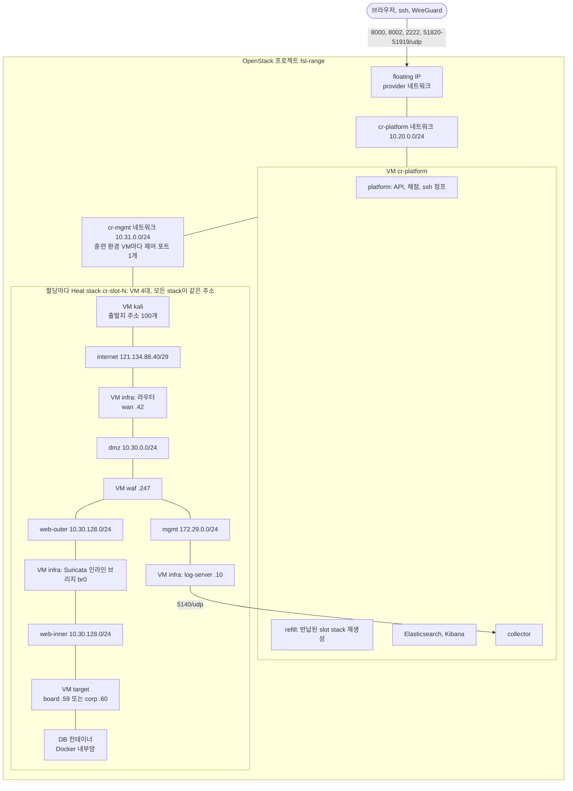

# fsl-project-mvp

사이버 공격·방어 훈련 플랫폼입니다. 공격 쪽은 웹사이트를 뚫고, 방어 쪽은 WAF(ModSecurity, OWASP CRS)와
IDS(Suricata)로 막습니다. 플랫폼은 대상 시스템이 무엇을 잃었는지와 방어가 무엇을 맞히고 틀렸는지를 따로 채점합니다.

워게임은 두 개입니다.

- `board`: `board.com`, Django 게시판과 MySQL
- `corp`: `corp.com`, WordPress 회사 사이트와 MySQL

학습은 **실전 라운드**로 합니다. 레슨은 다시 만들 예정이라 지금은 없습니다.

실전 라운드에는 slot stack 하나에 공격 플레이어와 방어 플레이어가 하나씩 들어갑니다. 플레이어는 사람이거나 봇입니다. 매치업은 셋입니다.

| 매치업 | 공격 플레이어 | 방어 플레이어 |
|---|---|---|
| `pvp` | 사람 | 사람 |
| `def_vs_bot` | AI 공격 봇 | 사람 |
| `atk_vs_bot` | 사람 | AI 수비 봇 |

`pvp`는 문제 없이 워게임에서 엽니다. 라운드 내용은 그 워게임의 목표와 케이스 전부이고, 시작 방어 설정은 slot에
올라가 있는 그대로입니다. 문제는 봇 매치업(`def_vs_bot`, `atk_vs_bot`)에만 씁니다. 라운드를 만들 때 `pvp`에 문제를
주면 `400 problem_not_allowed`, 봇 매치업에 문제가 없으면 `400 required`입니다.
`pvp` 라운드의 시간 제한은 `CR_PVP_TIME_LIMIT_SECONDS`(기본 900초, 15분)입니다.

사람 콘솔과 봇은 같은 API를 씁니다. 공격 API(`/api/rounds/<id>/attack/`)와 방어 API(`/api/rounds/<id>/defence/`)가
하나씩 있고, 봇은 사람과 같은 endpoint를 같은 권한으로 호출합니다. 터미널도 마찬가지입니다. 봇은 특정 모델에
묶이지 않습니다. 지금은 Claude Code가 `bots/cli.py`로 봇 플레이어를 맡고, 다른 모델은 `bots/provider.py` 인터페이스로
붙입니다([bots/README.md](bots/README.md)).

## 학습 단계

교육 담당자가 봇 매치업(`def_vs_bot`, `atk_vs_bot`)용 문제를 만들고, 학습자는 실전 라운드에 들어갑니다. `pvp` 라운드는 문제 없이 워게임에서 엽니다.

### 레슨

레슨은 다시 만들 예정입니다. 기존 레슨 코드와 내용(단계, 판정, 힌트, 레슨 화면)은 지웠고,
`platform/training/lessons/`는 새 레슨이 들어갈 자리로 비워 두었습니다. 지금 학습자가 고를 수 있는 것은 실전 라운드뿐입니다.

### 실전 라운드

봇 매치업의 라운드 문제는 매치업, 시작 방어 설정(posture), 룰 테스트에 쓸 케이스, 노리는 목표, 고객 트래픽, 시간
제한을 정합니다. `pvp` 라운드는 문제 없이 워게임의 목표와 케이스 전부, slot에 올라가 있는 방어 설정,
`CR_PVP_TIME_LIMIT_SECONDS`로 열립니다.

- 공격 플레이어는 Kali 터미널, 대상 사이트 패널, API로 공격하고 탈취한 값을 loot로 제출합니다.
- 방어 플레이어는 Kibana, 방어 터미널, 구성도, 알림 목록으로 보고, IDS 룰과 WAF 파일을 고칩니다. 방어 터미널은
  WAF와 IDS 두 개이고 패널에서 바꿔 엽니다. IDS 룰은 단독 센서를 다루듯 IDS 터미널에서 룰 파일을 고치고
  `sudo suricata -T`로 검사한 뒤 `sudo suricatasc -c reload-rules`로 반영합니다. 콘솔에는 IDS 룰을 고치는 폼이
  없고 지금 룰과 변경 이력, 룰 테스트만 있습니다. WAF 파일은 콘솔에서 고쳐 적용해도 되고, WAF 터미널에서 고친 뒤
  `sudo nginx -t`, `sudo nginx -s reload`로 반영해도 됩니다.
- 룰 테스트를 통과해야 반영됩니다. 룰 테스트는 probes(정상 케이스와 공격 케이스마다 저장해 둔 요청)와 이 라운드에서 공격자가
  지금까지 보낸 요청을 WAF는 임시 인스턴스에, IDS는 센서의 오프라인 `-r` 실행에 다시 보냅니다. 엔진이 파일을
  받아들이고 정상 케이스를 하나도 막지 않아야(WAF) 또는 정상 케이스에서 경보가 하나도 나지 않아야(IDS) 통과입니다.
  콘솔 적용은 이 라운드에서 같은 파일로 통과한 테스트가 있어야 받고(아니면 `409 not_tested`), 터미널의 reload도
  통과한 테스트의 해시 목록에 없는 스냅샷은 불러오지 않고 거부합니다. 플랫폼은 테스트를 통과할 때마다 그 해시를
  WAF와 infra의 root 전용 파일(`/var/lib/cr-reloaded/<waf|ids>.passed`)에 적고, 라운드를 시작할 때 비웁니다.
  콘솔은 지금 내용으로 통과한 테스트가 있을 때만 적용 버튼을 켭니다. 그래서 오탐이 나는 룰은 실제 센서에 올라가지
  않습니다.
- 터미널에서 reload한 내용은 reload 때 남긴 스냅샷으로 다음 요청 때 새 버전으로 기록되고, 같은 파일로 통과한
  테스트와 묶입니다. 로그 설정을 건드린 파일은 reload가 불러오기 전에 거부합니다. reload한 뒤에 파일을 또 고쳐도
  그 파일은 건드리지 않습니다. reload가 도는 동안(WAF는 `nginx -t`부터 새 worker가 뜰 때까지)은 그 파일을 저장할
  수 없습니다.
- 플랫폼이 라운드 내내 정상 케이스와 고객 트래픽을 보냅니다. 공격 플레이어가 아무것도 하지 않아도 오탐과 정상 통과가 쌓입니다.
- 라운드는 시간 제한, 목표 전부 탈취, 공격 출발지 전부 소진, 운영자 종료, 한쪽 기권으로 끝납니다. 출발지 소진으로
  끝나는 것은 정상 케이스가 한 바퀴 이상 돈 뒤입니다.

### 문제 내용

지금 저장소에는 라운드 문제가 하나도 없습니다. 기존 레슨 F1~F6, 과정 c1·c2, 시나리오 1.1~4.1은
삭제했습니다. 문제는 스태프 페이지에서 새로 작성할 예정이고, 문제 본문은 DB에만 둡니다. 저장소 사이 이동은
스태프 API의 내보내기·가져오기(`/api/staff/problems/<id>/export/`, `/api/staff/problems/import/`)로만 합니다.
스태프 페이지(`/staff/problems/`)가 이 API를 그대로 씁니다. 스태프 페이지는 아직 훈련 환경에서 써 보지 않았습니다.

| 스태프 API | 용도 |
|---|---|
| `GET\|POST /api/staff/problems/`, `GET\|PUT\|DELETE /api/staff/problems/<id>/` | 문제, 라운드 설정, 시작 posture를 한 문서로 저장. `PUT`은 `base_revision`이 최신이 아니면 `409 stale_revision` |
| `POST /api/staff/problems/validate/` | 저장하지 않고 검증. 오류는 필드 경로(`round.matchups[0]`)로 옴 |
| `GET\|POST /api/staff/postures/`, `GET\|PUT /api/staff/postures/<id>/` | 시작 방어 설정(Suricata 룰, WAF 파일 텍스트) |
| `POST /api/staff/wargames/<id>/probes/record/` | 룰 테스트용 probes 만들기 |

## 점수

점수는 두 가지이고 서로 합치지 않습니다.

**목표**(주 점수): 공격이 성공했는지는 대상 시스템이 직접 저장한 데이터로 판정합니다. 플랫폼이 공격 성공을 추정하지
않습니다.

- board: 공격 플레이어가 탈취한 계정 해시를 loot로 제출합니다(`POST /api/rounds/<id>/attack/loot/`). 라운드를
  시작할 때마다 board의 `set_passwords`로 계정 비밀번호를 무작위로 새로 정하고, 그 직후 읽어 둔 해시와 정확히
  같으면 그 목표를 잃은 것입니다. 이전 라운드의 해시나 `seed.py`의 기본 비밀번호로는 맞지 않습니다. 응답은
  비밀값을 드러내지 않습니다.
- corp: MySQL 바이너리 로그에 관리자 계정 추가, 회원 가입 설정 변경, 글 생성·덮어쓰기가 남으면 잃은 것입니다.
- 잃은 목표마다 탐지와 대응을 O/X로 매깁니다. 탐지는 그 목표의 귀속 구간(탈취 전 2분, corp는 변경 시각에 걸친
  공격 행동)에 든 공격 행동 가운데 하나라도 `expect`를 통과한 알림을 받았으면 O입니다. 마지막 행동만 보지 않으므로
  공격 뒤에 평범한 요청을 하나 더 보내도 바뀌지 않습니다. 대응은 목표를 잃기 전에 그 행동들의 출발지 IP가 소진됐거나
  (WAF error log의 `deny`·`limit_req`), 그 행동들의 첫 알림 뒤에(알림이 없으면 첫 행동 뒤에) 올라간 WAF 버전의
  룰 테스트가 그 행동들이 보낸 요청(케이스는 probes, 자유 요청은 플랫폼이 남긴 요청)을 다시 보내 WAF가 모두 막았으면
  O입니다. 효과를 확인하지 못한 버전이나 IDS 버전(IDS는 알리기만 함)은 대응이 아닙니다. Kibana를 본 것은 로그에
  남지 않으므로 대응이 아닙니다.
- 대응하지 못한 채 잃은 목표는 탐지 여부와 상관없이 2배로 셉니다. 목표 등급의 난이도가 가중치입니다. 탐지와 첫
  알림부터 첫 대응까지 걸린 시간은 점수 옆에 보여 주고 점수에 넣지 않습니다.

**탐지 결과**: 케이스마다 정탐, 미탐, 오탐, 정상 통과 중 하나입니다.

- 케이스 하나는 알림이 몇 건 나오든 1건입니다. `board-sqli-orderby-sqlmap`은 WAF로 요청을 약 2,000건 보내고
  알림도 많이 나오지만 1건입니다. 알림 단위로 세면 방어가 아니라 알림 임계값을 재게 됩니다.
- 알림이 공격 수법을 짚지 못하면(케이스의 `expect` 문자열이 signature에 없으면) `corroborated: false`로 표시하고
  탐지로 인정하지 않습니다.
- 탐지 결과에 들어가는 것은 선언된 케이스(`cases/`)와 플랫폼이 보내는 정상 케이스뿐입니다. 공격 플레이어가
  터미널이나 API로 자유롭게 보낸 요청은 출발지별로 따로 보여 주고(`free_actions`) 정탐·오탐으로 세지 않습니다.
- 모든 요청을 막는 방어는 탐지 결과에서 만점을 받지만 정상 케이스에서 오탐이 쌓이고, 목표는 지켜도 그 오탐이 옆에
  그대로 남습니다.
- 방어 플레이어는 라운드 중에도 케이스 판정을 바로 받습니다(`case.judged` 이벤트, 콘솔 오른쪽 아래 판정 알림).
  알림은 정탐·미탐·오탐만 띄우고 몇 초 뒤 닫히며, 콘솔을 열기 전에 난 판정은 다시 띄우지 않습니다. 케이스가
  끝난 뒤 라운드를 읽을 때 알림이 묶여 있으면 그때 정탐·오탐으로 판정하고, 알림 없이 `CR_JUDGE_AFTER_SECONDS`(기본
  30초)가 지나면 미탐·정상 통과로 판정합니다. 도구 케이스는 도구가 끝날 때까지 기다리고, 라운드가 끝나면 남은 케이스를
  모두 판정합니다. 케이스마다 한 번만 알리며(`scoring_verdict` 행) 공격 플레이어에게는 보이지 않습니다. 한 번 알린 판정은 다시
  고치지 않으므로, 그 뒤에 들어온 알림 때문에 라운드가 끝난 뒤 점수의 판정이 다를 수 있습니다.

점수는 `GET /api/rounds/<id>/score/`입니다. 플레이어는 라운드가 끝난 뒤에, 운영자와 스태프는 언제든 읽습니다.
라운드를 끝내는 요청은 바로 답합니다. 끝난 뒤 `CR_JUDGE_AFTER_SECONDS`가 지나고 처음 라운드를 읽을 때 알림을 한 번
더 가져와 목표와 케이스를 마지막으로 판정하고 `round.judged`를 남깁니다. 그때까지 점수는 `pending: true`입니다.

## 출발지 IP 소진

공격자는 출발지 IP 몇 개로 공격합니다. 방어자가 WAF에서 그 IP를 막아야 소진됩니다.

- WAF nginx 오류 로그에 그 IP(`client:`)로 `access forbidden by rule`(`deny`)이나 `limiting requests`
  (`limit_req`)가 찍히면 소진됩니다. CRS 룰이 403으로 막은 요청으로는 소진되지 않습니다. `geo`와 `return 403`으로
  막으면 오류 로그에 남지 않으므로 세지 않습니다.
- `limit_req` 하한: `traffic.yaml`에서 가장 바쁜 정상 고객 출발지의 요청 속도의 두 배를 라운드를 열 때
  계산해 둡니다(`limit_floor_rpm`, 분당 요청 수). 걸린 zone의 `rate`가 이보다 낮으면 소진하지 않고 방어 쪽에
  `limit.below_floor` 이벤트로 알립니다. `rate`는 그 줄이 찍힌 시각에 적용돼 있던 WAF 버전(콘솔 적용이나 터미널 reload 스냅샷)의 파일에서 읽습니다. 키가 클라이언트 주소
  (`$binary_remote_addr`, `$remote_addr`)를 담지 않은 zone(`$server_name`이나 상수처럼 모든 클라이언트가 나눠 쓰는
  zone)에 걸린 요청은 하한이 없어도 소진하지 않고, 방어 쪽에 `limit.shared_key` 이벤트로 한 번 알립니다.
- 소진되면 infra 라우터가 그 주소를 떨어뜨리고(이미 맺은 연결 포함), 돌고 있던 도구를 멈추고, 다음 출발지로
  바꿉니다. 출발지가 다 떨어지면 공격 API 쓰기는 `409 origins_spent`이고 라운드가 끝납니다.
- 공격 API의 성공 응답에는 `remaining` 블록(현재 출발지, 남은 수, 전체 수, 소진된 IP)이, 모든 응답(오류 포함)에는
  `X-Origin`, `X-Origins-Left` 헤더가 붙습니다. 콘솔에는 "남은 IP"로 보입니다.
- 오류 로그는 그 라운드에 다음 API 요청이 들어올 때 읽습니다. API, 터미널, 도구, 봇 셸의 요청이 모두 같은 규칙을
  따릅니다.
- 고객 요청은 공격 박스(kali)가 아니라 infra VM에서 고객 주소로 나갑니다. 고객 주소는 소진 대상이 아니고,
  공격 출발지와 겹치지 않습니다.

## 구성



| 연결 | 경로 |
|---|---|
| 브라우저 → 콘솔 | floating IP의 8000, 8002 |
| 학습자 ssh → Kali | floating IP의 2222(플랫폼 컨테이너의 sshd) → `cr-mgmt`의 Kali 22번. 공격 플레이어의 점프 권한 |
| 학습자 ssh → WAF | 같은 2222 → `cr-mgmt`의 WAF 22번, `analyst` 계정. 방어 플레이어의 점프 권한 |
| 학습자 ssh → 센서 | 같은 2222 → `cr-mgmt`의 infra 22번, `analyst` 계정. 방어 플레이어의 두 번째 점프 권한 |
| 플랫폼 → 훈련 환경 VM | `cr-mgmt`의 제어 포트로 ssh. 관리 계정 `ubuntu`, 비밀번호 없는 sudo. 대상 컨테이너는 target VM에서 `docker exec` |
| WAF → log-server | stack의 `mgmt`로 syslog 514/tcp |
| log-server → collector | infra의 제어 포트에서 `cr-mgmt`로 syslog 5140/udp(센서 알림, WAF audit log, 모든 요청의 nginx 접근 로그) |

- `bin/cloud up`이 Heat stack `cr-platform`으로 플랫폼 VM을 만들고, 플랫폼이 Heat API로 slot stack
  `cr-slot-<n>`을 만듭니다.
- slot stack은 VM 4대(kali, waf, infra, target)와 LAN 5개(internet, dmz, web-outer, web-inner, mgmt)입니다. LAN은
  stack마다 따로 만든 Neutron 네트워크이고 Neutron 라우터가 없습니다. stack끼리 네트워크가 다르므로 모든 stack이 같은
  주소를 씁니다.
- stack은 워게임별 pool에 미리 띄워 둡니다(`compute.pool`, 기본 board 3개, corp 1개). 할당을 열면(`POST /api/allocations/`)
  준비된 stack 하나를 받고, 할당을 닫거나 하트비트 없이 만료되면 그 stack을 지우고 새로 만듭니다. 할당 하나에서 라운드를
  여러 번 열 수 있지만, 목표를 하나라도 잃은 할당에서는 채점 라운드를 새로 시작하지 않습니다(`409 objective_fallen`). board 비밀번호는
  이제 라운드마다 새로 정하지만 이 규칙은 아직 그대로입니다.
- 훈련 환경 VM은 `deploy/roles/<역할>/install.sh`로 미리 구운 Glance 이미지로 부팅합니다. 기본 이름은
  `cr-<역할>-bake1`이고, 이 클라우드는 `cr-kali-bake5`, `cr-waf-bake6`, `cr-infra-bake3`, `cr-target-bake3`을 씁니다. 부팅할 때 인터넷에 나가지 않습니다.
- Kali는 인터넷 역할입니다. 출발지 30개국의 /24 대역에 걸친 주소 100개를 갖고, 기본 출발지 5.188.10.10을 첫 주소로
  둡니다. Kali의 `internet` 포트는 address pair `0.0.0.0/0`으로 이 주소를 모두 쓰고, MAC은 Neutron이 준 것만
  통과합니다.
- 라우터는 infra VM의 nftables입니다. `wan`은 공인 IP 121.134.88.42/29 하나이고, 80/tcp를 WAF의 DMZ 주소로
  포트포워딩합니다. Kali에서 `board.com`, `corp.com`은 이 공인 IP로 풀립니다. VPN으로 들어온 학습자는 이름 없이
  `http://121.134.88.42/`를 그대로 입력합니다. WAF는 이름이 없는 `Host`를 그 stack의 워게임 사이트로 보냅니다.
- board와 corp는 target VM의 Docker 컨테이너이고 WAF 뒤 `web-inner`에 있습니다. DB는 target VM 안의 Docker
  내부망에만 있습니다. Kali의 공격은 모두 WAF를 지나갑니다.
- 센서는 stack마다 하나이고 infra VM에 있습니다. `web-outer`와 `web-inner`를 잇는 리눅스 브리지 `br0`에 인라인으로
  붙어 af-packet으로 WAF와 대상 사이의 트래픽을 봅니다. WAF가 막은 요청은 센서에 닿지 않고 WAF 로그에 남습니다.
- 센서가 보는 요청의 출발지는 WAF입니다. 수집할 때 같은 요청의 X-Forwarded-For 주소를 알림의 출발지로 씁니다.
- 격리는 Neutron 보안 그룹과 port security가 맡습니다. Kali나 WAF의 root 셸로는 바꿀 수 없습니다.
- 플랫폼 VM의 `refill` 서비스(같은 이미지의 `manage.py refill_slots`)는 반납된 slot의 stack을 다시 만드는 일만
  합니다. `bots` 서비스(`cr-bots`)는 대기 중인 봇 실행을 REST API로 가져가 실행마다 Claude Code를 하나 띄웁니다
  (`bots/README.md`). 방어 봇은 라운드가 끝날 때까지 같은 세션에 남고, 런처가 난이도 단계의 주기(`steps.yaml`의
  `watch_s`)마다 새 알림, 새 차단, 처음 보는 출발지를 넣어 줍니다.
- 알림 수집, 출발지 소진, corp 변경 관찰, 명령 기록 읽기, WAF 설정 변경 감시, 정상 케이스, 라운드 종료 조건은 그 라운드에
  API 요청(이벤트, 상태, 점수, 공격·방어 동작)이 들어올 때 처리합니다. 라운드마다 한 번에 한 요청만 읽고, 읽은 뒤
  `CR_READ_EVERY_SECONDS`(기본 5초) 동안은 다시 읽지 않습니다. `compose.yaml`은 `CR_READ_IN_BACKGROUND=1`로 이
  읽기를 요청과 따로 돌려, 요청이 읽기(로그 수집, 박스 ssh)를 기다리지 않게 합니다.
- 제한 시간이 지난 라운드는 다음 요청이 끝내고, 종료 시각은 제한 시간으로 기록합니다. 채점은 종료 시각까지 일어난
  것만 셉니다.
- 만료된 할당은 다음 할당 요청이나 그 할당에 들어온 요청이 닫습니다.

플랫폼 코드(`platform/`)는 다섯 단위로 나뉩니다.

| 단위 | 맡는 일 |
|---|---|
| `users/` | 계정, 로그인·가입·승인, 차단, 플레이어 토큰 |
| `sandbox/` | 훈련 환경: pool, Heat stack, 에지, 점프 접속, 그리고 바깥 장치를 아는 파일 전부(OpenStack, Suricata, CRS/nginx, Kibana, 공격 박스, 고객 박스) |
| `telemetry/` | Elasticsearch, 이벤트, 알림, WAF 접근·오류 로그 |
| `training/` | 문제와 워게임(`content/`), 할당과 라운드(`round/`), 고객 트래픽(`traffic/`), 공격 API(`attack/`), 방어 API(`defence/`), 비어 있는 `lessons/` |
| `scoring/` | 대상의 정답 데이터 읽기, baseline, 목표, 판정, 점수 |

`cr/`(설정, 오류, URL), `domain/`(Django 없는 규칙 함수), `testing/`(가짜 클라우드와 가짜 훈련 환경)은 함께 씁니다.
자세한 구성은 [ARCHITECTURE.md](docs/ARCHITECTURE.md)에 있습니다.

## 요구 사항

컨트롤러 노드:

- `git`, `ssh`, `ssh-keygen`
- Python 3.10 이상
- [uv](https://docs.astral.sh/uv/getting-started/installation/)
- github.com, ghcr.io 접속

클라우드:

- x86_64 호스트, Kolla-Ansible 2025.1 이상
- compute node는 KVM 권장
- Heat 필요
- [외부 네트워크](docs/OPENSTACK.md#25-external-network-and-floating-ips-admin-once): floating IP pool, [인터넷 연결](docs/OPENSTACK.md#26-internet-egress)
- 아래 [flavor](docs/OPENSTACK.md#33-flavors-admin-once-init-chooses). `init`은 flavor를 만들지 않습니다.
- Glance에 역할 이미지 4개(기본 이름 `cr-kali-bake1`, `cr-waf-bake1`, `cr-infra-bake1`, `cr-target-bake1`. 이름은 `compute.images`. 이 클라우드는 `cr-kali-bake5`, `cr-waf-bake6`, `cr-infra-bake3`, `cr-target-bake3`).
  `deploy/roles/<역할>/install.sh`를 인터넷에 나갈 수 있는 빌더 VM에서 실행하고 스냅샷을 뜹니다.
  스냅샷의 `min_disk`는 빌더의 디스크 크기가 되므로, 빌더 flavor의 디스크가 훈련 환경 VM의 flavor보다 크면 stack이 뜨지 않습니다.
  절차는 [이미지](docs/OPENSTACK.md#36-images)에 있습니다. target 이미지는 구울 때 받은 board, corp
  이미지의 태그(그 커밋)를 `compute.target_tag`에 적습니다. 기본값은 `cr-target-bake1`을 구운 커밋입니다.

| VM | flavor 키 | 조건 |
|---|---|---|
| 플랫폼 VM | `compute.flavors.platform` | 2 vCPU, 8 GB RAM, 40 GB 디스크 이상 |
| 훈련 환경 VM(kali, waf, infra, target) | `compute.flavors.<역할>` | 디스크가 역할 이미지의 `min_disk` 이상(지금 이미지는 모두 30 GB). 지정하지 않으면 `dba.small`(디스크 30 GB) |

- 예: 플랫폼 `m1.large`(2 vCPU, 8 GB, 60 GB)
- quota: 인스턴스 1 + 4 × stack 수, 그만큼의 vCPU와 RAM. 기본 pool(stack 4개)이면 인스턴스 17개. 보안 그룹은 stack 수와 상관없이 9개
- stack 하나에 드는 RAM, `dba.small`로 target의 Docker와 MySQL이 충분한지는 아직 재지 않았습니다.

VM 1대에 클라우드 전체를 올려 시험하려면 [VM 1대로 시험하기](docs/OPENSTACK.md#9-try-it-in-one-vm-virtualbox-or-vmware)를 보세요.

## 설치

컨트롤러 노드에서 `kolla-ansible post-deploy`를 실행한 계정으로 실행합니다.

```bash
git clone https://github.com/Nekonic/fsl-project-mvp.git && cd fsl-project-mvp
uv run bin/cloud init
uv run bin/cloud up
```

`up`이 끝나면 `the range is ready; the platform is at http://ADDRESS:8000/`를
출력합니다. `up`은 플랫폼 stack, 공용 네트워크 `cr-mgmt`와 보안 그룹, 이전 훈련 환경이 남긴
자원 정리, slot stack 생성, stack 부팅 대기, IDS 기본 룰 적재 순서로 진행합니다. 플랫폼 VM과
역할 이미지 빌드는 apt 패키지를 카카오 미러(`mirror.kakao.com`)에서 받습니다.

### init

관리자 인증 정보는 `/etc/kolla/clouds.yaml`의 `kolla-admin` 항목에서 읽습니다. 다시
실행하면 빠진 것만 만듭니다.

| 항목 | 동작 |
|---|---|
| 외부 네트워크 | `router:external` 네트워크를 찾음 |
| 프로젝트, 사용자 | `fsl-range` 프로젝트와 member 사용자 생성. 비밀번호는 무작위 |
| 인증 정보 | `~/.config/openstack/clouds.yaml`의 `fsl-range` 항목(0600)에 씀 |
| flavor | 플랫폼은 조건에 맞는 것 중 가장 작은 것을, 훈련 환경 VM은 역할마다 `compute.flavors.<역할>`(없으면 `dba.small`)을 고름. private flavor는 프로젝트에 공유 |
| 베이스 이미지 | `ubuntu-24.04`가 없으면 noble amd64 클라우드 이미지를 받아 `SHA256SUMS`로 확인하고 public으로 올림 |
| quota | 플랫폼 VM과 `compute.pool`의 stack(stack마다 VM 4대)이 들어가는지 확인 |
| ssh 키 | `~/.ssh/fsl_claude`가 없으면 생성 |
| `cloud.yaml` | `deploy/openstack/cloud.yaml`에 찾은 값을 씀 |

| `init` 출력 | 조치 |
|---|---|
| `no admin credentials` | `source /etc/kolla/admin-openrc.sh` 후 다시 실행 |
| `are not an admin's` | 새 셸에서 실행 |
| `no external network` | [외부 네트워크](docs/OPENSTACK.md#25-external-network-and-floating-ips-admin-once) 생성 후 다시 실행 |
| `more than one external network` | 출력된 이름 하나를 `cloud.yaml`의 `network.external`에 적고 다시 실행 |
| `no flavor fits` | 출력된 `openstack flavor create` 명령 실행 후 다시 실행 |
| `not active` | 출력된 `openstack image delete` 명령 실행 후 다시 실행 |
| `cannot hold the platform and the pool` | 출력된 값만큼 `openstack quota set` 후 다시 실행하거나 `compute.pool`의 stack 수를 줄임 |
| `no flavor ... for the slot role` | 있는 flavor 이름을 `compute.flavors.<역할>`에 적고 다시 실행 |
| `no working entry fsl-range` | `uv run bin/cloud init --reset-password` 실행 후 `uv run bin/cloud up --replace` |

### up

- `cloud.yaml`의 `cloud`가 가리키는 `clouds.yaml` 항목으로 인증합니다.
- `keys.key_name` Nova 키페어가 없으면 `keys.key_file`의 공개키로 등록합니다.
- 실패하면 원인을 출력하고 멈춥니다. 원인을 고친 뒤 같은 명령을 다시 실행하면 멈춘
  곳부터 이어 갑니다.

## 동작 확인

콘솔의 스태프 range 페이지(`/staff/range/`)가 이 상태를 보여 주지만 훈련 환경에서는 아직 확인하지 않았으므로, API로도 확인합니다. 스태프 계정으로 로그인한 쿠키로 pool 상태를 봅니다. slot마다
할당과 재생성 상태(`refill.state`)가 나오고, `idle`이면서 할당이 없는 slot을 새 할당이 받습니다. slot stack의 서버
상태는 `GET /api/staff/range/pool/`에 있습니다.

```bash
curl -s -c cookies.txt http://ADDRESS:8000/api/auth/csrf/
curl -s -b cookies.txt http://ADDRESS:8000/api/staff/range/
```

라운드 하나를 처음부터 끝까지 돌리는 순서는 `test/plays.py`와 [test/README.md](test/README.md)에 있습니다. 할당 열기,
라운드 만들기(`POST /api/allocations/<id>/rounds/`), 시작, 케이스 발사, 종료, 점수 읽기 순서입니다.

## 문제 해결

| 증상 | 확인 | 조치 |
|---|---|---|
| stack이 `SETUP_FAILED` | 그 VM의 `/var/lib/cr/failed`(부팅 유닛의 `systemctl status`. target은 이미지 태그가 `compute.target_tag`와 다르면 그 `image:` 줄)와 `/var/log/cloud-init-output.log` | 원인 수정 후 `uv run bin/cloud up` |
| stack이 `NOT_STANDING`, `no active image ... in Glance` | `compute.images`의 이름과 Glance의 이미지 | 이미지를 굽거나 있는 이름을 `compute.images.<역할>`에 적고 `uv run bin/cloud up --replace` |
| stack이 `CREATE_FAILED` | `GET /api/staff/range/pool/`의 `failures`(Heat의 `stack_status_reason`) | 원인 수정 후 `uv run bin/cloud up` |
| 플랫폼이 응답하지 않음 | `ssh -i ~/.ssh/fsl_claude ubuntu@ADDRESS`에서 `systemctl status cr-platform`, `sudo docker logs cr-platform` | 원인 수정 후 `uv run bin/cloud up` |
| `docker ps`에 `cr-platform`이 없음 | `sudo cloud-init status --long`. 대개 VM이 인터넷에 못 나감([인터넷 연결](docs/OPENSTACK.md#26-internet-egress)) | 원인 수정 후 `uv run bin/cloud up --replace` |
| Heat stack 생성 실패 | `uvx --from python-openstackclient --with python-heatclient openstack --os-cloud fsl-range stack failures list cr-platform` | 원인 수정 후 `uv run bin/cloud up` |
| slot의 `refill.state`가 `failed` | `GET /api/staff/range/`의 `refill.reason` | 원인 수정 후 `uv run bin/cloud up` |

## 운영

```bash
uv run bin/cloud up              # 없는 것만 만들고 pool의 stack을 띄움
uv run bin/cloud up --replace    # 플랫폼 VM 교체 후 pool까지 맞춤. DB는 백업 후 복원
uv run bin/cloud down            # DB 백업 후 slot stack, cr-mgmt, 플랫폼 VM 삭제
uv run bin/platform-rebuild      # 플랫폼 VM만 교체. 훈련 환경은 맞추지 않음
```

- `down`과 `--replace`는 먼저 DB를 `backups/store-<UTC+9 시각>.pgdump`로 받습니다. 백업이
  실패하면 아무것도 지우지 않습니다. 아직 SQLite를 쓰는 이전 플랫폼 VM이면 `db-<UTC+9 시각>.sqlite3`로 받고,
  새 VM이 그 파일을 PostgreSQL로 한 번 옮겨 담습니다(아래 "백업과 복원").
- 플랫폼 VM 교체는 보통 `uv run bin/cloud up --replace`로 합니다. 훈련 환경 ssh 키(`keys.range`)를
  옮겨 주고, 템플릿·이미지·flavor·`target_tag`가 같은 stack은 그대로 씁니다. 다른 stack은
  `STALE`이 되어 지우고 새로 만듭니다. 새 플랫폼 VM은 이전 VM의 `cr-mgmt` 포트(`cr-platform.mgmt`)를
  그대로 붙이므로 `cr-mgmt` 주소가 바뀌지 않습니다.
- push하지 않은 이미지를 올릴 때는 `--sideload NAME=TARBALL`을 씁니다. 절차는
  [재구축과 삭제](docs/OPENSTACK.md#53-rebuild-and-delete--lossless)에 있습니다.
- pool 크기는 `cloud.yaml`의 `compute.pool`(워게임별 stack 수)입니다. 바꾼 뒤 `uv run bin/cloud up --replace`를
  실행합니다. 플랫폼은 이 값을 Heat stack 파라미터로 받고, 할당이 없는 stack은 새 배정에 맞는
  워게임으로 다시 만듭니다.

`cloud.yaml` 항목:

| 섹션 | 항목 |
|---|---|
| `cloud` | `clouds.yaml` 항목 이름 |
| `network` | 외부 네트워크, 고정 floating IP, DNS, platform·mgmt CIDR, 플랫폼에 접속할 수 있는 대역 |
| `compute` | 베이스 이미지, availability zone, 워게임별 stack 수(`pool`), 역할별 flavor와 이미지, target 이미지의 워게임 태그(`target_tag`) |
| `keys` | Nova 키페어 이름과 개인키 경로, 플랫폼의 훈련 환경 ssh 키 |
| `platform` | stack 이름, 저장소, ref |
| `backups` | `backups/`에 남길 백업 수 |

`bin/cloud`가 쓰는 훈련 환경 API(`/api/staff/range/fabric/`, `/leftovers/`, `/pool/`)는
[훈련 환경](docs/OPENSTACK.md#6-the-range-substrate-openstack)에 있습니다.

## 포트

| 포트 | 서비스 | 접속 |
|---|---|---|
| 8000 | 콘솔, `/api/`, Kibana(`/kibana/`), 터미널(`/vm-terminal/`) | 브라우저, 봇, `test/`, `bin/` |
| 8002 | 대상 사이트(`/site/<라운드 id>/<host>/<path>`) | 콘솔 안의 iframe |
| 2222 | SSH 점프 호스트, 플랫폼 컨테이너 안의 sshd | 학습자 PC의 `ssh`. 플레이어마다 받은 키로 공격 플레이어는 Kali 22번, 방어 플레이어는 WAF 22번과 infra 22번(둘 다 `analyst`)으로만 포워딩. 셸 없음 |
| 51820-51919/udp | 학습자 WireGuard 터널의 UDP 중계, 플랫폼 컨테이너 안 | 학습자 PC의 WireGuard. 계정마다 포트 하나. 라운드 동안 그 판의 Kali 51820번(`cr-mgmt`)으로 넘김 |
| 5140/udp | collector | 훈련 환경 infra VM의 log-server, `cr-mgmt`에서만 |
| 5601 | Kibana 직접 접속, VM loopback 전용 | ssh 터널, 인증 없음 |
| 9200 | Elasticsearch, VM loopback 전용 | acceptance 테스트, 인증 없음 |

- 8002는 콘솔과 다른 origin이라 대상 사이트의 스크립트가 콘솔을 읽지 못합니다. 로그인은 8000과 같이 씁니다.
  로그인하지 않은 채 8002를 열면 콘솔 로그인 페이지로 가고, 로그인하면 보던 사이트 주소로 돌아옵니다.
- 콘솔과 사이트의 origin은 `compose.yaml`의 `CR_CONSOLE_ORIGIN`, `CR_SITE_ORIGIN`으로 정합니다. 비워 두면 요청한
  호스트의 `http://<host>:8000`, `http://<host>:8002`입니다. TLS 리버스 프록시나 도메인 뒤에 둘 때는 둘 다
  `https://cr.example`처럼 scheme, 호스트, 포트만 적습니다. 플랫폼 컨테이너가 시작할 때 nginx 설정에 넣고,
  사이트 origin은 `/api/me/`의 `site_origin`으로 콘솔에 알려 줍니다. 형식이 틀리면 컨테이너가 시작하지 않습니다.
- `board.com`과 `corp.com`은 훈련 환경 안에서만 응답합니다. 공격 플레이어가 8002로 보낸 요청은 공격 API와 같은 경로로
  나갑니다. 방어 플레이어의 요청은 할당의 브라우징 마커를 달고 infra VM에서 고객 주소로 나가며, 공격으로도 오탐으로도
  세지 않습니다.
- 공격 API와 방어 API의 계약은 `openapi/schema.yaml`입니다. 공격·방어 쪽 스키마는 `/api/schema/attack/`,
  `/api/schema/defence/`입니다.

## 워게임 추가

1. `wargames/<이름>/`에 `wargame.yaml`(id, 제목, 이미지, 공개 URL, 호스트, 목표 판정 방식, 케이스 파일, 기본 고객
   트래픽), `compose.yaml`, `objectives.yaml`, `topology.yaml`(stack의 LAN, VM, 고정 IP, 장치와 역할), 필요하면
   `traffic.yaml`
2. `cases/<이름>.yaml`에 공격 케이스와 정상 케이스. 정상 케이스가 없으면 테스트가 실패합니다.
   센서의 시작 룰은 `deploy/suricata/rules/<이름>.rules`에 공격 케이스마다 signature 하나(`msg`에 케이스의
   `expect`)로 쓰고, `topology.yaml`의 `cr-ids` 장비 `baseline:`에 그 경로를 적습니다. `baseline:`이 없으면 slot
   재생성이 실패합니다
3. 모든 워게임 `topology.yaml`의 `cr-waf`에서 `names:`에 사이트 이름, `upstreams:`에 대상 주소
4. `deploy/roles/target/`에 compose 파일 링크 `<이름>.yaml`, `wargames.yaml`의 `fronts`와 `limits`,
   `install.sh`의 `WARGAMES`
5. `deploy/roles/waf/sites.conf`에 사이트의 `server` 블록, `deploy/roles/waf/slot-boot`와 `deploy/roles/kali/install.sh`의 호스트 이름
6. target, waf, kali 이미지를 다시 굽고 `cloud.yaml`의 `compute.images`에 새 이름, `compute.pool`에 stack 수
7. 룰 테스트용 probes를 만들어 `wargames/<이름>/probes/`에 커밋(`bin/record-probes`, 스태프 API 사용)

## 단위 테스트

로컬에서는 단위 테스트만 돌립니다. 훈련 환경은 OpenStack에만 있습니다.

```bash
uv sync --frozen        # .venv를 uv.lock에 맞춤
git config core.hooksPath .githooks   # 클론마다 한 번: dev로 가는 push 전에 bin/verify --changed
bin/verify --changed    # 바뀐 파일이 닿는 테스트만
CR_FINAL_CHECK=1 bin/verify --fast    # 단위·API 테스트 전체, 최종 검증 때만
```

- `.githooks/pre-push`는 `dev`로 가는 push만 봅니다. `origin/dev`와 push하는 커밋을 임시 worktree에서 합치고
  `bin/verify --changed`를 돌려 실패하면 push를 거절합니다. 다른 브랜치 push는 그대로 나갑니다.
- `bin/verify --fast`, 전체 `bin/verify`, `--only` 없는 `bin/acceptance`는 `CR_FINAL_CHECK=1` 없이는 시작하지
  않습니다. 리뷰 라운드에서 결함이 0건일 때 한 번 돌리는 최종 검증입니다. GitHub Actions `tests`가 `dev` push마다
  `bin/verify --fast`를 돌립니다.

- `bin/verify`는 먼저 `openapi/schema.yaml`을 다시 내보냅니다(`manage.py spectacular`). 스키마가 바뀌면 그 변경과
  함께 커밋합니다. `bots/`, `test/`, `bin/`은 생성 클라이언트 없이 이 스키마의 `operationId`로 API를 부릅니다
  (`bots/rest.py`). `front/src/api/schema.d.ts`는 `front/`가 `npm run types`로 만들고 커밋하지 않습니다.
  node가 없으면 TypeScript 타입과 `front/` 검사를 건너뜁니다.
- `front/`, `strings/`, `openapi/` 아래가 바뀌면 `bin/verify`가 `front/`를 타입 검사·빌드하고 vitest를 돌립니다.
- `--fast`는 `platform/tests/` 아래 계층별로 `domain`(Django 없이), `seams`, 단위별(`users`, `telemetry`, `scoring`,
  `training`), `contract` 순서로 돌리고, 그다음 `platform/tests/test_*.py`를
  돌립니다.
- 단위 테스트의 DB는 SQLite입니다(`CR_DB_HOST`가 비어 있을 때 `cr/settings.py`가 고름). 서비스 없이 빨리 돌고,
  ORM이 두 엔진에서 같게 동작하는 부분이 대부분이라서입니다. PostgreSQL에만 있는 경로(`bin/backup`의 덤프와 복원,
  `load_sqlite_store`)는 `platform/tests/test_store_postgres.py`가 `compose.yaml`의 PostgreSQL 이미지를 Docker로
  잠깐 띄워 시험합니다. Docker가 없으면 그 파일만 건너뜁니다. 전체 단위 테스트를 PostgreSQL에서 돌리려면
  `CR_DB_HOST`, `CR_DB_PORT`, `CR_DB_PASSWORD`를 주고 pytest를 실행합니다.
- 한 계층만 돌리려면 `platform/`에서 실행합니다.

```bash
cd platform && ../.venv/bin/python -m pytest tests/domain -q
```

- 콘솔 화면은 가짜 응답으로 띄워 볼 수 있습니다. 화면마다 어느 파일을 고치는지는
  [ARCHITECTURE.md](docs/ARCHITECTURE.md) "화면 바꾸는 법"에 있습니다.

```bash
cd front && npm ci && npm run types && npm run dev   # http://localhost:5173, front/mock/의 응답
npm run build && npx vitest run
```

- 전체 `bin/verify`는 acceptance(`test/`)까지 돌리고 플랫폼 VM에서 실행합니다:
  `CR_FINAL_CHECK=1 CR_PLATFORM_URL=http://<address>:8000 bin/verify`. acceptance 구성은 [test/README.md](test/README.md)에 있습니다.

## 백업과 복원

DB는 플랫폼 VM의 `cr-postgres` 컨테이너(PostgreSQL 18.4, `cr_storedata` 볼륨)입니다. 계정, 할당, 라운드,
플레이어, 출발지, 공격 기록, 도구 실행, 탐지 기록, 고객 요청, 목표, 룰셋, 룰 테스트가 들어 있습니다.
Elasticsearch 데이터는 백업하지 않습니다. `cr-postgres`는 `store` 네트워크(외부로 나가지 않는 내부 네트워크)에만
붙고, 거기에는 `platform`과 `refill`만 함께 있습니다. 비밀번호는 cloud-init이 만든 `/opt/cr/store-password`
(0640, uid 10001, gid 999)를 compose secret으로 읽습니다.

```bash
CR_STORE_EXEC="ssh -i ~/.ssh/fsl_claude ubuntu@ADDRESS sudo docker exec -i cr-postgres bash -s" \
  bin/backup --keep 2
```

플랫폼이 도는 동안 `pg_dump` custom format으로 받아 `backups/store-<UTC+9 시각>.pgdump`에 저장합니다.
컨테이너 안에서 `pg_restore --list`로 읽히는지 확인한 뒤에만 이 이름을 붙입니다. 행이 하나도 없는 DB는
백업을 남기지 않고, 그때는 이전 백업도 지우지 않습니다. `--keep`(기본 1)을 넘는 이전 백업은 지웁니다.
`db-<UTC+9 시각>.sqlite3`(SQLite 시절 백업)도 시각 순서로 같이 셉니다. 예전 UTC 이름(`store-20261127T203345Z.pgdump`)도 같은 시각 순서로 읽습니다. 손으로 이름 붙인 파일은 지우지 않습니다.

복원(DB 내용 전체를 한 트랜잭션으로 바꿉니다):

```bash
ssh -i ~/.ssh/fsl_claude ubuntu@ADDRESS 'cd /opt/cr && sudo docker compose stop platform refill'
CR_STORE_EXEC="ssh -i ~/.ssh/fsl_claude ubuntu@ADDRESS sudo docker exec -i cr-postgres bash -s" \
  bin/backup --restore backups/store-20261126T110000+0900.pgdump
ssh -i ~/.ssh/fsl_claude ubuntu@ADDRESS 'cd /opt/cr && sudo docker compose start platform refill'
```

`platform`과 `refill`을 먼저 멈춥니다. 연결이 남아 있으면 복원이 그 잠금을 기다립니다.

SQLite 백업(`db-<UTC+9 시각>.sqlite3`)을 PostgreSQL로 옮기기(`up --replace`가 이 경우 알아서 합니다):

```bash
scp -i ~/.ssh/fsl_claude backups/db-20261125T042248Z.sqlite3 ubuntu@ADDRESS:/opt/cr/backups/
ssh -i ~/.ssh/fsl_claude ubuntu@ADDRESS
cd /opt/cr
sudo docker compose stop platform refill
sudo docker compose run --rm --no-deps -T -v /opt/cr/backups:/backups:ro --entrypoint gosu platform \
  cr python manage.py load_sqlite_store /backups/db-20261125T042248Z.sqlite3
sudo docker compose start platform refill
```

`load_sqlite_store`는 백업 파일을 읽기만 합니다. 복사본을 지금 코드의 마이그레이션까지 올린 뒤 PostgreSQL을
비우고, 같은 마이그레이션을 적용하고, 테이블마다 행을 옮겨 행 수를 맞춰 봅니다. 한 트랜잭션이라 중간에
실패하면 아무것도 들어가지 않습니다. PostgreSQL 텍스트는 NUL 문자를 담지 못해 그 문자만 빼고 옮기며,
그런 값이 있으면 테이블별로 개수를 알려 줍니다.

새 구조의 DB는 마이그레이션을 `0001_initial`부터 새로 시작합니다. 이전 저장소에서 옮기는 데이터는 없습니다.

## 보안

실습 전용 환경입니다. 표면마다 막는 장치는 다음과 같습니다.

| 표면 | 보호 |
|---|---|
| `/api/`(사람) | Django 로그인. 세션 쿠키는 HttpOnly, SameSite=Lax. 쓰기 요청은 CSRF 토큰 필요. CORS 헤더 없음 |
| `/api/`(봇) | `Authorization: Bearer <플레이어 토큰>`. 토큰은 라운드를 만들 때 한 번만 보여 주고 해시로만 저장. 자기 쪽 공격 또는 방어 경로와 라운드 읽기만 닿음. 라운드가 끝나면 15분 동안 읽기만 가능 |
| 플레이어 | 상대 쪽 경로는 403. 라운드 시작 전 쓰기는 `409 round_not_started`, 끝난 뒤는 `409 round_closed`. 플레이어는 할당을 열거나 닫지 못하고 라운드를 끝내지 못함(기권만 가능). PvP에서 한 사람이 양쪽 플레이어를 맡지 못함(`already_playing`) |
| 이벤트 피드 | 이벤트 종류마다 볼 수 있는 쪽이 정해져 있음. 공격 쪽은 알림과 룰 이벤트를, 방어 쪽은 공격 행동과 출발지 이벤트를 보지 못함 |
| WAF 파일 | 방어 플레이어가 고치는 파일은 `crs-setup.conf`, REQUEST-900·RESPONSE-999 예외 파일, `deny`·`limit_req`를 넣는 nginx 파일(`/etc/nginx/defence/`)뿐. `log_format`, `access_log`, `error_log`, real IP 설정, 감사 로그 설정과 `include`는 측정용이라 콘솔이 거부하고, 터미널의 `sudo nginx -s reload`·`-t`·`-T`도 이런 설정이 든 파일은 불러오지 않고 거부함. 콘솔 적용과 터미널 reload 모두 이 라운드에서 같은 파일로 통과한 룰 테스트가 있어야 함. `SecRuleEngine Off`·`DetectionOnly`는 허용(점수에 결과가 드러남) |
| `/vm-terminal/<attack\|defence\|ids>/<round>/` | nginx `auth_request`가 `/api/rounds/<round>/terminal-auth/<attack\|defence\|ids>/`에 그 라운드의 그 쪽 플레이어인지 물음(`ids`는 방어 플레이어). 공격 플레이어는 Kali의 `kali` 계정, 방어 플레이어는 cr-waf와 cr-infra의 `analyst` 계정(root 아님)으로 열리고, `GET attack/terminal/`, `GET defence/waf/terminal/`, `GET defence/ids/terminal/`로 받은 점프 권한이 없거나 라운드가 끝났으면 열리지 않음. 열려 있던 셸도 15초마다 다시 확인해 권한이 없어지면 닫힘 |
| `/kibana/`, 8002(`/site/...`) | nginx `auth_request`로 `/api/me/`에 로그인 세션 확인. 없으면 로그인 페이지로. 로그인 뒤 돌아가는 `next`는 콘솔 안의 경로이거나 `CR_SITE_ORIGIN`(기본은 같은 호스트의 8002)의 `/site/` 주소만 받음 |
| 회원가입 계정 | 비활성 상태로 만들어짐. 스태프가 승인해야 로그인 가능 |
| 로그인 시도 | IP당 분당 5회(버스트 5), 넘으면 429. 계정은 잠그지 않고 시도한 쪽을 차단: 스태프 계정에 3번 틀린 IP는 1시간, 다른 아이디에 10번 틀린 IP는 15분. 같은 브라우저 헤더 지문이 두 IP 이상에서 같은 횟수만큼 틀려도 차단. 스태프가 `DELETE /api/staff/blocks/<id>/`로 해제 |
| 회원가입 요청 | IP당 분당 1회(버스트 3), 같은 주소에서 시간당 5개까지. 승인 대기 계정이 50개면 가입을 받지 않음 |
| `/api/` 요청량 | 로그인 세션당 초당 20회(버스트 40), IP당 초당 100회(버스트 200). 넘으면 429 |
| 터미널, 8002 사이트 연결 | 로그인 세션당 동시 연결 10개 |
| 제한 제외 | 플랫폼 VM 자신이 보낸 요청(loopback, Docker 게이트웨이, `DJANGO_ALLOWED_HOSTS`의 IP)은 nginx 제한을 받지 않음. VM에서 도는 `bin/verify` acceptance가 여기에 해당 |
| 8002의 대상 사이트 | 콘솔 쿠키를 지운 뒤 대상에 넘기고, 대상의 `Set-Cookie`는 브라우저로 보내지 않음 |
| Elasticsearch, Kibana | 9200, 5601은 플랫폼 VM loopback에만 열림. 인증은 켜지 않음. space 안의 Kibana API 호출은 nginx가 플랫폼의 `/kibana-gate/`로 넘김. Discover가 쓰지 않는 호출(개발 도구, `bsearch`, ES\|QL 등)은 그 게이트가 한국어 안내와 함께 403으로 거절 |
| 프로젝트 비밀번호 | `/opt/cr/openstack-password`(0600)를 compose secret으로 읽기 전용 마운트. 컨테이너 환경 변수에는 없음 |
| DB | `cr-postgres`는 포트를 열지 않고 내부 `store` 네트워크에만 붙음. 거기에는 `platform`과 `refill`만 있고 `bots`는 없음. 비밀번호는 `/opt/cr/store-password`(0640)를 compose secret으로 읽음 |
| 플랫폼 VM 인바운드 | ssh, 2222, 8000, 8002, 51820-51919/udp는 `cloud.yaml`의 `network.allowed`에서만. 기본값 `[0.0.0.0/0]` |
| 훈련 환경 VM | 학습자는 Kali에서 root(`NOPASSWD:ALL`). 그래서 소진된 출발지는 학습자가 손댈 수 없는 infra 라우터에서 떨어뜨림. stack 사이, stack과 플랫폼 사이의 격리는 VM 밖의 Neutron 보안 그룹과 port security가 맡음 |
| Docker 소켓 | 플랫폼 VM의 어떤 서비스에도 마운트하지 않음 |

초기 계정은 `admin` / `123456`이고 언제나 있습니다. 빈 저장소에 마이그레이션을 돌리면 스태프 계정으로 생기고,
비밀번호를 바꾸라고 요구하지 않습니다.

`bots/signin.py`와 acceptance는 `CR_ADMIN_USER` / `CR_ADMIN_PASSWORD`(기본 `admin` / `123456`)로 로그인합니다.

위협 모델은 [THREAT-MODEL.md](docs/THREAT-MODEL.md)에 있습니다.

## 현재 상태

지금 트리는 Player vs AI 라운드, PostgreSQL 저장소, 라운드가 끝날 때까지 남는 방어 봇 위에 다음을 더한 것입니다.
두 차례 라이브 리뷰에서 나온 수정, 늦게 색인된 알림 읽기, 문제 없이 여는 `pvp`(15분 제한), 봇끼리 붙는 기준선
라운드 제거, 화면 전체의 한국어 문구 정리와 로그아웃 수정, 워게임마다 따로 두는 IDS 시작 룰(corp는 `corp.rules`),
요청과 따로 도는 로그 읽기, 다시 로드되지 않는 Kali 터미널, UTC+9 시각 표시, 영어로 쓰는 용어(probes, range 등)는 영어 그대로. 클라우드의 `cr-platform2`에서
돌아갑니다. 룰 테스트용 probes는 `wargames/<id>/probes/`에 커밋되어 있고, 콘솔은 플랫폼 이미지의 `/srv/front`에서
나갑니다. 훈련 환경에서 돌린 것과 그 결과, 아직 돌리지 않은 것은 [docs/STATE.md](docs/STATE.md)에 있습니다.

시각: 저장소와 API는 UTC ISO 시각을 그대로 주고받습니다. 콘솔은 보는 사람의 브라우저 시간대와 상관없이 모든
시각을 UTC+9로 보여 주고(`front/src/format.ts`), Kibana 공간도 UTC+9로 보여 줍니다(`sandbox/kibana.py`의
`dateFormat:tz`). 터미널 출력은 도구가 찍는 그대로입니다. 백업 파일 이름(`store-20261128T053345+0900.pgdump`), `bin/cloud`가 줄마다 찍는
시각, `cr-platform`·`cr-bots` 컨테이너 로그의 시각도 UTC+9입니다(`cr/logtime.py`, `bots/launcher.py`의 `log`). 예전 UTC
이름의 백업(`...Z.pgdump`)도 그대로 읽습니다. 훈련 환경 VM의 nginx·Suricata 로그는 수집기가 읽는 형식 그대로 둡니다.

다음 순서는 [docs/state/now.md](docs/state/now.md)에 있습니다.

## 문서

- [CLAUDE.md](CLAUDE.md): 저장소 목적, 점수 계산, 작업 규칙
- [ARCHITECTURE.md](docs/ARCHITECTURE.md): 계층, 파일 지도, 격리 경계, 라운드 흐름
- [bots/README.md](bots/README.md): 봇이 플레이어로 들어가는 방법, 출발지 소진, 오류 코드(영어)
- [OPENSTACK.md](docs/OPENSTACK.md): 클라우드 준비, 플랫폼 VM, 훈련 환경 운영(영어)
- [THREAT-MODEL.md](docs/THREAT-MODEL.md): 위협 모델
- [TROUBLESHOOTING.md](docs/TROUBLESHOOTING.md): 겪은 문제와 해결(영어)
- [STATE.md](docs/STATE.md): 작업 현황(영어)
- [2026-11-19 설계 문서](docs/specs/2026-11-19-side-split-design.md): 그날 승인한 공격·방어·심판 분리 설계. 지금 구조는 ARCHITECTURE.md에 있음
