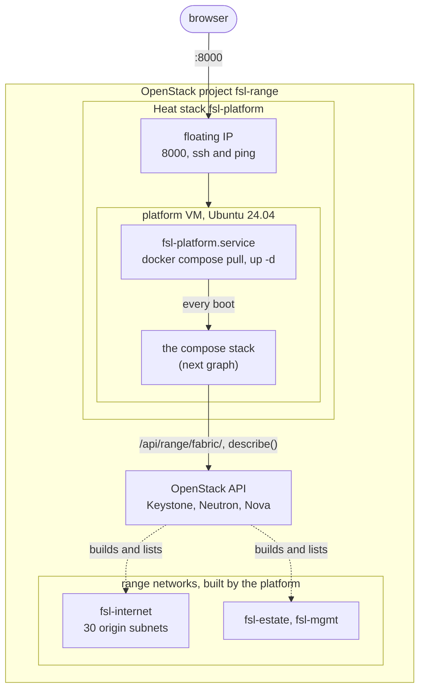
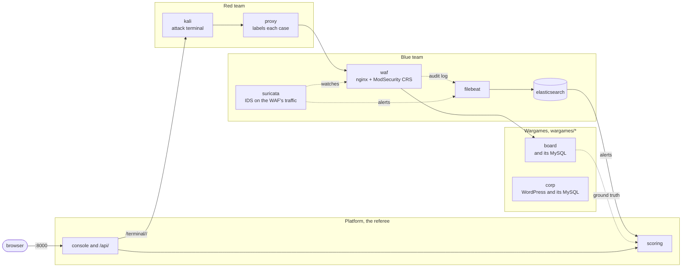

# fsl-project-mvp

A cyber attack/defence training range. A red team attacks two targets behind
the WAF, a Django board and a WordPress corporate site, each with its own
MySQL. A blue team defends with Suricata and ModSecurity, and the platform
scores both sides. This repo is a throwaway prototype; the production project
lives elsewhere.

- `CLAUDE.md`: what the repo is for, how the score works, the working rules
- `docs/superpowers/specs/2026-10-08-composable-isolated-learning-mvp-design.md`:
  the approved direction (2026-10-08); parts of it are not built yet
- `docs/ARCHITECTURE.md`: how the range is put together, and where it is going
- `docs/THREAT-MODEL.md`: what the range emulates and what it leaves out
- `docs/STATE.md`: where the work stands
- `docs/OPENSTACK.md`: what to set up on OpenStack (Kolla-Ansible 2026.1+), from the cloud to the range
- `README.ko.md`, `docs/ARCHITECTURE.ko.md`: this README and the architecture in Korean

## How it fits together

### Where it runs

On the OpenStack cloud the whole stack runs inside one VM, which one Heat
stack (`deploy/openstack/platform.yaml`) creates. The platform drives the
range through the OpenStack API as the member-role user `fsl-range`. On the VM
`FSL_SUBSTRATE=range.openstack.connect`, so the scored range is the OpenStack
slot, and a session cannot start until `/api/range/ready/` reports that slot
ready.



### Inside the stack

The red team attacks a wargame through the blue team's WAF and IDS. The
sensors' alerts go to Elasticsearch. The platform scores from those alerts and
from the target's own records (ground truth): exfiltrated data the attacker
submits is checked against the target's data. Two compose files split the
stack. `compose.yaml` is the control plane, one long-lived copy: the platform,
Elasticsearch, Kibana, and `collector`, a Filebeat that only takes syslog from
the OpenStack range. `session.yaml` is one session's data plane: the WAF,
Suricata, Filebeat, Kali, the proxy, and one folder per wargame under
`wargames/` that it includes. Opening a session (`POST /api/sessions/`) starts
`session.yaml` as its own compose project, `fsl-<session id>`, and waits until
every service is healthy; the platform then reads the target's baseline from
that session's own target. Sessions run side by side: each stack has its own
`estate` network and its own Elasticsearch index (`fsl-logs-<session id>-*`),
and opening a session takes down only the stacks of sessions closed more than
three minutes before, since a just-closed session's Filebeat may still be
shipping the alerts it is scored on.
At most `FSL_MAX_SESSIONS` sessions (default 2) are open at once; one more
answers 409, because each stack holds about 1.5 GB.
Closing a session leaves its stack standing until an open at least three
minutes later. A new wargame needs its folder with its `compose.yaml`,
`scenario.yaml` and `objectives.yaml`, a case file under `redteam/cases/`, and
one more `include:` line in `session.yaml`; `platform/wargames.py` discovers it
from `scenario.yaml`. There are two wargames: the board (`loot_verified`) and corp,
a WordPress site (`effect_observed`).



Not drawn: Kali's raw TCP goes straight to the WAF without the proxy, and the
platform fires scripted cases at the WAF itself. Through the substrate runner
(`docker exec` on compose, ssh on OpenStack) the platform writes the sensor's
rules and the proxy's case label, reads the attacker's command log, and reads
corp-db's MySQL binary log (`mysqlbinlog`); corp is scored by observed effect,
not by submitted data. The board's ground truth (its `auth_user` table) is read
over HTTP from the board itself (`BOARD_API_URL`), bypassing the WAF. On
compose the red terminal is Kali's own ttyd, which the platform's nginx serves
at `/terminal/<session id>/` from that session's `fsl-<id>-kali-1`; on OpenStack
it is a ttyd inside the platform that ssh's to the `mgmt` address of the Kali
in the session's slot (`/vm-terminal/fsl-kali/?arg=<session id>`). The networks are in `docs/ARCHITECTURE.md`.

## Bringing it up

On a host with Docker, clone the repo, fetch the GeoIP database once, pull
the images and bring the control plane up:

```bash
bin/fetch-geoip
docker compose -f session.yaml pull
docker compose pull && docker compose up -d
```

Our six images (platform, board, corp, corp-db, kali, proxy) are built by
`.github/workflows/images.yml` on every push to `dev` and published as
`ghcr.io/nekonic/fsl-<name>`, tagged with the commit SHA and `dev`. Compose
names each one `ghcr.io/nekonic/fsl-<name>:${FSL_IMAGE_TAG:-dev}`; set
`FSL_IMAGE_TAG` to a commit SHA to run exactly that commit's images (the
platform VM does). A package GitHub creates on first push is private even
when the repository is public; make each of the six public once, or an
unauthenticated pull fails: on github.com, the package's page, **Package
settings**, **Change visibility**, **Public** (irreversible). Every such service keeps its `build:`, so a developer who
changed a Dockerfile or an app builds locally instead of pulling:

```bash
docker compose -f session.yaml build
docker compose up -d --build
```

Sessions start their stack with `--no-build`, from whatever image the host
holds under that name, pulled or built. To start a session's stack by hand, as
the platform does:
`docker compose -p fsl-<id> -f session.yaml up -d --wait --no-build`.

Elasticsearch's managed GeoIP downloader is off; it reads `GeoLite2-City.mmdb`
from `config/ingest-geoip` (a durable bind mount) instead. `bin/fetch-geoip`
puts it there once. The file is not committed and survives a container
recreate (the cloud's Elasticsearch cannot reach the download CDN). On start
the platform sets the docker socket group; then, in the background while it
starts serving, it registers the Elasticsearch ingest pipeline, which sets each
event's time and geolocates source addresses, and imports Kibana's data view,
the "FSL alerts" search and the "FSL overview" dashboard, and points Kibana's
default route at the search.
Firing the scripted cases from the command line and `bin/verify`, `--fast`
included, need a virtualenv:

```bash
python3 -m venv .venv && .venv/bin/pip install -r platform/requirements.txt
```

| Port | | Used by |
|---|---|---|
| 8000 | the console, `/api/`, each session's Kali ttyd at `/terminal/<session id>/`, each session's WAF shell at `/waf-terminal/<session id>/`, and the terminals at `/vm-terminal/fsl-kali/` and `/vm-terminal/fsl-waf/` | a person's browser |
| 8002 | the blue console's Website pane: `/site/<session id>/<host>/`, proxied to that session's WAF (on OpenStack, to its slot's WAF over `mgmt`) | the iframe in a person's browser |
| 3080 | `gns3`, GNS3 3.1's API and web UI: each session's learner map, the company network the learner defends drawn as a lab topology (role names, interface and address with prefix at each link end, each zone captioned with its network; no management segment, no platform, no machine's own name), one per slot (OpenStack) or session (Docker) and the session's wargame, in English and Korean, held open with every node started (each host is a display container of one pinned busybox image, so every link end is green; the machines themselves run in the range). The full wiring is in `deploy/topology/system/`, never offered to learners. The blue console's Topology pane (tab Network map) frames `/static/web-ui/fsl-auditor.html`, which signs in read-only, on its session's map in the console's language, view-only (no editing controls; drag pans, the wheel zooms) and fitted to the pane. The container has `CAP_NET_ADMIN`, `/dev/net/tun`, the Docker socket and the host's pid namespace, which GNS3 needs to run its switches and start a docker node (`docs/ARCHITECTURE.md`, The topology) | the iframe in a person's browser, and `platform/gns3.py` over `mgmt` |
| 5140/udp | `collector`, Filebeat's syslog input | the OPNsense edge, the WAF and the wargame host's estate sensor on OpenStack |
| 9200 | Elasticsearch | the acceptance tests |

nginx inside the platform image serves 8000 and 8002. 8002 is a separate
origin for the target site, so a script planted on the target cannot read or
drive the console. Cookies are scoped by host, not port, so such a script could
still set a cookie the console would send; the console uses no cookies. It passes `/terminal/<session id>/`
to the ttyd on that session's Kali container, `fsl-<id>-kali-1` (compose), and
`/vm-terminal/` to ttyd processes inside the platform, which ssh to the host's
`mgmt` address (OpenStack; on compose Kali and the WAF have no `mgmt` address,
so these do not connect). On compose `/waf-terminal/<session id>/` goes to a ttyd
inside the platform that runs `docker exec` into `fsl-<id>-waf-1`.
By default every port is published on `127.0.0.1`.
On the platform VM, 8000, 8002 and 3080 are published on the VM's own address
(`FSL_PUBLISH`) and 5140/udp on `0.0.0.0` (`FSL_SYSLOG_PUBLISH`); the
platform template's security group opens 8000, 8002 and 3080 (`docs/OPENSTACK.md`
§3.5). The target is
not published: the command-line cases and the acceptance tests reach it from
inside the range, as the console does. Inside the range the
targets sit behind the WAF on port 80: `http://board.com` (aliased on the
`edge` network) and `http://corp.com` (a vhost reached by the `Host` header).
The edge networks are shared by every session, so the name would resolve to
every session's WAF; the platform aims each session's proxy at its own WAF and
gives launched tools `--add-host` entries for that WAF.

### On OpenStack

Everything that differs between clouds is in one file. Copy
`deploy/openstack/cloud.example.yaml` to `deploy/openstack/cloud.yaml` (git
ignores it) and fill it in: Keystone URL, region, interface, domain, project
and member user, where to read the password (`password_file` or
`password_env`; the password itself never goes in the file), the external
network, DNS, the tenant MTU, the platform/estate/mgmt CIDRs, the base image
name, an availability zone, flavors for the platform, the image builders, the
range and any role (`edge`), the operator's keypair and key file, the range
key, the OPNsense release to build (version, mirror, the image's SHA256
and the signing key's SHA256 from the release announcement), and the stack,
repository and ref. Every script and the Heat stack read it; a value that does
not parse is refused before anything is touched, with every problem named by
its key.

The cloud needs exactly one uploaded image: Canonical's stock Ubuntu 24.04
cloud image, uploaded as is under the name `compute.base_image` gives
(`docs/OPENSTACK.md` has the download, checksum and `openstack image create`
commands). Everything else is built from it at boot: the platform VM by
cloud-init, the range's golden images by builders, and the OPNsense edge image
by a builder that downloads the official release (below).

With `python-openstackclient` and `python-heatclient` installed, from the
operator's machine:

```bash
.venv/bin/python bin/cloud up        # the platform VM, then the whole range
.venv/bin/python bin/cloud down      # back up the store, keep the key, remove range and stack
```

`up` creates the platform's Heat stack (`deploy/openstack/platform.yaml`) if it
is absent (`--replace` replaces a standing one through `bin/platform-rebuild`),
waits for the API, then calls the platform's own range API in order: fabric,
images until clean, slot, configure, and waits until `/api/range/ready/` says
ready. It stops at the first drift, failed image, blocked slot or refused
configuration and says why. Neither command has been run against a cloud yet.

`bin/platform-rebuild` alone creates or replaces only the platform VM:

```bash
.venv/bin/python bin/platform-rebuild            # --cloud PATH, --ref REF
```

Before deleting anything it checks that the six images for the ref's commit
can be pulled anonymously from ghcr.io, keeps the range key (below) and backs
the store up (`bin/backup` over ssh). It then deletes the stack, creates it
again with every parameter from `cloud.yaml`, and waits until `/api/sessions/`
answers.

The new VM clones `ref`, pulls the images tagged with that checkout's commit,
and starts; cloud-init writes the cloud's values into
`/opt/fsl/openstack.env`. Two secrets stay out of the stack, because Nova's
metadata service serves user data to every process on the VM, containers
included: the password and the platform's range ssh key. Once the VM answers
ssh and cloud-init is done, `bin/platform-rebuild` appends
`FSL_OPENSTACK_PASSWORD` to `/opt/fsl/openstack.env`, writes the range key into
the platform's data volume at `/data/ssh/id_ed25519`, restores the store it
backed up (a replace), and recreates the platform container. The range key
lives on the operator's machine at `keys.range` (mode 0600); when the file is
absent, it is copied once from the running platform, and the script refuses
when there is none. Because the key survives, the range's VMs and the
`fsl-platform` keypair keep trusting the new platform, and the range can stand
through a platform replace.

The stack's `address` output is the floating IP. The console is at
`http://ADDRESS:8000/` and does not ask for a login. 9200 stays
on the VM's loopback; 5140/udp listens on all of the VM's addresses.

On the VM the checkout is `/opt/fsl`, owned by `ubuntu`; run compose,
`bin/backup` and the restore below there. `systemctl status fsl-platform`
shows how the last boot's bring-up went.

The range steps `bin/cloud up` runs can also be called by hand. The fabric
(networks, keypair, groups):

```bash
curl -s -X POST -H "Content-Type: application/json" -d "{}" http://ADDRESS:8000/api/range/fabric/
```

`GET` shows what is missing, present, drifted or left over; `DELETE` takes it
down, and is refused while a server is attached.

The range's VMs boot from golden images the platform builds from the setup
scripts `declaration.yaml` names under `hosts:`, each on a builder booted from
the base image. Each POST moves every build one step (boot a builder, stop it
once its setup reports, snapshot it, delete it; the edge's builder uploads its
disk instead of being snapshotted), so repeat it until the answer says
`"clean": true`:

```bash
curl -s -X POST -H "Content-Type: application/json" -d "{}" http://ADDRESS:8000/api/range/images/
```

A failed build shows the end of its console under `detail`; `DELETE` on the
same path removes failed builders and images built from older scripts.

With the images ready, one POST boots `fsl-edge`, `fsl-kali`, `fsl-waf`
and `fsl-wargame-host` (every wargame, as its GHCR containers), each from its
image, and the platform reaches them over ssh on `mgmt`:

```bash
curl -s -X POST -H "Content-Type: application/json" -d "{}" http://ADDRESS:8000/api/range/slot/
```

`POST /api/range/configure/` then pushes config over ssh: the OPNsense edge's
config.xml (WAN addresses, pass rules, Suricata, syslog) followed by a reboot,
and the WAF's ModSecurity log forwarding. `POST /api/range/slot/rebuild/`
Nova-rebuilds every VM from its golden image, keeping its ports and addresses,
so no edited data or rule carries over. The rebuild wipes the pushed config
(board and corp run as containers on the wargame host image, which configure
starts). Closing a session resets its own slot: it rebuilds Kali and the WAF,
resets the edge (hash-checked, no reboot unless its files drifted) and the wargame host
(`docker compose down -v`) in place, and configures them again by itself once
the VMs are ACTIVE: meanwhile `GET /api/range/ready/` reads phase `RESETTING` and a
session open is refused; on failure it reads `RESET_FAILED` with the reason,
and `POST /api/range/configure/` retries. After `slot/rebuild/` called alone,
run `configure/` yourself.

`compute.slots` in `cloud.yaml` (default 1) stands that many copies of the
range, each its own edge, WAF, Kali and wargame host on its own copy of the
internet and estate networks (slot N's hosts are `<host>-N`), so that many
sessions run at once; each session holds one slot, and its close resets only
that slot. `slot/`, `slot/rebuild/` and `configure/` take `?slot=N`, and
without it act on every slot.

The range lives outside the stack. A platform replaced with `bin/platform-rebuild`
keeps the range key, so the slot and the fabric can stand through
it; the new server is attached to `mgmt` again by the next `POST
/api/range/fabric/`, and `configure/` points the range's syslog at it. A stack
deleted by hand, without the key kept, leaves a new VM that makes a new key,
and the fabric reports the old keypair as drift: then `DELETE`
`/api/range/slot/` and `/api/range/fabric/` first. The images stay.

The stack boots with the keypair `keys.operator` names, which has to be in the
project first:

```bash
openstack keypair create --public-key PUBLIC_KEY_FILE fsl-claude
```

### The OPNsense image

The edge is OPNsense (BSD 2-clause), built automatically by the images step.
A builder booted from the stock Ubuntu image installs its tools, downloads
`OPNsense-<version>-nano-amd64.img.bz2`, its `.sig` and the release key from
`opnsense.mirror`, checks the archive against `opnsense.image_sha256` and the
key against `opnsense.pubkey_sha256` (both from the release announcement, not
from the mirror), unpacks it, verifies the signature, boots it once under QEMU
answering its configuration importer so it starts from `deploy/opnsense/config.xml`
(root trusts only the platform key and has no password; the stock image's
default password never exists), converts it with `qemu-img` to qcow2 and
uploads it to Glance as `fsl-opnsense-<version>`. A new version, a new MTU or a
new platform key builds a new image. The image is built from the official
release on each cloud and never published; OPNsense's trademark policy asks
for permission before a derivative name is used.

## Running a session

Open http://localhost:8000, start a session, and open the red and blue consoles
side by side. The language button in the header switches between English and
Korean.

- **Red** has the objectives, a Kali shell and the scripted cases. A fired
  case is labelled on the way out. Alternatively name a case, press start,
  work in the shell and press stop: everything sent in between is attributed
  to that name.
- **Blue** is a sidebar of framed tools: Kibana, opened on Discover with the
  "FSL alerts" columns and query narrowed to the session, a WAF terminal, and a
  Website pane (a site browser with a Network panel). It calls `/api/` for the
  session, the site's requests, the steps and hints of a foundation or worked
  scenario, a scenario's status and triage, ingest and detections. The
  result appears on the session page when the session closes: objectives lost
  first, then in plain sentences how many attacks were caught and benign
  requests passed.

A session opened with no guidance (`{"scenario": "board"}`, the home card's
"Start wargame") is a plain wargame at the full defense, CRS paranoia level 1;
`{"defense": "<name>"}` takes another posture the wargame declares (`minimal`
is PL4). An agent tunes the WAF through `PUT /api/sessions/<id>/waf/`; `GET`
reports what is in the WAF's file.

The home page lists six foundations for learners new to networks, each opened
by its id (`{"lesson": "f1"}` to `f6`; `{"guidance": true}` alone opens F1):
F1 reads the range's map in the Topology pane, F2 follows one Korean search hop
by hop, F3 reads its method, path, parameter and status code, F4 finds records
in Kibana and tells the WAF's from the IDS's, F5 follows a blocked SQL injection
and a sqlmap run from the Red console's Kali terminal, and F6 runs the same
sqlmap against a WAF whose blocking rules are off (defense `missed`), hands in
the dumped accounts and reads the loss in the first score. Every answer is read
from the learner's own records or the substrate's topology, never a fixed key;
the learner's own sqlmap run counts in both scores like any other red action.
The blue console's note walks the unit's steps, each checked by the platform
(`POST /api/sessions/<id>/lesson/steps/<step>/check/`), and records each step
reached, passed or skipped; the session payload carries no answer key, a step's
command only once the step is reached, and a step's answer text only once its
hints reach it. Each step has hints that end in "Do it for me" (`.../do/`, a
server action); hint and "Do it for me" use is recorded on the session. The
benign request a unit replays at open counts in neither score.

After the foundations come scenarios (`{"scenario": "1.1"}`): customers and an
attacker use the board while the learner defends with the real tools. Each
opens on a briefing (situation, goal, how it is measured, time); a strip shows
the time left, customers blocked and alerted requests per minute, and objectives lost;
an attack schedule the learner does not see fires through the normal path,
and a dump it gets counts in the first score when the board's accounts match.
"I'm done" (or the schedule) opens a final check of a few minutes, judged by
task class: judgement passes when every alerted item listed at its start is
judged right (blocked customers are reported, not counted); availability and
unknown when no customer is blocked and every attack is held (2.3 also needs
anomaly thresholds of at most 5/4); detection when every attack draws a
corroborated Suricata alert and no customer request does. `1.1` "A quiet shift" asks the learner to judge each request
that drew an alert, customer or attack and whether it got the data
(`/api/sessions/<id>/triage/`); `2.1` "Korean searches blocked" asks for the
customers a PL3 WAF refuses to be served without letting sqlmap through. The
rest of the course follows by task class: `1.2` and `1.3` judge alerts when an
inherited exception lets sqlmap take the accounts (1.3 also the kind of each
attack), `2.2` and `2.3` serve customers blocked at PL2 and while lowering the
anomaly thresholds to 5/4 at PL3, `3.1` to `3.4` make the IDS alert on the sort
attack, its tamper variant and the comment XSS in an IDS rules pane (second
score only), and `4.1` gives no help against an unseen sqlmap variant and new
false positives. A
hint is offered when the learner is stuck and recorded only when opened; the
debrief adds the customers blocked and the attack timeline. Detail:
`docs/ARCHITECTURE.md`, "Scenarios".

The scripted cases can also be fired from the command line, as the acceptance
tests do. The target is not published, so the harness runs inside the range,
from the platform:

```bash
docker compose exec platform \
  python redteam/run.py --target http://board.com --tool-target http://board.com
```

The harness opens the session of the scenario whose `case_file` matches the
`--cases` basename (`board.yaml` opens board, `corp.yaml` opens corp, anything
else opens board), and `--target` defaults to that scenario's `public_url`.
For corp: `--cases redteam/cases/corp.yaml`.

## Checking it

```bash
bin/verify --fast     # unit and API tests and the metrics, no stack needed
bin/verify            # also the acceptance tests in test/, against the live stack
```

The full run restarts the platform and resets the target, the rules and the
attacker's origin, so do not run it against a stack someone is using. It
deletes only the sessions it created. The acceptance step is `bin/acceptance`:
one pytest process per session the range can hold at once (`max_sessions` of
`GET /api/range/ready/`), plus one for the checks that read only
Elasticsearch; `bin/acceptance --plan` prints the split, `test/README.md`
explains it.
On a platform that does not listen on localhost (the OpenStack platform VM),
run it on that host with `FSL_PLATFORM_URL=http://<address>:8000 bin/verify`;
tests that exercise the compose range are skipped when the platform reports
another substrate.
`bin/prune` deletes sessions by hand and is a dry run without `--apply`:

```bash
bin/prune --keep 20 --apply      # keep the newest 20
bin/prune --ids FILE --apply     # only the closed sessions FILE lists
```

After adding a Tailwind class to a template, run `bin/build-css`; the
generated stylesheet is committed, and a test fails when it is stale.

## Backup and restore

The platform's store (sessions, cases, detections, objectives, rule sets,
suppressions) is one SQLite file, `/data/db.sqlite3` on the `fsl_platformdata`
volume. Nothing else is backed up: not Elasticsearch's `fsl_esdata` volume,
not the collector's registry in `fsl_collectordata`, and not a session's
volumes (`fsl-<id>_filebeatdata`, `fsl-<id>_waflogs` with ModSecurity's audit
log, `fsl-<id>_suricatalogs` with Suricata's `eve.json`, `fsl-<id>_label`
with the proxy's case label), which are deleted when a session opens more
than three minutes after this one closed. `docker compose down -v` deletes
the control plane's three volumes.

```bash
bin/backup      # writes backups/db-<UTC time>.sqlite3 while the platform serves
```

It uses SQLite's online backup API, checks the copy with `PRAGMA
integrity_check`, and keeps nothing if either step fails. To reach a platform
that is not in Docker, set `FSL_PLATFORM_EXEC` to a command that runs
`python -` with the platform's settings importable.

Restore by hand, with the platform stopped:

```bash
docker compose stop platform
docker run --rm --network none --entrypoint sh --user fsl \
  -v fsl_platformdata:/data -v "$PWD/backups:/backups:ro" fsl-platform \
  -c 'rm -f /data/db.sqlite3-journal && cp /backups/db-20260925T020000Z.sqlite3 /data/db.sqlite3'
docker compose start platform
```

`--entrypoint sh` replaces the image's entrypoint, which ignores its
arguments. `--user fsl` leaves the copy owned by the platform's user;
`docker cp` would leave it owned by root and unwritable. The old `-journal`
must go, or SQLite replays it onto the restored file. On start the platform
applies any newer migrations. The copy step was checked on a scratch volume;
the whole procedure has not been run against a live stack.

## Local lab only

Elasticsearch runs without security and Django with `DEBUG=1`. Django answers
only to `localhost`, `127.0.0.1` and `[::1]` unless `DJANGO_ALLOWED_HOSTS`
names more; the platform VM adds its floating IP. The Docker socket is
mounted into the platform, a container escape path. `/terminal/` is an
unauthenticated root shell on Kali (`/terminal/<session id>/` on compose), and the terminals under `/vm-terminal/` need
no login of their own and give a shell on Kali and the WAF, as does
`/waf-terminal/<session id>/` on compose (a shell in that session's WAF).

The same holds on the platform VM. There the project's password is also plain
text in `/opt/fsl/openstack.env` and in the platform container's environment.
The VM's ssh and 8000 are open to any address, and 8000 asks for no login.
