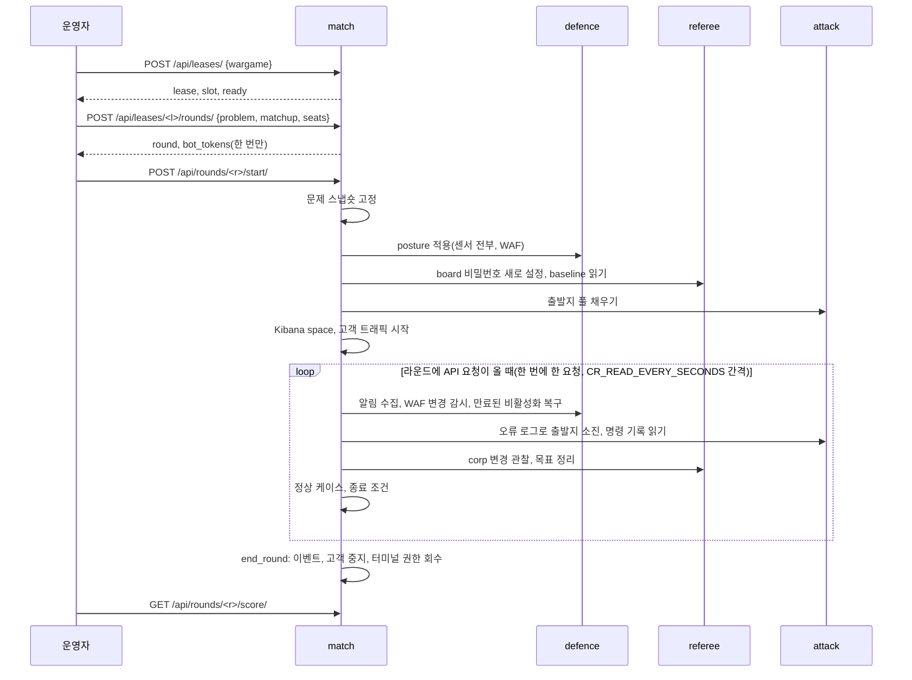

# 아키텍처

이 문서는 `side-split` 구조의 계층, 파일 지도, 격리 경계, 라운드 흐름을 다룹니다. 설계 근거는
[설계 문서](superpowers/specs/2026-11-19-side-split-design.md), 점수 정의는 `CLAUDE.md`, 작업 현황은 `docs/STATE.md`에
있습니다. 훈련 환경(OpenStack, Heat 스택, 역할 이미지) 운영 절차는 `docs/OPENSTACK.md`에 있습니다.

이전 구조(`platform/api/`, `platform/console/`, 시나리오 엔진)의 설명은 git 기록에 있습니다. 새 구조는 이전 코드를
옮긴 것이 아니라 새로 쓴 것이고, 격리 경계, 채점 핵심, 훈련 환경 어댑터, 케이스만 가져왔습니다.

## 용어

- **워게임**: 대상 앱과 그 목표, 케이스. `board`와 `corp` 두 개. `wargames/<id>/wargame.yaml`이 정의
- **문제**(`Problem`): 스태프가 DB에 쓰는 레슨 또는 라운드 문제. 레슨 문제는 단계(`Step`)를, 라운드 문제는 라운드
  설정(`RoundSetup`)을 가짐
- **리스**(`Lease`): 슬롯 스택 하나를 빌린 것. 용도는 `round`, `lesson`, `probe`. 닫히거나 만료되면 스택을 지우고 새로 만듦
- **라운드**(`Round`): 리스 위에서 도는 한 판. 종류는 `round` 또는 `lesson`, 단계는 `created → starting → running → ended`
- **자리**(`Seat`): 라운드의 공격석 또는 방어석. 사람(`human`) 또는 봇(`bot`). 봇 자리는 자리 토큰을 가짐
- **매치업**: `pvp`, `def_vs_bot`(사람 수비 vs AI 공격 봇), `atk_vs_bot`(사람 공격 vs AI 수비 봇)
- **슬롯**: `cr-slot-N`의 N. 다시 쓰는 번호. Kibana space `soc-logs-N`, 로그 인덱스 `logs-N-*`도 이 번호
- **케이스**: `redteam/cases/<wargame>.yaml`에 선언한 공격 요청이나 정상 요청. 알림이 몇 건 나오든 판정은 1건
- **자유 행동**: 선언된 케이스가 아닌 요청, 도구 실행, 명령, 사이트 패널 요청. 출발지와 시간으로 묶어 따로 보고하고
  정탐·오탐으로 세지 않음
- **마커**: 요청의 `X-Request-ID` 값. API로 보낸 요청과 케이스는 플랫폼이 붙이고, 알림과 행동을 이 값으로 매칭
- **posture**: 라운드 시작 시점의 Suricata 룰과 WAF 파일 텍스트. 스태프가 `Posture` 행으로 작성
- **probe 녹화**: 룰 테스트에 쓰는 케이스별 요청·응답·pcap. `wargames/<id>/probes/`에 커밋

## 계층

모듈은 자기 계층이나 그보다 낮은 계층만 import합니다. `platform/tests/seams/test_imports.py`가 AST로 검사하고, 모델
FK 대상과 마이그레이션 의존성도 같은 순서를 따르는지 봅니다. `platform/` 아래 모듈은 모두 계층이 있어야 하고, 없으면
테스트가 실패합니다.

| 계층 | 모듈 |
|---|---|
| L0 순수 | `domain/**` |
| L1 경계와 라이브러리 | `cr/config.py`, `cr/errors.py`, `ingest/*`, `rules/*`, `range/*`, `attack/box.py`, `attack/firing.py`, `attack/tools.py`, `defence/kibana.py`, `referee/loot.py`, `referee/effect.py`, `testing/*` |
| L2 기본 앱 | `accounts/*`, `events/*`, `content/*` |
| L3 라운드 기록 | `match/models.py`, `match/auth.py` |
| L4 | `referee/models.py`, `referee/service.py` |
| L5 양쪽 | `attack/models.py`, `attack/service.py`, `defence/*`(`kibana.py` 제외) |
| L6 | `match/service.py`, `customers.py`, `site.py`, `retention.py`, `probes.py` |
| L7 | `lessons/*` |
| L8 HTTP | `views*.py`, `serializers.py`, `urls.py`, `cr/urls.py`, `cr/handler.py`, `cr/schema.py`, `cr/settings.py`, `cr/strings.py`, `cr/wsgi.py`, `management/commands/*`, `apps.py`, 마이그레이션 |

주요 규칙:

1. `domain/`은 표준 라이브러리와 `domain`만 import합니다.
2. L1은 Django, DRF, 앱을 import하지 않습니다. 설정은 `cr/config.py`가 만든 frozen dataclass로 받고, 원격 실행은
   주입받은 runner(`range/runner.py`의 `Runner`, `Launcher`, `Substrate`)로 합니다.
3. `attack`과 `defence`는 서로 import하지 않습니다.
4. `referee.loot`, `referee.effect`는 `referee/`만 import합니다. 다른 앱은 `referee.service`만 씁니다.
5. `referee`는 `attack`, `defence`, `lessons`, `match.service`를 import하지 않습니다. 행동과 탐지는 호출하는 쪽이
   `domain.types` 레코드로 넘깁니다.
6. `lessons`는 `match`, `attack`, `defence`, `referee`, `content`의 `service.py`만 import합니다.
7. 양쪽 서비스를 둘 이상 import하는 것은 L6의 `match` 모듈과 `lessons.service`뿐입니다.
8. `events`는 다른 앱을 import하지 않고 FK도 없습니다. 모든 앱이 `events.log`를 씁니다.
9. 앱 경계를 넘을 때는 `<앱>.service`만 import합니다. `<앱>.models`는 아래 계층 FK 대상일 때만 씁니다.
10. view와 serializer는 자기 앱의 `service.py`, 자기 `models`, DRF, `cr.errors`, `match.auth`, `accounts.service`만
    import합니다. L1 경계를 직접 부르지 않습니다.
11. `objective.lost` 이벤트는 `platform/referee/`에서만 남깁니다.
12. `bots/`, `test/`, `bin/`은 `platform/`을 import하지 않습니다. `/api/`의 클라이언트입니다.

서비스는 `cr/errors.py`의 도메인 오류를 던지고 응답을 만들지 않습니다. `cr/handler.py` 하나가 상태 코드와 오류
형태로 바꿉니다.

## 파일 지도

```
openapi/schema.yaml           커밋하는 API 계약(유일하게 커밋하는 생성물)
openapi/python-client.yaml    Python 클라이언트 생성 설정
strings/console.json          콘솔이 보여 주는 한국어(front/에 묶임)
strings/server.json           서버가 직접 그리는 한국어(Kibana 게이트 페이지). 번들에 넣지 않음
bin/
  verify                      gen-clients → 계층별 단위 테스트 → acceptance
  gen-clients                 schema.yaml 내보내기, bots/client/와 front/src/api/schema.d.ts 생성(커밋 안 함)
  select-tests                --changed가 돌릴 테스트 고르기
  acceptance                  test/ 실행
  cloud  platform-rebuild     클라우드와 플랫폼 VM. 스태프 range API를 생성 클라이언트로 호출
  backup  prune  carry-users  DB 스냅숏, 닫힌 리스 정리, 옛 DB에서 계정만 옮기기
  fetch-geoip  pick-origins  worldmap  build-css
platform/                     패키지 아님. manage.py와 pytest의 작업 디렉터리
  cr/          settings.py  urls.py  wsgi.py  schema.py(자리별 스키마)
               config.py    경계마다 넘기는 frozen 설정, topology의 센서 목록
               errors.py    DomainError와 하위 클래스, 오류 코드
               handler.py   DRF 예외 처리기. 오류 형태 하나
               strings.py   strings/server.json 읽기
  domain/      types.py  traffic.py(고객 배분, limit_req 하한)  verdicts.py(룰 테스트 판정표)  checks.py(단계 판정)
               problems.py(문제 검증)  round_rules.py(매치업, 단계, 종료 조건)
               scoring/  correlate.py  metrics.py  corroborate.py  objectives.py
  ingest/      elastic.py   경계: search_after 커서 읽기, 접근 로그, 정규화, ingest 파이프라인 등록
  rules/       suricata.py  경계: 룰 파일, -T 검사, 오프라인 -r 실행, 적용, 기본 룰 적재, 패킷 캡처
               crs.py       경계: WAF 파일 읽기·검사·쓰기, nginx -t·reload·되돌리기, 임시 인스턴스 검사·테스트
  range/       openstack.py 경계: Keystone/Heat/Neutron REST, 실제 배선 읽기, 재생성 때 기본 룰 적재
               cloud_config.py  stack_plan.py  declaration.py(+declaration.yaml)  networks.py
               wiring.py(배선 파싱)  topology.py(학습자용 이름, 자리별 필터)  pool.py  refill.py
               reachability.py  runner.py  substrate.py
               edge.py      경계: infra nftables pool·spent 집합, conntrack 정리
               jump.py      경계: 플랫폼 sshd 점프 권한, 키 생성, 박스 계정의 authorized_keys
  accounts/    SignInBlock, 로그인·가입·승인, 차단, 스태프 계정 API, 초기 계정 admin(마이그레이션 0002)
  events/      Event(FK 없음), kinds.py(종류별 스키마와 보는 쪽), log.py(append, after), 피드 API
  content/     Wargame, Posture, Problem, Step, RoundSetup, ProbeSet, catalog.py(wargames/와 redteam/cases 읽기)
               스태프 문제 API(중첩 문서, revision, 내보내기·가져오기), 학습자 읽기 API
  match/       Lease, Round, Seat, CustomerRequest
               auth.py      SeatTokenAuthentication, HasSeat(side), InRound, IsOperator, OnLease
               service.py   리스·라운드 수명, 참가, 시작, 요청 때 로그 읽기, 종료, 기권, 점수
               customers.py  정상 케이스와 고객 트래픽
               site.py      사이트 패널 프록시      probes.py     probe 녹화   retention.py
               management/commands/  rebuild_slots  register_pipeline  prune  run_on_role  terminal_shell
  referee/     Objective, loot.py(경계: board 정답 데이터), effect.py(경계: corp 정답 데이터)
               service.py   baseline, loot 제출, corp 변경 관찰, 목표, 비밀값 가리기, 점수
  attack/      Action, ToolRun, Origin, AccessCursor
               box.py       경계: 공격 박스(출발지, set-origin, 명령 기록, 도구 이미지, 실행 중지)
               (sandbox/customers.py  경계: infra VM의 고객 프로그램과 고객 주소)
               firing.py    케이스 요청 만들기와 발사(X-Request-ID 마커)   tools.py  도구 인자
               service.py   공격 API의 모든 동작, 고객 전송   origins.py  출발지 풀, 오류 로그로 소진, limit_req 하한
  defence/     Detection, RuleSet, RuleTest, DisabledRule, AlertCursor
               kibana.py    경계: Kibana API, space, 거부 규칙, 초기 설정
               alerts.py    AlertCursor로 알림 수집    ruletest.py  검사 → probe 묶음 → 오프라인 실행 → 판정표
               disable.py   룰 임시 비활성화
               service.py   방어 API의 모든 동작       views_kibana.py  Kibana 게이트
  lessons/     StepResult, Progress, facts.py(판정에 필요한 기록을 양쪽 서비스로 모음), service.py
  testing/     fakecloud.py  standin.py  fakes.py(가짜 runner, 가짜 ES)  fakerange.py  factories.py(영어 자리표시 문제)
  tests/       domain/  seams/  accounts/  events/  content/  match/  referee/  defence/  attack/  lessons/  contract/
               test_*.py(배포 파일, compose, 역할 이미지, 경계 검사 등)
  entrypoint.sh  nginx.conf  vm-terminal.sh  tmux.conf  Dockerfile
bots/          tools.py  calls.py  cli.py  play.py  provider.py  signin.py  prompts/  client/(생성, 커밋 안 함)
test/          라이브 acceptance. plays.py가 생성 클라이언트로 리스와 라운드를 돌림
redteam/cases/ board.yaml  corp.yaml   공격·정상 케이스(데이터만)
wargames/<board|corp>/  wargame.yaml  compose.yaml  topology.yaml  objectives.yaml  traffic.yaml  probes/  app/
deploy/        roles/<kali|waf|infra|target>/  openstack/  suricata/  filebeat/  elastic/  kibana/  traffic/
               kali/  waf/  proxy/   역할 디렉터리가 링크로 가리키는 원본(proxy/stamp.py는 사본 없이 하나)
front/         Vite, TypeScript, Preact 콘솔. platform/Dockerfile의 node 단계가 빌드하고 nginx가 /app/front/dist로 내줌
  src/theme/   tokens.css(색, 글꼴, 크기, 간격, 둥글기, 그림자 값)  components.css(모든 컴포넌트 클래스)
  src/ui/      props만 받아 클래스를 그리는 작은 컴포넌트: Button, Badge, Card, Hero, Table, Field, Notice, Shell(TopNav,
               PageShell), Console(Rail, Pane, PaneHeader, Aside), Steps, Site, Editor, Ops, Record, Tiles, Text, Icon
               looks.ts     상태별 모양 선택(타일 색, 단계 색). index.ts에서 모두 내보냄
  src/panes/   설계 §13의 패널. 각자 api/의 훅으로 데이터를 받고 ui/로 그림. 어느 페이지에 있는지 모름
               Kibana  Terminal(Kali, WAF)  Site  Map(+map-symbols/)  IdsRules  Waf  RuleTestTable  Alerts
               Objectives  Origins  Loot  AttackCases  RuleVersions  Score  StepCard
               registry.ts  패널 id → 컴포넌트 표   staff/  문제·posture 편집기, 가져오기, 단계 편집
  src/pages/   얇은 배치: 어떤 패널을 어디에 둘지. Login  Signup  Home  RoundLobby  Lesson  RoundAttack  RoundDefence
               Result  staff/(Problems  Postures  Users  Range)
  src/console/ Console.tsx(layouts.ts의 선언대로 레일, 본문, 오른쪽 열을 그림)  RoundHeader.tsx
  src/shell/   AppPage.tsx(상단 메뉴와 페이지 틀)  AuthCard.tsx(로그인·가입 카드)
  src/api/     client.ts(CSRF 갱신, 90초 제한, 슬롯 대기, 오류 형태)  follow.ts(이벤트 커서 하나, 리스 heartbeat)
               hooks.ts(useResource, useEvents 등)  schema.d.ts(생성, 커밋 안 함)
  src/         layouts.ts(공격·방어·레슨 콘솔의 레일 순서와 오른쪽 열)  routes.ts(경로 표)  nav.ts(상단 메뉴 표)
               strings.ts(t(key, params), strings/console.json 읽기)  links.ts  router.ts  format.ts  App.tsx  main.tsx
  mock/        개발 서버(npm run dev)에서만 쓰는 가짜 /api/ 응답. fixtures/에 화면별 응답, 영어 자리표시
```

### 화면 바꾸는 법

| 바꿀 것 | 고칠 파일 |
|---|---|
| 색, 글꼴, 크기, 간격, 둥글기(지도 포함) | `front/src/theme/tokens.css`. 지도 아이콘(`panes/map-symbols/node-*.svg`)은 색과 둥글기를 `var(--map-…)`로 적고, `panes/Map.tsx`가 그리기 전에 토큰 값으로 바꿔 넣음. cytoscape의 모서리, 글꼴 크기, 투명도도 `--map-…` 토큰에서 읽음 |
| 카드, 버튼, 표 같은 모양 | `front/src/theme/components.css`. 페이지와 패널에는 스타일이 없음(진행 막대 너비만 예외) |
| 콘솔의 레일 순서, 패널 추가·제거, 오른쪽 열 | `front/src/layouts.ts`의 한 줄. 오른쪽 열 맨 위의 큰 패널은 `asideLead`, 나머지는 `aside`라서 `aside` 순서를 바꿔도 모양은 그대로 |
| 본문에 패널 둘을 나란히 | `front/src/layouts.ts`에서 레일 항목에 `beside: ["<패널>"]`을 적음. 그 탭을 열면 본문이 패널과 `beside` 패널로 나뉨(좁은 화면에서는 위아래) |
| 페이지에 어떤 패널을 둘지 | `front/src/pages/<페이지>.tsx` |
| 경로, 상단 메뉴 | `front/src/routes.ts`, `front/src/nav.ts` |
| 문구 | `strings/console.json`. 화면 문구는 모두 `t(key, params)`로 나옴. 다른 값의 라벨을 가져다 쓸 때는 `{@verdict.tn}`처럼 키를 적어 두므로, 라벨 이름은 그 값 하나만 고치면 됨 |
| 패널이 보여 주는 데이터 | `front/src/panes/<패널>.tsx`와 `front/src/api/hooks.ts`. 서버 응답은 `openapi/schema.yaml`이 정함 |

`front/`에서 `npm ci && npm run types && npm run dev`로 띄우면 `mock/`의 가짜 응답으로 모든 화면을 볼 수
있습니다. 아직 남은 제약:

- 지도 선 굵기와 라벨 여백 같은 cytoscape 수치 일부, 아이콘 안 그림의 선 굵기는 아직 `panes/Map.tsx`와 SVG 파일에
  숫자로 있습니다.
- `beside`는 레일 탭 하나에 붙고, 나란히 놓인 패널은 같은 너비로 나뉩니다. 너비 비율을 바꾸려면
  `components.css`의 `.pane-split`을 고쳐야 합니다.

## 격리 경계

각 외부 시스템은 파일 하나만 압니다. `platform/tests/seams/test_isolation_seams.py`가 `platform/`, `front/src`, `bots/`,
`test/`, `bin/`을 훑으며 경계마다 패턴 하나를 두고, 그 패턴이 주인 파일과 아래 예외 밖에서 나오면 실패합니다. 주인 파일에서
패턴이 사라져도, 예외 목록이 `CLAUDE.md`의 목록과 달라져도 실패합니다.

| 아는 것 | 주인 파일 | 예외(코드에 남은 것) |
|---|---|---|
| Elasticsearch(검색, 삭제, bulk, ingest 파이프라인) | `ingest/elastic.py` | Elasticsearch 설정 자체를 보는 acceptance 검사 `test/test_event_time.py`, `test/test_geoip_durable.py`, `test/test_origin_placement.py`, `test/test_waf_geolocation.py` |
| 패킷 캡처(`tcpdump`) | `rules/suricata.py` | 없음 |
| Suricata 프로세스(`-T`, `suricatasc`, reload, af-packet) | `rules/suricata.py` | 각 `topology.yaml`의 센서 장치 `cr-ids`가 룰 파일과 reload 명령을 적음 |
| CRS/ModSecurity 설정과 nginx reload | `rules/crs.py` | `cr/config.py`의 기본값(예외 파일 경로, reload 명령). 각 `topology.yaml`의 WAF 장치 `cr-waf`가 예외 파일과 reload를 적음 |
| Kibana API | `defence/kibana.py` | `platform/nginx.conf`: 거부할 Kibana API 경로, space 안 API 호출을 `kibana-gate`로 넘기기, `api/spaces/space` 직접 응답 |
| 로그 인덱스 패턴(`logs-*`) | `defence/kibana.py` | `cr/config.py`의 기본값. `test/test_event_time.py` |
| 훈련 환경 노드 이름(`cr-kali`, `cr-waf`, `cr-infra`, `cr-target`) | 없음(설정으로 넘김) | `cr/config.py`의 기본값. `platform/entrypoint.sh`가 `vm-terminal.sh cr-kali attack`, `vm-terminal.sh cr-waf defence`를 띄움 |
| OpenStack API와 실제 배선 | `range/openstack.py`(파싱 `range/wiring.py`, 이름 `range/topology.py`) | 없음 |
| infra 라우터의 nftables 집합 | `range/edge.py` | `deploy/roles/infra/edge.nft`가 `pool`, `spent` 집합을 선언(역할 이미지에는 아직 없음, 아래 참고) |
| 플랫폼 점프 호스트와 박스 계정 키 | `range/jump.py` | `platform/entrypoint.sh`가 점프 호스트의 `authorized_keys`를 만듦 |
| 공격 박스 | `attack/box.py` | `cr/config.py`의 라벨 파일 경로 기본값 |
| 대상의 정답 데이터 | `referee/loot.py`(board), `referee/effect.py`(corp) | 없음 |

- `range/jump.py`가 `range/` 아래 있는 이유: 공격석(Kali)과 방어석(WAF의 `analyst`) 터미널이 같은 점프 권한을 쓰고,
  `attack`과 `defence`는 서로 import하지 않기 때문입니다. 박스 주소, runner, 계정은 호출하는 쪽이 넘깁니다.
- `range/openstack.py`는 슬롯을 재생성할 때 `rules.suricata.seed`로 `deploy/suricata/rules/local.rules`를 적재합니다.
  재생성 기본 룰은 슬롯의 시작 파일이고, 라운드 시작 때 문제의 posture가 그 위에 적용됩니다.
- 이전 구조의 예외 중 `register_pipeline.py`(→ `ingest/elastic.py`), `operator_log.py`(→ `attack/box.py`),
  `redteam/tools.py`의 `cr-kali`(→ 박스가 `launch`를 넘김), 레슨 F6의 명령(레슨과 함께 삭제), `blue.html`의 Kibana
  localStorage 설정(콘솔과 함께 삭제)은 없어졌습니다. 그 설정은 이제 `front/src/panes/Kibana.tsx`(`presetKibana`)가 맡습니다.
- Elasticsearch를 직접 읽는 acceptance 검사 넷은 `/api/` 뒤로 옮길지 아직 정하지 않았습니다.

## 라운드 흐름



- 시작 조건: 비어 있는 사람 자리가 없어야 하고(`seats_open`), 슬롯이 준비돼 있어야 하며, 채점 라운드는 목표를 잃은 적
  없는 리스여야 합니다.
- 종료 이유: `time_limit`, `all_objectives_lost`, `origins_spent`(정상 케이스가 한 바퀴 돈 뒤에만), `ended_by_operator`,
  `forfeit_attack`, `forfeit_defence`, `steps_done`(레슨), `lease_expired`.
- 리스는 `CR_LEASE_IDLE_MINUTES` 동안 하트비트가 없으면 만료됩니다. 운영자와 자리가 하트비트를 보냅니다.
- 읽기 단계 하나가 실패해도 나머지 단계는 계속 돕니다. 제한 시간이 지난 라운드는 다음 요청이 끝내고 종료 시각은
  제한 시간으로 남깁니다. 점수는 종료 시각까지의 동작, 알림, 목표만 셉니다.
- 만료된 할당은 다음 할당 요청이나 그 할당에 들어온 요청이 닫습니다. 반납된 슬롯의 스택은 `rebuild` 서비스
  (`manage.py rebuild_slots`)가 다시 만듭니다.

## API

모든 응답은 JSON이고, 2xx가 아닌 응답은 `{errors:[{path, code, line?, params?}]}` 하나의 형태입니다. `code`는 영어
고정값이고 `openapi/schema.yaml`에 enum으로 들어갑니다. 한국어는 콘솔이 `strings/console.json`에서 찾습니다.

| 태그 | 경로 | 내용 |
|---|---|---|
| `accounts` | `/api/auth/csrf/`, `login/`, `signup/`, `logout/`, `/api/me/`, `/api/staff/users/`, `/api/staff/blocks/` | 로그인, 가입, 승인, 차단 |
| `match` | `/api/leases/`, `/api/leases/<l>/{heartbeat,close,rounds}/`, `/api/rounds/`, `/api/rounds/<r>/{seats/<side>/join,start,end,score,topology,site/requests,terminal-auth/<side>,attack/forfeit,defence/forfeit}/`, `/api/staff/range/{,fabric/,leftovers/,pool/}`, `/api/staff/wargames/<id>/probes/record/`, `/api/staff/probes/<l>/` | 리스, 라운드, 점수, 구성도, 사이트 패널, 터미널 인증, 풀 운영, probe 녹화 |
| `events` | `/api/rounds/<r>/events/?after=` | 커서 피드. 종류마다 보는 쪽이 정해짐 |
| `attack` | `/api/rounds/<r>/attack/{state,cases,requests,tools,tools/<run>,loot,origins/next,terminal}/` | 공격 API. 성공 응답에 `remaining`, 모든 응답에 `X-Origin`, `X-Origins-Left` |
| `defence` | `/api/rounds/<r>/defence/{state,alerts,traffic,probes,ids/rules,ids/rules/versions,ids/rules/check,ids/rules/test,ids/rules/tests/<t>,ids/rules/apply,ids/disabled,ids/disabled/<sid>,waf,waf/versions,waf/check,waf/test,waf/tests/<t>,waf/apply,terminal,kibana}/` | 방어 API |
| `lessons` | `/api/lessons/`, `/api/lessons/<r>/{,steps/<n>/check,steps/<n>/hint,end}/`, `/api/staff/steps/<p>/<n>/try/` | 레슨 |
| `catalog`, `staff` | `/api/problems/`, `/api/staff/problems/…`, `/api/staff/postures/…`, `/api/staff/wargames/` | 문제 읽기와 작성 |

권한:

- 사람은 세션 쿠키와 CSRF, 봇은 `Authorization: Bearer <자리 토큰>`입니다. 토큰은 해시로만 저장합니다.
- `HasSeat(side)`가 요청의 자리를 찾습니다. GET이 아닌 요청은 라운드가 `running`이 아니면 `409 round_not_started`
  또는 `409 round_closed`입니다.
- 터미널 경로는 nginx `auth_request`로 `terminal-auth/<side>/`에 묻습니다. `auth_request`는 2xx, 401, 403 말고는
  모두 500으로 바꾸므로, `terminal-auth`가 거부 코드를 `X-Error-Code` 헤더에 싣고 nginx의 `@terminal-refused`가
  그 코드로 API와 같은 상태와 오류 형태(`409 round_closed` 등)를 돌려줍니다.
- 자리 토큰은 자기 쪽 경로, 라운드의 `GET /`, `events/`, `topology/`, 리스 하트비트, 끝난 뒤의 `score/`에 닿습니다.
  라운드가 끝나면 15분 동안 읽기 전용입니다.
- 운영자는 `Lease.opened_by` 또는 스태프입니다. 자리는 리스를 열고 닫거나 라운드를 끝내지 못하고 기권만 합니다.
- `tests/contract/test_opposite_seat.py`가 라운드의 모든 GET을 상대 자리로 불러 상대 쪽 정보가 새지 않는지 봅니다.

### 공격 API

- `POST requests/`: 공격 박스에서 현재 출발지로 요청을 보냅니다. `X-Request-ID`는 그 행동의 마커이고 응답에도
  마커가 들어갑니다. 응답의 403만으로는 출발지가 소진되지 않습니다.
- `POST cases/`: 선언된 케이스를 `attack/firing.py`로 발사합니다. 도구 케이스는 ToolRun이 됩니다. 공격 봇의 기본
  동작입니다.
- `POST tools/`, `GET tools/<run>/?after=`, `DELETE tools/<run>/`: 비동기 도구 실행, 출력, 중지.
- `POST loot/`: `referee.service.submit_loot`. 비밀값을 드러내지 않습니다.
- `POST origins/next/`: 현재 출발지를 버리고 다음으로.
- `GET terminal/`: `ws_url`(Kali ttyd)과 `ssh`(점프 권한, 개인키 포함). 라운드가 끝나면 회수합니다.
- 명령 기록(bash `PROMPT_COMMAND`)은 대화형 셸만 남고 sudo로 고칠 수 있어, `command.run` 이벤트와 `kali` 판정에만
  쓰고 점수 근거로 쓰지 않습니다.

### 방어 API와 룰 테스트

- IDS는 룰 텍스트를, WAF는 `files`(파일 경로 → 파일 전체 텍스트)를 받습니다. 방어석이 고치는 WAF 파일은
  `crs-setup.conf`, `REQUEST-900-EXCLUSION-RULES-BEFORE-CRS.conf`, `RESPONSE-999-EXCLUSION-RULES-AFTER-CRS.conf`,
  `/etc/nginx/defence/`의 `http.conf`(http 블록), `board.com.conf`·`corp.com.conf`(각 server 블록)입니다.
  `log_format`, `access_log`, 요청 마커, 감사 로그는 읽기 전용인 `conf.d/board.com.conf`와 `modsecurity.conf`에
  있고, 방어 파일에 `access_log`·`log_format`·`error_log`·`SecAudit*`·`ctl:audit*`를 쓰면 거부합니다.
- 흐름은 IDS와 WAF가 같습니다: 읽기 → 검사(`suricata -T` / `nginx -t`) → 녹화된 요청으로 테스트 → 쓰기 → reload →
  버전 기록(파일 텍스트와 해시, `RuleSet.files`·`sha`·`source`). nginx가 거부하면 이전 파일로 되돌립니다.
- `check/`: IDS는 모든 센서에서 `suricata -T`와 읽을 수 없게 되는 sid 검사, WAF는 `sandbox.crs.refusals`와 임시
  설정의 `nginx -t`(오류는 파일 경로와 줄로 돌려줌).
- `test/`: 라운드의 probe 케이스와 그 워게임의 정상 HTTP 케이스 전부를 녹화본으로 돌립니다. 실제 대상, 실제 센서,
  라운드의 알림은 건드리지 않습니다.
  - IDS: 센서 노드에서 같은 고정 이미지와 `suricata.yaml`로 `suricata -r <case>.pcap`을 돌리고, `/var/log/suricata`
    밖의 임시 `eve.json`을 읽습니다.
  - WAF: cr-waf에 따로 띄운 nginx 마스터(자기 prefix, `127.0.0.1`의 임시 포트, 자기 audit log)가 loopback의
    `probe-upstream.py`를 upstream으로 씁니다. 녹화된 요청을 `curl`로 보내고 임시 audit log를 읽은 뒤 내립니다.
  - WAF에서 도구 케이스는 `untested: tool_case`, 녹화가 없는 케이스는 `untested: not_recorded`입니다. 미탐이 아닙니다.
  - 판정은 `domain.verdicts`가 마커로 알림을 묶고 케이스 하나를 한 번 판정하고 `expect`로 수법을 확인합니다.
    `against_applied`는 적용된 버전의 테스트 결과와 비교합니다.
  - 리스·엔진마다 한 번에 하나만 돌고, 두 번째는 `409 test_busy`입니다.
- `apply/`: `base_version`이 최신이 아니면 `409 stale_version`. 테스트 없이도 적용할 수 있고, `tested`를 주면
  `same_as_tested`를 기록합니다. IDS는 센서마다 차례로 적용하고 하나라도 거부하면 앞서 쓴 센서를 이전 버전으로
  되돌린 뒤 `422 apply_refused`입니다.
- `GET terminal/`: cr-waf 관리 주소로 가는 점프 권한, 계정 `analyst`. 방어 파일만 쓸 수 있고 `sudo nginx -t`,
  `-T`, `-s reload`, `systemctl reload nginx`만 root로 돌리며, 네트워크는 loopback만 닿습니다(`curl`로 WAF를 거쳐
  사이트를 시험). 라운드가 끝나면 회수하고,
  `range.jump.end_account`가 `analyst`의 crontab과 `at` 작업을 지우고 linger를 끄고 로그인 세션을 끝낸 뒤
  남은 프로세스를 모두 죽입니다. `nohup`, cron, `at`, `systemd --user`로 띄운 것이 다음 라운드까지 남지 않습니다.
- 터미널에서 reload한 WAF 파일은 다음 요청의 읽기(`defence.record_terminal_reload`)에서 기록됩니다. 파일 해시가
  마지막 버전과 다르고 nginx 워커가 가장 늦게 쓴 파일보다 나중에 떴으면 `source: terminal`인 새 버전이 됩니다.
  고치기만 하고 reload하지 않은 파일은 돌고 있지 않으므로 기록하지 않습니다. `GET waf/`의 `recorded`가 지금
  파일이 마지막 버전과 같은지 알려 줍니다. 라운드 시작 때 posture에 WAF 파일이 없으면 지금 파일을
  `source: setup`인 1번 버전으로 기록합니다.

## 점수

`match.service.score(round)`가 양쪽 기록을 모아 `referee.service.score(...)`를 부르는 함수 하나뿐입니다.

```
{objectives:{lost:[{key, name, seen, attributed_marker}], kept:[...], weighted},
 outcomes:{per_case:[{case, verdict, alerts, corroborated}], totals, note:"one_case_one_decision"},
 free_actions:{by_origin:[{ip, actions, alerts, refused}]}}
```

- `objectives`: 대상의 정답 데이터로만 정합니다. board는 loot가 라운드 시작 때 무작위 비밀번호로 새로 정한 뒤 읽은 해시와 정확히 같을 때, corp는
  공격 행동 시간 안에 바이너리 로그의 변경이 있을 때 잃은 것입니다. `seen`은 방어 쪽이 그 손실을 탐지했는지입니다.
- `outcomes`: 선언된 케이스와 플랫폼이 보낸 정상 케이스만. 케이스 하나는 결정 하나입니다.
- `free_actions`: 자유 행동을 출발지별로. TP/FP/FN/TN에 들어가지 않습니다.
- 자리는 라운드가 끝난 뒤에만 읽습니다(진행 중은 `409 round_running`). `?correlation=marker|window`는 스태프만 씁니다.

## 출발지 IP 소진

`training/attack/origins.py`가 맡습니다. 라운드의 출발지는 `Origin` 행(`spent_at`, `spent_by`)입니다.

- 소진 판정은 WAF nginx 오류 로그입니다. `log-shipper.conf`가 `/var/log/nginx/error.log`를 Tag `nginx-error`로
  보내고, filebeat가 `message`를 `error.message`로 옮겨 모듈 `nginx_error`로 넣습니다. 라운드에 API 요청이 올 때
  `telemetry.elastic.error_events`가 읽고 `telemetry.access.refusal_in`이 `access forbidden by rule, client: <ip>`
  (`deny`)와 `limiting requests, excess: ... by zone "<zone>", client: <ip>`(`limit_req`)를 골라냅니다.
  dry run 줄, `delaying request`, ModSecurity의 403 줄은 고르지 않습니다.
- `limit_req` 하한은 `domain.traffic.limit_floor`입니다. `traffic.yaml`의 `users`, `origins` 가중치, `rate`(없으면
  초당 1건)로 가장 바쁜 고객 출발지의 분당 요청 수를 구하고 두 배를 합니다. `content.snapshot`이 라운드 설정에
  `limit_floor_rpm`으로 넣습니다. `limit_req` 줄이 나오면 `sandbox.crs.limit_rates`가 `nginx -T`에서
  `limit_req_zone`의 `rate`를 읽고, zone의 rate가 하한보다 낮으면 소진하지 않고 방어 쪽에 `limit.below_floor`를
  한 번 남깁니다. 설정 읽기는 WAF를 파일로 다루는 단계에서 그쪽으로 옮깁니다.
- 출발지는 WAF에서 셉니다. Suricata는 WAF 뒤에 있어 출발지가 WAF이고, WAF가 거부한 요청을 보지 못하기 때문입니다.
- 출발지가 소진되면 `sandbox.edge.spend`가 그 주소를 `spent` 집합에 넣고 conntrack을 지웁니다. `edge.nft`에서 이
  drop 규칙은 established 허용보다 앞에 있어야 열린 연결도 끊깁니다. 이어서 그 자리의 도구 실행을 멈추고
  (`stopped_by: origin_spent`) 다음 출발지로 바꿉니다.
- 고객 요청은 kali가 아니라 infra VM에서 나갑니다. infra는 고객 주소를 dummy 링크 `customers`에 /32로 들고,
  DMZ 포트로 WAF 앞단에 바로 보냅니다. 에지를 거치지 않으므로 고객 주소는 `pool`에도 `spent`에도 들어가지
  않고, kali가 고객 주소를 붙여 보내면 `pool` 밖 주소라 에지에서 버려집니다.
- 라운드를 시작할 때 `sandbox.edge.restart`가 `pool`과 `spent`를 비우고 새 라운드의 주소로 다시 채웁니다. 슬롯은
  할당을 반납할 때만 다시 만들어지므로, 그러지 않으면 같은 할당의 다음 라운드가 앞 라운드에서 소진된 출발지를
  물려받습니다. 라운드 중에는 다시 채우지 않습니다.
- 라운드가 끝나면 `attack.close`가 두 집합을 비웁니다. 오류 로그는 라운드 중에만 읽으므로, 비우지 않으면 kali에
  남겨 둔 프로세스가 라운드 사이에 타깃을 칠 수 있습니다.
- `pool` 밖 주소도 established 허용보다 앞에서 버립니다. kali의 인터넷 포트는 모든 주소를 허용(`0.0.0.0/0`
  allowed address pair)하고 학습자는 sudo가 있으므로, 이 규칙이 없으면 출발지 서브넷의 안 쓰는 주소를 붙여
  보낸 요청은 막혀도 소진되지 않습니다.
- 그래서 출발지 서브넷에서 나가는 요청은 모두 `pool`에 든 주소로 나갑니다. 케이스, 도구, 요청, 공격석 사이트
  패널은 `origins.wearing`으로 출발지를 입고(라운드에 출발지가 없으면 `pool`부터 채움), 터미널도 권한을 주기 전에
  같은 식으로 채웁니다. 고객과 방어석 사이트 패널은 infra에서 고객 주소로 보내고, 라운드가 없는 probe 리스는 케이스마다
  입은 출발지를 `range.edge.admit`으로 넣습니다.

## 이벤트

`events.kinds`가 종류마다 본문 스키마와 보는 쪽을 정합니다. 레슨 라운드에서는 학습자가 모든 자리를 맡으므로 양쪽을
다 봅니다.

| 종류 | 보는 쪽 |
|---|---|
| `round.started`, `round.ended`, `seat.joined` | 양쪽 |
| `action.sent`, `tool.started`, `tool.ended`, `command.run`, `origin.spent`, `origin.switched`, `origins.spent` | 공격, 스태프 |
| `alert.seen`, `rule.tested`, `rule.applied`, `rule.disabled`, `limit.below_floor` | 방어, 스태프 |
| `objective.lost` | 양쪽(누구 행동인지는 스태프만) |
| `step.answered`, `step.passed` | 레슨 자리, 스태프 |

이벤트는 피드일 뿐 저장소가 아닙니다. 점수와 단계 판정은 이벤트가 아니라 행(`Action`, `Detection`, `Objective`,
`RuleTest`, `RuleSet`)을 읽습니다.

## 레슨

- `POST /api/lessons/ {problem}`가 `Lease(purpose=lesson)`와 `Round(kind=lesson)`를 열고, 문제의 `side`가 필요로
  하는 자리에 학습자를 앉힙니다. 슬롯이 준비되면 라운드가 스스로 시작합니다.
- 판정: `lessons.facts`가 그 판정 종류에 필요한 기록만 양쪽 서비스로 모으고, `domain.checks.JUDGES[kind]`가 정합니다.
  `CHECK_SCHEMAS`와 `JUDGES`는 키가 같고 테스트가 확인합니다.
- 단계는 앞 단계가 그 라운드에서 처음 통과한 시점에 열립니다. 앞 단계를 다시 판정해도 뒤 단계의 기록이 가려지지 않습니다.
- 진도(`Progress`)는 학습자·문제별입니다. 답안은 API로 나가지 않습니다.

## 봇

`bots/`는 `/api/`의 클라이언트입니다. `tools.py`가 커밋된 스키마에서 자리별 도구 명세(자기 쪽 동작, 라운드 읽기,
리스 하트비트. 상대 쪽 동작, 스태프 전용 `correlation`, 사람용 `defence_kibana` 제외)를 만들고, `calls.py`가 생성
클라이언트로 한 번 호출하며, `play.py`의 턴 루프에 `provider.py` 인터페이스로 모델을 붙입니다. 상대 쪽 도구는 보내기
전에 거부합니다. 자세한 규칙은 [bots/README.md](../bots/README.md)에 있습니다.

## 훈련 환경

훈련 환경은 이전 구조와 같습니다. 리스마다 Heat 스택 `cr-slot-N`(VM kali, waf, infra, target, LAN 다섯 개)을 쓰고,
워게임별 풀에 미리 띄워 둡니다. 네트워크 구성, 주소, 로그 경로는 `README.md`의 "구성", 클라우드 준비와 이미지 굽기는
`docs/OPENSTACK.md`에 있습니다. 바뀌는 점은 아래입니다. 배포 파일은 고쳤고, infra와 waf 이미지는 아직 다시 굽지
않았습니다(`docs/OPENSTACK.md` §3.7).

- `deploy/roles/infra/edge.nft`: `pool`, `spent` 집합과 established 허용보다 앞선 `spent` drop 규칙. `slot-boot`가
  테이블을 다시 읽으면 집합이 비고, 라운드 중에는 아무도 다시 채우지 않으므로 다음 라운드 시작까지 kali에서
  타깃에 닿지 않습니다. infra 이미지에는
  `conntrack`, `tcpdump`(probe 녹화), 오프라인 룰 테스트의 임시 폴더 `/var/lib/cr-ruletest`가 더해집니다.
- `deploy/roles/waf/board.com.conf`: 두 vhost의 `$refused` 맵(400, 403) 하나와 모든 요청의 JSON 접근 로그
  `/var/log/nginx/access.json`(`client_ip`, `status`, `refused`, `request_id` 등). `request_id`는 마커 모양(`^[A-Za-z0-9._:-]{1,128}$`)일 때만 남기고 아니면 비웁니다. 헤더를 부풀리거나 여러 번 넣어 줄이 64 KiB를 넘기면 `client_ip`가 사라지기 때문입니다.
  같은 파일이 오류 로그 `error_log /var/log/nginx/error.log warn;`을 정합니다.
  `log-shipper.conf`가 Tag `nginx-access`로 보내고(`refused.log` 대체), infra의 `log-relay.conf`가 collector로 넘기며, `deploy/filebeat/filebeat.yml`과
  `deploy/elastic/ingest-pipeline.json`이 모듈 `nginx_access`로 받습니다. 오류 로그는 Tag `nginx-error`, 모듈
  `nginx_error`입니다.
- `deploy/roles/waf/probe.conf`, `probe-upstream.py`: CRS 임시 인스턴스의 설정 틀과 loopback 스텁.
  `/usr/local/share/cr/`에 설치되고 임시 prefix는 `/var/lib/cr-crstest` 아래입니다.
- `deploy/roles/waf/analyst.sh`: 방어석 계정 `analyst`. nginx·CRS 설정과 로그(`adm` 그룹)를 읽고
  `sudo nginx -t`, `sudo nginx -T`만 root로 돌립니다. 설정과 로그를 고치거나 nginx를 reload할 수 없고, ssh 포워딩과
  WAF에서 밖으로 나가는 패킷(`meta skuid analyst drop`)이 막혀 있습니다.
- `deploy/roles/kali/stamp.py`는 `deploy/proxy/stamp.py`를 가리키는 링크라 프록시 코드는 한 벌입니다. 설계 문서가 지우기로 했던 "중복"은 처음부터 없었습니다.

## 아직 없는 것

- `front/`는 가짜 응답(`front/mock/`)으로만 확인했고 훈련 환경에서는 아직 돌리지 않았습니다. 플랫폼 Dockerfile의
  node 단계가 `npm run types`(openapi-typescript)로 `front/src/api/schema.d.ts`를 만들고 빌드한 뒤 `dist`를
  `/app/front/dist`에 넣습니다. `strings/server.json`은 빌드에 쓰이지만 `dist`에는 들어가지 않습니다. Python 클라이언트
  `bots/client/`는 여전히 `bin/verify`만 만듭니다.
- API에 없어서 목업과 다른 곳: 지난 라운드의 종료 시각과 결과, 레슨의 단계 수, 로비의 연 시각, CRS 미리 보기, 케이스·목표 목록(스태프 편집기는 id로
  입력)이 없습니다.
- infra, waf 이미지 다시 굽기와 `wargames/<id>/probes/` 녹화(`bin/record-probes`). 배포 파일은 고쳐 두었습니다.
