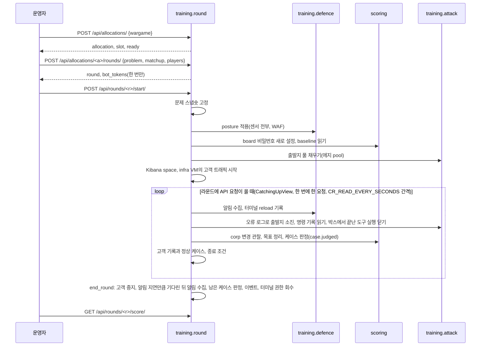

# 아키텍처

이 문서는 `restructure` 브랜치의 단위, 계층, 파일 지도, 격리 경계, 라운드 흐름을 다룹니다. 설계 근거는
[설계 문서](superpowers/specs/2026-11-19-side-split-design.md)와 `docs/DECISIONS.md`의 2026-11-21 항목(다섯 단위로
다시 나눔), 점수 정의는 `CLAUDE.md`, 작업 현황은 `docs/STATE.md`에 있습니다. 훈련 환경(OpenStack, Heat 스택, 역할
이미지) 운영 절차는 `docs/OPENSTACK.md`에 있습니다.

이전 구조(`platform/api/`, `platform/console/`, 시나리오 엔진)의 설명은 git 기록에 있습니다. 새 구조는 이전 코드를
옮긴 것이 아니라 새로 쓴 것이고, 격리 경계, 채점 핵심, 훈련 환경 어댑터, 케이스만 가져왔습니다. `side-split`의
앱(`accounts`, `events`, `content`, `match`, `referee`, `attack`, `defence`)은 `restructure`에서 아래 다섯 단위로
다시 나눴고, DB는 마이그레이션 `0001`부터 새로 시작합니다.

## 용어

- **워게임**: 대상 앱과 그 목표, 케이스. `board`와 `corp` 두 개. `wargames/<id>/wargame.yaml`이 정의
- **문제**(`Problem`): 스태프가 DB에 쓰는 라운드 문제. 라운드 설정(`RoundSetup`)을 가짐. 봇 매치업 라운드에만 쓰고, `pvp` 라운드는 문제 없이(`Round.problem`이 비어 있음) 워게임의 목표와 케이스로 진행
- **할당**(`Allocation`): 슬롯 스택 하나를 운영자에게 준 것. KYPO의 sandbox allocation에서 온 이름. 용도는 `round`,
  `probe`. 닫히거나 만료되면 스택을 지우고 새로 만듦
- **라운드**(`Round`): 할당 위에서 도는 한 판. 종류는 `round`, 단계는 `created → starting → running → ended`
- **플레이어**(`Player`): 라운드의 공격 쪽이나 방어 쪽을 맡은 사람(`human`) 또는 봇(`bot`). 봇 플레이어는 플레이어
  토큰을 가짐
- **매치업**: `pvp`, `def_vs_bot`(사람 수비 vs AI 공격 봇), `atk_vs_bot`(사람 공격 vs AI 수비 봇)
- **슬롯**: `cr-slot-N`의 N. 다시 쓰는 번호. Kibana space `soc-logs-N`, 로그 인덱스 `logs-N-*`도 이 번호
- **케이스**: `redteam/cases/<wargame>.yaml`에 선언한 공격 요청이나 정상 요청. 알림이 몇 건 나오든 판정은 1건
- **자유 행동**: 선언된 케이스가 아닌 요청, 도구 실행, 명령, 사이트 패널 요청. 출발지와 시간으로 묶어 따로 보고하고
  정탐·오탐으로 세지 않음
- **출발지**(`Origin`): 공격 박스가 요청을 보내는 주소 하나. WAF가 `deny`나 `limit_req`로 막으면 소진
- **마커**: 요청의 `X-Request-ID` 값. API로 보낸 요청과 케이스는 플랫폼이 붙이고, 알림과 행동을 이 값으로 매칭.
  누구나 이 헤더를 붙일 수 있으므로 알림의 출발지가 그 행동을 보낸 주소일 때만 매칭(`correlate._sent_from`)
- **posture**: 라운드 시작 시점의 Suricata 룰과 WAF 파일 텍스트. 스태프가 `Posture` 행으로 작성
- **probe 녹화**: 룰 테스트에 쓰는 케이스별 요청·응답·pcap. `wargames/<id>/probes/`에 커밋

## 단위

`platform/`은 다섯 단위와 함께 쓰는 모듈 셋으로 나뉩니다. `training`은 KYPO의 Training Service를, 할당
(`Allocation`)은 KYPO의 sandbox allocation을 따른 이름입니다(`docs/DECISIONS.md` 2026-11-21).

| 단위 | Django 앱 | 맡는 일 | 모델 |
|---|---|---|---|
| `users/` | `users` | 계정, 로그인·가입·승인, 차단, 플레이어 토큰 | `SignInBlock` |
| `sandbox/` | `sandbox`(모델 없음) | 훈련 환경: 풀, Heat 스택, 에지, 점프 접속, 바깥 장치를 아는 파일 전부 | 없음 |
| `telemetry/` | `telemetry` | Elasticsearch, 이벤트, 알림, WAF 접근·오류 로그 | `Event`, `Detection`, `AlertCursor`, `AccessCursor` |
| `training/` | `training` | 문제, 할당, 라운드, 고객 트래픽, 공격 API, 방어 API, 레슨 자리 | `Wargame`, `Posture`, `Problem`, `RoundSetup`, `ProbeSet`, `Allocation`, `Round`, `Player`, `CustomerRequest`, `Action`, `ToolRun`, `Origin`, `RuleTest`, `RuleSet` |
| `scoring/` | `scoring` | 대상의 정답 데이터, baseline, 목표, 케이스 판정, 점수 | `Objective`, `Verdict` |

함께 쓰는 것: `cr/`(설정, 오류, URL, 스키마), `domain/`(Django 없는 규칙 함수), `testing/`(가짜 클라우드, 가짜
훈련 환경, 문제 팩토리). `training/`은 앱 하나이고 그 안이 `content/`, `round/`, `traffic/`, `attack/`, `defence/`,
`lessons/`로 나뉩니다.

## 계층

모듈은 자기 계층이나 그보다 낮은 계층만 import합니다(HTTP 계층 제외). `platform/tests/seams/test_imports.py`가 AST로
검사하고, 모델 FK 대상과 마이그레이션 의존성도 같은 순서를 따르는지 봅니다. `platform/` 아래 모듈은 모두 계층이
있어야 하고, 없으면 테스트가 실패합니다.

| 계층 | 모듈 |
|---|---|
| L0 순수 | `domain/**` |
| L1 경계와 라이브러리 | `cr/config.py`, `cr/errors.py`, `sandbox/*`, `telemetry/elastic.py`, `training/attack/cases.py`, `training/attack/tools.py`, `scoring/loot.py`, `scoring/effect.py`, `testing/*`, 모든 `__init__.py` |
| L2 | `users/*` |
| L3 훈련 기록 | `training/models.py` |
| L4 | `telemetry/*` |
| L5 | `scoring/*` |
| L6 | `training/round/access.py`, `training/content/catalog.py`, `training/content/problems.py`, `training/content/bots.py` |
| L7 양쪽 | `training/attack/actions.py`, `training/attack/origins.py`, `training/defence/*` |
| L8 조정 | `training/round/lifecycle.py`, `training/round/allocation.py`, `training/round/site.py`, `training/round/retention.py`, `training/traffic/customers.py`, `training/content/probes.py`, `training/round/bots.py`, `training/round/records.py`, `training/round/debrief.py` |
| HTTP | `views*.py`, `serializers.py`, `urls.py`, `cr/urls.py`, `cr/handler.py`, `cr/schema.py`, `cr/settings.py`, `cr/strings.py`, `cr/wsgi.py`, `management/commands/*`, `apps.py`, 마이그레이션 |

주요 규칙(번호는 테스트 이름의 번호):

1. `domain/`은 표준 라이브러리와 `domain`만 import합니다.
2. L1은 Django, DRF, 앱을 import하지 않고 서드파티는 `requests`, `yaml`만 씁니다. 예외는 설정을 읽어 frozen
   dataclass를 만드는 `cr/config.py` 하나입니다. 원격 실행은 주입받은 runner(`sandbox/runner.py`,
   `sandbox/reach.py`)로 합니다.
3. `training/attack`과 `training/defence`는 서로 import하지 않습니다.
4. 대상의 정답 데이터(`scoring/loot.py`, `scoring/effect.py`)와 `scoring/models.py`는 `scoring/` 안에서만 씁니다.
   다른 단위는 `scoring/baseline.py`, `losses.py`, `score.py`만 씁니다.
5. `scoring/`은 `training/models.py` 말고 `training/`을 import하지 않습니다. 행동과 탐지는 호출하는 쪽이
   `domain.types` 레코드로 넘깁니다.
7. 양쪽 서비스를 함께 import하는 것은 L8 조정 모듈뿐입니다.
8. `telemetry/`는 `training/models.py` 말고 다른 단위를 import하지 않습니다. `users/`는 다른 단위를 import하지
   않습니다.
9. 단위나 `training/`의 부분 경계를 넘을 때는 그쪽의 공개 모듈(테스트의 `SURFACES`)이나 낮은 계층의 모델만
   import합니다.
10. view와 serializer는 자기 부분, DRF, `cr.errors`, `training/round/access.py`, `training/round/views_catch_up.py`,
    `users/permissions.py`, `users/accounts.py`만 import합니다. 스태프 range view만 `sandbox/service.py`를 씁니다.
11. `objective.lost` 이벤트는 `scoring/`에서만 남깁니다(종류 선언은 `telemetry/events.py`).
12. `bots/`, `test/`, `bin/`, `front/`는 `platform/`을 import하지 않습니다. `/api/`의 클라이언트입니다.
15. 모델 FK와 마이그레이션 의존성은 같은 앱이나 아래로만 향합니다: `auth` < `users` < `training` < `telemetry` <
    `scoring`.

서비스는 `cr/errors.py`의 도메인 오류를 던지고 응답을 만들지 않습니다. `cr/handler.py` 하나가 상태 코드와 오류
형태로 바꿉니다.

## 파일 지도

```
openapi/schema.yaml           커밋하는 API 계약(유일하게 커밋하는 생성물)
strings/console.json          콘솔이 보여 주는 한국어(front/에 묶임)
strings/server.json           서버가 직접 그리는 한국어(Kibana 게이트 페이지). 번들에 넣지 않음
bin/
  verify                      schema.yaml 내보내기 → 계층별 단위 테스트 → acceptance
  select-tests                --changed가 돌릴 테스트 고르기
  acceptance                  test/ 실행
  cloud                       클라우드 전체. 스태프 range API를 bots/rest.py로 호출
  platform-rebuild            플랫폼 VM 재구축. 준비 확인만 urllib로 /api/auth/csrf/를 직접 찌름(bots/rest.py 안 거침)
  backup  prune               DB 백업(pg_dump custom format)·복원(--restore), 닫힌 할당 정리
  fetch-geoip  pick-origins  worldmap  build-css
platform/                     패키지 아님. manage.py와 pytest의 작업 디렉터리
  cr/          settings.py(CR_DB_HOST가 있으면 PostgreSQL, 없으면 SQLite)  urls.py  wsgi.py  schema.py(쪽별 스키마)
               config.py    경계마다 넘기는 frozen 설정, topology의 센서 목록. 설정을 읽는 유일한 경계 모듈
               errors.py    DomainError와 하위 클래스, 오류 코드
               handler.py   DRF 예외 처리기. 오류 형태 하나
               strings.py   strings/server.json 읽기
  domain/      types.py  traffic.py(고객 배분, limit_req 하한)  verdicts.py(룰 테스트 판정표)
               problems.py(문제 검증)  round_rules.py(매치업, 단계, 종료 조건)
               bots.py(난이도·공격 카드, 카드 추첨)
               scoring/  correlate.py  metrics.py(판정 시점 decided 포함)  corroborate.py  objectives.py
  users/       accounts.py(로그인·가입·승인)  permissions.py(SessionAuthentication, CsrfChecked, IsStaff)
               players.py(플레이어 토큰 해시·발급·회수)  blocks.py(로그인 차단, SignInBlock)
               vpn.py(계정마다 VPN 프로필 하나, VpnProfile: 발급·조회·폐기, 라운드 kali에 붙이고 떼기, 포트 맵 쓰기)
               management/commands/  vpn_relay(포트 맵을 DB에서 다시 쓰고 UDP 중계 시작)
               스태프 계정 API, 초기 계정 admin(마이그레이션 0002)
  sandbox/     훈련 환경. 바깥 장치를 아는 파일이 모두 여기 있음
               openstack.py 경계: Keystone/Heat/Neutron REST, 실제 배선 읽기, 재생성 때 기본 룰 적재
               suricata.py  경계: 룰 파일, -T 검사, 오프라인 -r 실행, 적용, 기본 룰 적재, 패킷 캡처,
                            터미널 reload 스냅샷 읽기, 로그를 끄는 룰(config: logging) 찾기,
                            통과한 테스트 목록 쓰기·비우기
               crs.py       경계: WAF 파일 여섯 개 읽기·검사·쓰기, nginx -t·reload·되돌리기, limit_req rate·키 읽기,
                            터미널 reload 스냅샷 읽기, 임시 인스턴스 검사·테스트, 통과한 테스트 목록 쓰기·비우기
               kibana.py    경계: Kibana API, space, 거부 규칙, 초기 설정, 로그 인덱스 패턴
               edge.py      경계: infra nftables pool·spent 집합, conntrack 정리
               access.py    경계: 플랫폼 sshd 점프 권한(플레이어·박스마다 하나), 키 생성, 박스 계정의 authorized_keys
               attacker.py  경계: 공격 박스(출발지, set-origin, set-peer, 명령 기록, 도구 이미지, 실행 중지)
               vpn.py       경계: WireGuard(키 쌍, 프로필 텍스트, 계정별 UDP 포트 맵, 플랫폼 컨테이너의 UDP 중계)
               customers.py 경계: infra VM의 고객 프로그램(cr-customers.service)과 고객 주소
               cloud_config.py  stack_plan.py  definitions.py(+declaration.yaml)  fabric.py
               wiring.py(배선 파싱)  topology.py(학습자용 이름, 쪽별 필터)  pool.py  refill.py
               runner.py  reach.py(runner 묶음, 훈련 환경 전체·슬롯·할당별 범위)
               service.py   다른 단위가 쓰는 풀, fabric, 슬롯 호출
               management/commands/  rebuild_slots(rebuild 서비스)  run_on_role
  telemetry/   Event, Detection, AlertCursor, AccessCursor
               events.py    종류별 스키마와 보는 쪽, append, after
               elastic.py   경계: 커서 읽기(늦게 색인된 문서를 30초까지 되돌아 읽음, 트래픽은 15초 전까지만), 접근·오류 로그, 정규화, ingest 파이프라인 등록
               alerts.py    AlertCursor로 알림 수집과 읽기
               access.py    WAF 접근 로그(트래픽), 오류 로그의 deny·limit_req 줄
               views.py     이벤트 피드, 방어 쪽 알림·트래픽 API   management/commands/  register_pipeline
  training/    Django 앱 하나. models.py에 Wargame부터 RuleTest까지 모든 훈련 기록
    content/   catalog.py(wargames/와 redteam/cases 읽기, limit_floor_rpm)  problems.py(중첩 문서, revision,
               내보내기·가져오기, posture)  probes.py(probe 녹화)  스태프 문제 API, 학습자 읽기 API
               bots.py(steps.yaml 난이도 3단계, cards.yaml ATT&CK 공격 카드 A1~A8 읽기)
    round/     allocation.py  할당 열기·하트비트·닫기·만료(열 때 만료된 할당 닫기와 오래된 할당 정리)
               lifecycle.py   라운드 만들기, 참가, 시작, catch_up(READS), 케이스 판정, 종료, 기권, 점수
               access.py      PlayerTokenAuthentication, IsPlayer(side), InRound, IsOperator, OnAllocation
               views_catch_up.py  CatchingUpView: 요청마다 할당 만료 확인과 catch_up(CR_READ_IN_BACKGROUND면 별도 스레드)
               site.py(사이트 패널 프록시)  retention.py  views.py(라운드, 할당, 스태프 range API)
               bots.py        봇 실행: 시작 때 자리마다 BotRun, 실행기의 수령(토큰 발급)·메모·종료
               records.py     라운드 기록(점수·복기 고정, 90일 보관)
               debrief.py     끝난 라운드의 복기: 공격 봇 카드, 봇 의도, 두 갈래 타임라인
    traffic/   customers.py   정상 케이스와 고객 트래픽, 라운드마다 새로 만드는 고객 비밀번호
    attack/    actions.py     공격 API의 모든 동작, 고객 전송, 명령 기록, 공격 쪽 터미널
               origins.py     출발지 풀, 오류 로그로 소진, limit_req 하한
               cases.py       케이스 요청 만들기와 발사(X-Request-ID 마커)   tools.py  도구 인자
    defence/   rules.py       IDS 룰과 WAF 파일: 읽기, 검사, 테스트, posture 적용, WAF 쓰기·reload, 버전,
                              두 터미널의 reload 기록
               ruletest.py    검사 → probe 묶음 → 오프라인 실행 → 판정표
               terminal.py    방어 쪽 점프 권한 두 개(WAF, IDS)    kibana_gate.py  views_kibana.py  Kibana 게이트
    lessons/   빈 패키지. 다시 만들 레슨의 자리
    management/commands/  prune  terminal_shell  load_sqlite_store(SQLite 백업을 PostgreSQL로 한 번 옮김)
  scoring/     Objective, Verdict. 대상의 정답 데이터를 읽는 유일한 단위
               loot.py      경계: board 정답 데이터, 라운드 시작 때 비밀번호 새로 정하기(rotate)
               effect.py    경계: corp 정답 데이터(MySQL 바이너리 로그)
               baseline.py  라운드 시작 baseline, 비밀값 가리기
               losses.py    loot 제출, corp 변경 관찰, 목표
               score.py     점수, 케이스 판정(judge), 종료 시각까지 자르기
  testing/     fakecloud.py  fakes.py(가짜 runner, 가짜 ES)  fakerange.py  factories.py(영어 자리표시 문제)
  tests/       domain/  seams/  users/  telemetry/  scoring/  training/{content,round,attack,defence}/  contract/
               test_*.py(배포 파일, compose, 역할 이미지, 경계 검사 등)
  entrypoint.sh  nginx.conf  vm-terminal.sh  tmux.conf  Dockerfile
bots/          tools.py  rest.py  calls.py  shell.py  cli.py  play.py  provider.py  signin.py  prompts/
               launcher.py(bots compose 서비스)  watch.py(방어 실행에 보낼 새 소식)  relay.py(실행별 프록시, 속도·허용 동작)
               pace.py  Dockerfile
test/          라이브 acceptance. plays.py가 bots/rest.py로 할당과 라운드를 돌림
redteam/cases/ board.yaml  corp.yaml   공격·정상 케이스(데이터만)
wargames/<board|corp>/  wargame.yaml  compose.yaml  topology.yaml  objectives.yaml  traffic.yaml  probes/  app/
deploy/        roles/<kali|waf|infra|target>/  openstack/  suricata/  filebeat/  elastic/  kibana/  traffic/
               kali/  waf/  proxy/   역할 디렉터리가 링크로 가리키는 원본(proxy/stamp.py는 사본 없이 하나)
front/         Vite, TypeScript, Preact 콘솔. platform/Dockerfile의 node 단계가 빌드하고 nginx가 /srv/front로 내줌
  src/theme/   tokens.css(색, 글꼴, 크기, 간격, 둥글기, 그림자 값)  components.css(모든 컴포넌트 클래스)
  src/ui/      props만 받아 클래스를 그리는 작은 컴포넌트: Button, Badge, Card, Hero, Table, Field, Notice, Shell(TopNav,
               PageShell), Console(Rail, Pane, PaneHeader, Aside), Site, Editor, Ops, Record, Tiles, Text, Icon
               looks.ts     상태별 모양 선택(타일 색, 단계 색). index.ts에서 모두 내보냄
  src/panes/   설계 §13의 패널. 각자 api/의 훅으로 데이터를 받고 ui/로 그림. 어느 페이지에 있는지 모름
               Kibana  Terminal(Kali, 방어 쪽 WAF·IDS 전환)  Site  Map(+map-symbols/)  IdsRules(읽기 전용)  Waf
               RuleTestTable  Alerts
               Objectives  Origins  Loot  AttackCases  RuleVersions  Score  Verdicts
               registry.ts  패널 id → 컴포넌트 표
               staff/  문제·posture 편집기, 가져오기. RoundSetupEditor(봇 난이도, 공격 봇 카드 체크)
  src/pages/   얇은 배치: 어떤 패널을 어디에 둘지. Login  Signup  Home  RoundLobby(대전 방식, 봇 쪽 난이도)
               RoundAttack  RoundDefence  Result(복기 링크)  Debrief(복기: 봇, 카드, 의도, 타임라인, 점수)
               Records(내 기록 목록과 기록 한 건)  Access(VPN 프로필, 워게임별 공격 대상 주소, kali SSH 설정)
               staff/(Problems  Postures  Users  Range)
  src/console/ Console.tsx(layouts.ts의 선언대로 레일, 본문, 오른쪽 열을 그림)  RoundHeader.tsx
  src/shell/   AppPage.tsx(상단 메뉴와 페이지 틀)  AuthCard.tsx(로그인·가입 카드)
  src/api/     client.ts(CSRF 갱신, 90초 제한, 슬롯 대기, 오류 형태)  follow.ts(이벤트 커서 하나, 할당 heartbeat)
               hooks.ts(useResource, useEvents 등)  schema.d.ts(생성, 커밋 안 함)
  src/         layouts.ts(공격·방어 콘솔의 레일 순서와 오른쪽 열)  routes.ts(경로 표)  nav.ts(상단 메뉴 표)
               strings.ts(t(key, params), strings/console.json 읽기)  links.ts  router.ts  format.ts  App.tsx  main.tsx
  mock/        개발 서버(npm run dev)에서만 쓰는 가짜 /api/ 응답. fixtures/에 화면별 응답, 영어 자리표시
```

### 화면 바꾸는 법

| 바꿀 것 | 고칠 파일 |
|---|---|
| 색, 글꼴, 크기, 간격, 둥글기(지도 포함) | `front/src/theme/tokens.css`. 지도 아이콘(`panes/map-symbols/node-*.svg`)은 색과 둥글기를 `var(--map-…)`로 적고, `panes/Map.tsx`가 그리기 전에 토큰 값으로 바꿔 넣음. cytoscape의 모서리, 글꼴 크기, 투명도도 `--map-…` 토큰에서 읽음 |
| 카드, 버튼, 표 같은 모양 | `front/src/theme/components.css`. 페이지와 패널에는 스타일이 없음(진행 막대 너비만 예외) |
| 콘솔의 레일 순서, 패널 추가·제거, 오른쪽 열 | `front/src/layouts.ts`의 한 줄. 오른쪽 열 맨 위의 큰 패널은 `asideLead`, 나머지는 `aside`라서 `aside` 순서를 바꿔도 모양은 그대로 |
| 본문에 패널 둘을 나란히 | `front/src/layouts.ts`에서 레일 항목에 `beside: ["<패널>"]`을 적음. 그 탭을 열면 본문이 패널과 `beside` 패널로 나뉨(좁은 화면에서는 위아래) |
| 페이지에 어떤 패널을 둘지 | `front/src/pages/<페이지>.tsx` |
| 경로, 상단 메뉴 | `front/src/routes.ts`, `front/src/nav.ts` |
| 문구 | `strings/console.json`. 화면 문구는 모두 `t(key, params)`로 나옴. `strings.ts`는 값 안의 `{@키}` 참조를 풀지만 지금 그렇게 쓴 값은 없음 |
| 패널이 보여 주는 데이터 | `front/src/panes/<패널>.tsx`와 `front/src/api/hooks.ts`. 서버 응답은 `openapi/schema.yaml`이 정함 |

`front/`에서 `npm ci && npm run types && npm run dev`로 띄우면 `mock/`의 가짜 응답으로 모든 화면을 볼 수
있습니다. 아직 남은 제약:

- 지도 선 굵기와 라벨 여백 같은 cytoscape 수치 일부, 아이콘 안 그림의 선 굵기는 아직 `panes/Map.tsx`와 SVG 파일에
  숫자로 있습니다.
- `beside`는 레일 탭 하나에 붙고, 나란히 놓인 패널은 같은 너비로 나뉩니다. 너비 비율을 바꾸려면
  `components.css`의 `.pane-split`을 고쳐야 합니다.

## 격리 경계

각 외부 시스템은 파일 하나만 압니다. `platform/tests/seams/test_isolation_seams.py`가 `platform/`, `front/src`, `bots/`,
`test/`, `bin/`을 훑으며 경계마다 패턴 하나를 두고, 그 패턴이 주인 파일과 아래 예외 밖에서 나오면 실패합니다. 주인 파일에서
패턴이 사라져도, 예외 목록이 `CLAUDE.md`의 목록과 달라져도 실패합니다.

| 아는 것 | 주인 파일 | 예외(코드에 남은 것) |
|---|---|---|
| Elasticsearch(검색, 삭제, bulk, ingest 파이프라인) | `telemetry/elastic.py` | Elasticsearch 설정 자체를 보는 acceptance 검사 `test/test_event_time.py`, `test/test_geoip_durable.py`, `test/test_origin_placement.py`, `test/test_waf_geolocation.py` |
| 패킷 캡처(`tcpdump`) | `sandbox/suricata.py` | 없음 |
| Suricata 프로세스(`-T`, `suricatasc`, reload, af-packet) | `sandbox/suricata.py` | 각 `topology.yaml`의 센서 장치 `cr-ids`가 룰 파일과 reload 명령을 적음 |
| CRS/ModSecurity 설정과 nginx reload | `sandbox/crs.py` | `cr/config.py`의 기본값(WAF 파일 경로, reload 명령). 각 `topology.yaml`의 WAF 장치 `cr-waf`가 `files:`(방어 쪽이 고치는 WAF 파일)와 reload를 적음. acceptance 드라이버 `test/plays.py`가 API의 `files`에 CRS 룰 텍스트를 씀 |
| Kibana API | `sandbox/kibana.py` | `platform/nginx.conf`: 거부할 Kibana API 경로, space 안 API 호출을 `kibana-gate`로 넘기기, `api/spaces/space` 직접 응답. `front/src/panes/Kibana.tsx`가 Kibana localStorage 키를 미리 씀 |
| 로그 인덱스 패턴(`logs-*`) | `sandbox/kibana.py` | `cr/config.py`의 기본값. `test/test_event_time.py` |
| 훈련 환경 노드 이름(`cr-kali`, `cr-waf`, `cr-infra`, `cr-target`) | 없음(설정으로 넘김) | `cr/config.py`의 기본값. `platform/entrypoint.sh`가 `vm-terminal.sh cr-kali attack`, `vm-terminal.sh cr-waf defence`, `vm-terminal.sh cr-infra ids`를 띄움 |
| OpenStack API와 실제 배선 | `sandbox/openstack.py`(파싱 `sandbox/wiring.py`, 이름 `sandbox/topology.py`) | 없음 |
| infra 라우터의 nftables 집합 | `sandbox/edge.py` | `deploy/roles/infra/edge.nft`가 `pool`, `spent` 집합을 선언 |
| 플랫폼 점프 호스트와 박스 계정 키 | `sandbox/access.py` | `platform/entrypoint.sh`가 점프 호스트의 `authorized_keys`를 만듦 |
| 공격 박스 | `sandbox/attacker.py` | `cr/config.py`의 라벨 파일 경로 기본값 |
| WireGuard(키, 프로필, 중계) | `sandbox/vpn.py` | 없음. kali 쪽 `deploy/roles/kali/set-peer`는 `sandbox/attacker.py`만 부름 |
| 고객 박스(infra VM의 `cr-customers` 유닛, 계정, 기록) | `sandbox/customers.py` | 없음 |
| 대상의 정답 데이터 | `scoring/loot.py`(board), `scoring/effect.py`(corp) | 점수를 정답 데이터와 맞춰 보는 acceptance 검사 `test/shared_sessions.py`, `test/test_board_exfil.py` |

- 바깥 장치를 아는 파일은 모두 `sandbox/`에 있고 `telemetry/elastic.py`, `scoring/loot.py`, `scoring/effect.py`만
  예외입니다. 공격 쪽(Kali)과 방어 쪽(WAF와 센서 호스트의 `analyst`) 터미널이 같은 점프 권한(`sandbox/access.py`)을 쓰고,
  `training/attack`과 `training/defence`는 서로 import하지 않으므로 공용 경계가 어느 한쪽에 있으면 안 됩니다.
  박스 주소, runner, 계정은 호출하는 쪽이 넘깁니다.
- `sandbox/openstack.py`는 슬롯을 재생성할 때 `sandbox.suricata.seed`로 그 슬롯 워게임의
  `topology.yaml`이 센서 장비(`cr-ids`)의 `baseline:`에 적은 룰 파일(board는 `deploy/suricata/rules/local.rules`,
  corp는 `deploy/suricata/rules/corp.rules`)을 적재합니다. 재생성 기본 룰은 슬롯의 시작 파일이고, 라운드 시작 때 문제의 posture가 그 위에 적용됩니다.
- 이전 구조의 예외 중 `register_pipeline.py`(→ `telemetry/elastic.py`), `operator_log.py`(→
  `sandbox/attacker.py`), `redteam/tools.py`의 `cr-kali`(→ 박스가 `launch`를 넘김), 레슨 F6의 명령(레슨과 함께
  삭제), `blue.html`의 Kibana localStorage 설정(→ `front/src/panes/Kibana.tsx`)은 없어졌습니다.
- Elasticsearch를 직접 읽는 acceptance 검사 넷은 `/api/` 뒤로 옮길지 아직 정하지 않았습니다.

## 라운드 흐름



- 시작 조건: 비어 있는 사람 플레이어가 없어야 하고(`players_open`), 슬롯이 준비돼 있어야 하며, 채점 라운드는 목표를
  잃은 적 없는 할당이어야 합니다(`objective_fallen`).
- 종료 이유: `time_limit`, `all_objectives_lost`, `origins_spent`(정상 케이스가 한 바퀴 돈 뒤에만), `ended_by_operator`,
  `forfeit_attack`, `forfeit_defence`, `allocation_expired`.
- 할당은 `CR_ALLOCATION_IDLE_MINUTES`(기본 30분) 동안 하트비트가 없으면 만료됩니다. 운영자와 플레이어가 하트비트를
  보냅니다.
- 주기적으로 도는 라운드 작업은 없습니다. 라운드나 할당에 대한 API view는 모두 `CatchingUpView`
  (`training/round/views_catch_up.py`)를 거치고, 인증과 권한 확인 뒤 `lifecycle.catch_up`으로 라운드를 먼저 읽고
  그다음 만료된 할당을 닫습니다. `CR_READ_IN_BACKGROUND=1`(`compose.yaml`이 켬)이면 이 읽기를 요청 스레드가
  아니라 같은 프로세스의 스레드 하나에서 돌리고 요청은 기다리지 않습니다. 같은 라운드에 이미 도는 스레드가 있으면
  새로 띄우지 않습니다. 터미널 권한 view(`Terminal`, `IdsTerminal`)는 읽기를 부르지 않습니다. `catch_up`은 `Round.reading_since`에 대한 조건부 `UPDATE` 하나로 라운드를 잡고(5분이 지난 잡기는 버려진
  것으로 봄) `read_at`으로 놓습니다. 놓을 때는 자기가 잡은 시각과 같은 잡기만 풉니다. 읽기 단계마다 DB에서 라운드가
  아직 진행 중인지 보고, 그사이 끝났으면 거기서 멈춥니다. 아무도 부르지 않는 라운드는 아무 일도 하지 않습니다.
- 읽기 단계 하나가 실패해도 나머지 단계는 계속 돕니다. 제한 시간이 지난 라운드는 다음 요청이 끝내고 종료 시각은
  제한 시간으로 남깁니다. 점수는 종료 시각까지의 동작, 알림, 목표만 셉니다.
- 운영자 종료, 기권, 할당 만료로 끝나는 라운드도 끝내기 전에 읽기를 한 번 더 돌립니다. 이 마지막 읽기는 정상
  트래픽을 새로 보내지 않습니다. 라운드를 끝내는 요청은 기다리지 않고 바로 답합니다. 종료 시각에서
  `CR_JUDGE_AFTER_SECONDS`가 지난 뒤 그 라운드를 처음 읽는 요청(`lifecycle.judge_late`)이 라운드를 잡고 알림을 한 번
  더 수집해 목표를 정하고 남은 케이스를 판정한 뒤 `Round.judged_at`을 적고 `round.judged`를 남깁니다. 그래서 종료
  직전에 찍혔지만 늦게 도착한 알림도 점수에 들어가고, 그때까지 점수는 `pending: true`입니다. 시작 전에 끝난 라운드는
  바로 `judged_at`을 적습니다. 다른 요청이 읽는 중이면
  그 읽기가 끝나거나 버려질 때까지 기다렸다가 읽습니다. 요청은 할당 만료를 보기 전에
  라운드부터 읽으므로, 제한 시간이 지난 라운드는 할당이 만료됐어도 `time_limit`으로 끝납니다.
- 만료된 할당은 다음 할당 요청이나 그 할당에 들어온 요청이 닫습니다. 반납된 슬롯의 스택은 `rebuild` 서비스
  (`manage.py rebuild_slots`, `sandbox.service.keep_rebuilding`)가 다시 만듭니다.

## API

모든 응답은 JSON이고, 2xx가 아닌 응답은 `{errors:[{path, code, line?, params?}]}` 하나의 형태입니다. `code`는 영어
고정값이고 `openapi/schema.yaml`에 enum으로 들어갑니다. 한국어는 콘솔이 `strings/console.json`에서 찾습니다.

| 태그(스키마) | 경로 | 내용 |
|---|---|---|
| `accounts` | `/api/auth/csrf/`, `login/`, `signup/`, `logout/`, `/api/me/` | 로그인, 가입 |
| `staff` | `/api/staff/users/`, `/api/staff/blocks/` | 승인, 차단 |
| `accounts` | `/api/vpn/profile/` (POST 발급, GET 조회, DELETE 폐기) | 자기 계정의 VPN 프로필. 개인 키는 발급 응답에 한 번만 |
| `staff` | `/api/vpn/profiles/`, `/api/users/<id>/vpn/` (DELETE) | 모든 계정의 프로필, 다른 계정 프로필 폐기 |
| `staff` | `/api/staff/range/{,fabric/,leftovers/,pool/}`, `/api/staff/wargames/<id>/probes/record/`, `/api/staff/probes/<a>/` | 풀 운영, probe 녹화(`training/round`, `training/content`) |
| `match` | `/api/allocations/`, `/api/allocations/<a>/{heartbeat,close,rounds}/`, `/api/rounds/`, `/api/rounds/<r>/{players/<side>/join,start,end,score,topology,site/requests,terminal-auth/{attack,defence,ids},attack/forfeit,defence/forfeit}/` | 할당, 라운드, 점수, 구성도, 사이트 패널, 터미널 인증(`training/round`) |
| `match` | `/api/rounds/<r>/events/?after=&kinds=` | 커서 피드(`telemetry/views.py`). 종류마다 보는 쪽이 정해짐. `kinds`를 주면 그 종류만 돌려주고 커서는 건너뛴 이벤트 뒤로 옮김 |
| `attack` | `/api/rounds/<r>/attack/{state,cases,requests,tools,tools/<run>,loot,origins/next,terminal}/` | 공격 API. 성공 응답에 `remaining`, 모든 응답에 `X-Origin`, `X-Origins-Left` |
| `defence` | `/api/rounds/<r>/defence/{state,alerts,traffic,probes,ids/rules,ids/rules/versions,ids/rules/versions/<n>,ids/rules/test,ids/rules/tests/<t>,ids/terminal,waf,waf/versions,waf/versions/<n>,waf/check,waf/test,waf/tests/<t>,waf/apply,terminal,kibana}/` | 방어 API. IDS 룰을 쓰는 경로는 없음. `alerts`, `traffic`은 `telemetry/views.py`, 나머지는 `training/defence`. `alerts`는 `after`면 오래된 것부터 커서 뒤를, `before`(0이면 맨 앞)면 최신부터 그 id 앞을 돌려주고, 둘 다 필터에 맞는 전체 수 `total`과 남은 것이 있는지 `more`를 붙임 |
| `catalog`, `staff` | `/api/wargames/`, `/api/problems/`, `/api/staff/problems/…`, `/api/staff/postures/…`, `/api/staff/wargames/` | 학습자 워게임 목록(`pvp`를 여는 곳), 문제 읽기와 작성. 학습자 문제 목록에 허용 대전 방식과 봇 난이도, 스태프 워게임 목록에 그 워게임의 공격 카드 |
| `match` | `/api/bot-steps/`, `/api/rounds/<r>/debrief/` | 난이도 표(로비), 끝난 라운드의 복기(진행 중이면 `409 round_running`) |
| `records` | `/api/records/`, `/api/records/<id>/` | 자기 라운드 기록(점수, 복기). 스태프는 모두 |
| `bots` | `/api/bot-runs/claim/`, `/api/bot-runs/<id>/{notes,finish}/` | 실행기 전용(실행기 키). 플레이어 토큰으로는 못 부름 |

권한:

- 사람은 세션 쿠키와 CSRF, 봇은 `Authorization: Bearer <플레이어 토큰>`입니다. 토큰은 해시로만 저장합니다
  (`users/players.py`).
- `IsPlayer(side)`(`training/round/access.py`)가 요청의 플레이어를 찾습니다. GET이 아닌 요청은 라운드가 `running`이 아니면 `409 round_not_started`
  또는 `409 round_closed`입니다.
- 터미널 경로는 nginx `auth_request`로 `terminal-auth/<attack|defence|ids>/`에 묻습니다(`ids`는 방어 플레이어). `auth_request`는 2xx, 401, 403 말고는
  모두 500으로 바꾸므로, `terminal-auth`가 거부 코드를 `X-Error-Code` 헤더에 싣고 nginx의 `@terminal-refused`가
  그 코드로 API와 같은 상태와 오류 형태(`409 round_closed` 등)를 돌려줍니다.
- 플레이어 토큰은 자기 쪽 경로, 라운드의 `GET /`, `events/`, `topology/`, 할당 하트비트, 끝난 뒤의 `score/`에 닿습니다.
  라운드가 끝나면 15분 동안 읽기 전용입니다.
- 운영자는 `Allocation.opened_by` 또는 스태프입니다. 플레이어는 할당을 열고 닫거나 라운드를 끝내지 못하고 기권만 합니다.
- `tests/contract/test_opposite_player.py`가 라운드의 모든 GET을 상대 쪽 플레이어로 불러 상대 쪽 정보가 새지 않는지 봅니다.

### 공격 API

- `POST requests/`: 공격 박스에서 현재 출발지로 요청을 보냅니다. `X-Request-ID`는 그 행동의 마커이고 응답에도
  마커가 들어갑니다. 응답의 403만으로는 출발지가 소진되지 않습니다.
- `POST cases/`: 선언된 케이스를 `training/attack/cases.py`로 발사합니다. 도구 케이스는 ToolRun이 됩니다. 공격 봇의 기본
  동작입니다.
- `POST tools/`, `GET tools/<run>/?after=`, `DELETE tools/<run>/`: 비동기 도구 실행, 출력, 중지.
- `POST loot/`: `scoring.losses.submit_loot`. 비밀값을 드러내지 않습니다.
- `POST origins/next/`: 현재 출발지를 버리고 다음으로.
- `GET terminal/`: `ws_url`(Kali ttyd)과 `ssh`(점프 권한, 개인키 포함). 라운드가 끝나면 회수합니다.
- 명령 기록(bash `PROMPT_COMMAND`)은 대화형 셸만 남고 sudo로 고칠 수 있어, `command.run` 이벤트와 `kali` 판정에만
  쓰고 점수 근거로 쓰지 않습니다.

### 방어 API와 룰 테스트

- IDS 룰은 단독 센서를 다루듯 센서에서 고칩니다(2026-11-22 결정). API와 콘솔에는 IDS 룰을 쓰는 경로가 없고,
  `GET ids/rules/`는 센서가 지금 돌리는 룰 파일, 마지막 버전, 그 파일이 마지막 버전과 같은지(`recorded`)를 돌려줍니다.
  `ids/rules/test/`(녹화된 요청으로 테스트)와 버전 이력은 그대로 있습니다.
- WAF는 `files`(파일 경로 → 파일 전체 텍스트)를 받습니다. 방어 쪽이 고치는 WAF 파일은
  `crs-setup.conf`, `REQUEST-900-EXCLUSION-RULES-BEFORE-CRS.conf`, `RESPONSE-999-EXCLUSION-RULES-AFTER-CRS.conf`,
  `/etc/nginx/defence/`의 `http.conf`(http 블록), `board.com.conf`·`corp.com.conf`(각 server 블록)입니다.
  `log_format`, `access_log`, 요청 마커, 감사 로그는 읽기 전용인 `conf.d/board.com.conf`와 `modsecurity.conf`에
  있고, 방어 파일 어느 줄 어느 자리에든 `access_log`·`log_format`·`error_log`·`open_log_file_cache`·`SecAudit*`·`ctl:audit*`가
  있으면 거부합니다. 클라이언트 주소도 측정이라 `set_real_ip_from`·`real_ip_header`·`real_ip_recursive`도 거부합니다.
  검사하지 않은 파일을 불러올 수 있는 nginx `include`와 ModSecurity `Include`·`IncludeOptional`도 거부합니다.
  콘솔에서 적용할 때는 보낸 파일만이 아니라 함께 다시 불러올 지금 파일도 검사하고, 룰 테스트의 scratch도 그렇게
  합니다. 터미널의 reload 래퍼(`deploy/roles/waf/nginx`)도 같은 검사를 스냅샷에 돌려 걸리면 `nginx -t`와 reload 전에
  멈추고, `sudo nginx -t`·`-T`도 지금 파일에 같은 검사를 돌립니다. 센서의 래퍼(`deploy/roles/infra/suricatasc`)도
  `config: logging` 검사를 스냅샷에 돌려 걸리면 불러오기 전에 멈춥니다.
- 룰 테스트를 통과해야 반영됩니다(2026-11-22 결정). 테스트는 엔진이 받아들이고(WAF 임시 설정의 `nginx -t`, IDS
  `suricata -T`) 라운드의 정상 케이스를 빠짐없이 시험해 WAF가 400·403으로 막은 것도, IDS가 경보를 낸 것도 없어야
  통과입니다(`passed`, 걸린 케이스는 `failed_benign`). 녹화가 없어 시험하지 못한 정상 케이스가 하나라도 있거나 시험한
  정상 케이스가 없으면 통과하지 못합니다(`untested_benign`). 통과하면 `ruletest.permitted`가 박스가 계산하는 해시를
  `sandbox.crs.permit`·`sandbox.suricata.permit`으로 root 전용 파일 `/var/lib/cr-reloaded/waf.passed`(cr-waf)와
  `.../ids.passed`(센서 노드)에 한 줄씩 적습니다. WAF 해시는 방어 파일 여섯 개를 정해진 순서로 `sha256  경로` 줄로
  늘어놓은 것의 sha256(`crs.loaded_sha`), IDS 해시는 룰 파일의 sha256입니다. posture를 적용할 때 두 목록을 비웁니다
  (`ruletest.forget_passed`). 콘솔 적용은 지금 파일과 보낸 파일을 합친 결과가 이 라운드에서 통과한 테스트의 해시와
  같아야 받고(`409 not_tested`), 그 합친 파일 전체를 씁니다. 두 reload 래퍼는 스냅샷의 해시가 목록에 없으면 불러오지
  않고 이유를 찍고 끝납니다. 플랫폼이 직접 불러오는 것(posture, 되돌리기, probe 녹화의 DetectionOnly)은
  `crs.apply`가 reload 전에 그 해시를 목록에 넣습니다. 터미널 reload로 기록한 버전은 같은 파일로 통과한 테스트에
  묶입니다.
- 터미널에서 reload한 파일도 다음 읽기 때 같은 검사를 거칩니다. 검사 대상은 지금 파일이 아니라 reload 때 남긴
  스냅샷입니다. 걸리면 기록하지 않고 마지막 버전 파일을 써서 reload하고 `rule.refused` 이벤트를 남깁니다. IDS는
  `config: logging`이 든 룰(그 트랜잭션의 eve 기록을 끔)이 걸리는 대상이고, 백슬래시로 여러 줄에 이어 쓴 룰도 한
  룰로 봅니다. reload하지 않고 고치기만 한 파일은 검사하지도 되돌리지도 않습니다.
- WAF 흐름: 읽기 → 검사(`nginx -t`) → 녹화된 요청으로 테스트(통과 필수) → 쓰기 → reload → 버전 기록(파일 텍스트와 해시,
  `RuleSet.files`·`sha`·`source`). nginx가 거부하면 이전 파일로 되돌립니다. IDS는 라운드 시작 때 posture의 룰만
  플랫폼이 쓰고(센서마다 차례로, 하나라도 거부하면 앞서 쓴 센서를 되돌림), 그 뒤로는 터미널 reload로만 바뀝니다.
- `check/`(WAF만): `sandbox.crs.refusals`와 임시 설정의 `nginx -t`(오류는 파일 경로와 줄로 돌려줌).
- `test/`: 라운드의 probe 케이스와 그 워게임의 정상 HTTP 케이스 전부를 녹화본으로 돌립니다. 실제 대상, 실제 센서,
  라운드의 알림은 건드리지 않습니다. WAF 테스트는 여기에 이 라운드의 공격 행동이 지금까지 보낸 요청
  (`rules.attack_requests`: 쏜 케이스는 그 녹화본, 자유 요청·사이트 패널 요청은 플랫폼이 남긴 method·host·path·query·
  header·body)을 테스트마다 새로 만든 마커(`replay-<test>-<무작위>`)로 더해 보내고, 행동마다 막혔는지를 원래 행동의
  마커로 테스트 결과의 `actions`에 남깁니다. 방어자가 access log에서 본 실제 마커에 건 룰은 다시 보낸 요청을 막지
  못합니다. 이 목록은
  방어 쪽 API에 내보내지 않습니다(알림이 없던 공격까지 드러나므로). 도구 실행과 명령은 다시 보낼 수 없어 빠집니다.
  - IDS: 센서 노드에서 같은 고정 이미지와 `suricata.yaml`로 `suricata -r <case>.pcap`을 돌리고, `/var/log/suricata`
    밖의 임시 `eve.json`을 읽습니다.
  - WAF: cr-waf에 따로 띄운 nginx 마스터(자기 prefix, `127.0.0.1`의 임시 포트, 자기 audit log)가 loopback의
    `probe-upstream.py`를 upstream으로 씁니다. stub이 응답할 때까지 기다린 뒤, 녹화된 요청 전부를 순서대로
    `curl` 하나(`--config`, 요청마다 `next`)로 SSH 한 번에 보내고 임시 audit log를 읽은 뒤 내립니다.
  - WAF에서 도구 케이스는 `untested: tool_case`, 녹화가 없는 케이스는 `untested: not_recorded`입니다. 미탐이 아닙니다.
  - 판정은 `domain.verdicts`가 마커로 알림을 묶고 케이스 하나를 한 번 판정하고 `expect`로 수법을 확인합니다.
    `against_applied`는 적용된 버전의 테스트 결과와 비교합니다.
  - 할당·엔진마다 한 번에 하나만 돌고, 두 번째는 `409 test_busy`입니다.
- `apply/`(WAF만): `base_version`이 최신이 아니면 `409 stale_version`. 같은 파일로 통과한 테스트가 없으면
  `409 not_tested`이고, 있으면 그 테스트를 붙여 `same_as_tested`로 기록합니다.
- `GET terminal/`: cr-waf 관리 주소로 가는 점프 권한, 계정 `analyst`. 방어 파일만 쓸 수 있고 `sudo nginx -t`,
  `-T`, `-s reload`, `systemctl reload nginx`만 root로 돌리며, 네트워크는 loopback만 닿습니다(`curl`로 WAF를 거쳐
  사이트를 시험).
- `GET ids/terminal/`: 첫 센서가 있는 노드(cr-infra) 관리 주소로 가는 두 번째 점프 권한, 계정 `analyst`(키 이름
  `cr-session-<player>-ids`). 토폴로지의 `cr-ids`가 적은 룰 파일만 쓸 수 있고 eve 로그는 `adm`으로 읽으며,
  `sudo suricata -T`와 토폴로지의 reload 명령(`suricatasc -c reload-rules`)만 root로 돌립니다. 라우터 파일, 고객
  프로그램과 기록, docker, `nft`에는 닿지 않고 네트워크는 `127.0.0.0/8`과 `::1`만 닿습니다. 이 박스의 로그 중계가
  자기 주소의 514번에서 받은 로그를 WAF 로그로 넘기기 때문에, 자기 주소로 가는 패킷(이것도 `lo`로 나갑니다)도 막습니다.
- 두 권한 모두 라운드가 끝나면 회수하고,
  `sandbox.access.end_account`가 그 박스의 `analyst` crontab과 `at` 작업을 지우고 linger를 끄고 로그인 세션을 끝낸 뒤
  남은 프로세스를 모두 죽입니다. `nohup`, cron, `at`, `systemd --user`로 띄운 것이 다음 라운드까지 남지 않습니다.
- 터미널에서 reload한 내용은 다음 요청의 읽기(`training.defence.rules.record_terminal_reload`)에서 기록됩니다.
  `analyst`가 sudo로 돌리는 reload는 래퍼(WAF는 `/usr/local/sbin/nginx`, 센서는 `/usr/local/bin/suricatasc`)를
  거치고, 래퍼는 불러올 파일을 `analyst`가 쓸 수 없는 root 0700 폴더(`/var/lib/cr-reloaded/waf`, `.../ids`)에
  복사하고, 그 복사본을 root만 쓸 수 있는 새 파일로 원래 경로에 깐 뒤 reload합니다. 성공하면 그 시각(`at`)을
  남기고, 그다음에야 `analyst`에게 쓰기 권한을 돌려줍니다. 그래서 엔진이 읽는 것은 스냅샷과 똑같고, reload 도중의
  쓰기는 거부되며, 미리 열어 둔 파일 디스크립터로 쓴 내용은 갈아 끼워진 옛 파일에 들어갈 뿐입니다. 래퍼는
  INT·TERM·HUP을 무시하고 `flock`으로 한 번에 하나만 돌며 `mktemp -d`로 만든 자기 폴더에서 준비합니다. 플랫폼은 지금 파일이 아니라 이 스냅샷을 읽어,
  시각이 마지막 버전에 남긴 시각(`RuleSet.reloaded`)과 다르고 내용이 다르면 `source: terminal`인 새 버전으로
  기록합니다. 그래서 reload한 뒤 다음 읽기 전에 파일을 또 고쳐도, 기록되는 것은 reload한 내용이고 고친 파일은
  그대로 둡니다. 고치기만 하고 reload하지 않은 것은 돌고 있지 않으므로 기록하지 않습니다.
  `GET waf/`와 `GET ids/rules/`의 `recorded`가 지금 파일이 마지막 버전과 같은지 알려 줍니다. 라운드 시작 때
  posture에 WAF 파일이나 IDS 룰이 없으면 지금 파일을 `source: setup`인 1번 버전으로 기록합니다.

## 점수

`training.round.lifecycle.score(round)`가 양쪽 기록을 모아 `scoring.score.score(...)`를 부르는 함수 하나뿐입니다.
`scoring/`에는 view가 없고, 점수 API는 `training/round/views.py`에 있습니다.

```
{objectives:{lost:[{key, name, difficulty, detected, responded, response_seconds, attributed_marker}],
             kept:[{key, name, difficulty}], weighted},
 outcomes:{per_case:[{case, verdict, alerts, corroborated}], totals, note:"one_case_one_decision"},
 free_actions:{by_origin:[{ip, actions, alerts, refused}]}}
```

- `objectives`: 대상의 정답 데이터로만 정합니다. board는 loot가 라운드 시작 때 무작위 비밀번호로 새로 정한 뒤 읽은 해시와 정확히 같을 때, corp는
  라운드 시간 안에 바이너리 로그에 변경이 남았을 때 잃은 것입니다. 그 시각에 겹친 공격 행동이 없으면 `attributed_marker`는 비어 있고,
  정상 케이스는 `attributed_marker`가 되지 않습니다. `detected`는 귀속 구간의 공격 행동 가운데 하나라도 `expect`를
  통과한 알림을 받았는지, `responded`는 목표를 잃기 전에 그 행동들의 출발지가 소진됐거나(`Origin.spent_by`가
  `deny`·`limit_req`) 첫 알림 뒤에(알림이 없으면 첫 행동 뒤에) 콘솔이나 터미널로 올라간 WAF 버전(`RuleSet`, `setup`
  제외) 가운데, 붙은 통과 테스트가 그 행동들의 요청을 다시 보내 공격 요청을 막은 것이 있는지입니다
  (`domain.scoring.objectives.refused_the_attack`, `ResponseRecord.replayed`·`refused`). 공격 요청은 다시 보낸 행동
  가운데 알림을 받은 것 전부이고, 알림을 받은 것이 없으면 케이스로 쏜 공격 전부입니다. 둘 다 없으면(자유 요청만
  있으면) 하나라도 막으면 됩니다. 알림 없는 평범한 요청이 통과했다고 대응이 사라지지 않습니다. IDS 버전은 알리기만 하므로
  대응이 아닙니다. `lifecycle.responses`가 이 둘을 `ResponseRecord`로 모읍니다. `weighted`는 대응한 목표를 난이도(`difficulty`)의
  절반, 대응하지 못한 목표를 난이도 그대로 셉니다. 점수 화면은 목표마다 난이도와 더해진 점수를 보여 줘서 학습자가 합을 맞춰 볼 수 있습니다. `response_seconds`는 첫 알림부터 첫 대응까지 초이고, 둘 중 하나라도
  없으면 비어 있습니다. `Objective.seen`과 방어 상태의 `seen`은 `detected`를 그대로 담습니다.
- `outcomes`: 선언된 케이스와 플랫폼이 보낸 정상 케이스만. 케이스 하나는 결정 하나입니다.
- `free_actions`: 자유 행동을 출발지별로. TP/FP/FN/TN에 들어가지 않습니다.
- 출발지 요청: WAF 접근 로그에서 라운드 시작부터 끝까지 이 라운드의 공격 출발지(현재·소진 모두, `Origin` 행)에서 온
  요청 가운데 플랫폼이 보낸 행동의 마커가 없는 줄은 그 공격자의 행동입니다(`telemetry/access.origin_requests`,
  `elastic.access_record`의 `host`는 nginx `vhost`). SOCKS·VPN 터널로 보낸 요청과 kali 셸의 `curl`이 여기에 들어갑니다.
  `training/attack/actions.actions`가 한 줄마다 `origin_request` 행동(마커 `log:<문서 id>`, 시각 상관)을 덧붙이고,
  선언된 케이스가 아니므로 `free_actions`로만 셉니다. board의 귀속 구간(loot 전 2분)에 들어가고, corp도 그 시각에 겹친
  행동이 없으면 귀속 구간을 board와 같은 2분으로 저장합니다. 그 출발지를 소진하면 대응 O입니다. 점수는 판정 때 접근
  로그를 읽으므로 로그가 늦게 들어와도 됩니다. loot 제출, corp 변경 관찰, 케이스 판정(`case.judged`)은 DB의 행동만 봅니다.
  WAF 룰 테스트(`training/defence/rules.attack_requests`)는 이 요청을 자유 요청으로 함께 다시 보냅니다. 같은
  `(method, host, path)` 줄은 한 번만 보내고 결과를 그 줄의 마커 모두에 붙입니다. 접근 로그에는 헤더와 본문이 없으므로
  본문 없이 보내고 POST·PUT·PATCH는 `body_missing`으로 표시하며, 그 줄은 테스트의 `actions`에 넣지 않아 버전 대응의
  근거가 되지 않습니다. URI가 있는 알림은 요청 대상이 로그의 요청 대상과 같은 출발지 요청에만 붙습니다. 2026-11-23의 "공격이 보낸 요청을 로그에서 꺼내
  현재 버전과 후보에 두 번 보내는" 재전송과는 다른 것이고, 그것은 만들지 않았습니다.
- 판정 알림: 라운드를 읽을 때마다(`lifecycle.READS`의 마지막 단계)와 늦은 판정 때(`round.judged` 앞)
  `lifecycle.judge`가 `scoring.score.judge`를 부릅니다. 점수와 같은 상관 분석으로 케이스마다 판정하되,
  `domain.scoring.metrics.decided`가 판정할 때가 됐는지 정합니다. 끝난 케이스에 알림이 묶였으면 바로, 알림이 없으면
  끝나고 `CR_JUDGE_AFTER_SECONDS`(기본 30초) 뒤에, 실행 중인 도구 케이스는 끝난 뒤에, 라운드가 끝났으면 모두입니다.
  판정은 `scoring.Verdict` 행(라운드와 행동마다 하나, 유일 제약)으로 남기고 새로 만든 행만 `case.judged`
  `{action, case, verdict, alerts, corroborated}` 이벤트로 냅니다. 방어 쪽 콘솔은 이 이벤트를 판정 알림으로 띄웁니다.
- 플레이어는 라운드가 끝난 뒤에만 읽습니다(진행 중은 `409 round_running`). `?correlation=marker|window`는 스태프만 씁니다.
  `pending`은 늦은 판정(`Round.judged_at`)이 끝나기 전까지 참입니다.

## 출발지 IP 소진

`training/attack/origins.py`가 맡습니다. 라운드의 출발지는 `Origin` 행(`spent_at`, `spent_by`)입니다.

- 소진 판정은 WAF nginx 오류 로그입니다. `log-shipper.conf`가 `/var/log/nginx/error.log`를 Tag `nginx-error`로
  보내고, filebeat가 `message`를 `error.message`로 옮겨 모듈 `nginx_error`로 넣습니다. 라운드에 API 요청이 올 때
  `telemetry.elastic.error_events`가 읽고 `telemetry.access.refusal_in`이 `access forbidden by rule, client: <ip>`
  (`deny`)와 `limiting requests, excess: ... by zone "<zone>", client: <ip>`(`limit_req`)를 골라냅니다.
  dry run 줄, `delaying request`, ModSecurity의 403 줄은 고르지 않습니다.
- `limit_req` 하한은 `domain.traffic.limit_floor`입니다. `traffic.yaml`의 `users`, `origins` 가중치, `rate`(없으면
  초당 1건)로 가장 바쁜 고객 출발지의 분당 요청 수를 구하고 두 배를 합니다. `training.content.problems.snapshot`이 라운드 설정에
  `limit_floor_rpm`으로 넣습니다. `limit_req` 줄이 나오면 `training.attack.origins.zones_at`이 그 줄의 시각에
  적용돼 있던 WAF 버전(`RuleSet`, 시각은 `RuleSet.took_effect`: 터미널 reload는 스냅샷 시각, 나머지는 적용 시각)을
  고르고 `sandbox.crs.limit_zones_in`이 그 버전 파일에서 `limit_req_zone`의 `rate`와 키를 읽습니다. 읽는 시점의 실행 중
  설정은 보지 않습니다. 키에 `$binary_remote_addr`나 `$remote_addr`가 없는 zone은 모든 클라이언트가 나눠 쓰므로
  하한이 있든 없든 소진하지 않고 방어 쪽에 `limit.shared_key`를 한 번 남깁니다. zone의 rate가 하한보다 낮으면
  소진하지 않고 방어 쪽에 `limit.below_floor`를 한 번 남깁니다. 하한이 있을 때 그 버전이 선언하지 않은 zone도
  소진하지 않습니다.
- 출발지는 WAF에서 셉니다. Suricata는 WAF 뒤에 있어 출발지가 WAF이고, WAF가 거부한 요청을 보지 못하기 때문입니다.
- 출발지가 소진되면 `sandbox.edge.spend`가 그 주소를 `spent` 집합에 넣고 conntrack을 지웁니다. `edge.nft`에서 이
  drop 규칙은 established 허용보다 앞에 있어야 열린 연결도 끊깁니다. 이어서 그 출발지의 도구 실행을 멈추고
  (`stopped_by: origin_spent`) 다음 출발지로 바꿉니다.
- 고객 요청은 kali가 아니라 infra VM에서 나갑니다. infra는 고객 주소를 dummy 링크 `customers`에 /32로 들고,
  DMZ 포트로 WAF 앞단에 바로 보냅니다. 에지를 거치지 않으므로 고객 주소는 `pool`에도 `spent`에도 들어가지
  않고, kali가 고객 주소를 붙여 보내면 `pool` 밖 주소라 에지에서 버려집니다.
- 라운드를 시작할 때 `sandbox.edge.restart`가 `pool`과 `spent`를 비우고 새 라운드의 주소로 다시 채웁니다. 슬롯은
  할당을 반납할 때만 다시 만들어지므로, 그러지 않으면 같은 할당의 다음 라운드가 앞 라운드에서 소진된 출발지를
  물려받습니다. 라운드 중에는 다시 채우지 않습니다.
- 라운드가 끝나면 `training.attack.origins.close_edge`가 두 집합을 비웁니다. 오류 로그는 라운드 중에만 읽으므로, 비우지 않으면 kali에
  남겨 둔 프로세스가 라운드 사이에 타깃을 칠 수 있습니다.
- `pool` 밖 주소도 established 허용보다 앞에서 버립니다. kali의 인터넷 포트는 모든 주소를 허용(`0.0.0.0/0`
  allowed address pair)하고 학습자는 sudo가 있으므로, 이 규칙이 없으면 출발지 서브넷의 안 쓰는 주소를 붙여
  보낸 요청은 막혀도 소진되지 않습니다.
- 그래서 출발지 서브넷에서 나가는 요청은 모두 `pool`에 든 주소로 나갑니다. 케이스, 도구, 요청, 공격 쪽 사이트
  패널은 `origins.wearing`으로 출발지를 입고(라운드에 출발지가 없으면 `pool`부터 채움), 터미널도 권한을 주기 전에
  같은 식으로 채웁니다. 고객과 방어 쪽 사이트 패널은 infra에서 고객 주소로 보내고, 라운드가 없는 probe 할당은 케이스마다
  입은 출발지를 `sandbox.edge.admit`으로 넣습니다.

## 이벤트

`telemetry/events.py`가 종류마다 본문 스키마와 보는 쪽을 정합니다.

| 종류 | 보는 쪽 |
|---|---|
| `round.started`, `round.ended`, `round.judged`, `player.joined` | 양쪽 |
| `action.sent`, `tool.started`, `tool.ended`, `command.run`, `origin.spent`, `origin.switched`, `origins.spent` | 공격, 스태프 |
| `alert.seen`, `rule.tested`, `rule.applied`, `rule.refused`, `limit.below_floor`, `limit.shared_key`, `case.judged` | 방어, 스태프 |
| `objective.lost` | 양쪽(누구 행동인지는 스태프만) |

이벤트는 피드일 뿐 저장소가 아닙니다. 점수와 판정은 이벤트가 아니라 행(`Action`, `Detection`, `Objective`,
`RuleTest`, `RuleSet`)을 읽습니다.

## 레슨

레슨은 다시 만들 예정입니다. 기존 레슨의 단계, 판정, 진도, 힌트, API와 화면은 지웠고,
`platform/training/lessons/`는 모델 없는 빈 패키지로 자리만 남겼습니다.

## 봇

`bots/`는 `/api/`의 클라이언트입니다. `tools.py`가 커밋된 스키마에서 쪽별 도구 명세(자기 쪽 동작, 라운드 읽기,
할당 하트비트. 상대 쪽 동작, 스태프 전용 `correlation`, 사람용 `defence_kibana` 제외)와 `shell`을 만들고, `calls.py`가
도구 명세로 인자를 검사한 뒤 `rest.py`로 한 번 호출하며, `play.py`의 턴 루프에 `provider.py` 인터페이스로 모델을
붙입니다. 생성 클라이언트는 없습니다. 학습자가 난이도(`{step}`)로 만든 봇 자리는 플랫폼이 띄웁니다. 라운드가
시작되면 `training/round/bots.py`가 봇 자리마다 `BotRun`을 만들고, 실행기가 `bot_run_claim`(태그 `bots`, 실행기 키
`IsLauncher`)으로 가져가 플레이어 토큰, 모델, 속도, 허용 동작, 공격이면 카드를 받습니다. 실행기는 `bot_run_report`로
메모를, `bot_run_finish`로 종료를 알립니다. 서버는 봇 자리를 사람 자리와 똑같이 다루고, 속도와 허용 동작은 실행기의
프록시가 겁니다. 실행기는 compose 서비스 `bots`(`bots/launcher.py`, 이미지 `cr-bots`)입니다. 실행마다 `127.0.0.1`에 `relay.py`를 띄우고 그 뒤에 Claude Code를 print 모드(stream-json 입력)로 실행합니다. 공격 봇은 첫 메시지 하나를 받고 입력이 닫혀, 턴이 끝나면 실행도 끝납니다. 방어 봇은 라운드가 끝날 때까지 세션을 그대로 둡니다. 실행기가 난이도의 `watch_s`(1~3단계 75·30·10초)마다 플레이어 토큰으로 `defence_state`, `defence_alerts`, `defence_traffic`를 커서 이어서 읽고, 새 알림, 거부, 처음 보는 출발지 주소, 단계 변화가 있으면 그것을 담은 메시지를 하나 더 보냅니다(`watch.py`, 알림과 주소는 20개까지 보이고 나머지는 개수만). 턴이 끝나도 실행은 이어지고, 단계가 `ended`가 되면 그 확인의 알림·트래픽 읽기가 실패해도 `round_score`를 읽으라는 마지막 메시지를 보내고 입력을 닫습니다. `defence_state`가 `401`(실행 토큰 폐기)로 답하면 바로 입력을 닫습니다. 난이도의 턴 수(메시지를 합쳐 셈)나 예산을 다 쓰면 그때도 끝납니다. 자식은 relay 주소와 실행 키만 받고, 플레이어 토큰은 relay만 쥡니다. 속도를 넘긴 호출은 `429 pace_limited`, 난이도가 주지 않는 동작이나 케이스는 `403 not_at_this_step`으로 플랫폼에 닿기 전에 거부합니다. 자식은 실행마다 빈 작업 디렉터리와 자기 설정 디렉터리에서 `--safe-mode`, 설정 소스 없이, Bash(`python -m bots.cli`와 `sleep`만 허용)와 Write(작업 디렉터리 최상위의 `.json`만 허용, `Edit(/*.json)`) 두 도구로 돌고, 비밀을 못 읽는 별도 uid(`bot0`..`bot7`)로 실행됩니다. 명령줄 설정은 `bashOutputMaxChars` 128000 하나입니다. 기본값 30,000자를 넘는 응답(`defence_waf`는 약 42 KB)은 파일로 빠지는데, 자식은 파일을 읽는 명령이 전부 막혀 있어 그 파일을 못 엽니다. 따옴표가 든 인자는 명령줄에 쓰지 않고 Write로 `call.json`에 적은 뒤 `python -m bots.cli <도구> --json-file call.json`으로 넘깁니다. 실행기는 플랫폼을 compose 이름 `http://platform:8000`으로 부르므로 플랫폼 스택이 `DJANGO_ALLOWED_HOSTS`에 `platform`을 넣습니다. 이미지에는 `bots/`와 `openapi/schema.yaml`만 있습니다. nginx는 세션 쿠키 없이 Bearer 헤더로 온 요청을 그 헤더로 묶어(`api_client`) 봇 자리마다 사람 세션처럼 따로 셉니다. 시연이 끝날 때까지 `{step}` 자리가 있는 라운드와 기준 분포는 `CR_BOT_ROUND_USERS`에 적힌 계정만
엽니다(`403 bot_rounds_closed`). `{name}` 자리(토큰을 한 번 돌려주는 외부 드라이버)는 스태프만 만듭니다. `rest.py`가 스키마의 `operationId`에서 메서드·경로·쿼리를 찾아 보냅니다. 상대 쪽
도구는 보내기 전에 거부합니다. `shell`은 사람 플레이어와 같은 셸입니다. `attack_terminal`이나 `defence_terminal`이 주는
SSH 권한으로 점프 호스트를 거쳐 공격 박스나 WAF(`analyst`)에서 명령 하나를 실행합니다(`shell.py`). 방어 봇에는
`defence_ids_terminal`로 센서 호스트(`analyst`)에서 실행하는 `ids_shell`도 있고, IDS 룰은 이것으로만 바꿉니다. 룰 테스트는
몇 분 걸려 Claude Code의 명령 제한(120초)을 넘기므로, CLI의 `defence_waf_test`와 `defence_ids_test`는 테스트를 분리된
프로세스(`bots.cli finish-test`)에 맡기고 곧바로 작업 번호를 돌려줍니다. 봇은 `defence_waf_test_result --job <번호>`를
`sleep`을 두고 되풀이해 결과를 받습니다. 자세한 규칙은
[bots/README.md](../bots/README.md)에 있습니다.

## 훈련 환경

훈련 환경은 이전 구조와 같습니다. 할당마다 Heat 스택 `cr-slot-N`(VM kali, waf, infra, target, LAN 다섯 개)을 쓰고,
워게임별 풀에 미리 띄워 둡니다. 네트워크 구성, 주소, 로그 경로는 `README.md`의 "구성", 클라우드 준비와 이미지 굽기는
`docs/OPENSTACK.md`에 있습니다. 바뀌는 점은 아래입니다. 네 역할 이미지는 이 내용으로 다시 구웠고(`docs/OPENSTACK.md` §3.6), §3.7~§3.10 점검을
훈련 환경에서 통과했습니다.

- `deploy/roles/infra/edge.nft`: `pool`, `spent` 집합과 established 허용보다 앞선 `spent` drop 규칙. `slot-boot`가
  테이블을 다시 읽으면 집합이 비고, 라운드 중에는 아무도 다시 채우지 않으므로 다음 라운드 시작까지 kali에서
  타깃에 닿지 않습니다. infra 이미지에는
  `conntrack`, `tcpdump`(probe 녹화), 오프라인 룰 테스트의 임시 폴더 `/var/lib/cr-ruletest`가 더해집니다.
- `deploy/roles/waf/board.com.conf`: 두 vhost의 `$refused` 맵(400, 403) 하나와 모든 요청의 JSON 접근 로그
  `/var/log/nginx/access.json`(`client_ip`, `status`, `refused`, `request_id` 등). `request_id`는 마커 모양(`^[A-Za-z0-9._:-]{1,128}$`)일 때만 남기고 아니면 비웁니다. 헤더를 부풀리거나 여러 번 넣어 줄이 64 KiB를 넘기면 `client_ip`가 사라지기 때문입니다.
  같은 파일이 오류 로그 `error_log /var/log/nginx/error.log warn;`을 정합니다.
  각 server 블록의 `listen`은 `/etc/nginx/slot/<워게임>.listen`에서 읽고, WAF의 `slot-boot`가 `/etc/slot.env`의
  `WARGAMES`(그 스택의 워게임)에만 `default_server`를 붙입니다. 그래서 `Host`가 공인 IP인 요청도 그 스택의 사이트로
  가고, `board.com`·`corp.com` 이름으로 보낸 요청은 전처럼 이름으로 갈립니다. corp의 WordPress는
  `WORDPRESS_CONFIG_EXTRA`로 `WP_HOME`을 요청의 `Host`에 맞춰, 주소로 들어온 학습자를 `corp.com`으로 돌려보내지 않습니다.
  룰 테스트의 임시 인스턴스(`probe.conf`)는 board를 `default_server`로 두므로, 룰 테스트가 origin 요청을 다시 보낼 때
  어느 워게임의 이름도 아닌 `Host`(공인 IP 등)는 라운드 워게임의 이름으로 바꿔 보냅니다(`training/defence/rules.py`
  `origin_lines`). 그래야 라이브 WAF와 같은 사이트 설정이 적용됩니다.
  `log-shipper.conf`가 Tag `nginx-access`로 보내고(`refused.log` 대체), infra의 `log-relay.conf`가 collector로 넘기며, `deploy/filebeat/filebeat.yml`과
  `deploy/elastic/ingest-pipeline.json`이 모듈 `nginx_access`로 받습니다. 오류 로그는 Tag `nginx-error`, 모듈
  `nginx_error`입니다.
- `deploy/roles/waf/probe.conf`, `probe-upstream.py`: CRS 임시 인스턴스의 설정 틀과 loopback 스텁.
  `/usr/local/share/cr/`에 설치되고 임시 prefix는 `/var/lib/cr-crstest` 아래입니다.
- `deploy/roles/waf/analyst.sh`: 방어 쪽 계정 `analyst`. nginx·CRS 설정과 로그(`adm` 그룹)를 읽고, 방어 파일
  여섯 개(root:analyst 0664)만 쓸 수 있으며, `sudo nginx -t`, `nginx -T`, `nginx -s reload`, `systemctl reload nginx`만
  root로 돌립니다. `nginx`는 sudo의 `secure_path`에서 먼저 찾는 래퍼 `/usr/local/sbin/nginx`이고(`deploy/roles/waf/nginx`),
  `-s reload`일 때만 방어 파일을 `/var/lib/cr-reloaded/waf`에 복사해 root 전용 파일로 원래 경로에 깔고, 측정용 설정
  검사와 통과한 테스트 목록(`/var/lib/cr-reloaded/waf.passed`) 확인을 거친 뒤 `nginx -t`와
  reload를 거쳐 master의 새 worker가 뜨면 파일을 root:analyst 0664로 돌려줍니다.
  `systemctl reload nginx`도 drop-in(`nginx-reload.conf`)으로 같은 래퍼를 부릅니다. 측정용 설정(`log_format`, `access_log`, rsyslog, 로그 전송)은 읽기 전용이고, ssh 포워딩이 막혀
  있으며 네트워크는 loopback만 닿습니다.
- `deploy/roles/infra/analyst.sh`: 센서 쪽 계정 `analyst`. `local.rules`만 ACL(`u:analyst:rw`)로 쓸 수 있습니다.
  센서 컨테이너가 시작할 때 룰 폴더 소유자를 자기 사용자로 바꾸는데(`chown -R`), ACL은 그대로 남기 때문입니다.
  root 명령은 `/usr/local/bin/suricata -T`(센서 컨테이너에서 `-T`만 돌리는 래퍼)와
  `/usr/local/bin/suricatasc -c reload-rules`뿐입니다. 이 래퍼는 reload 전에 룰 파일을 `/var/lib/cr-reloaded/ids`에
  복사하고, `config: logging` 룰이 있거나 그 해시가 통과한 테스트 목록(`/var/lib/cr-reloaded/ids.passed`)에 없으면
  불러오지 않고 멈추고, 아니면 원래 경로에 root 전용으로 깔고, reload가 끝나면 ACL을 돌려줍니다(`/var/lib/cr-reloaded`는 두 박스 모두 root 0700). `suricata.yaml`, 룰 폴더, eve 로그, rsyslog는 읽기 전용이고,
  `/usr/local/share/slot`(edge.nft, 로그 중계)과 `/var/lib/cr-ruletest`는 root 0700, 고객 홈과 프로그램 폴더는
  `cr-users` 0750입니다. nft 울타리(`/etc/nftables.conf`)는 WAF보다 좁아서 `lo`로 나가는 패킷도 목적지가
  `127.0.0.0/8`, `::1`일 때만 통과시킵니다(로그 중계가 자기 주소의 514번에 있기 때문). 이 파일에는 그 테이블만
  있어 `nftables.service`를 켜도 `slot-boot`가 읽는 edge 테이블은 그대로입니다.
- `deploy/roles/infra/`: 고객 계정 `cr-users`, `/usr/local/lib/cr-users/users.py`, 켜지 않은 유닛
  `cr-customers.service`(플랫폼이 라운드 시작 때 켜고 끝날 때 끔). `slot-boot`가 고객 주소를 dummy 링크 `customers`에
  /32로 붙이고 사이트 이름을 `WAF_FRONT`로 `/etc/hosts`에 적습니다.
- `wargames/board/`: `set_passwords` 명령. `objectives.yaml`의 비밀값이 `rotate`로 이 명령을 선언하고, 라운드
  시작 때 `scoring.loot.rotate`가 target VM에서 돌립니다. target 이미지가 이 명령이 든 `cr-board`를 받아야 합니다.
- `deploy/roles/kali/stamp.py`는 `deploy/proxy/stamp.py`를 가리키는 링크라 프록시 코드는 한 벌입니다. 설계 문서가 지우기로 했던 "중복"은 처음부터 없었습니다.

## DB

플랫폼 DB는 PostgreSQL 18.4입니다(compose 서비스 `postgres`, 컨테이너 `cr-postgres`, 볼륨 `cr_storedata`). 2026-11-25에
SQLite에서 옮겼습니다. SQLite는 파일 하나에 쓰는 쪽이 하나뿐이라 라운드 셋이 동시에 돌 때 봇 메모, 판정,
`bot_run_finish`가 30초 잠금 대기를 넘겼기 때문입니다(`docs/DECISIONS.md` 2026-11-25).

- `platform`과 `rebuild`가 `CR_DB_HOST=postgres`로 붙고, 비밀번호는 compose secret `store_password`에서 읽습니다.
  `cr-postgres`는 내부 네트워크 `store`에만 있고 포트를 열지 않습니다.
- 원격 장비에 ssh로 닿는 동안에는 DB 쓰기 트랜잭션을 열어 두지 않습니다. `apply_waf`, `apply_ids`와 라이브
  룰 기록은 WAF·센서에 먼저 쓰고, 그 결과를 짧은 트랜잭션에서 버전 확인과 함께 기록합니다. 같은 라운드·엔진의
  적용은 프로세스 안의 잠금(`training/defence/rules.py`의 `engine_held`)으로 차례를 지킵니다.
- 백업은 `bin/backup`(`pg_dump -Fc`, `backups/store-<UTC 시각>.pgdump`), 복원은 `bin/backup --restore`입니다.
  `bin/cloud up --replace`는 이전 VM을 백업하고 새 VM에 복원합니다. 이전 VM이 아직 SQLite면 `db-<UTC 시각>.sqlite3`로
  받고, 새 VM에서 `manage.py load_sqlite_store`가 PostgreSQL로 옮깁니다.
- 단위 테스트는 SQLite에서 돕니다(`CR_DB_HOST`가 비면 `cr/settings.py`가 SQLite를 고름).

## 아직 없는 것

- API에 없어서 목업과 다른 곳: 지난 라운드의 종료 시각과 결과, 로비의 연 시각, CRS 미리 보기, 케이스·목표 목록(스태프 편집기는 id로
  입력)이 없습니다.
- 훈련 환경에서 아직 돌리지 않은 것(`pvp` 라운드, 대응 O인 손실 등)은 `docs/STATE.md`의 "Not live-verified"에 있습니다.
